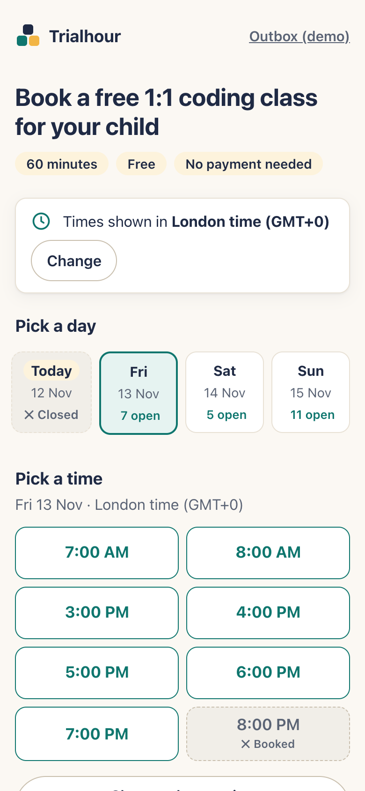
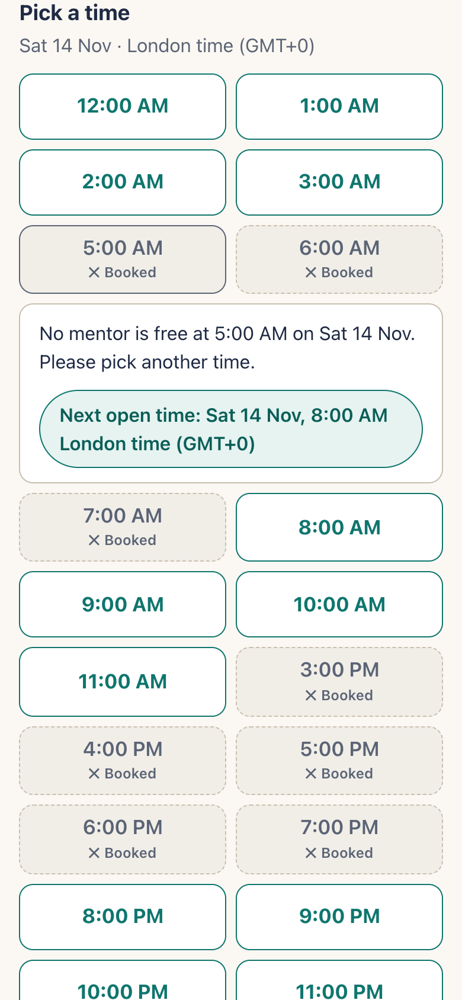
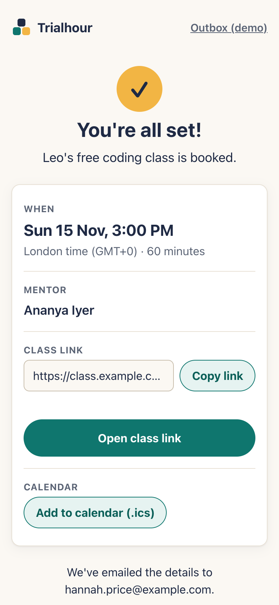

   # AI Development Transcript
   Tool: Claude Code (Claude Opus 5.5). Background research was done separately with Claude; the findings are in my first prompt.

❯ I'm building a take-home assignment for a Senior Full Stack Engineer role at
  Codeyoung (live 1:1 coding classes for kids; parents mostly in
  US/UK/Canada/Australia, mentors in India). The full brief is in
  @"Codeyoung_Senior_Full_Stack_Engineer_Assignment (1) (1).pdf"

  Before any code, I want us to agree on a spec. Here is my research and the
  decisions I've already made:

  Research:
  - Codeyoung's real trial is a free 1:1 session, ~45 min (their booking page
  says 1 hour), no payment, form asks name, grade, email, country code;
  confirmation includes a video link.
  - Calendly re-checks availability at confirm time, assigns round-robin across
  team members, and supports daily caps, minimum notice and booking windows.

  Decisions:
  1. 60-minute slots. Each mentor has availability windows defined in
  Asia/Kolkata (e.g. some on evening shifts for UK parents, some on
  night/early-morning shifts for US parents). Slots are generated from these
  windows.
  2. The 2-classes/day cap counts per mentor's IST calendar day.
  3. All instants stored in UTC; users and mentors store an IANA zone name.
  Never fixed offsets or abbreviations like "EST". Convert only at the edges.
  4. Never display a bare "IST" (Irish Standard Time collides with India
  Standard Time). Show e.g. "India time (GMT+5:30)".
  5. Every displayed time includes date + zone, since bookings often cross
  midnight between zones.
  6. Concurrency: DB unique constraint on (mentor_id, start_utc) plus a
  transaction that re-checks the daily cap; on conflict return 409 with nearest
  alternative slots. Idempotency key on the booking request. No Redis holds
  (overkill at this scale; documented trade-off).
  7. Mentor assignment: among eligible mentors, pick the one with the fewest
  bookings that IST day; tie-break deterministically.
  8. Booking window: from 12 hours ahead to 14 days ahead. "Now" must be
  injectable so tests can simulate DST dates (e.g. US switches Mar 14 2027, UK
  Mar 28 2027).
  9. Out of scope: auth, real email (a mock outbox page instead), payments,
  rescheduling, admin UI, real video. Nice extras: browser-detected time zone
  with manual override, .ics download, a mentor view page.
  10. Capacity is 10 mentors × 2 = 20 slots/day against ~20 parents/day, so
  "full" is a normal state. The no-availability UX (greyed-out slots with a
  reason, nearest alternatives) is a core feature, not an edge case.

  Your task now:
  1. Ask me up to 8 clarifying questions where my decisions are ambiguous,
  conflicting or missing something. Challenge any decision you think is wrong,
  with reasons.
  2. Do NOT write code yet.
  ⎿  Read Codeyoung_Senior_Full_Stack_Engineer_Assignment (1) (1).pdf (32KB)

  Read 1 file (ctrl+o to expand)

⏺ I read the brief. Most of your decisions hold up. A few of them conflict with
  each other or leave something unsaid that will matter once we write code. Here
  are 8 questions, roughly from most to least important.

  ---

  1. Which "day" does the 2-class cap count? (challenges decision 2)
  UK after-school hours fall across IST midnight. 16:00–19:00 GMT is 21:30–00:30
  India time. A mentor working 22:00–02:00 IST could then teach 2 classes
  before midnight and 2 after, which is 4 in one sitting. The 2 after midnight
  also use up the next day's cap, so that mentor's next evening is blocked. "Per
  IST calendar day" doesn't match how people actually work in shifts.
  My recommendation: count the cap per mentor shift date, meaning the IST date
  the availability window starts on. An equally good option is a fixed business
  day such as 06:00–06:00 IST. Which do you want, or do you have a reason to
  keep strict calendar days?

  2. Should windows be in IST or in the mentor's own zone? And where should
  slots start? (decision 1 vs decision 3)
  - Decision 3 says mentors store an IANA zone, but decision 1 hard-codes
    windows to Asia/Kolkata. I suggest defining windows and the cap day in the
    mentor's own zone, and seeding every mentor as Asia/Kolkata. That costs
    nothing and keeps the model consistent.
  - Because India has no DST, a window fixed in IST moves an hour for UK and US
    parents when their clocks change. In winter, 21:30 IST is 4:00 PM London
    time; in summer it's 5:00 PM. Are you happy with that (realistic, and it
    gives the DST tests real work), or should "UK shift" windows follow London
    time?
  - India is GMT+5:30 and every US/UK offset is a whole hour. Windows that start
    on the hour in IST therefore show parents times like 4:30 PM. I recommend
    starting slots at :30 IST so parents see whole hours. Agree?

  3. The daily-cap race isn't covered by the unique constraint (challenges
  decision 6)
  UNIQUE(mentor_id, start_utc) stops two bookings of the same slot. Now take two
  parents booking different slots with the same mentor, who already has 1 class
  that day. Both transactions read count=1 and both insert, so the mentor ends
  up with 3. In Postgres's default READ COMMITTED mode, re-checking inside the
  transaction doesn't stop this. You need one of these:
  - SELECT … FOR UPDATE on the mentor row (or on a mentor_day counter row)
  - SERIALIZABLE isolation plus retry
  - SQLite with BEGIN IMMEDIATE, which allows only one writer at a time and so
    avoids the race

  Which database do you want? I lean towards Postgres + row lock on the mentor,
  plus a concurrency test that fires parallel requests. SQLite is simpler to
  run, but its single-writer behaviour would hide the problem rather than show
  you solved it.

  4. One mentor being taken shouldn't return 409 (refines decision 6)
  The parent picks a time, not a mentor. If the chosen mentor's slot was just
  taken, the server should quietly try the next eligible mentor in the same
  transaction. Only return 409 when no mentor is free at that time. Do you
  agree? Also, how should "nearest alternatives" be ranked: by time distance, or
  same local day first? I suggest the same parent-local day first, then the
  nearest days, at most 3–5 options. Otherwise a parent asking for 5 PM gets
  offered 3 AM because it's 2 hours away.

  5. Fewest bookings isn't the best way to assign mentors (challenges decision
  7)
  When capacity is tight, balancing load can reduce how many bookings you can
  take in total. Say mentor A is the only one covering 03:30 IST (US Pacific
  evenings) and also covers 22:30. If A gets 2 bookings at 22:30 because A had
  the fewest, nobody can take the US Pacific parent later that day.
  My recommendation: pick the mentor whose remaining availability that day is
  least scarce, keeping the mentors who cover rare hours free. Break ties by
  fewest bookings, then mentor id. It's slightly more logic, but you can easily
  defend it in the README. Fair-load or capacity-preserving?

  6. What should US/UK times look like? (decision 4 only covers India)
  US/UK abbreviations have the same problem as IST: "BST" is also Bangladesh
  Standard Time, and "CST" is also China Standard Time. When clocks go back,
  1:30 AM happens twice. I suggest one format everywhere:
  Thu 12 Nov, 4:00 PM UK time (GMT+0) / Fri 13 Nov, 9:30 PM India time
  (GMT+5:30)
  The offset is calculated for that specific instant, never stored. Should US
  zones show a friendly name like "US Eastern time (GMT-5)", or the city ("New
  York time")? Cities are clearer for Arizona and Indiana edge cases.

  7. Duplicates and idempotency
  - Can one email or child book more than one active trial? In practice a trial
    is once per child. I suggest blocking a second upcoming trial for the same
    email, with a friendly "you already have a trial on…" message. Since full is
    normal, this also stops one parent taking several slots.
  - Idempotency key: the client creates one per form submission. If the same key
    arrives with the same payload, return the original booking. If it arrives
    with a different payload, return 422. Agree?

  8. Rules for greying out slots and minimum notice
  - Which hours appear greyed out? Showing all 24 hours is noise. I suggest
    showing only times inside some mentor's window. Then each greyed-out slot
    gets one reason: "Fully booked", "All mentors at their daily limit", or "Too
    soon to book" (inside the 12h notice).
  - Is 12h minimum notice firm, or a guess? It's sensible for mentor prep, but
    Codeyoung's trial is a low-effort marketing funnel, and same-day booking
    (e.g. 4h notice) could convert better. I'd make it a config value and
    default it to 12h with that rationale written down. That fine?

  ---

  Things I agree with as they stand: storing UTC plus IANA zones, an injectable
  clock, no Redis holds at this scale, treating "full" as a core UX state, and
  the list of out-of-scope items.

  Once you answer, I'll write the spec as a SPEC.md for the repo. It will also
  cover the data model, the API contract and a test matrix with the DST dates.

❯ Good questions. Going through them in order:

  1. Agreed, go with shift date (the IST date the availability window starts
  on). Strict calendar days would break evening shifts that run past midnight,
  which is exactly the UK case.
  2. Yes, store windows in the mentor's own zone and seed everyone as
  Asia/Kolkata. Keep the windows fixed in IST and let them move for parents
  when US/UK clocks change. That's how it actually works, since mentors'
  schedules don't follow US/UK DST, and it gives the DST tests something real
  to check. Start slots at :30 IST so UK and US parents see whole hours. Also
  suggest seed shifts for the 10 mentors in the spec so we cover UK evenings,
  US evenings (East and West coast) and some Australia mornings.
  3. Postgres with SELECT ... FOR UPDATE on the mentor row, plus the
  parallel-requests test. But reviewers have to be able to run this easily, so
  run Postgres through docker-compose and keep setup to one command (migrate +
  seed). If that becomes painful, tell me before falling back to anything else.
  4. Agreed. Quietly try the next eligible mentor in the same transaction, and
  return 409 only if nobody is free at that time. For alternatives: same
  parent-local day first, then the nearest following days, max 5.
  5. Capacity-preserving makes sense, I'd rather not waste rare US Pacific
  slots. But build mentor assignment as a separate strategy behind an interface
  so it can be swapped (fair-load vs capacity-preserving) without touching the
  booking service. Keep it deterministic and unit-test it, and put the
  reasoning in the README.
  6. Use the city format: "Thu 12 Nov, 4:00 PM New York time (GMT-5)". It
  handles Arizona/Indiana better. For mentors: "India time (GMT+5:30)". Offset
  worked out per instant, never stored.
  7. Don't block per email only. A parent with two kids should be able to book
  one trial for each. Block a second upcoming trial for the same email + child
  name, with a friendly message showing their existing booking. Idempotency
  approach is fine as you described.
  8. Only show times inside at least one mentor's window, each greyed-out slot
  with its reason. For minimum notice, make it a config value but default to
  4h, not 12h. It's a trial and a marketing funnel, so a parent should be able
  to book while they're still interested. Mentors see new bookings straight
  away anyway. Note this trade-off in the spec.

  Now write SPEC.md: requirements, assumptions, out of scope, data model, API
  contract, the assignment strategy, error states, and a test matrix with the
  DST dates (US Mar 14 2027, UK Mar 28 2027, US Nov 7 2027, UK Oct 31 2027,
  plus Australia). Keep it tight, no padding. Then stop and wait for me to
  review before any code.

⏺ Write(SPEC.md)
  ⎿  Wrote 247 lines to SPEC.md
      1 # Trial Class Booking — Spec
      2
      3 Status: **draft for review**. No code until this is approved.
      4
      5 A parent picks a time for their child's free 1:1 trial class, sho
        wn in the parent's own time zone. The system assigns an eligible
        mentor (mentors work in India), confirms with a dummy class link,
         and sends both sides the details in their own local time.
      6
      7 ---
     … +240 lines (ctrl+o to expand)

⏺ I've written the spec to SPEC.md and stopped there. No code yet.

  Written for: the Codeyoung reviewers who will read the repo, and you reviewing
  it first.

  I checked every DST and offset value in the test matrix by hand: day-of-week,
  transition instant and offset on both sides of each change. Here's what the
  spec decides beyond your answers:

  - The slot grid is defined in UTC. Every slot starts on the hour in UTC, which
    is :30 India time. That gives you whole hours for UK and US parents, and it
    works for mentors in any zone. Because slots never overlap, "mentor busy at
    this slot" is a simple equality check on start time.
  - The cap race needs a lock, not just the unique constraint. The booking
    transaction locks all candidate mentors in id order, then runs the
    assignment strategy on that locked data. Locking in a fixed order avoids
    deadlocks, closes the cap race, and makes "quietly try the next mentor"
    correct. An advisory lock per parent and child stops two tabs both getting
    past the duplicate-trial check.
  - Capacity-preserving gets a concrete formula. It scores each mentor by how
    scarce their remaining slots are. The spec includes a worked example where
    it picks the opposite mentor to fair-load and keeps the rare US West slots
    free.
  - Seed shifts are fixed in India time.
    - UK evenings: 20:30 to 01:30 IST, which crosses midnight and so tests the
      shift-date cap.
    - New York evenings: 01:30 to 06:30.
    - Los Angeles evenings: 04:30 to 09:30. Its late slots are covered by only 2
      mentors.
    - Sydney after school: 10:30 to 14:30.
    - One mentor also covers UK weekend mornings.
  - Extra test cases. Besides the four DST dates you listed, the matrix covers
    23-hour and 25-hour days when grouping slots by date, and the weeks when US
    and UK clocks disagree (only 4 hours apart). It also covers Brisbane against
    Sydney, Arizona, and a check that no label ever shows "IST", "BST", "EST"
    or "CST".

  Three things in the spec need your decision; they're listed at the bottom of
  the file:
  1. Stack. I've proposed TypeScript, Fastify, Luxon and plain SQL. You haven't
     confirmed any of it.
  2. Slot buttons. They show only the time, with the date and zone in the day
     header above them. That's a deliberate exception to "every time shows date
     and zone", to keep the grid readable. On a clock-change day, each button
     also shows its own offset.
  3. Seed shifts run 7 days a week. Do you want days off for more realistic
     availability?

❯ Spec looks really solid. I checked the DST dates and expected outputs and
  they're right. A few changes before we move on:

  Stack:
  - Express instead of Fastify. I'm a MERN developer and I'd rather be able to
  explain and defend every part of the server. Use zod for validation.
  - Keep Postgres + plain SQL with pg, no ORM. I want the FOR UPDATE locking
  visible in the code. I know MERN usually means Mongo, but Postgres fits a
  transactional booking system better. Add a short "Why Postgres" note to the
  spec.
  - TypeScript, React + Vite, Luxon, npm workspaces all fine.
  - Running it: keep docker compose for the full stack, but also support
  running only Postgres in Docker plus npm run dev for API and web, in case a
  reviewer prefers that.

  Open items:
  2. Grid exception is fine. Header with date + zone, buttons with time only,
  per-button offset on transition days.
  3. Keep every day for now. Windows are per weekday, so days off are just seed
  data. Mention that in the README.

  One more thing. This is a 1-2 day assignment and I'd rather ship something
  complete than half-build everything. Add a "Build order" section to the spec:
  - P0: slot generation + time formatting with the DST tests (T1–T16), booking
  transaction with cap, fall-through and the concurrency tests (X1, X2), basic
  booking flow UI with confirmation and greyed-out reasons.
  - P1: alternatives + 409 rebook flow, duplicate-trial check, idempotency,
  outbox page, .ics.
  - P2: mentor page, Playwright happy path, polish.
    Keep capacity-preserving in P0 but if it takes too long, ship fair-load
  first behind the same interface.

  Then:
  1. Update SPEC.md with all of this.
  2. Write a CLAUDE.md with the project conventions: the layering rules (routes
  → services → domain → repositories, domain stays pure with no I/O), UTC +
  IANA only, never abbreviations, inject Clock everywhere, tests for every
  domain function, no new dependencies without asking me, small focused
  commits.
  3. Show me the folder structure and the order you'd build the P0 slices in.

  Don't write app code yet, I'll review the structure first.

⏺ I'll update the spec first, then write CLAUDE.md.

⏺ Update(SPEC.md)
  ⎿  Added 2 lines
      49  | M9 | 10:30 → 14:30 | 10:30 … 13:30 (4) | Sydney 3–6 PM AEST ↔
           4–7 PM AEDT. Brisbane is 3–6 PM all year. |
      50  | M10 | Mon–Fri 10:30 → 14:30; Sat–Sun 13:30 → 17:30 | 4 + 4 | 
          Weekdays: Sydney as above. Weekends: London 8–11 AM GMT → 9 AM–
          12 PM BST. |
      51  
      52 +Windows are defined per weekday, so a mentor's day off is just 
         +a missing seed row; no code change is needed. The README will s
         +ay so.                                                         
      53 +                                                               
      54  The seed also adds a few bookings relative to "now" so that the
           full state is visible on first run: tomorrow's UK shift is ful
          ly booked, and one mentor is at the cap. The US West late slots
           (06:30–08:30 IST) are covered only by M7 and M8, which is the 
          scarcity case the assignment strategy is designed for.
      55  
      56  ## 5. Data model (Postgres 16)

⏺ Update(SPEC.md)
  ⎿  Added 33 lines, removed 5 lines
      176  
      177  The class link is `https://class.example.com/trial/<booking-id
           >`. It uses a reserved domain, so it can't be mistaken for a r
           eal Codeyoung URL.
      178  
      179 -## 10. Architecture and stack (proposed — confirm)            
      179 +## 10. Architecture and stack                                 
      180  
      181 -- **TypeScript** throughout, npm workspaces: `apps/web` (React
          - + Vite), `apps/api` (Fastify), `packages/shared` (zod schemas
          -, API types, time formatting used by the UI and outbox).      
      182 -- Layers in the API: `routes` (HTTP + validation) → `services`
          - (BookingService, SlotService; receive `Clock` and `Assignment
          -Strategy`) → `domain` (pure functions: slot generation, eligib
          -ility, reasons, alternatives, strategies) → `repositories` (SQ
          -L via `pg`, plain SQL migrations).                            
      181 +- **TypeScript** (strict) throughout, npm workspaces:         
      182 +  - `apps/web`: React + Vite                                  
      183 +  - `apps/api`: **Express 5**, which passes errors from async 
          +handlers to the error middleware without wrappers, plus **zod*
          +* for validation                                              
      184 +  - `packages/shared`: zod schemas, API types, and time format
          +ting used by both the UI and the outbox                       
      185 +- **Postgres 16** through `pg` with plain SQL. No ORM, so the 
          +`FOR UPDATE` locking is visible in the repository code. Migrat
          +ions are numbered `.sql` files applied by a ~40-line runner th
          +at tracks them in a `schema_migrations` table.                
      186 +- Layers in the API: `routes` (HTTP + zod) → `services` (Booki
          +ngService, SlotService; receive `Clock`, `AssignmentStrategy`,
          + repositories) → `domain` (pure: slot generation, eligibility,
          + reasons, alternatives, strategies) → `repositories` (SQL). Se
          +e CLAUDE.md for the rules.                                    
      187  - Time: **Luxon** on top of Node's full ICU.
      184 -- Run: `docker compose up --build` starts Postgres, runs migra
          -te + seed, then the API and web app. Tests run with `npm test`
          - against the compose database.                                
      185 -- Config (env): `DATABASE_URL`, `MIN_NOTICE_MINUTES=240`, `BOO
          -KING_HORIZON_DAYS=14`, `MENTOR_DAILY_CAP=2`, `ASSIGNMENT_STRAT
          -EGY=capacity-preserving`, `NOW_OVERRIDE` (dev only).          
      188  
      189 +### Why Postgres (not Mongo)                                  
      190 +                                                              
      191 +The hard part of this system is a transaction across several r
          +ows: check the cap across a mentor's bookings, check the dupli
          +cate trial, insert the booking, and write the outbox and idemp
          +otency rows, all atomically and under concurrency. Postgres pr
          +ovides that directly with row locks (`SELECT … FOR UPDATE`), p
          +artial unique indexes (`UNIQUE (mentor_id, start_utc) WHERE st
          +atus='confirmed'`), advisory locks and `timestamptz`. MongoDB 
          +can do multi-document transactions, but it needs a replica set
          + even locally, it has no `FOR UPDATE`, so the cap race would n
          +eed a counter document or optimistic retries, and it has no pa
          +rtial unique index on a time-dependent condition. The data is 
          +small, relational and fixed in shape, which is what a relation
          +al database is for.                                           
      192 +                                                              
      193 +### Dependencies (complete list; anything else needs approval)
      194 +                                                              
      195 +| Workspace | Runtime | Dev |                                 
      196 +|---|---|---|                                                 
      197 +| root | — | `typescript`, `concurrently` (runs api + web from
          + one `npm run dev`), `prettier` |                             
      198 +| shared | `luxon`, `zod` | `vitest`, `@types/luxon` |        
      199 +| api | `express`, `pg`, `zod`, `luxon` | `tsx`, `vitest`, `su
          +pertest`, `@types/express`, `@types/pg`, `@types/supertest` | 
      200 +| web | `react`, `react-dom`, `react-router-dom` | `vite`, `@v
          +itejs/plugin-react`, `vitest`, `jsdom`, `@testing-library/reac
          +t` |                                                          
      201 +| P2 | — | `@playwright/test` |                               
      202 +                                                              
      203 +There is no data-fetching library (plain `fetch` + small hooks
          +), no CSS framework (CSS modules), no uuid package (`crypto.ra
          +ndomUUID`) and no migration library.                          
      204 +                                                              
      205 +### Running                                                   
      206 +                                                              
      207 +| Mode | Commands |                                           
      208 +|---|---|                                                     
      209 +| Full stack in Docker | `docker compose up --build` starts Po
          +stgres, runs migrate + seed, then the API on :3001 and the web
          + app on :5173 |                                               
      210 +| Postgres only in Docker | `docker compose up -d db` → `npm i
          +nstall` → `npm run db:setup` (migrate + seed) → `npm run dev` 
          +(API + web together) |                                        
      211 +| Tests | `docker compose up -d db` → `npm test`. Integration 
          +tests use a separate `booking_test` database, which is migrate
          +d on setup and truncated between tests. |                     
      212 +                                                              
      213 +Config (env, validated with zod at startup, `.env.example` pro
          +vided): `DATABASE_URL`, `PORT=3001`, `MIN_NOTICE_MINUTES=240`,
          + `BOOKING_HORIZON_DAYS=14`, `MENTOR_DAILY_CAP=2`, `ASSIGNMENT_
          +STRATEGY=capacity-preserving`, `NOW_OVERRIDE` (dev only).     
      214 +                                                              
      215  ## 11. Test matrix
      216  
      217  Unit tests cover pure domain code and formatting with an injec
           ted clock. Integration tests run against Postgres. Times in **
           bold** are the expected display.

⏺ Update(SPEC.md)
  ⎿  Added 21 lines, removed 4 lines
      270  
      271  ---
      272  
      273 -## Open items for review                                      
      273 +## 12. Build order                                            
      274  
      275 -1. Stack in §10 (Fastify / Luxon / plain SQL) is my proposal a
          -nd hasn't been confirmed.                                     
      276 -2. The §7 grid exception: slot buttons show only the time unde
          -r a header that carries date and zone. Is that acceptable unde
          -r "every time includes date + zone"?                          
      277 -3. Seed shifts run every day of the week. Do you want days off
          - to make availability patterns more realistic?                
      275 +This is a 1–2 day assignment. Each phase must be complete (wor
          +king, tested, documented) before the next one starts.         
      276 +                                                              
      277 +**P0: core, must ship**                                       
      278 +- Slot generation and time formatting, with DST/zone tests T1–
          +T16.                                                          
      279 +- Booking transaction with the cap, mentor locking and fall-th
          +rough. Tests C1–C8, C11, X1, X2.                              
      280 +- Assignment strategy interface with capacity-preserving (C5, 
          +C6). If capacity-preserving takes too long, ship fair-load fir
          +st behind the same interface and add capacity-preserving after
          +wards.                                                        
      281 +- Basic UI: zone bar with override, date strip, slot grid with
          + greyed-out reasons, booking form, confirmation page.         
      282 +- In P0, a 409 response returns `alternatives: []` and `Idempo
          +tency-Key` is accepted but not enforced.                      
      283 +                                                              
      284 +**P1: complete the flow**                                     
      285 +- Alternatives and the one-click rebook from the 409 modal (C1
          +0).                                                           
      286 +- Duplicate-trial check (C9, X5).                             
      287 +- Idempotency enforced (X3, X4).                              
      288 +- Outbox writes and the outbox page (X6).                     
      289 +- .ics download.                                              
      290 +                                                              
      291 +**P2: polish**                                                
      292 +- Mentor page.                                                
      293 +- Playwright happy path.                                      
      294 +- Visual polish, empty states, README screenshots.            

⏺ Write(CLAUDE.md)
  ⎿  Wrote 61 lines to CLAUDE.md
      1 # CLAUDE.md
      2
      3 A trial-class booking app for Codeyoung. **SPEC.md is the source
        of truth.** If code and spec disagree, stop and ask; don't silent
        ly change either. Build in the order given in SPEC.md §12 (P0 → P
        1 → P2).
      4
      5 ## Stack
      6
      7 TypeScript (strict), npm workspaces: `apps/api` (Express 5 + zod
     … +55 lines (~4 KB) (ctrl+o to expand)

⏺ I've updated SPEC.md and written CLAUDE.md. There's no app code yet.

  What changed in SPEC.md
  - Stack: Express 5 with zod, and Postgres through pg with plain SQL.
    Migrations are numbered .sql files run by a short script of our own, so the
    FOR UPDATE locking stays visible in the code.
  - Why Postgres: a short section added. The core reason is that the booking is
    one transaction covering several rows, and Postgres has row locks and
    partial unique indexes built in. Mongo would need a counter document or
    optimistic retries for the cap race, plus a replica set even locally.
  - Dependencies: there's now a complete list that you approve once; anything
    not on it needs your OK. The only additions are concurrently (so one npm run
    dev starts both API and web), react-router-dom, supertest and prettier.
  - Running: two documented modes, everything in Docker, or only Postgres in
    Docker plus npm run db:setup && npm run dev. Tests use a separate
    booking_test database.
  - Build order: new §12 with P0, P1 and P2 as you described, including the
    fair-load fallback. In P0, a 409 returns an empty alternatives list and the
    idempotency key is accepted but not enforced, so P0 can ship on its own.
  - Days off: noted as seed-only, with a README mention to come.

  Folder structure

  codeyoung/
  ├─ package.json  tsconfig.base.json  .env.example  docker-compose.yml
  ├─ SPEC.md  CLAUDE.md  README.md  TRANSCRIPT.md
  ├─ packages/shared/src/
  │  ├─ time/
  │  │  ├─ format.ts          formatInstant, zoneLabel, offsetLabel  (+
  .test.ts: T3, T4, T7, T10, T13–T16)
  │  │  └─ zones.ts           isValidZone, common US/UK/CA/AU zones for the
  picker
  │  └─ api/
  │     ├─ schemas.ts         zod: slot query, booking request/response, error
  envelope
  │     └─ types.ts
  ├─ apps/api/
  │  ├─ Dockerfile
  │  ├─ src/
  │  │  ├─ server.ts          composition root: real pool, SystemClock, strategy
  from config
  │  │  ├─ app.ts             createApp(deps) → Express app (tests build it with
  FixedClock)
  │  │  ├─ config.ts          zod-parsed env
  │  │  ├─ clock.ts           Clock, SystemClock, FixedClock
  │  │  ├─ routes/            slots.ts  bookings.ts  health.ts   (P1: outbox.ts,
  P2: mentors.ts)
  │  │  ├─ middleware/        errorHandler.ts  validate.ts
  │  │  ├─ services/          slotService.ts  bookingService.ts
  │  │  ├─ domain/
  │  │  │  ├─ types.ts        Mentor, Window, Slot, MentorState, ShiftSnapshot
  │  │  │  ├─ errors.ts       typed domain errors
  │  │  │  ├─ slots.ts        windows → slots with shift date, grid/overlap
  validation, local-day bounds
  │  │  │  ├─ bookingWindow.ts  notice/horizon checks
  │  │  │  ├─ availability.ts   per-slot eligibility + reason precedence
  │  │  │  ├─ alternatives.ts   (P1)
  │  │  │  └─ assignment/     strategy.ts  fairLoad.ts  capacityPreserving.ts
  index.ts
  │  │  ├─ repositories/      mentorRepo.ts  bookingRepo.ts   (P1:
  idempotencyRepo, outboxRepo)
  │  │  └─ db/
  │  │     ├─ pool.ts  tx.ts  withTransaction(pool, fn)
  │  │     ├─ migrate.ts  migrations/001_init.sql
  │  │     └─ seed.ts  seedData.ts
  │  └─ test/
  │     ├─ helpers/           testDb.ts (create/migrate/truncate booking_test),
  fixtures.ts
  │     └─ integration/       slots.test.ts  bookings.test.ts
  concurrency.test.ts (X1, X2)
  └─ apps/web/src/
     ├─ main.tsx  App.tsx  (routes: /, /bookings/:id; P1 /outbox; P2
  /mentors/:id)
     ├─ api/client.ts
     ├─ hooks/                useTimezone.ts (detect + override + localStorage)
  useSlots.ts
     ├─ features/booking/     TimezoneBar  DateStrip  SlotGrid  SlotButton
  BookingForm
     ├─ features/confirmation/ ConfirmationView
     └─ pages/                BookPage  ConfirmationPage

  Unit tests sit next to their files as *.test.ts. Integration tests live under
  apps/api/test/, because they need the database.

  P0 build order (one commit per slice, each with its tests)

  ┌─────┬──────────────────────────────────────┬────────────────────────────┐
  │  #  │                Slice                 │         Done when          │
  ├─────┼──────────────────────────────────────┼────────────────────────────┤
  │     │ Scaffold: workspaces, strict         │ npm run typecheck and an   │
  │ 1   │ tsconfig, Vitest, docker-compose db  │ empty npm test pass        │
  │     │ service, config.ts, clock.ts         │                            │
  ├─────┼──────────────────────────────────────┼────────────────────────────┤
  │     │ Shared time formatting:              │ T3, T4, T7, T10, T13–T16   │
  │ 2   │ formatInstant, zoneLabel,            │ green                      │
  │     │ offsetLabel                          │                            │
  ├─────┼──────────────────────────────────────┼────────────────────────────┤
  │     │ Slot generation: windows → UTC slots │ T1, T2, T5, T6, T8, T9,    │
  │ 3   │  with shift date, grid and overlap   │ T11, T12, C11 green        │
  │     │ validation, parent-local day bounds  │                            │
  ├─────┼──────────────────────────────────────┼────────────────────────────┤
  │     │ Availability: notice/horizon,        │                            │
  │ 4   │ per-mentor eligibility, reason       │ C2, C7, C8 green           │
  │     │ precedence                           │                            │
  ├─────┼──────────────────────────────────────┼────────────────────────────┤
  │ 5   │ Assignment: interface, fair-load,    │ C5, C6 green. If it drags, │
  │     │ then capacity-preserving             │  stop at fair-load.        │
  ├─────┼──────────────────────────────────────┼────────────────────────────┤
  │     │ DB: 001_init.sql, migrate runner,    │ Seed loads 10 mentors and  │
  │ 6   │ seed and seed validation, npm run    │ the "already full"         │
  │     │ db:setup                             │ bookings                   │
  ├─────┼──────────────────────────────────────┼────────────────────────────┤
  │     │ Slots API: repositories,             │ Integration test against   │
  │ 7   │ SlotService, GET /api/slots, error   │ seed fixtures              │
  │     │ middleware                           │                            │
  ├─────┼──────────────────────────────────────┼────────────────────────────┤
  │     │ Booking API: BookingService          │                            │
  │ 8   │ transaction (mentor lock →           │ C1, C3, C4, X1, X2 green   │
  │     │ eligibility → strategy → insert),    │                            │
  │     │ POST /api/bookings                   │                            │
  ├─────┼──────────────────────────────────────┼────────────────────────────┤
  │     │ Web: zone bar, date strip, slot grid │ Book end to end in the     │
  │ 9   │  with reasons, form, confirmation    │ browser, including the     │
  │     │ page                                 │ transition-day offsets on  │
  │     │                                      │ buttons                    │
  ├─────┼──────────────────────────────────────┼────────────────────────────┤
  │     │ Run modes + README (P0): full docker │ Both modes verified from a │
  │ 10  │  compose up --build, plus the        │  clean checkout            │
  │     │ Postgres-only path                   │                            │
  └─────┴──────────────────────────────────────┴────────────────────────────┘

  Slices 2–5 are pure domain code, which is where the DST and assignment logic
  lives, so they're tested before any database or HTTP exists. That matches the
  "domain stays pure" rule.

  One practical note: this folder isn't a git repository yet. Before slice 1 I'd
  run git init and commit the PDF-free docs (SPEC.md and CLAUDE.md) as the
  first commit, so the history starts from the agreed spec. Should I keep the
  assignment PDF out of the repo?

❯ Approved, nice work. A few last things:

  1. Yes, git init with SPEC.md and CLAUDE.md as the first commit. Keep the
  assignment PDF out of the repo since it's Codeyoung's document. Add a
  .gitignore for the PDF, .env, node_modules and build output.
  2. Add a UI section to CLAUDE.md:
     - Mobile-first. A lot of parents will book on their phones, so nothing
  important can depend on hover. A greyed-out slot's reason must be visible or
  show on tap, not just in a tooltip.
     - Every data-loading screen has loading, empty and error states.
     - Accessible by default: real buttons, labelled inputs, visible focus,
  enough colour contrast, and greyed-out state not shown by colour alone.
  3. Add to the testing rules: never change a test's expected value to make it
  pass without asking me first. If you think a spec expectation is wrong, stop
  and tell me.
  4. Workflow: after each slice, stop and give me a short summary of what you
  built, any decisions you made that aren't in the spec, and the test output.
  I'll review and say continue.

  Then go ahead with slice 1 (scaffold).

  Ran 1 shell command (ctrl+o to expand)

⏺ Update(CLAUDE.md)
  ⎿  Added 21 lines
      38  - Local days are bounded by local midnight in the zone (`startO
          f('day')`), never `+24h`.
      39  - **Inject `Clock` everywhere.** Nothing outside `clock.ts` rea
          ds the system time. Tests use `FixedClock`.
      40  
      41 +## UI (apps/web)                                               
      42 +                                                               
      43 +- **Mobile-first.** Many parents book on a phone, so design for
         + narrow screens first and widen from there. Nothing important m
         +ay depend on hover. A greyed-out slot's reason must be visible 
         +inline or appear on tap, never only in a tooltip.              
      44 +- **Every screen that loads data has loading, empty and error s
         +tates.** An error state says what went wrong and offers a retry
         +.                                                              
      45 +- **Accessible by default:**                                   
      46 +  - real `<button>`s and `<a>`s, never clickable `<div>`s      
      47 +  - every input has a `<label>`                                
      48 +  - focus is always visible                                    
      49 +  - text and controls meet WCAG AA contrast                    
      50 +  - unavailable state is never shown by colour alone; use text 
         +or an icon and `aria-disabled` plus the reason                 
      51 +                                                               
      52  ## Testing
      53  
      54  - Every exported domain and shared/time function has unit tests
          , co-located as `*.test.ts`.
      55  - Spec test IDs (T1, C3, X2, …) appear in the test names so the
           matrix in SPEC.md can be traced.
      56  - Concurrency tests (X*) run against real Postgres, never mocks
          .
      57  - Bug fix = failing test first.
      58 +- **Never change a test's expected value just to make it pass w
         +ithout asking first.** If a spec expectation looks wrong, stop 
         +and explain why. The spec gets corrected first; the test follow
         +s.                                                             
      59  
      60 +## Workflow                                                    
      61 +                                                               
      62 +Work one slice at a time (SPEC.md §12). After each slice, **sto
         +p** and report:                                                
      63 +1. what was built                                              
      64 +2. any decision made that isn't in the spec                    
      65 +3. the test and typecheck output                               
      66 +                                                               
      67 +Then wait for "continue".                                      
      68 +                                                               
      69  ## Dependencies
      70  
      71  The full allowed list is in SPEC.md §10. **Do not add any depen
          dency without asking first**, including dev dependencies and ty
          pe packages beyond that list.

⏺ Write(.gitignore)
  ⎿  Wrote 23 lines to .gitignore
       1 # Assignment brief (Codeyoung's document, not ours to publish)
       2 *.pdf
       3
       4 # Env
       5 .env
       6 .env.*
       7 !.env.example
       8
       9 # Dependencies
      10 node_modules/
     … +13 lines (ctrl+o to expand)

  Ran 1 shell command (ctrl+o to expand)

⏺ Repo is initialised with the first commit. I left TRANSCRIPT-session1.md
  untracked; I assume you'll add it when you put together TRANSCRIPT.md.
  Starting the slice 1 scaffold now.

  Ran 1 shell command (ctrl+o to expand)

⏺ The root install failed on an invalid -w . flag, and I added @types/node,
  which isn't on the approved list. I'm removing that package and keeping the
  scaffold working without it. · summary

  Ran 1 shell command (ctrl+o to expand)

⏺ Now the config and clock modules and their tests.

  Ran 1 shell command (ctrl+o to expand)

⏺ Typecheck and tests pass. Next I'll check that the Postgres container starts
  and creates both databases.

  Ran 1 shell command (ctrl+o to expand)

⏺ Port 5432 is already in use locally, so I'll publish the container on 5433 by
  default. · summary

  Ran 1 shell command (ctrl+o to expand)

⏺ Postgres is healthy on 5433 with both databases, and the server time zone is
  UTC. Committing slice 1:

  Ran 1 shell command (ctrl+o to expand)
⏺ git add -A picked up TRANSCRIPT-session1.md, which I said I'd leave alone, and
  Prettier flagged the compose file. I'll fix both by amending the commit I
  just made (local only, never pushed):

  Ran 1 shell command (ctrl+o to expand)

⏺ Slice 1 (scaffold) is done and committed as 757df1b. Typecheck and tests pass,
  and the Postgres container is healthy.

  What I built
  - Workspaces: npm workspaces with packages/shared and apps/api, ESM
    throughout, and a shared strict tsconfig (including
    noUncheckedIndexedAccess). There's no build step: shared is consumed
    straight from source, which works for tsx, Vite and Vitest.
  - Config and clock:
    - config.ts (apps/api/src/config.ts) validates env with zod. loadConfig
      takes the env as an argument, so only the composition root will ever read
      process.env. It refuses NOW_OVERRIDE in production.
    - clock.ts (apps/api/src/clock.ts) has Clock, SystemClock, FixedClock (with
      set/advance) and createClock.
  - Postgres: docker-compose.yml runs Postgres 16 with a healthcheck, server
    time zone UTC, and an init script that creates booking_test. I also added
    .env.example, .gitignore and Prettier config. CLAUDE.md now has the UI,
    test-expectation and workflow rules.

  Decisions not in the spec
  1. Postgres host port is 5433, not 5432. Port 5432 was already in use on your
     machine, so the container couldn't start. You can override it with DB_PORT.
     I didn't touch whatever is on 5432.
  2. FixedClock rejects time strings without Z or an offset. A string like
     2027-03-14T02:30 is ambiguous on DST days.
  3. Clock instants are Luxon DateTimes in UTC. That means domain code works
     with Luxon objects rather than JS Date.
  4. Zod is v4 and Vitest is v3. Those are the current majors npm installed.
  5. Dependencies so far: typescript, prettier, luxon, zod, vitest,
     @types/luxon. All are on the approved list. The rest get installed in the
     slice that first needs them.

  Things I got wrong and corrected
  - @types/node: I installed it, which wasn't on the approved list. I removed it
    before committing, and the scaffold builds without it. It will probably be
    needed once Express and pg code reads process.env (from slice 6). Can I add
    it then?
  - TRANSCRIPT-session1.md: git add -A swept it into the slice 1 commit. I
    amended that local commit to untrack it again; nothing was pushed. It's
    still untracked in the folder for you to handle.

  Output
  typecheck: shared ✓, api ✓ (tsc, no errors)
  apps/api: ✓ src/config.test.ts (8 tests)  ✓ src/clock.test.ts (7 tests)
            Test Files 2 passed · Tests 15 passed
  packages/shared: no test files yet
  prettier --check: all files pass
  docker compose up -d --wait db → Healthy; databases: booking, booking_test;
  timezone: UTC

  Next is slice 2, shared time formatting with T3, T4, T7, T10 and T13–T16. Say
  "continue" when you're ready.

❯ claude --continue
  ⎿  Interrupted · What should Claude do instead?

❯ claude --continue

⏺ This session is still running with its context, so you don't need claude
  --continue. That's a terminal command for resuming a session after it has been
  closed.

  Here's where we are: slice 1 (scaffold) is done and committed as 757df1b.
  Typecheck passes, all 15 tests pass, and Postgres is healthy on port 5433. Two
  questions from my last report are still open:

  1. @types/node: can I add it when the pg and Express code arrives (around
     slice 6)?
  2. TRANSCRIPT-session1.md: it's untracked in the folder for you to handle.

  Next is slice 2, shared time formatting with tests T3, T4, T7, T10 and
  T13–T16. If "claude --continue" was meant as "continue", reply "continue" and
  I'll start it. From now on, commits won't include the Co-Authored-By line.

❯ Looks good. Answers:

  1. Port 5433 is fine, just make sure .env.example and the README mention it.
  2. Agreed on FixedClock rejecting strings without an offset, and on Luxon
  DateTimes in UTC for the clock.
  3. Yes, add @types/node now and put it on the approved list in SPEC.md. It's
  standard for a Node TS project.
  4. Don't use git add -A from now on. Stage only the files from the slice
  you're committing. Also add TRANSCRIPT-session*.md to .gitignore (not
  TRANSCRIPT.md, that one gets committed at the end).

  FYI, I cleaned up the commit messages myself, so the hashes have changed.
  Check git log rather than relying on the old ones.

  Continue with slice 2.

  Ran 1 shell command (ctrl+o to expand)

⏺ The hashes are now c3d461e and b65e047. First, a housekeeping commit: add
  @types/node, put it on the approved list, and update .gitignore.

⏺ Bash(npm install -D -w @codeyoung/api @types/node@22 2>&1 | tail -1 && printf
      '{\n  "extends": "../../tsconfig.base.json",\n  "compilerOptions": {
      "types": ["node"]…)
  ⎿  Updated .gitignore (+3 -0)
      1  # Assignment brief (Codeyoung's document, not ours to publish)
      2  *.pdf
      3  
      4 +# Local AI session transcripts (the final TRANSCRIPT.md is commi
        +tted)                                                           
      5 +TRANSCRIPT-session*.md                                          
      6 +                                                                
      7  # Env
      8  .env
      9  .env.*
  ⎿  Updated SPEC.md (+1 -1)
      196  |---|---|---|
      197  | root | — | `typescript`, `concurrently` (runs api + web from
            one `npm run dev`), `prettier` |
      198  | shared | `luxon`, `zod` | `vitest`, `@types/luxon` |
      199 -| api | `express`, `pg`, `zod`, `luxon` | `tsx`, `vitest`, `su
          -pertest`, `@types/express`, `@types/pg`, `@types/supertest` | 
      199 +| api | `express`, `pg`, `zod`, `luxon` | `tsx`, `vitest`, `su
          +pertest`, `@types/node`, `@types/express`, `@types/pg`, `@type
          +s/supertest` |                                                
      200  | web | `react`, `react-dom`, `react-router-dom` | `vite`, `@v
           itejs/plugin-react`, `vitest`, `jsdom`, `@testing-library/reac
           t` |
      201  | P2 | — | `@playwright/test` |
      202  
  ⎿  Updated apps/api/package.json (+1 -0)
      13    },
      14    "devDependencies": {
      15      "@types/luxon": "^3.7.6",
      16 +    "@types/node": "^22.20.5",                                 
      17      "vitest": "^3.2.7"
      18    }
      19  }
  ⎿  Updated apps/api/tsconfig.json (+1 -0)
      1  {
      2    "extends": "../../tsconfig.base.json",
      3 +  "compilerOptions": { "types": ["node"] },                     
      4    "include": ["src", "test"]
      5  }
  ⎿  Updated package-lock.json (+18 -0)
      26        },
      27        "devDependencies": {
      28          "@types/luxon": "^3.7.6",
      29 +        "@types/node": "^22.20.5",                             
      30          "vitest": "^3.2.7"
      31        }
      32      },
      33 +    "apps/api/node_modules/@types/node": {                     
      34 +      "version": "22.20.5",                                    
      35 +      "resolved": "https://registry.npmjs.org/@types/node/-/nod
         +e-22.20.5.tgz",                                                
      36 +      "integrity": "sha512-U2+DNr+wSjpsTS/wZGYHq7GcwfuSmKiKvoPv
         +K22zwTlRhU91yOniN4qRR5KhIjvif7ysw/dz/hKmfDH0Ris4aA==",         
      37 +      "dev": true,                                             
      38 +      "license": "MIT",                                        
      39 +      "dependencies": {                                        
      40 +        "undici-types": "~6.21.0"                              
      41 +      }                                                        
      42 +    },                                                         
      43 +    "apps/api/node_modules/undici-types": {                    
      44 +      "version": "6.21.0",                                     
      45 +      "resolved": "https://registry.npmjs.org/undici-types/-/un
         +dici-types-6.21.0.tgz",                                        
      46 +      "integrity": "sha512-iwDZqg0QAGrg9Rav5H4n0M64c3mkR59cJ6wQ
         +p+7C4nI0gsmExaedaYLNO44eT4AtBBwjbTiGPMlt2Md0T9H9JQ==",         
      47 +      "dev": true,                                             
      48 +      "license": "MIT"                                         
      49 +    },                                                         
      50      "node_modules/@codeyoung/api": {
      51        "resolved": "apps/api",
      52        "link": true

  Ran 1 shell command (ctrl+o to expand)

⏺ Now slice 2. FixedClock already contains instant-parsing logic that the
  formatter also needs. I'll move it into shared as parseInstant and have the
  clock reuse it.

  Ran 1 shell command (ctrl+o to expand)

⏺ Luxon accepts legacy zone names like EST and IST because ICU treats them as
  valid, so our no-abbreviations rule needs its own check; I'm looking at how
  ICU handles them next. · summary

  Ran 1 shell command (ctrl+o to expand)

⏺ EST silently maps to America/Panama, which lacks DST, and ICU renames
  Asia/Kolkata, so I'm validating zones by shape (Area/City or UTC) that Luxon
  also accepts and writing the module now. · summary

⏺ Bash(cd
      /Users/debangichoudhury/Projects/assignment/codeyoung/packages/shared/src
      && cat > time/instant.ts <<'EOF'
      import { DateTime } from 'luxon';…)
  ⎿  Updated packages/shared/src/index.ts (+3 -2)
      1 -// Public surface of @codeyoung/shared. Time formatting and API 
        -schemas land here in slices 2+.                                 
      2 -export {};                                                      
      1 +export { parseInstant } from './time/instant.js';               
      2 +export { isValidZone, assertValidZone, InvalidTimeZoneError } fr
        +om './time/zones.js';                                           
      3 +export { zoneLabel, offsetLabel, formatDate, formatTime, formatI
        +nstant } from './time/format.js';                               
  ⎿  Created packages/shared/src/time/format.ts (+58 -0)
       1 +import type { DateTime } from 'luxon';                         
       2 +import { parseInstant } from './instant.js';                   
       3 +import { assertValidZone } from './zones.js';                  
       4 +                                                               
       5 +// Friendly names where the IANA city would mislead. Never abbr
         +eviations.                                                     
       6 +const ZONE_LABEL_OVERRIDES: Readonly<Record<string, string>> = 
         +{                                                              
       7 +  'Asia/Kolkata': 'India time',                                
       8 +  'Asia/Calcutta': 'India time',                               
       9 +  UTC: 'UTC',                                                  
      10 +  'Etc/UTC': 'UTC',                                            
      11 +};                                                             
      12 +                                                               
      13 +/** "New York time", "India time", "Indianapolis time", "UTC". 
         +*/                                                             
      14 +export function zoneLabel(zone: string): string {              
      15 +  assertValidZone(zone);                                       
      16 +  const override = ZONE_LABEL_OVERRIDES[zone];                 
      17 +  if (override) return override;                               
      18 +  // Etc/GMT+5 is POSIX-inverted (it means GMT-5); never show i
         +ts name, only the computed offset.                             
      19 +  if (zone.startsWith('Etc/')) return 'Fixed-offset time';     
      20 +  const city = zone.slice(zone.lastIndexOf('/') + 1).replaceAll
         +('_', ' ');                                                    
      21 +  return `${city} time`;                                       
      22 +}                                                              
      23 +                                                               
      24 +/** UTC offset at that instant: "GMT-5", "GMT+5:30", "GMT+0". N
         +ever stored, always computed. */                               
      25 +export function offsetLabel(instant: DateTime | string, zone: s
         +tring): string {                                               
      26 +  assertValidZone(zone);                                       
      27 +  const minutes = parseInstant(instant).setZone(zone).offset;  
      28 +  const sign = minutes < 0 ? '-' : '+';                        
      29 +  const abs = Math.abs(minutes);                               
      30 +  const hours = Math.floor(abs / 60);                          
      31 +  const mins = abs % 60;                                       
      32 +  return `GMT${sign}${hours}${mins ? `:${String(mins).padStart(
         +2, '0')}` : ''}`;                                              
      33 +}                                                              
      34 +                                                               
      35 +function localised(instant: DateTime | string, zone: string): D
         +ateTime {                                                      
      36 +  assertValidZone(zone);                                       
      37 +  // en-US tokens give "Thu", "Nov", "PM" regardless of the run
         +time's default locale.                                         
      38 +  return parseInstant(instant).setZone(zone).setLocale('en-US')
         +;                                                              
      39 +}                                                              
      40 +                                                               
     … 18 more lines (ctrl+o to expand)
  ⎿  Created packages/shared/src/time/instant.ts (+18 -0)
       1 +import { DateTime } from 'luxon';                              
       2 +                                                               
       3 +/**                                                            
       4 + * Parses an instant into a UTC DateTime. Strings must carry `Z
         +` or an explicit offset:                                       
       5 + * a bare local time like "2027-03-14T02:30" is ambiguous (or n
         +on-existent) on DST days.                                      
       6 + */                                                            
       7 +export function parseInstant(value: DateTime | string): DateTim
         +e {                                                            
       8 +  if (typeof value !== 'string') {                             
       9 +    if (!value.isValid) throw new Error(`Invalid instant: ${val
         +ue.invalidExplanation ?? 'unknown'}`);                         
      10 +    return value.toUTC();                                      
      11 +  }                                                            
      12 +  const dt = DateTime.fromISO(value, { setZone: true });       
      13 +  if (!dt.isValid) throw new Error(`Invalid instant: ${value}`)
         +;                                                              
      14 +  if (!/(Z|[+-]\d{2}:?\d{2})$/.test(value)) {                  
      15 +    throw new Error(`Instant must include Z or an explicit offs
         +et: ${value}`);                                                
      16 +  }                                                            
      17 +  return dt.toUTC();                                           
      18 +}                                                              
  ⎿  Created packages/shared/src/time/zones.ts (+25 -0)
       1 +import { Info } from 'luxon';                                  
       2 +                                                               
       3 +export class InvalidTimeZoneError extends Error {              
       4 +  constructor(readonly zone: string) {                         
       5 +    super(`Not a supported IANA time zone: "${zone}"`);        
       6 +    this.name = 'InvalidTimeZoneError';                        
       7 +  }                                                            
       8 +}                                                              
       9 +                                                               
      10 +// Area/Location form, e.g. America/New_York, America/Indiana/I
         +ndianapolis, Etc/GMT+5.                                        
      11 +const IANA_AREA_LOCATION = /^[A-Z][A-Za-z_-]*(\/[A-Za-z0-9_+-]+
         +)+$/;                                                          
      12 +                                                               
      13 +/**                                                            
      14 + * True for canonical-looking IANA names that the runtime knows
         +. Deliberately rejects                                         
      15 + * abbreviations and legacy aliases that ICU accepts: "EST" sil
         +ently resolves to                                              
      16 + * America/Panama (no DST) and "IST" to India, which is exactly
         + the ambiguity we avoid.                                       
      17 + */                                                            
      18 +export function isValidZone(zone: string): boolean {           
      19 +  if (zone === 'UTC') return true;                             
      20 +  return IANA_AREA_LOCATION.test(zone) && Info.isValidIANAZone(
         +zone);                                                         
      21 +}                                                              
      22 +                                                               
      23 +export function assertValidZone(zone: string): void {          
      24 +  if (!isValidZone(zone)) throw new InvalidTimeZoneError(zone);
      25 +}                                                              

⏺ Now the tests, with spec IDs in the test names:

⏺ Bash(cd /Users/debangichoudhury/Projects/assignment/codeyoung/packages/shared/
      src/time && cat > instant.test.ts <<'EOF'
      import { describe, expect, it } from 'vitest'…)
  ⎿  Created packages/shared/src/time/format.test.ts (+204 -0)
        1 +import { describe, expect, it } from 'vitest';                
        2 +import { DateTime } from 'luxon';                             
        3 +import { formatDate, formatInstant, formatTime, offsetLabel, z
          +oneLabel } from './format.js';                                
        4 +import { InvalidTimeZoneError } from './zones.js';            
        5 +                                                              
        6 +const NY = 'America/New_York';                                
        7 +const LA = 'America/Los_Angeles';                             
        8 +const LONDON = 'Europe/London';                               
        9 +const INDIA = 'Asia/Kolkata';                                 
       10 +                                                              
       11 +describe('zoneLabel', () => {                                 
       12 +  it('uses the city from the IANA id', () => {                
       13 +    expect(zoneLabel(NY)).toBe('New York time');              
       14 +    expect(zoneLabel('America/Indiana/Indianapolis')).toBe('In
          +dianapolis time');                                            
       15 +    expect(zoneLabel('America/Port_of_Spain')).toBe('Port of S
          +pain time');                                                  
       16 +  });                                                         
       17 +                                                              
       18 +  it('labels India and UTC by override', () => {              
       19 +    expect(zoneLabel('Asia/Kolkata')).toBe('India time');     
       20 +    expect(zoneLabel('Asia/Calcutta')).toBe('India time');    
       21 +    expect(zoneLabel('UTC')).toBe('UTC');                     
       22 +    expect(zoneLabel('Etc/UTC')).toBe('UTC');                 
       23 +  });                                                         
       24 +                                                              
       25 +  it('never shows the POSIX-inverted Etc/GMT name', () => {   
       26 +    expect(zoneLabel('Etc/GMT+5')).toBe('Fixed-offset time'); 
       27 +  });                                                         
       28 +                                                              
       29 +  it('rejects invalid zones', () => {                         
       30 +    expect(() => zoneLabel('EST')).toThrow(InvalidTimeZoneErro
          +r);                                                           
       31 +  });                                                         
       32 +});                                                           
       33 +                                                              
       34 +describe('offsetLabel', () => {                               
       35 +  it('formats whole, half and three-quarter hour offsets', () 
          +=> {                                                          
       36 +    expect(offsetLabel('2027-01-15T12:00:00Z', NY)).toBe('GMT-
          +5');                                                          
       37 +    expect(offsetLabel('2027-01-15T12:00:00Z', INDIA)).toBe('G
          +MT+5:30');                                                    
       38 +    expect(offsetLabel('2027-01-15T12:00:00Z', LONDON)).toBe('
          +GMT+0');                                                      
       39 +    expect(offsetLabel('2027-01-15T12:00:00Z', 'America/St_Joh
          +ns')).toBe('GMT-3:30');                                       
       40 +    expect(offsetLabel('2027-01-15T12:00:00Z', 'Asia/Kathmandu
          +')).toBe('GMT+5:45');                                         
     … 164 more lines (ctrl+o to expand)
  ⎿  Created packages/shared/src/time/instant.test.ts (+24 -0)
       1 +import { describe, expect, it } from 'vitest';                 
       2 +import { DateTime } from 'luxon';                              
       3 +import { parseInstant } from './instant.js';                   
       4 +                                                               
       5 +describe('parseInstant', () => {                               
       6 +  it('normalises offset strings to UTC', () => {               
       7 +    expect(parseInstant('2027-03-14T02:30:00-05:00').toISO()).t
         +oBe('2027-03-14T07:30:00.000Z');                               
       8 +    expect(parseInstant('2027-03-14T21:00:00Z').zoneName).toBe(
         +'UTC');                                                        
       9 +  });                                                          
      10 +                                                               
      11 +  it('normalises zoned DateTimes to UTC', () => {              
      12 +    const local = DateTime.fromISO('2027-03-28T01:30', { zone: 
         +'Europe/London' });                                            
      13 +    expect(parseInstant(local).toISO()).toBe('2027-03-28T01:30:
         +00.000Z');                                                     
      14 +  });                                                          
      15 +                                                               
      16 +  it('rejects strings without Z or offset', () => {            
      17 +    expect(() => parseInstant('2027-03-14T02:30:00')).toThrow(/
         +explicit offset/);                                             
      18 +  });                                                          
      19 +                                                               
      20 +  it('rejects garbage and invalid DateTimes', () => {          
      21 +    expect(() => parseInstant('not-a-date')).toThrow(/Invalid i
         +nstant/);                                                      
      22 +    expect(() => parseInstant(DateTime.invalid('test'))).toThro
         +w(/Invalid instant/);                                          
      23 +  });                                                          
      24 +});                                                            
  ⎿  Created packages/shared/src/time/zones.test.ts (+49 -0)
       1 +import { describe, expect, it } from 'vitest';                 
       2 +import { InvalidTimeZoneError, assertValidZone, isValidZone } f
         +rom './zones.js';                                              
       3 +                                                               
       4 +describe('isValidZone', () => {                                
       5 +  it.each([                                                    
       6 +    'America/New_York',                                        
       7 +    'America/Indiana/Indianapolis',                            
       8 +    'America/Phoenix',                                         
       9 +    'Europe/London',                                           
      10 +    'Europe/Dublin',                                           
      11 +    'Asia/Kolkata',                                            
      12 +    'Asia/Calcutta',                                           
      13 +    'Australia/Sydney',                                        
      14 +    'Australia/Brisbane',                                      
      15 +    'Etc/UTC',                                                 
      16 +    'UTC',                                                     
      17 +  ])('accepts %s', (zone) => {                                 
      18 +    expect(isValidZone(zone)).toBe(true);                      
      19 +  });                                                          
      20 +                                                               
      21 +  it.each([                                                    
      22 +    ['EST', 'abbreviation ICU maps to America/Panama (no DST)']
         +,                                                              
      23 +    ['IST', 'abbreviation ICU maps to India; Irish users would 
         +disagree'],                                                    
      24 +    ['EST5EDT', 'POSIX-style legacy zone'],                    
      25 +    ['GMT', 'abbreviation'],                                   
      26 +    ['UTC+5', 'fixed offset'],                                 
      27 +    ['+05:30', 'fixed offset'],                                
      28 +    ['america/new_york', 'non-canonical case'],                
      29 +    ['Nope/Zone', 'unknown'],                                  
      30 +    ['', 'empty'],                                             
      31 +  ])('rejects %s (%s)', (zone) => {                            
      32 +    expect(isValidZone(zone)).toBe(false);                     
      33 +  });                                                          
      34 +});                                                            
      35 +                                                               
      36 +describe('assertValidZone', () => {                            
      37 +  it('throws InvalidTimeZoneError carrying the zone', () => {  
      38 +    expect(() => assertValidZone('EST')).toThrow(InvalidTimeZon
         +eError);                                                       
      39 +    try {                                                      
      40 +      assertValidZone('EST');                                  
     … 9 more lines (ctrl+o to expand)

⏺ The locale test I wrote is messy: it calls DateTime.now() and has an import at
  the bottom. Fixing it before running:

⏺ Bash(python3 - <<'EOF'
      p='format.test.ts'…)
  ⎿  Updated packages/shared/src/time/format.test.ts (+5 -10)
      1  import { describe, expect, it } from 'vitest';
      2 -import { DateTime } from 'luxon';                               
      2 +import { DateTime, Settings } from 'luxon';                     
      3  import { formatDate, formatInstant, formatTime, offsetLabel, zon
         eLabel } from './format.js';
      4  import { InvalidTimeZoneError } from './zones.js';
      5  
     ...
      185    });
      186  
      187    it('is independent of the runtime default locale', () => {
      188 -    const original = DateTime.now().locale; // reading locale,
          - not time                                                     
      188 +    const original = Settings.defaultLocale;                  
      189      try {
      190 -      // Luxon's default locale affects tokens like "a" (pm vs
          - PM) in en-GB.                                                
      191 -      DateTimeSettingsLocale('en-GB');                        
      190 +      // In en-GB, Luxon's "a" token renders "pm"; formatting 
          +must still say "PM".                                          
      191 +      Settings.defaultLocale = 'en-GB';                       
      192        expect(formatInstant('2026-11-12T21:00:00Z', NY)).toBe(
      193          'Thu 12 Nov, 4:00 PM New York time (GMT-5)',
      194        );
      195      } finally {
      196 -      DateTimeSettingsLocale(original ?? 'en-US');            
      196 +      Settings.defaultLocale = original;                      
      197      }
      198    });
      199  });
      200 -                                                              
      201 -import { Settings } from 'luxon';                             
      202 -function DateTimeSettingsLocale(locale: string): void {       
      203 -  Settings.defaultLocale = locale;                            
      204 -}                                                             

⏺ All 47 pass on the first run. I'll check that the locale test isn't vacuous,
  i.e. that without our explicit en-US the output really would change:

  Ran 1 shell command (ctrl+o to expand)

⏺ It really would print lower-case "pm", so the test guards something real. Now
  FixedClock reuses parseInstant:

  Ran 1 shell command (ctrl+o to expand)

⏺ Something hung for over 2 minutes; this run was quick before. Checking the
  output:

  Read 1 file (ctrl+o to expand)

⏺ Background command "Refactor clock to shared parseInstant, then lint,
typecheck, test" completed (exit code 0)

⏺ It did finish: typecheck is clean and all 62 tests pass. It was only slow.
  I'll time the typecheck to find out whether it's a real problem, and fix the
  Prettier warning:

⏺ Bash(npx prettier --write packages/shared/src/time/instant.ts >/dev/null &&
      npx prettier --check . 2>&1 | tail -1 && time (npm run typecheck
      >/dev/null 2>&1) && time…)
  ⎿  Updated packages/shared/src/time/instant.ts (+2 -1)
       6   */
       7  export function parseInstant(value: DateTime | string): DateTim
          e {
       8    if (typeof value !== 'string') {
       9 -    if (!value.isValid) throw new Error(`Invalid instant: ${val
         -ue.invalidExplanation ?? 'unknown'}`);                         
       9 +    if (!value.isValid)                                        
      10 +      throw new Error(`Invalid instant: ${value.invalidExplanat
         +ion ?? 'unknown'}`);                                           
      11      return value.toUTC();
      12    }
      13    const dt = DateTime.fromISO(value, { setZone: true });
  ⎿  (timeout 5m)

⏺ Typecheck takes 0.6s and tests 1.5s, so the earlier stall was a one-off rather
  than something in the code. Committing slice 2, staging only its files:

  Ran 1 shell command (ctrl+o to expand)

⏺ Slice 2 (shared time formatting) is done and committed as fc99c81. Typecheck
  is clean and all 62 tests pass.

  Housekeeping first (d38b504)
  - @types/node is installed and now on the approved list in SPEC.md. I pinned
    it to v22 to match the Node 22 we target, since v26 was the default.
  - .gitignore now excludes TRANSCRIPT-session*.md, which covers both of your
    session files. TRANSCRIPT.md is still tracked.
  - .env.example already mentions port 5433. There's no README yet; it's written
    in slice 10, and I'll cover the port there.
  - From now on I stage only the slice's files by name.

  What I built (in packages/shared/src/time/)
  - format.ts (packages/shared/src/time/format.ts) has five functions:
    - formatInstant produces "Thu 12 Nov, 4:00 PM New York time (GMT-5)".
    - formatDate and formatTime are the two halves, used for the slot grid.
    - zoneLabel gives "New York time" or "India time".
    - offsetLabel gives "GMT-5", "GMT+5:30" or "GMT+5:45", worked out for the
      specific instant.
  - zones.ts (packages/shared/src/time/zones.ts) has isValidZone,
    assertValidZone and InvalidTimeZoneError.
  - instant.ts (packages/shared/src/time/instant.ts) has parseInstant, moved
    here from FixedClock. The clock now imports it, so both share one parsing
    rule.

  Decisions not in the spec
  1. Zone validation is stricter than Luxon's. Luxon and ICU accept EST, IST,
     GMT, EST5EDT and lower-case names as valid zones. I checked that EST
     silently becomes America/Panama, which has no DST, so it would be an hour
     off for New York all summer. IST becomes India. isValidZone therefore
     accepts only names shaped like Area/City that the runtime also knows, plus
     exactly UTC.
     - I couldn't validate by comparing against ICU's canonical name, because
       ICU turns Asia/Kolkata into Asia/Calcutta.
  2. UTC is written "Thu 12 Nov, 9:00 PM UTC" rather than "UTC (GMT+0)", which
     repeats itself.
  3. Etc/GMT+5-style zones are labelled "Fixed-offset time". Their names have
     the sign reversed (Etc/GMT+5 means GMT-5), so I never show the name, only
     the computed offset.
  4. English formatting is forced. Formatting always uses the en-US locale.
     Under an en-GB default, Luxon prints "4:00 pm" in lower case. I confirmed
     that, and a test now guards it.
  5. No year in the format. That follows the spec and is fine for a 14-day
     booking window. It would need revisiting if the window ever crosses New
     Year in a confusing way.

  Spec test IDs covered: T3, T4, T7, T10, T13, T14, T15 (including a check that
  no abbreviation appears across 15 zones × 3 instants) and T16. T1, T2, T5, T6,
  T8, T9, T11 and T12 are about slot generation and day boundaries, so they
  belong to slice 3. No expected value from the spec needed changing.

  Output
  packages/shared:  ✓ instant.test.ts (4)  ✓ zones.test.ts (22)  ✓
  format.test.ts (21)   → 47 passed
  apps/api:         ✓ clock.test.ts (7)    ✓ config.test.ts (8)
          → 15 passed
  typecheck: shared ✓, api ✓ (0.6s) · prettier --check: all files pass

  One run took over 2 minutes and got moved to the background. It finished with
  exit code 0, and timed reruns took 0.6s for typecheck and 1.5s for tests, so I
  put it down to machine load rather than anything in the code.

  Next is slice 3: slot generation from windows, with shift dates, grid and
  overlap validation, and parent-local day boundaries. It covers T1, T2, T5, T6,
  T8, T9, T11, T12 and C11. Say "continue" when you're ready.

❯ Really good catch on EST becoming Panama, put that in the README's time-zone
  section later. Everything else here is fine.

  Two quick checks before slice 3:
  1. Add tests that America/Argentina/Buenos_Aires and
  America/Indiana/Indianapolis are accepted. Also handle Etc/UTC and the old
  Asia/Calcutta, since browsers can report those. Etc/UTC should be accepted
  and treated as UTC, not rejected, otherwise a real parent gets the "zone not
  detected" fallback for nothing.
  2. No year in dates is fine for a 14-day window, leave it.

  Then continue with slice 3.
⏺ First the zone checks. I'll look at how ICU and Luxon treat the names browsers
  actually report, including the other UTC aliases. I'll also check what Luxon
  does with times that fall in a DST gap or overlap, which slot generation needs
  to know.

  Ran 1 shell command (ctrl+o to expand)

⏺ Buenos_Aires and Indianapolis are accepted, and Etc/Unknown is rejected so the
  parent gets the manual picker. I'm also fixing my formatter, which wrongly
  labelled the UTC aliases Etc/GMT, Etc/Universal, Etc/Zulu, Etc/UCT and
  Etc/Greenwich as fixed-offset time. · summary

⏺ Bash(cd /Users/debangichoudhury/Projects/assignment/codeyoung/packages/shared/
      src/time && python3 - <<'EOF'
      p='format.ts'; s=open(p).read()…)
  ⎿  Updated packages/shared/src/time/format.test.ts (+27 -0)
      22      expect(zoneLabel('Etc/UTC')).toBe('UTC');
      23    });
      24  
      25 +  it('treats every UTC alias a browser may report as UTC', () =
         +> {                                                            
      26 +    for (const zone of [                                       
      27 +      'Etc/UTC',                                               
      28 +      'Etc/UCT',                                               
      29 +      'Etc/GMT',                                               
      30 +      'Etc/Greenwich',                                         
      31 +      'Etc/Universal',                                         
      32 +      'Etc/Zulu',                                              
      33 +    ]) {                                                       
      34 +      expect(zoneLabel(zone)).toBe('UTC');                     
      35 +      expect(formatInstant('2026-11-12T21:00:00Z', zone)).toBe(
         +'Thu 12 Nov, 9:00 PM UTC');                                    
      36 +    }                                                          
      37 +  });                                                          
      38 +                                                               
      39 +  it('labels legacy alias Asia/Calcutta and nested zones correc
         +tly', () => {                                                  
      40 +    expect(formatInstant('2026-11-12T21:00:00Z', 'Asia/Calcutta
         +')).toBe(                                                      
      41 +      'Fri 13 Nov, 2:30 AM India time (GMT+5:30)',             
      42 +    );                                                         
      43 +    expect(zoneLabel('America/Argentina/Buenos_Aires')).toBe('B
         +uenos Aires time');                                            
      44 +    expect(formatInstant('2026-11-12T21:00:00Z', 'America/Argen
         +tina/Buenos_Aires')).toBe(                                     
      45 +      'Thu 12 Nov, 6:00 PM Buenos Aires time (GMT-3)',         
      46 +    );                                                         
      47 +    expect(formatInstant('2026-11-12T21:00:00Z', 'America/India
         +na/Indianapolis')).toBe(                                       
      48 +      'Thu 12 Nov, 4:00 PM Indianapolis time (GMT-5)',         
      49 +    );                                                         
      50 +  });                                                          
      51 +                                                               
      52    it('never shows the POSIX-inverted Etc/GMT name', () => {
      53      expect(zoneLabel('Etc/GMT+5')).toBe('Fixed-offset time');
      54    });
  ⎿  Updated packages/shared/src/time/format.ts (+9 -0)
       6  const ZONE_LABEL_OVERRIDES: Readonly<Record<string, string>> = 
          {
       7    'Asia/Kolkata': 'India time',
       8    'Asia/Calcutta': 'India time',
       9 +  // Browsers can report any of these UTC aliases; all of them 
         +are plain UTC.                                                 
      10    UTC: 'UTC',
      11    'Etc/UTC': 'UTC',
      12 +  'Etc/UCT': 'UTC',                                            
      13 +  'Etc/GMT': 'UTC',                                            
      14 +  'Etc/GMT0': 'UTC',                                           
      15 +  'Etc/GMT+0': 'UTC',                                          
      16 +  'Etc/GMT-0': 'UTC',                                          
      17 +  'Etc/Greenwich': 'UTC',                                      
      18 +  'Etc/Universal': 'UTC',                                      
      19 +  'Etc/Zulu': 'UTC',                                           
      20  };
      21  
      22  /** "New York time", "India time", "Indianapolis time", "UTC". 
          */
  ⎿  Updated packages/shared/src/time/zones.test.ts (+7 -0)
       5    it.each([
       6      'America/New_York',
       7      'America/Indiana/Indianapolis',
       8 +    'America/Indianapolis',                                    
       9 +    'America/Argentina/Buenos_Aires',                          
      10 +    'America/Buenos_Aires',                                    
      11      'America/Phoenix',
      12      'Europe/London',
      13      'Europe/Dublin',
     ...
      16      'Australia/Sydney',
      17      'Australia/Brisbane',
      18      'Etc/UTC',
      19 +    'Etc/GMT',                                                 
      20 +    'Etc/Universal',                                           
      21 +    'Etc/Zulu',                                                
      22      'UTC',
      23    ])('accepts %s', (zone) => {
      24      expect(isValidZone(zone)).toBe(true);
     ...
      33      ['+05:30', 'fixed offset'],
      34      ['america/new_york', 'non-canonical case'],
      35      ['Nope/Zone', 'unknown'],
      36 +    ['Etc/Unknown', 'what some browsers report when detection f
         +ails'],                                                        
      37      ['', 'empty'],
      38    ])('rejects %s (%s)', (zone) => {
      39      expect(isValidZone(zone)).toBe(false);

  Ran 1 shell command (ctrl+o to expand)

⏺ Slot generation is next: two DST edge cases (a window starting in the spring
  gap moves forward, and one starting in the autumn overlap resolves to the
  later time) will get tests, and the day-boundary helpers will go in
  shared/time for the web date strip. · summary

⏺ Bash(cat > packages/shared/src/time/days.ts <<'EOF'
      import { DateTime } from 'luxon';…)
  ⎿  Updated packages/shared/src/index.ts (+1 -0)
      1  export { parseInstant } from './time/instant.js';
      2  export { isValidZone, assertValidZone, InvalidTimeZoneError } fr
         om './time/zones.js';
      3  export { zoneLabel, offsetLabel, formatDate, formatTime, formatI
         nstant } from './time/format.js';
      4 +export { localDayBounds, localDateOf, type UtcRange } from './ti
        +me/days.js';                                                    
  ⎿  Created packages/shared/src/time/days.test.ts (+64 -0)
       1 +import { describe, expect, it } from 'vitest';                 
       2 +import { localDateOf, localDayBounds } from './days.js';       
       3 +                                                               
       4 +const NY = 'America/New_York';                                 
       5 +                                                               
       6 +function iso(range: ReturnType<typeof localDayBounds>) {       
       7 +  return [range.startUtc.toISO(), range.endUtc.toISO()];       
       8 +}                                                              
       9 +                                                               
      10 +function hours(range: ReturnType<typeof localDayBounds>) {     
      11 +  return range.endUtc.diff(range.startUtc, 'hours').hours;     
      12 +}                                                              
      13 +                                                               
      14 +describe('localDayBounds', () => {                             
      15 +  it('a normal day is 24h', () => {                            
      16 +    const day = localDayBounds('2026-11-12', NY);              
      17 +    expect(iso(day)).toEqual(['2026-11-12T05:00:00.000Z', '2026
         +-11-13T05:00:00.000Z']);                                       
      18 +    expect(hours(day)).toBe(24);                               
      19 +  });                                                          
      20 +                                                               
      21 +  it('T2: US spring-forward day in New York is 23h', () => {   
      22 +    const day = localDayBounds('2027-03-14', NY);              
      23 +    expect(iso(day)).toEqual(['2027-03-14T05:00:00.000Z', '2027
         +-03-15T04:00:00.000Z']);                                       
      24 +    expect(hours(day)).toBe(23);                               
      25 +  });                                                          
      26 +                                                               
      27 +  it('T9: US fall-back day in New York is 25h', () => {        
      28 +    const day = localDayBounds('2027-11-07', NY);              
      29 +    expect(iso(day)).toEqual(['2027-11-07T04:00:00.000Z', '2027
         +-11-08T05:00:00.000Z']);                                       
      30 +    expect(hours(day)).toBe(25);                               
      31 +  });                                                          
      32 +                                                               
      33 +  it('UK and Sydney transition days', () => {                  
      34 +    expect(hours(localDayBounds('2027-03-28', 'Europe/London'))
         +).toBe(23);                                                    
      35 +    expect(hours(localDayBounds('2027-10-31', 'Europe/London'))
         +).toBe(25);                                                    
      36 +    expect(hours(localDayBounds('2027-04-04', 'Australia/Sydney
         +'))).toBe(25);                                                 
      37 +    expect(hours(localDayBounds('2027-10-03', 'Australia/Sydney
         +'))).toBe(23);                                                 
      38 +  });                                                          
      39 +                                                               
      40 +  it('India never changes', () => {                            
     … 24 more lines (ctrl+o to expand)
  ⎿  Created packages/shared/src/time/days.ts (+32 -0)
       1 +import { DateTime } from 'luxon';                              
       2 +import { parseInstant } from './instant.js';                   
       3 +import { assertValidZone } from './zones.js';                  
       4 +                                                               
       5 +const ISO_DATE = /^\d{4}-\d{2}-\d{2}$/;                        
       6 +                                                               
       7 +export interface UtcRange {                                    
       8 +  /** Inclusive. */                                            
       9 +  startUtc: DateTime;                                          
      10 +  /** Exclusive. */                                            
      11 +  endUtc: DateTime;                                            
      12 +}                                                              
      13 +                                                               
      14 +/**                                                            
      15 + * UTC bounds of a calendar day in a zone: [local midnight, nex
         +t local midnight).                                             
      16 + * Uses calendar arithmetic, never +24h, so DST days come out a
         +s 23h or 25h.                                                  
      17 + */                                                            
      18 +export function localDayBounds(date: string, zone: string): Utc
         +Range {                                                        
      19 +  assertValidZone(zone);                                       
      20 +  const start = ISO_DATE.test(date) ? DateTime.fromISO(date, { 
         +zone }) : null;                                                
      21 +  if (!start?.isValid) throw new Error(`Invalid date (expected 
         +YYYY-MM-DD): ${date}`);                                        
      22 +  return {                                                     
      23 +    startUtc: start.startOf('day').toUTC(),                    
      24 +    endUtc: start.plus({ days: 1 }).startOf('day').toUTC(),    
      25 +  };                                                           
      26 +}                                                              
      27 +                                                               
      28 +/** The calendar date ("YYYY-MM-DD") an instant falls on in a z
         +one. */                                                        
      29 +export function localDateOf(instant: DateTime | string, zone: s
         +tring): string {                                               
      30 +  assertValidZone(zone);                                       
      31 +  return parseInstant(instant).setZone(zone).toISODate() as str
         +ing;                                                           
      32 +}                                                              

⏺ Now the domain: types, errors, slot generation, schedule validation, and a
  test fixture that mirrors the §4 seed shifts.

⏺ Bash(mkdir -p apps/api/src/domain apps/api/test/fixtures && cat >
      apps/api/src/domain/types.ts <<'EOF'
      import type { DateTime } from 'luxon';…)
  ⎿  Created apps/api/src/domain/errors.ts (+16 -0)
       1 +/** Base for all business-rule errors. Routes map `code` to an 
         +HTTP status. */                                                
       2 +export abstract class DomainError extends Error {              
       3 +  abstract readonly code: string;                              
       4 +}                                                              
       5 +                                                               
       6 +export class ScheduleValidationError extends DomainError {     
       7 +  readonly code = 'INVALID_SCHEDULE';                          
       8 +                                                               
       9 +  constructor(                                                 
      10 +    readonly mentorId: string,                                 
      11 +    readonly issues: readonly string[],                        
      12 +  ) {                                                          
      13 +    super(`Invalid schedule for mentor ${mentorId}:\n  ${issues
         +.join('\n  ')}`);                                              
      14 +    this.name = 'ScheduleValidationError';                     
      15 +  }                                                            
      16 +}                                                              
  ⎿  Created apps/api/src/domain/slots.ts (+142 -0)
        1 +import { DateTime } from 'luxon';                             
        2 +import { isValidZone, type UtcRange } from '@codeyoung/shared'
          +;                                                             
        3 +import { ScheduleValidationError } from './errors.js';        
        4 +import type { AvailabilityWindow, MentorSchedule, MentorSlot }
          + from './types.js';                                           
        5 +                                                              
        6 +export const SLOT_MINUTES = 60;                               
        7 +const SLOT_MS = SLOT_MINUTES * 60_000;                        
        8 +const MAX_WINDOW_MINUTES = 24 * 60;                           
        9 +const HH_MM = /^([01]\d|2[0-3]):[0-5]\d$/;                    
       10 +                                                              
       11 +/**                                                           
       12 + * UTC instant a window starts on a given shift date. Mentor-l
          +ocal wall time is resolved in the                             
       13 + * mentor's zone, so a mentor in a DST zone keeps the same loc
          +al hours all year.                                            
       14 + * DST edge cases (Luxon): a start in the spring gap moves for
          +ward by the gap; a start in the                               
       15 + * autumn overlap resolves to the later instant.              
       16 + */                                                           
       17 +export function windowStartUtc(window: AvailabilityWindow, shi
          +ftDate: string, zone: string): DateTime {                     
       18 +  return DateTime.fromISO(`${shiftDate}T${window.startLocal}`,
          + { zone }).toUTC();                                           
       19 +}                                                             
       20 +                                                              
       21 +/** All slots of one window on one shift date. Slots step by e
          +lapsed time, not wall time. */                                
       22 +export function slotsForWindow(                               
       23 +  schedule: MentorSchedule,                                   
       24 +  window: AvailabilityWindow,                                 
       25 +  shiftDate: string,                                          
       26 +): MentorSlot[] {                                             
       27 +  const start = windowStartUtc(window, shiftDate, schedule.tim
          +ezone);                                                       
       28 +  const count = Math.floor(window.durationMin / SLOT_MINUTES);
       29 +  return Array.from({ length: count }, (_, i) => {            
       30 +    const startUtc = start.plus({ minutes: i * SLOT_MINUTES })
          +;                                                             
       31 +    return {                                                  
       32 +      mentorId: schedule.mentorId,                            
       33 +      windowId: window.id,                                    
       34 +      startUtc,                                               
       35 +      endUtc: startUtc.plus({ minutes: SLOT_MINUTES }),       
       36 +      shiftDate,                                              
       37 +    };                                                        
       38 +  });                                                         
       39 +}                                                             
       40 +                                                              
     … 102 more lines (ctrl+o to expand)
  ⎿  Created apps/api/src/domain/types.ts (+29 -0)
       1 +import type { DateTime } from 'luxon';                         
       2 +                                                               
       3 +/** ISO weekday, 1 = Monday … 7 = Sunday, in the mentor's zone,
         + of the shift *start*. */                                      
       4 +export type Weekday = 1 | 2 | 3 | 4 | 5 | 6 | 7;               
       5 +                                                               
       6 +export interface AvailabilityWindow {                          
       7 +  id: string;                                                  
       8 +  weekday: Weekday;                                            
       9 +  /** "HH:mm" in the mentor's zone. */                         
      10 +  startLocal: string;                                          
      11 +  durationMin: number;                                         
      12 +}                                                              
      13 +                                                               
      14 +export interface MentorSchedule {                              
      15 +  mentorId: string;                                            
      16 +  /** IANA zone. */                                            
      17 +  timezone: string;                                            
      18 +  windows: readonly AvailabilityWindow[];                      
      19 +}                                                              
      20 +                                                               
      21 +/** One bookable hour of one mentor. */                        
      22 +export interface MentorSlot {                                  
      23 +  mentorId: string;                                            
      24 +  windowId: string;                                            
      25 +  startUtc: DateTime;                                          
      26 +  endUtc: DateTime;                                            
      27 +  /** "YYYY-MM-DD" in the mentor's zone: the date the window st
         +arted on (SPEC A3). */                                         
      28 +  shiftDate: string;                                           
      29 +}                                                              
  ⎿  Created apps/api/test/fixtures/schedules.ts (+44 -0)
       1 +import type { AvailabilityWindow, MentorSchedule, Weekday } fro
         +m '../../src/domain/types.js';                                 
       2 +                                                               
       3 +// Mirrors the seed shifts in SPEC.md §4. All mentors in India 
         +time.                                                          
       4 +const INDIA = 'Asia/Kolkata';                                  
       5 +const ALL_DAYS: Weekday[] = [1, 2, 3, 4, 5, 6, 7];             
       6 +                                                               
       7 +function windows(                                              
       8 +  mentorId: string,                                            
       9 +  days: Weekday[],                                             
      10 +  startLocal: string,                                          
      11 +  durationMin: number,                                         
      12 +  tag = 'w',                                                   
      13 +): AvailabilityWindow[] {                                      
      14 +  return days.map((weekday) => ({                              
      15 +    id: `${mentorId}-${tag}${weekday}`,                        
      16 +    weekday,                                                   
      17 +    startLocal,                                                
      18 +    durationMin,                                               
      19 +  }));                                                         
      20 +}                                                              
      21 +                                                               
      22 +function mentor(mentorId: string, ws: AvailabilityWindow[]): Me
         +ntorSchedule {                                                 
      23 +  return { mentorId, timezone: INDIA, windows: ws };           
      24 +}                                                              
      25 +                                                               
      26 +const ukEvening = (id: string) => mentor(id, windows(id, ALL_DA
         +YS, '20:30', 300));                                            
      27 +const usEast = (id: string) => mentor(id, windows(id, ALL_DAYS,
         + '01:30', 300));                                               
      28 +const usWest = (id: string) => mentor(id, windows(id, ALL_DAYS,
         + '04:30', 300));                                               
      29 +                                                               
      30 +export const M1 = ukEvening('M1');                             
      31 +export const M2 = ukEvening('M2');                             
      32 +export const M3 = ukEvening('M3');                             
      33 +export const M4 = usEast('M4');                                
      34 +export const M5 = usEast('M5');                                
      35 +export const M6 = usEast('M6');                                
      36 +export const M7 = usWest('M7');                                
      37 +export const M8 = usWest('M8');                                
      38 +export const M9 = mentor('M9', windows('M9', ALL_DAYS, '10:30',
         + 240));                                                        
      39 +export const M10 = mentor('M10', [                             
      40 +  ...windows('M10', [1, 2, 3, 4, 5], '10:30', 240, 'au'),      
     … 4 more lines (ctrl+o to expand)

⏺ Now the slot tests:

⏺ Bash(cat > apps/api/src/domain/slots.test.ts <<'EOF'
      import { describe, expect, it } from 'vitest';…)
  ⎿  Created apps/api/src/domain/slots.test.ts (+345 -0)
        1 +import { describe, expect, it } from 'vitest';                
        2 +import { DateTime } from 'luxon';                             
        3 +import { formatInstant, formatTime, localDayBounds, offsetLabe
          +l } from '@codeyoung/shared';                                 
        4 +import {                                                      
        5 +  assertValidSchedule,                                        
        6 +  generateMentorSlots,                                        
        7 +  isOnSlotGrid,                                               
        8 +  mentorSlotAt,                                               
        9 +  slotsForWindow,                                             
       10 +  validateSchedule,                                           
       11 +  windowStartUtc,                                             
       12 +} from './slots.js';                                          
       13 +import { ScheduleValidationError } from './errors.js';        
       14 +import type { MentorSchedule } from './types.js';             
       15 +import { M1, M4, M7, M9, SEED_SCHEDULES } from '../../test/fix
          +tures/schedules.js';                                          
       16 +                                                              
       17 +const NY = 'America/New_York';                                
       18 +const LA = 'America/Los_Angeles';                             
       19 +const LONDON = 'Europe/London';                               
       20 +const SYDNEY = 'Australia/Sydney';                            
       21 +const INDIA = 'Asia/Kolkata';                                 
       22 +                                                              
       23 +const utc = (iso: string) => DateTime.fromISO(iso, { zone: 'ut
          +c' });                                                        
       24 +const starts = (slots: { startUtc: DateTime }[]) => slots.map(
          +(s) => s.startUtc.toISO());                                   
       25 +                                                              
       26 +/** A mentor's slots during one parent-local calendar day. */ 
       27 +function slotsOnLocalDay(schedule: MentorSchedule, date: strin
          +g, zone: string) {                                            
       28 +  return generateMentorSlots(schedule, localDayBounds(date, zo
          +ne));                                                         
       29 +}                                                             
       30 +                                                              
       31 +describe('windowStartUtc', () => {                            
       32 +  it('resolves India wall time to UTC', () => {               
       33 +    const w = M1.windows[0]!;                                 
       34 +    expect(windowStartUtc(w, '2027-03-27', INDIA).toISO()).toB
          +e('2027-03-27T15:00:00.000Z');                                
       35 +  });                                                         
       36 +});                                                           
       37 +                                                              
       38 +describe('slotsForWindow', () => {                            
       39 +  it('a shift crossing India midnight keeps the shift date of 
          +its start (SPEC A3)', () => {                                 
       40 +    const saturday = M1.windows.find((w) => w.weekday === 6)!;
     … 305 more lines (ctrl+o to expand)
  ⎿  Updated apps/api/src/domain/slots.ts (+8 -2)
      14   * DST edge cases (Luxon): a start in the spring gap moves forw
          ard by the gap; a start in the
      15   * autumn overlap resolves to the later instant.
      16   */
      17 -export function windowStartUtc(window: AvailabilityWindow, shif
         -tDate: string, zone: string): DateTime {                       
      17 +export function windowStartUtc(                                
      18 +  window: AvailabilityWindow,                                  
      19 +  shiftDate: string,                                           
      20 +  zone: string,                                                
      21 +): DateTime {                                                  
      22    return DateTime.fromISO(`${shiftDate}T${window.startLocal}`, 
          { zone }).toUTC();
      23  }
      24  
     ...
      89    }
      90    const d = window.durationMin;
      91    if (!Number.isInteger(d) || d <= 0 || d % SLOT_MINUTES !== 0 
          || d > MAX_WINDOW_MINUTES) {
      88 -    issues.push(`${label}: duration must be a positive multiple
         - of ${SLOT_MINUTES} min, ≤ 24h; got ${d}`);                    
      92 +    issues.push(                                               
      93 +      `${label}: duration must be a positive multiple of ${SLOT
         +_MINUTES} min, ≤ 24h; got ${d}`,                               
      94 +    );                                                         
      95    }
      96    return issues;
      97  }
  ⎿  (timeout 5m)

⏺ The overlap detection works, but it reports each pair 52 times, once per week,
  because the date is part of each message. I'm fixing the code so each
  overlapping pair is reported once, at its first occurrence. · summary

⏺ Update(apps/api/src/domain/slots.ts)
  ⎿  Added 4 lines
      128        );
      129      }
      130    }
      131 +  // All slots are the same length, so in start order only nei
          +ghbours can overlap.                                          
      132 +  const overlapReported = new Set<string>();                  
      133    for (let i = 1; i < slots.length; i++) {
      134      const prev = slots[i - 1]!;
      135      const curr = slots[i]!;
      136      if (curr.startUtc < prev.endUtc && prev.windowId !== curr.
           windowId) {
      137        const pair = [prev.windowId, curr.windowId].sort().join(
           ' and ');
      138 +      if (overlapReported.has(pair)) continue;                
      139 +      overlapReported.add(pair);                              
      140        issues.add(`windows ${pair} overlap (first at ${curr.sta
           rtUtc.toISO()})`);
      141      }
      142    }

  Ran 1 shell command (ctrl+o to expand)

⏺ All green. One small cleanup: one test loads M10 with a dynamic await import
  while everything else uses top-level imports. I'll make it consistent, then
  commit.

⏺ Bash(f=apps/api/src/domain/slots.test.ts && sed -i '' "s/import { M1, M4, M7,
      M9, SEED_SCHEDULES } from/import { M1, M10, M4, M7, M9, SEED_SCHEDULES }
      from/; s/ at w…)
  ⎿  Updated apps/api/src/domain/slots.test.ts (+2 -3)
      12  } from './slots.js';
      13  import { ScheduleValidationError } from './errors.js';
      14  import type { MentorSchedule } from './types.js';
      15 -import { M1, M4, M7, M9, SEED_SCHEDULES } from '../../test/fixt
         -ures/schedules.js';                                            
      15 +import { M1, M10, M4, M7, M9, SEED_SCHEDULES } from '../../test
         +/fixtures/schedules.js';                                       
      16  
      17  const NY = 'America/New_York';
      18  const LA = 'America/Los_Angeles';
     ...
      74      expect(starts(slots)).toEqual(['2027-03-27T15:00:00.000Z'])
          ;
      75    });
      76  
      77 -  it('respects weekdays (M10: Australia on weekdays, UK morning
         -s at weekends)', async () => {                                 
      78 -    const { M10 } = await import('../../test/fixtures/schedules
         -.js');                                                         
      77 +  it('respects weekdays (M10: Australia on weekdays, UK morning
         +s at weekends)', () => {                                       
      78      // Fri 2 Apr 2027 and Sat 3 Apr 2027, India days.
      79      const fri = generateMentorSlots(M10, localDayBounds('2027-0
          4-02', INDIA));
      80      const sat = generateMentorSlots(M10, localDayBounds('2027-0
          4-03', INDIA));

⏺ Slice 3 (slot generation) is done and committed as 482f98d. Typecheck is clean
  and all 105 tests pass. No spec expectation needed changing.

  Zone checks you asked for (40edc02)
  - Buenos Aires and Indianapolis are accepted in both their current and legacy
    forms, and so is Asia/Calcutta, which is labelled "India time".
  - Every UTC alias a browser might report (Etc/UTC, Etc/GMT, Etc/UCT,
    Etc/Universal, Etc/Zulu, Etc/Greenwich) is now treated as UTC. Before this
    fix, all of these except Etc/UTC were labelled "Fixed-offset time", so it's
    a real bug fixed.
  - Etc/Unknown, which some browsers report when they can't detect the zone, is
    rejected, so the parent correctly gets the manual picker.

  What I built in slice 3
  - days.ts (packages/shared/src/time/days.ts) in shared: localDayBounds and
    localDateOf. They find a day's start and end from local midnight, so
    clock-change days come out as 23 or 25 hours.
  - slots.ts (apps/api/src/domain/slots.ts) is pure domain code with these
    functions:
    - windowStartUtc and slotsForWindow turn a mentor's window into hourly
      slots.
    - generateMentorSlots returns a mentor's slots in a time range, including
      the tail of a shift that started the day before.
    - mentorSlotAt finds the slot at a given start time, which gives the booking
      its shift date.
    - isOnSlotGrid checks that a slot starts on the UTC hour.
    - validateSchedule and assertValidSchedule check a mentor's windows.
  - types.ts (apps/api/src/domain/types.ts) and errors.ts
    (apps/api/src/domain/errors.ts) hold the types and a DomainError base class
    with ScheduleValidationError.
  - test/fixtures/schedules.ts (apps/api/test/fixtures/schedules.ts) mirrors the
    10 seed shifts from SPEC §4.

  Decisions not in the spec
  1. Validation checks real dates, not just window definitions. validateSchedule
     generates a full year of actual slots and checks each one, rather than
     looking at the window definitions alone. That catches zones where DST
     pushes a window off the hour grid for part of the year. Lord Howe Island,
     which shifts by 30 minutes, is the test case. The seed passes over 366 days
     covering every 2027 change. The cost is about 150 ms, once at seed time.
  2. DST behaviour for mentors in DST zones. None are seeded, but the model
     allows them:
     - A window starting in the spring gap moves forward by the gap.
     - A window starting at a time that happens twice in autumn takes the later
       occurrence.

     That's Luxon's default behaviour, now pinned by a test.
  3. Window limits. A window can last at most 24 hours. A window that runs past
     midnight into the next day's window counts as an overlap, and is tested.
     Back-to-back windows are allowed.
  4. Slot length is a constant. SLOT_MINUTES = 60 is fixed in the domain, not a
     config value, matching the spec's config list.
  5. Day-boundary helpers live in shared, not in the API domain, because the web
     date strip will need them too.

  Problems found along the way
  - Duplicate overlap messages: overlap detection first reported the same pair
    52 times, once per week. That was a bug in my code; I fixed the code, not
    the test.
  - Slow run: another run stalled for 2 minutes. Timed reruns take about 1.5 s,
    so it was environmental.

  Output
  packages/shared  ✓ instant (4)  ✓ zones (29)  ✓ days (8)  ✓ format (23)   → 64
  passed
  apps/api         ✓ config (8)   ✓ clock (7)   ✓ domain/slots (26)         → 41
  passed
    T1 T2 T5 T6 T8 T9 T11 T12 ✓ · C11 ×6 ✓ · typecheck ✓ · prettier ✓

  All of T1–T16 are now covered across slices 2 and 3.

  Next is slice 4, availability: the 4-hour notice and 14-day window, which
  mentors are eligible for a slot, and the reason shown for a greyed-out slot.
  It covers C2, C7 and C8. Say "continue" when you're ready.

❯ Nice, especially the Etc/UTC aliases. One check and one ask:

  1. Add a unit test now for the shift date crossing midnight: the 00:30
  India-time slot from the 20:30 UK-evening shift must get the previous day's
  shift date, and the 20:30 slot the next evening must get a new one. That's
  the rule the whole cap depends on, so I want it pinned before the DB work.
  2. Keep the year-long validation, but no more work on DST mentor zones or
  other hypothetical cases. Every mentor is in India and that's what we seed.
  Let's stay focused on finishing P0.

  To keep things moving, do slices 4 and 5 together (availability, then the
  assignment strategies), then stop for review.

⏺ First the shift-date pin, committed on its own.

⏺ Update(apps/api/src/domain/slots.test.ts)
  ⎿  Added 20 lines
      225    });
      226  });
      227  
      228 +describe('shift date across India midnight (the rule the daily
          + cap depends on)', () => {                                    
      229 +  it('00:30 India slot of the 20:30 UK-evening shift keeps the
          + previous day; next 20:30 starts a new shift', () => {        
      230 +    // Shift that starts Sat 27 Mar 2027, 20:30 India time.   
      231 +    const at2330 = mentorSlotAt(M1, utc('2027-03-27T18:00:00Z'
          +));                                                           
      232 +    const at0030 = mentorSlotAt(M1, utc('2027-03-27T19:00:00Z'
          +));                                                           
      233 +    const nextEvening = mentorSlotAt(M1, utc('2027-03-28T15:00
          +:00Z'));                                                      
      234 +                                                              
      235 +    expect(formatInstant(at2330!.startUtc, INDIA)).toBe('Sat 2
          +7 Mar, 11:30 PM India time (GMT+5:30)');                      
      236 +    expect(formatInstant(at0030!.startUtc, INDIA)).toBe('Sun 2
          +8 Mar, 12:30 AM India time (GMT+5:30)');                      
      237 +    expect(formatInstant(nextEvening!.startUtc, INDIA)).toBe( 
      238 +      'Sun 28 Mar, 8:30 PM India time (GMT+5:30)',            
      239 +    );                                                        
      240 +                                                              
      241 +    expect(at2330!.shiftDate).toBe('2027-03-27');             
      242 +    expect(at0030!.shiftDate).toBe('2027-03-27'); // India cal
          +endar says 28 Mar; shift says 27 Mar                          
      243 +    expect(nextEvening!.shiftDate).toBe('2027-03-28');        
      244 +    expect([at0030!.windowId, nextEvening!.windowId]).toEqual(
          +['M1-w6', 'M1-w7']);                                          
      245 +  });                                                         
      246 +});                                                           
      247 +                                                              
      248  describe('mentorSlotAt', () => {
      249    it('finds the slot and its shift date, including after India
            midnight', () => {
      250      const slot = mentorSlotAt(M1, utc('2027-03-27T19:00:00Z'))
           ;

⏺ Bash(npx prettier --write apps/api/src/domain/slots.test.ts >/dev/null && npm
      run typecheck 2>&1 | grep error; npm test -w @codeyoung/api 2>&1 | grep -E
      'shift date…)
  ⎿  Updated apps/api/src/domain/slots.test.ts (+6 -2)
      232      const at0030 = mentorSlotAt(M1, utc('2027-03-27T19:00:00Z'
           ));
      233      const nextEvening = mentorSlotAt(M1, utc('2027-03-28T15:00
           :00Z'));
      234  
      235 -    expect(formatInstant(at2330!.startUtc, INDIA)).toBe('Sat 2
          -7 Mar, 11:30 PM India time (GMT+5:30)');                      
      236 -    expect(formatInstant(at0030!.startUtc, INDIA)).toBe('Sun 2
          -8 Mar, 12:30 AM India time (GMT+5:30)');                      
      235 +    expect(formatInstant(at2330!.startUtc, INDIA)).toBe(      
      236 +      'Sat 27 Mar, 11:30 PM India time (GMT+5:30)',           
      237 +    );                                                        
      238 +    expect(formatInstant(at0030!.startUtc, INDIA)).toBe(      
      239 +      'Sun 28 Mar, 12:30 AM India time (GMT+5:30)',           
      240 +    );                                                        
      241      expect(formatInstant(nextEvening!.startUtc, INDIA)).toBe(
      242        'Sun 28 Mar, 8:30 PM India time (GMT+5:30)',
      243      );
  ⎿  (timeout 5m)

⏺ The pin is committed as 1e151fd. Now slice 4, availability. I'm adding the
  booking types to the domain, then the booking-window and availability modules:

⏺ Bash(cd
      /Users/debangichoudhury/Projects/assignment/codeyoung/apps/api/src/domain
      && cat >> types.ts <<'EOF'…)
  ⎿  Created apps/api/src/domain/availability.ts (+144 -0)
        1 +import type { DateTime } from 'luxon';                        
        2 +import type { UtcRange } from '@codeyoung/shared';            
        3 +import { checkBookingWindow } from './bookingWindow.js';      
        4 +import { generateMentorSlots, isOnSlotGrid, SLOT_MINUTES } fro
          +m './slots.js';                                               
        5 +import type {                                                 
        6 +  BookedSlot,                                                 
        7 +  BookingPolicy,                                              
        8 +  MentorSchedule,                                             
        9 +  MentorSlot,                                                 
       10 +  UnavailableReason,                                          
       11 +} from './types.js';                                          
       12 +                                                              
       13 +/** Fast lookups over confirmed bookings: who is busy when, an
          +d how full each shift is. */                                  
       14 +export interface BookingIndex {                               
       15 +  isBusy(mentorId: string, startUtc: DateTime): boolean;      
       16 +  countInShift(mentorId: string, shiftDate: string): number;  
       17 +}                                                             
       18 +                                                              
       19 +export function indexBookings(bookings: readonly BookedSlot[])
          +: BookingIndex {                                              
       20 +  const busy = new Set<string>();                             
       21 +  const perShift = new Map<string, number>();                 
       22 +  for (const b of bookings) {                                 
       23 +    busy.add(`${b.mentorId}|${b.startUtc.toMillis()}`);       
       24 +    const key = `${b.mentorId}|${b.shiftDate}`;               
       25 +    perShift.set(key, (perShift.get(key) ?? 0) + 1);          
       26 +  }                                                           
       27 +  return {                                                    
       28 +    isBusy: (mentorId, startUtc) => busy.has(`${mentorId}|${st
          +artUtc.toMillis()}`),                                         
       29 +    countInShift: (mentorId, shiftDate) => perShift.get(`${men
          +torId}|${shiftDate}`) ?? 0,                                   
       30 +  };                                                          
       31 +}                                                             
       32 +                                                              
       33 +/** Mentors free at their slot and under the cap for that slot
          +'s shift. */                                                  
       34 +export function eligibleMentorSlots(                          
       35 +  candidates: readonly MentorSlot[],                          
       36 +  index: BookingIndex,                                        
       37 +  dailyCap: number,                                           
       38 +): MentorSlot[] {                                             
       39 +  return candidates.filter(                                   
       40 +    (s) => !index.isBusy(s.mentorId, s.startUtc) && index.coun
          +tInShift(s.mentorId, s.shiftDate) < dailyCap,                 
     … 104 more lines (ctrl+o to expand)
  ⎿  Created apps/api/src/domain/bookingWindow.ts (+24 -0)
       1 +import type { DateTime } from 'luxon';                         
       2 +import type { BookingPolicy } from './types.js';               
       3 +                                                               
       4 +export type BookingWindowCheck = 'IN_PAST' | 'TOO_SOON' | 'OK' 
         +| 'BEYOND_HORIZON';                                            
       5 +                                                               
       6 +/** Bookable starts are in [now + notice, now + horizon], both 
         +inclusive (SPEC A6). */                                        
       7 +export function bookableRange(now: DateTime, policy: BookingPol
         +icy) {                                                         
       8 +  return {                                                     
       9 +    earliest: now.plus({ minutes: policy.minNoticeMinutes }),  
      10 +    latest: now.plus({ days: policy.horizonDays }),            
      11 +  };                                                           
      12 +}                                                              
      13 +                                                               
      14 +export function checkBookingWindow(                            
      15 +  startUtc: DateTime,                                          
      16 +  now: DateTime,                                               
      17 +  policy: BookingPolicy,                                       
      18 +): BookingWindowCheck {                                        
      19 +  const { earliest, latest } = bookableRange(now, policy);     
      20 +  if (startUtc <= now) return 'IN_PAST';                       
      21 +  if (startUtc < earliest) return 'TOO_SOON';                  
      22 +  if (startUtc > latest) return 'BEYOND_HORIZON';              
      23 +  return 'OK';                                                 
      24 +}                                                              
  ⎿  Updated apps/api/src/domain/types.ts (+17 -0)
      27    /** "YYYY-MM-DD" in the mentor's zone: the date the window st
          arted on (SPEC A3). */
      28    shiftDate: string;
      29  }
      30 +                                                               
      31 +/** A confirmed booking, as far as availability is concerned. *
         +/                                                              
      32 +export interface BookedSlot {                                  
      33 +  mentorId: string;                                            
      34 +  startUtc: DateTime;                                          
      35 +  shiftDate: string;                                           
      36 +}                                                              
      37 +                                                               
      38 +/** Business rules for when and how often a slot can be booked 
         +(SPEC A6, R4). */                                              
      39 +export interface BookingPolicy {                               
      40 +  minNoticeMinutes: number;                                    
      41 +  horizonDays: number;                                         
      42 +  dailyCap: number;                                            
      43 +}                                                              
      44 +                                                               
      45 +/** Why a slot inside some mentor's window can't be booked. Pre
         +cedence follows the list order. */                             
      46 +export type UnavailableReason = 'TOO_SOON' | 'DAILY_LIMIT_REACH
         +ED' | 'FULLY_BOOKED';                                          

⏺ Now the tests for slice 4:

⏺ Bash(cat > bookingWindow.test.ts <<'EOF'
      import { describe, expect, it } from 'vitest';…)
  ⎿  Created apps/api/src/domain/availability.test.ts (+217 -0)
        1 +import { describe, expect, it } from 'vitest';                
        2 +import { DateTime } from 'luxon';                             
        3 +import { localDayBounds } from '@codeyoung/shared';           
        4 +import {                                                      
        5 +  assessSlot,                                                 
        6 +  computeAvailability,                                        
        7 +  eligibleMentorSlots,                                        
        8 +  indexBookings,                                              
        9 +} from './availability.js';                                   
       10 +import { mentorSlotAt } from './slots.js';                    
       11 +import type { BookedSlot, BookingPolicy, MentorSchedule } from
          + './types.js';                                                
       12 +import { M1, M2, M3, SEED_SCHEDULES } from '../../test/fixture
          +s/schedules.js';                                              
       13 +                                                              
       14 +const policy: BookingPolicy = { minNoticeMinutes: 240, horizon
          +Days: 14, dailyCap: 2 };                                      
       15 +const utc = (iso: string) => DateTime.fromISO(iso, { zone: 'ut
          +c' });                                                        
       16 +const WEEK_BEFORE = utc('2027-03-20T00:00:00Z');              
       17 +                                                              
       18 +/** Books `mentor` at `iso`, deriving the shift date the same 
          +way production will. */                                       
       19 +function booked(mentor: MentorSchedule, iso: string): BookedSl
          +ot {                                                          
       20 +  const slot = mentorSlotAt(mentor, utc(iso));                
       21 +  if (!slot) throw new Error(`fixture error: ${mentor.mentorId
          +} has no slot at ${iso}`);                                    
       22 +  return { mentorId: mentor.mentorId, startUtc: slot.startUtc,
          + shiftDate: slot.shiftDate };                                 
       23 +}                                                             
       24 +                                                              
       25 +const mentorIds = (slots: { mentorId: string }[]) => slots.map
          +((s) => s.mentorId);                                          
       26 +                                                              
       27 +// UK-evening shift of Sat 27 Mar 2027 (India): 15:00Z … 19:00
          +Z. M1–M3 cover it.                                            
       28 +const UK_SAT = ['2027-03-27T15:00:00Z', '2027-03-27T16:00:00Z'
          +, '2027-03-27T17:00:00Z'];                                    
       29 +                                                              
       30 +describe('indexBookings', () => {                             
       31 +  it('answers busy and per-shift counts', () => {             
       32 +    const index = indexBookings([booked(M1, UK_SAT[0]!), booke
          +d(M1, '2027-03-27T19:00:00Z')]);                              
       33 +    expect(index.isBusy('M1', utc(UK_SAT[0]!))).toBe(true);   
       34 +    expect(index.isBusy('M1', utc(UK_SAT[1]!))).toBe(false);  
       35 +    expect(index.countInShift('M1', '2027-03-27')).toBe(2);   
       36 +    expect(index.countInShift('M1', '2027-03-28')).toBe(0);   
       37 +    expect(index.countInShift('M2', '2027-03-27')).toBe(0);   
       38 +  });                                                         
       39 +});                                                           
       40 +                                                              
     … 177 more lines (ctrl+o to expand)
  ⎿  Updated apps/api/src/domain/availability.ts (+3 -1)
      37    dailyCap: number,
      38  ): MentorSlot[] {
      39    return candidates.filter(
      40 -    (s) => !index.isBusy(s.mentorId, s.startUtc) && index.count
         -InShift(s.mentorId, s.shiftDate) < dailyCap,                   
      40 +    (s) =>                                                     
      41 +      !index.isBusy(s.mentorId, s.startUtc) &&                 
      42 +      index.countInShift(s.mentorId, s.shiftDate) < dailyCap,  
      43    );
      44  }
      45  
  ⎿  Created apps/api/src/domain/bookingWindow.test.ts (+39 -0)
       1 +import { describe, expect, it } from 'vitest';                 
       2 +import { DateTime } from 'luxon';                              
       3 +import { bookableRange, checkBookingWindow } from './bookingWin
         +dow.js';                                                       
       4 +                                                               
       5 +const policy = { minNoticeMinutes: 240, horizonDays: 14, dailyC
         +ap: 2 };                                                       
       6 +const now = DateTime.fromISO('2027-03-20T12:00:00Z', { zone: 'u
         +tc' });                                                        
       7 +                                                               
       8 +describe('bookableRange', () => {                              
       9 +  it('is [now + 4h, now + 14 days]', () => {                   
      10 +    const { earliest, latest } = bookableRange(now, policy);   
      11 +    expect(earliest.toISO()).toBe('2027-03-20T16:00:00.000Z'); 
      12 +    expect(latest.toISO()).toBe('2027-04-03T12:00:00.000Z');   
      13 +  });                                                          
      14 +});                                                            
      15 +                                                               
      16 +describe('checkBookingWindow', () => {                         
      17 +  it('C7: 3h59m ahead is TOO_SOON, exactly 4h is OK', () => {  
      18 +    expect(checkBookingWindow(now.plus({ hours: 3, minutes: 59 
         +}), now, policy)).toBe('TOO_SOON');                            
      19 +    expect(checkBookingWindow(now.plus({ hours: 4 }), now, poli
         +cy)).toBe('OK');                                               
      20 +  });                                                          
      21 +                                                               
      22 +  it('C7: exactly 14 days ahead is OK, later is BEYOND_HORIZON'
         +, () => {                                                      
      23 +    expect(checkBookingWindow(now.plus({ days: 14 }), now, poli
         +cy)).toBe('OK');                                               
      24 +    expect(checkBookingWindow(now.plus({ days: 14, minutes: 1 }
         +), now, policy)).toBe(                                         
      25 +      'BEYOND_HORIZON',                                        
      26 +    );                                                         
      27 +  });                                                          
      28 +                                                               
      29 +  it('now and earlier are IN_PAST', () => {                    
      30 +    expect(checkBookingWindow(now, now, policy)).toBe('IN_PAST'
         +);                                                             
      31 +    expect(checkBookingWindow(now.minus({ hours: 1 }), now, pol
         +icy)).toBe('IN_PAST');                                         
      32 +  });                                                          
      33 +                                                               
      34 +  it('respects a configured notice (e.g. the cautious 12h)', ()
         + => {                                                          
      35 +    const cautious = { ...policy, minNoticeMinutes: 720 };     
      36 +    expect(checkBookingWindow(now.plus({ hours: 11 }), now, cau
         +tious)).toBe('TOO_SOON');                                      
      37 +    expect(checkBookingWindow(now.plus({ hours: 12 }), now, cau
         +tious)).toBe('OK');                                            
      38 +  });                                                          
      39 +});                                                            

⏺ Slice 4 is green with 65 API tests. Committing it on its own before starting
  the strategies:

  Ran 1 shell command (ctrl+o to expand)

⏺ Now slice 5, the assignment strategies. The strategy names now live in the
  domain, and config.ts imports them from there, so there's one source of truth.

⏺ Bash(mkdir -p apps/api/src/domain/assignment && cd
      apps/api/src/domain/assignment && cat > strategy.ts <<'EOF'
      import type { DateTime } from 'luxon';…)
  ⎿  Updated apps/api/src/config.ts (+5 -5)
      1  import { z } from 'zod';
      2 -                                                                
      3 -const strategies = ['capacity-preserving', 'fair-load'] as const
        -;                                                               
      2 +import {                                                        
      3 +  ASSIGNMENT_STRATEGY_NAMES,                                    
      4 +  type AssignmentStrategyName,                                  
      5 +} from './domain/assignment/strategy.js';                       
      6  
      7  const envSchema = z
      8    .object({
     ...
      12      MIN_NOTICE_MINUTES: z.coerce.number().int().min(0).default(
          240),
      13      BOOKING_HORIZON_DAYS: z.coerce.number().int().min(1).max(60
          ).default(14),
      14      MENTOR_DAILY_CAP: z.coerce.number().int().min(1).default(2)
          ,
      13 -    ASSIGNMENT_STRATEGY: z.enum(strategies).default('capacity-p
         -reserving'),                                                   
      15 +    ASSIGNMENT_STRATEGY: z.enum(ASSIGNMENT_STRATEGY_NAMES).defa
         +ult('capacity-preserving'),                                    
      16      NOW_OVERRIDE: z.iso.datetime({ offset: true }).optional(),
      17    })
      18    .refine((env) => !(env.NODE_ENV === 'production' && env.NOW_O
          VERRIDE), {
     ...
      20      path: ['NOW_OVERRIDE'],
      21    });
      22  
      21 -export type AssignmentStrategyName = (typeof strategies)[number
         -];                                                             
      22 -                                                               
      23  export interface Config {
      24    nodeEnv: 'development' | 'test' | 'production';
      25    databaseUrl: string;
  ⎿  Created apps/api/src/domain/assignment/capacityPreserving.ts (+49 -0)
       1 +import type { DateTime } from 'luxon';                         
       2 +import {                                                       
       3 +  byMentorId,                                                  
       4 +  type AssignmentStrategy,                                     
       5 +  type MentorState,                                            
       6 +  type ShiftSnapshot,                                          
       7 +} from './strategy.js';                                        
       8 +                                                               
       9 +const EPSILON = 1e-9;                                          
      10 +                                                               
      11 +/**                                                            
      12 + * How much the rest of the shift relies on this mentor (SPEC §
         +6):                                                            
      13 + * Σ 1/k(s) over the mentor's other bookable slots s in the sam
         +e shift, where k(s) is the                                     
      14 + * number of mentors eligible at s. A slot only this mentor can
         + take adds 1; a slot five                                      
      15 + * mentors can take adds 0.2. Lower = cheaper to spend this men
         +tor now.                                                       
      16 + */                                                            
      17 +export function scarcityScore(                                 
      18 +  mentor: MentorState,                                         
      19 +  slotStart: DateTime,                                         
      20 +  snapshot: ShiftSnapshot,                                     
      21 +): number {                                                    
      22 +  const requested = slotStart.toMillis();                      
      23 +  let score = 0;                                               
      24 +  for (const slot of snapshot.slots) {                         
      25 +    if (slot.startUtc.toMillis() === requested || slot.eligible
         +.length === 0) continue;                                       
      26 +    const covers = slot.eligible.some(                         
      27 +      (e) => e.mentorId === mentor.mentorId && e.shiftDate === 
         +mentor.shiftDate,                                              
      28 +    );                                                         
      29 +    if (covers) score += 1 / slot.eligible.length;             
      30 +  }                                                            
      31 +  return score;                                                
      32 +}                                                              
      33 +                                                               
      34 +/**                                                            
      35 + * Spend the mentor whose remaining availability is least scarc
         +e, keeping mentors who cover                                   
      36 + * rare hours free. Ties: fewest bookings in the shift, then me
         +ntor id. Greedy, not optimal:                                  
      37 + * the optimum depends on future demand we don't know.         
      38 + */                                                            
      39 +export const capacityPreserving: AssignmentStrategy = {        
      40 +  name: 'capacity-preserving',                                 
     … 9 more lines (ctrl+o to expand)
  ⎿  Created apps/api/src/domain/assignment/fairLoad.ts (+8 -0)
      1 +import { byMentorId, type AssignmentStrategy } from './strategy.
        +js';                                                            
      2 +                                                                
      3 +/** Fewest bookings in the shift first, then mentor id. */      
      4 +export const fairLoad: AssignmentStrategy = {                   
      5 +  name: 'fair-load',                                            
      6 +  rank: (_slotStart, eligible) =>                               
      7 +    [...eligible].sort((a, b) => a.bookingsInShift - b.bookingsI
        +nShift || byMentorId(a, b)),                                    
      8 +};                                                              
  ⎿  Created apps/api/src/domain/assignment/index.ts (+16 -0)
       1 +import { capacityPreserving } from './capacityPreserving.js';  
       2 +import { fairLoad } from './fairLoad.js';                      
       3 +import type { AssignmentStrategy, AssignmentStrategyName } from
         + './strategy.js';                                              
       4 +                                                               
       5 +export * from './strategy.js';                                 
       6 +export { capacityPreserving, scarcityScore } from './capacityPr
         +eserving.js';                                                  
       7 +export { fairLoad } from './fairLoad.js';                      
       8 +                                                               
       9 +const STRATEGIES: Record<AssignmentStrategyName, AssignmentStra
         +tegy> = {                                                      
      10 +  'capacity-preserving': capacityPreserving,                   
      11 +  'fair-load': fairLoad,                                       
      12 +};                                                             
      13 +                                                               
      14 +export function createAssignmentStrategy(name: AssignmentStrate
         +gyName): AssignmentStrategy {                                  
      15 +  return STRATEGIES[name];                                     
      16 +}                                                              
  ⎿  Created apps/api/src/domain/assignment/strategy.ts (+41 -0)
       1 +import type { DateTime } from 'luxon';                         
       2 +import type { BookingIndex } from '../availability.js';        
       3 +import type { MentorSlot } from '../types.js';                 
       4 +                                                               
       5 +export const ASSIGNMENT_STRATEGY_NAMES = ['capacity-preserving'
         +, 'fair-load'] as const;                                       
       6 +export type AssignmentStrategyName = (typeof ASSIGNMENT_STRATEG
         +Y_NAMES)[number];                                              
       7 +                                                               
       8 +/** An eligible mentor for the requested slot. */              
       9 +export interface MentorState {                                 
      10 +  mentorId: string;                                            
      11 +  /** Shift the requested slot belongs to, for this mentor. */ 
      12 +  shiftDate: string;                                           
      13 +  bookingsInShift: number;                                     
      14 +}                                                              
      15 +                                                               
      16 +/** Bookable slots around the request and who is eligible at ea
         +ch (SlotAvailability fits). */                                 
      17 +export interface ShiftSnapshot {                               
      18 +  slots: ReadonlyArray<{                                       
      19 +    startUtc: DateTime;                                        
      20 +    eligible: ReadonlyArray<{ mentorId: string; shiftDate: stri
         +ng }>;                                                         
      21 +  }>;                                                          
      22 +}                                                              
      23 +                                                               
      24 +/** Orders eligible mentors best-first. Pure and deterministic:
         + same input, same order. */                                    
      25 +export interface AssignmentStrategy {                          
      26 +  readonly name: AssignmentStrategyName;                       
      27 +  rank(slotStart: DateTime, eligible: readonly MentorState[], s
         +napshot: ShiftSnapshot): MentorState[];                        
      28 +}                                                              
      29 +                                                               
      30 +export function toMentorStates(eligible: readonly MentorSlot[],
         + index: BookingIndex): MentorState[] {                         
      31 +  return eligible.map((s) => ({                                
      32 +    mentorId: s.mentorId,                                      
      33 +    shiftDate: s.shiftDate,                                    
      34 +    bookingsInShift: index.countInShift(s.mentorId, s.shiftDate
         +),                                                             
      35 +  }));                                                         
      36 +}                                                              
      37 +                                                               
      38 +/** Locale-independent id order, the final tie-break of every s
         +trategy. */                                                    
      39 +export function byMentorId(a: MentorState, b: MentorState): num
         +ber {                                                          
      40 +  return a.mentorId < b.mentorId ? -1 : a.mentorId > b.mentorId
         + ? 1 : 0;                                                      
     … 1 more lines (ctrl+o to expand)
⏺ Now the strategy tests: C5 reproduces the §6 example end to end through the
  real availability code, and C6 covers determinism:

⏺ Bash(cd /Users/debangichoudhury/Projects/assignment/codeyoung/apps/api/src/dom
      ain/assignment && cat > assignment.test.ts <<'EOF'
      import { describe, expect, it } from…)
  ⎿  Created apps/api/src/domain/assignment/assignment.test.ts (+172 -0)
        1 +import { describe, expect, it } from 'vitest';                
        2 +import { DateTime } from 'luxon';                             
        3 +import { formatTime } from '@codeyoung/shared';               
        4 +import { assessSlot, computeAvailability, indexBookings } from
          + '../availability.js';                                        
        5 +import { mentorSlotAt } from '../slots.js';                   
        6 +import type { BookedSlot, BookingPolicy, MentorSchedule } from
          + '../types.js';                                               
        7 +import {                                                      
        8 +  capacityPreserving,                                         
        9 +  createAssignmentStrategy,                                   
       10 +  fairLoad,                                                   
       11 +  scarcityScore,                                              
       12 +  toMentorStates,                                             
       13 +  type MentorState,                                           
       14 +  type ShiftSnapshot,                                         
       15 +} from './index.js';                                          
       16 +import { M4, M5, M6, SEED_SCHEDULES } from '../../../test/fixt
          +ures/schedules.js';                                           
       17 +                                                              
       18 +const policy: BookingPolicy = { minNoticeMinutes: 240, horizon
          +Days: 14, dailyCap: 2 };                                      
       19 +const utc = (iso: string) => DateTime.fromISO(iso, { zone: 'ut
          +c' });                                                        
       20 +const ids = (states: MentorState[]) => states.map((s) => s.men
          +torId);                                                       
       21 +                                                              
       22 +function booked(mentor: MentorSchedule, iso: string): BookedSl
          +ot {                                                          
       23 +  const slot = mentorSlotAt(mentor, utc(iso))!;               
       24 +  return { mentorId: mentor.mentorId, startUtc: slot.startUtc,
          + shiftDate: slot.shiftDate };                                 
       25 +}                                                             
       26 +                                                              
       27 +/**                                                           
       28 + * SPEC §6 example. India shift date Tue 23 Mar 2027:         
       29 + * M4–M6 (01:30–06:30) each have one booking at 01:30; M7–M8 (
          +04:30–09:30) have none.                                       
       30 + * A parent books 04:30 India time = 6:30 PM New York / 3:30 P
          +M Los Angeles... in UTC 23:00Z.                               
       31 + */                                                           
       32 +function specExample() {                                      
       33 +  const now = utc('2027-03-15T00:00:00Z');                    
       34 +  const request = utc('2027-03-22T23:00:00Z');                
       35 +  const bookings = [M4, M5, M6].map((m) => booked(m, '2027-03-
          +22T20:00:00Z'));                                              
       36 +  const assessment = assessSlot(request, SEED_SCHEDULES, booki
          +ngs, now, policy);                                            
       37 +  if (assessment.kind !== 'bookable') throw new Error('fixture
          + error: slot should be bookable');                            
       38 +  const eligible = toMentorStates(assessment.eligible, indexBo
          +okings(bookings));                                            
       39 +  // A window lasts ≤ 24h, so ±24h around the request covers e
          +very candidate's whole shift.                                 
       40 +  const snapshot: ShiftSnapshot = {                           
     … 132 more lines (ctrl+o to expand)
  ⎿  Updated apps/api/src/domain/assignment/capacityPreserving.ts (+3 -1)
      39  export const capacityPreserving: AssignmentStrategy = {
      40    name: 'capacity-preserving',
      41    rank(slotStart, eligible, snapshot) {
      42 -    const scores = new Map(eligible.map((m) => [m.mentorId, sca
         -rcityScore(m, slotStart, snapshot)]));                         
      42 +    const scores = new Map(                                    
      43 +      eligible.map((m) => [m.mentorId, scarcityScore(m, slotSta
         +rt, snapshot)]),                                               
      44 +    );                                                         
      45      return [...eligible].sort((a, b) => {
      46        const diff = scores.get(a.mentorId)! - scores.get(b.mento
          rId)!;
      47        if (Math.abs(diff) > EPSILON) return diff;
  ⎿  Updated apps/api/src/domain/assignment/strategy.ts (+9 -2)
      24  /** Orders eligible mentors best-first. Pure and deterministic:
           same input, same order. */
      25  export interface AssignmentStrategy {
      26    readonly name: AssignmentStrategyName;
      27 -  rank(slotStart: DateTime, eligible: readonly MentorState[], s
         -napshot: ShiftSnapshot): MentorState[];                        
      27 +  rank(                                                        
      28 +    slotStart: DateTime,                                       
      29 +    eligible: readonly MentorState[],                          
      30 +    snapshot: ShiftSnapshot,                                   
      31 +  ): MentorState[];                                            
      32  }
      33  
      30 -export function toMentorStates(eligible: readonly MentorSlot[],
         - index: BookingIndex): MentorState[] {                         
      34 +export function toMentorStates(                                
      35 +  eligible: readonly MentorSlot[],                             
      36 +  index: BookingIndex,                                         
      37 +): MentorState[] {                                             
      38    return eligible.map((s) => ({
      39      mentorId: s.mentorId,
      40      shiftDate: s.shiftDate,
  ⎿  (timeout 5m)

⏺ Tests are all green, but I'm fixing the fixture comment, which wrongly gives
  6:30 PM New York and 3:30 PM Los Angeles for the 23:00Z request; the correct
  times are 7:00 PM and 4:00 PM, so I'm turning it into a checked assertion.
  · summary

⏺ Bash(cd /Users/debangichoudhury/Projects/assignment/codeyoung/apps/api/src/dom
      ain/assignment && python3 - <<'EOF'
      p='assignment.test.ts'; s=open(p).read()…)
  ⎿  Updated apps/api/src/domain/assignment/assignment.test.ts (+4 -1)
      27  /**
      28   * SPEC §6 example. India shift date Tue 23 Mar 2027:
      29   * M4–M6 (01:30–06:30) each have one booking at 01:30; M7–M8 (0
          4:30–09:30) have none.
      30 - * A parent books 04:30 India time = 6:30 PM New York / 3:30 PM
         - Los Angeles... in UTC 23:00Z.                                 
      30 + * A parent books 04:30 India time (23:00Z). US clocks have alr
         +eady changed on 22 Mar, so that's                              
      31 + * 7 PM New York / 4 PM Los Angeles (in winter the same slot is
         + 6 PM / 3 PM, as SPEC §6 says).                                
      32   */
      33  function specExample() {
      34    const now = utc('2027-03-15T00:00:00Z');
     ...
      67    it('C5: matches the SPEC §6 numbers (M4 ≈ 0.87, M7 = 1.70)', 
          () => {
      68      const { request, eligible, snapshot } = specExample();
      69      expect(formatTime(request, 'Asia/Kolkata')).toBe('4:30 AM')
          ;
      70 +    expect(formatTime(request, 'America/New_York')).toBe('7:00 
         +PM');                                                          
      71 +    expect(formatTime(request, 'America/Los_Angeles')).toBe('4:
         +00 PM');                                                       
      72      const m4 = eligible.find((m) => m.mentorId === 'M4')!;
      73      const m7 = eligible.find((m) => m.mentorId === 'M7')!;
      74      // M4: 02:30 and 03:30 (M4–M6 → 1/3 each), 05:30 (M4–M8 → 1
          /5).
  ⎿  (timeout 5m)

⏺ Slices 4 and 5 are both done: availability, then the assignment strategies.
  That finishes the pure domain layer for P0. Typecheck is clean and all 139
  tests pass. No spec expectation needed changing, and I haven't added any more
  DST-zone or hypothetical cases.

  Shift-date pin (1e151fd)
  For the 20:30 UK-evening shift that starts on Sat 27 Mar:
  - the 11:30 PM and 12:30 AM India-time slots both get shift date 2027-03-27,
    even though the India calendar already says 28 Mar for the second one;
  - the 8:30 PM slot the next evening gets 2027-03-28.

  The same rule is tested again in availability as C1: two bookings either side
  of India midnight fill one shift, and the mentor is eligible again the next
  evening.

  Slice 4: availability (67ab4fd)
  - bookingWindow.ts (apps/api/src/domain/bookingWindow.ts) decides when a slot
    can be booked at all. checkBookingWindow returns IN_PAST, TOO_SOON, OK or
    BEYOND_HORIZON; bookable starts run from 4 hours ahead to 14 days ahead,
    both ends included.
  - availability.ts (apps/api/src/domain/availability.ts) decides which mentors
    can take a slot:
    - indexBookings answers "is this mentor busy at this time?" and "how many
      bookings does this shift have?"
    - eligibleMentorSlots keeps mentors who are free at the slot and under the
      cap.
    - computeAvailability lists the slots in a range with the reason for any
      greyed-out slot.
    - assessSlot gives the booking path one of three answers: bookable,
      unavailable (409) or not offered (422).

  Slice 5: assignment strategies (3bb938c)
  - The AssignmentStrategy interface takes the eligible mentors' states and a
    snapshot of nearby slots, and returns them in order of preference. There are
    two implementations, fairLoad and capacityPreserving, the latter with a
    separate scarcityScore. createAssignmentStrategy(name) picks one by name.
  - The C5 test runs the §6 example through the real availability code, not
    hand-built inputs. The scores come out as M4 ≈ 0.867 and M7 = 1.70.
    Capacity-preserving picks M4; fair-load picks M7.
  - The C6 tests: all 120 input orders produce the same ranking for both
    strategies, ties break by bookings then id, and the input is never modified.

  Decisions not in the spec
  1. A start already in the past counts as TOO_SOON when booking (409 with
     alternatives), not 422. It almost always means the parent left the form
     open, so offering alternatives helps them. In the slot listing, past starts
     are simply hidden.
  2. What counts as "every covering mentor at the cap": a mentor counts as at
     the cap if their shift has 2 bookings, even when one of those bookings is
     at this very slot. That's the literal reading of the spec's precedence. A
     mix of at-cap and busy mentors shows FULLY_BOOKED.
  3. Mentor ids are compared as plain strings, so the order doesn't depend on
     locale. In the test fixtures that puts "M10" before "M2"; real ids will be
     UUIDs, where it doesn't matter.
  4. The snapshot for the scarcity score spans 24 hours either side of the
     requested slot. A window lasts at most 24 hours, so this always covers
     every candidate's whole shift. The booking service in slice 8 will build it
     the same way.
  5. The strategy names now live in the domain, and config.ts imports them, so
     there's a single source.

  Small error I caught: I'd written in a test comment that the §6 example slot
  is "6:30 PM New York". On 22 Mar 2027 US clocks have already changed, so it's
  actually 7 PM New York / 4 PM Los Angeles. I turned the comment into checked
  assertions. The spec's "6 PM / 3 PM" for that example is right in winter but
  not on that date. Should I add "(in winter)" to that line in SPEC.md?

  Output
  packages/shared  ✓ instant (4) ✓ zones (29) ✓ days (8) ✓ format (23)
         → 64 passed
  apps/api         ✓ config (8) ✓ clock (7) ✓ slots (27) ✓ bookingWindow (5)
                   ✓ availability (18) ✓ assignment (10)
         → 75 passed
  Spec IDs covered so far: T1–T16, C1 (domain part), C2, C5, C6, C7, C8, C11
  typecheck ✓ · prettier ✓

  Next is slice 6, the database: 001_init.sql, the migration runner, the seed
  with its validation, and npm run db:setup. It will need the pg and tsx
  dependencies, both already on the approved list. Say "continue" when you're
  ready.

❯ C5 picking M4 through the real availability code is exactly what I wanted.
  All five decisions are fine. Yes, add "(in winter)" to that line in SPEC.md.

  For the database work:
  - Seeded bookings must get their shift date and cap check from the same
  domain functions the app uses (mentorSlotAt etc.), not hand-written values. I
  don't want demo data that breaks our own rules.
  - The seed should be safe to run twice: reset and reseed, no duplicates or
  errors.
  - Use realistic mentor names in the seed rather than M1–M10. Keep the
  M-number mapping in a comment so the spec examples still make sense.

  Do slices 6 and 7 together (DB + slots API), then stop for review. Slice 8
  (booking transaction) I want to review on its own.

⏺ First, the SPEC wording fix:

  Searched for 1 pattern (ctrl+o to expand)

⏺ Bash(sed -i '' 's|a parent books 04:30 IST (6 PM New York / 3 PM Los
      Angeles)\.|a parent books 04:30 IST (6 PM New York / 3 PM Los Angeles in
      winter).|' SPEC.md && g…)
  ⎿  Updated SPEC.md (+1 -1)
      113    `scarcity(m) = Σ 1 / k(s)` over *m*'s other open, bookable s
           lots *s* in the same shift, where `k(s)` is the number of ment
           ors eligible at *s*.
      114    Rank by scarcity ascending (compared with ε = 1e-9), then fe
           west bookings, then `mentor.id`.
      115  
      116 -**Example.** M4, M5 and M6 each have 1 booking at 01:30 IST, M
          -7 and M8 have none, and a parent books 04:30 IST (6 PM New Yor
          -k / 3 PM Los Angeles).                                        
      116 +**Example.** M4, M5 and M6 each have 1 booking at 01:30 IST, M
          +7 and M8 have none, and a parent books 04:30 IST (6 PM New Yor
          +k / 3 PM Los Angeles in winter).                              
      117  `scarcity(M4) = 1/3 + 1/3 + 1/5 = 0.87` (slots 02:30, 03:30, 0
           5:30). `scarcity(M7) = 1/5 + 3 × 1/2 = 1.70` (05:30, 06:30–08:
           30).
      118  Capacity-preserving picks **M4**. Fair-load would pick M7 and 
           use up one of only four bookings available for the 06:30–08:30
            IST slots, which only M7 and M8 cover.
      119  

⏺ Now slices 6 and 7. I'm installing the approved dependencies they need: pg and
  tsx for slice 6, and Express and Supertest for slice 7.

⏺ Bash(npm install -w @codeyoung/api pg express@5 2>&1 | tail -1 && npm install
      -D -w @codeyoung/api tsx supertest @types/pg @types/express@5
      @types/supertest 2>&1 | t…)
  ⎿  Updated apps/api/package.json (+7 -0)
       8    },
       9    "dependencies": {
      10      "@codeyoung/shared": "*",
      11 +    "express": "^5.3.0",                                       
      12      "luxon": "^3.7.2",
      13 +    "pg": "^8.23.1",                                           
      14      "zod": "^4.6.7"
      15    },
      16    "devDependencies": {
      17 +    "@types/express": "^5.0.6",                                
      18      "@types/luxon": "^3.7.6",
      19      "@types/node": "^22.20.5",
      20 +    "@types/pg": "^8.23.1",                                    
      21 +    "@types/supertest": "^7.2.1",                              
      22 +    "supertest": "^7.3.2",                                     
      23 +    "tsx": "^4.23.15",                                         
      24      "vitest": "^3.2.7"
      25    }
      26  }
  ⎿  … 1 more file changed
  ⎿  (timeout 3m)

⏺ All of them are on the approved list. Now the migration and the database
  layer:

⏺ Bash(cd /Users/debangichoudhury/Projects/assignment/codeyoung/apps/api &&
      mkdir -p src/db/migrations src/repositories && cat >
      src/db/migrations/001_init.sql <<'EOF'…)
  ⎿  Created apps/api/src/db/migrate.ts (+35 -0)
       1 +import { readdir, readFile } from 'node:fs/promises';          
       2 +import { fileURLToPath } from 'node:url';                      
       3 +import type { Pool } from './pool.js';                         
       4 +import { withTransaction } from './tx.js';                     
       5 +                                                               
       6 +const MIGRATIONS_DIR = fileURLToPath(new URL('./migrations/', i
         +mport.meta.url));                                              
       7 +                                                               
       8 +/**                                                            
       9 + * Applies numbered .sql files in order, once each, each in its
         + own transaction.                                              
      10 + * Returns the names applied in this run. Safe to run repeatedl
         +y.                                                             
      11 + */                                                            
      12 +export async function migrate(pool: Pool, dir = MIGRATIONS_DIR)
         +: Promise<string[]> {                                          
      13 +  await pool.query(`                                           
      14 +    CREATE TABLE IF NOT EXISTS schema_migrations (             
      15 +      name       text PRIMARY KEY,                             
      16 +      applied_at timestamptz NOT NULL DEFAULT now()            
      17 +    )`);                                                       
      18 +  const files = (await readdir(dir)).filter((f) => /^\d+_.+\.sq
         +l$/.test(f)).sort();                                           
      19 +  const applied: string[] = [];                                
      20 +                                                               
      21 +  for (const name of files) {                                  
      22 +    const sql = await readFile(`${dir}${name}`, 'utf8');       
      23 +    const ran = await withTransaction(pool, async (client) => {
      24 +      // Serialise concurrent migrators (e.g. two containers st
         +arting at once).                                               
      25 +      await client.query('SELECT pg_advisory_xact_lock(hashtext
         +($1))', ['schema_migrations']);                                
      26 +      const done = await client.query('SELECT 1 FROM schema_mig
         +rations WHERE name = $1', [name]);                             
      27 +      if (done.rowCount) return false;                         
      28 +      await client.query(sql);                                 
      29 +      await client.query('INSERT INTO schema_migrations (name) 
         +VALUES ($1)', [name]);                                         
      30 +      return true;                                             
      31 +    });                                                        
      32 +    if (ran) applied.push(name);                               
      33 +  }                                                            
      34 +  return applied;                                              
      35 +}                                                              
  ⎿  Created apps/api/src/db/migrations/001_init.sql (+65 -0)
       1 +-- All instants are timestamptz (stored as UTC). Zones are IANA
         + names. See SPEC.md §5.                                        
       2 +                                                               
       3 +CREATE TABLE mentors (                                         
       4 +  id         uuid PRIMARY KEY,                                 
       5 +  name       text NOT NULL,                                    
       6 +  email      text NOT NULL UNIQUE,                             
       7 +  timezone   text NOT NULL,                                    
       8 +  created_at timestamptz NOT NULL DEFAULT now()                
       9 +);                                                             
      10 +                                                               
      11 +-- Recurring weekly windows in the mentor's own zone. weekday =
         + ISO weekday of the shift start.                               
      12 +CREATE TABLE availability_windows (                            
      13 +  id           uuid PRIMARY KEY DEFAULT gen_random_uuid(),     
      14 +  mentor_id    uuid NOT NULL REFERENCES mentors (id) ON DELETE 
         +CASCADE,                                                       
      15 +  weekday      smallint NOT NULL CHECK (weekday BETWEEN 1 AND 7
         +),                                                             
      16 +  start_local  time NOT NULL,                                  
      17 +  duration_min integer NOT NULL CHECK (duration_min > 0 AND dur
         +ation_min % 60 = 0 AND duration_min <= 1440)                   
      18 +);                                                             
      19 +CREATE INDEX availability_windows_mentor_idx ON availability_wi
         +ndows (mentor_id);                                             
      20 +                                                               
      21 +CREATE TABLE bookings (                                        
      22 +  id                uuid PRIMARY KEY,                          
      23 +  mentor_id         uuid NOT NULL REFERENCES mentors (id),     
      24 +  start_utc         timestamptz NOT NULL,                      
      25 +  end_utc           timestamptz NOT NULL,                      
      26 +  -- Mentor-local date the availability window started on (SPEC
         + A3). The daily cap counts these.                              
      27 +  shift_date        date NOT NULL,                             
      28 +  status            text NOT NULL DEFAULT 'confirmed' CHECK (st
         +atus IN ('confirmed', 'cancelled')),                           
      29 +  parent_name       text NOT NULL,                             
      30 +  parent_email      text NOT NULL,                             
      31 +  parent_email_norm text NOT NULL,                             
      32 +  child_name        text NOT NULL,                             
      33 +  child_name_norm   text NOT NULL,                             
      34 +  child_grade       smallint NOT NULL CHECK (child_grade BETWEE
         +N 1 AND 12),                                                   
      35 +  phone             text,                                      
      36 +  parent_timezone   text NOT NULL,                             
      37 +  class_link        text NOT NULL,                             
      38 +  created_at        timestamptz NOT NULL DEFAULT now(),        
      39 +  CHECK (end_utc = start_utc + interval '60 minutes')          
      40 +);                                                             
     … 25 more lines (ctrl+o to expand)
  ⎿  Created apps/api/src/db/pool.ts (+15 -0)
       1 +import pg from 'pg';                                           
       2 +                                                               
       3 +// Postgres `date` (OID 1082) would otherwise become a JS Date 
         +at *local* midnight, which shifts                              
       4 +// with the server's zone. Shift dates are calendar dates: keep
         + them as "YYYY-MM-DD" strings.                                 
       5 +pg.types.setTypeParser(pg.types.builtins.DATE, (value) => value
         +);                                                             
       6 +                                                               
       7 +export type Pool = pg.Pool;                                    
       8 +export type PoolClient = pg.PoolClient;                        
       9 +/** Anything that can run a query: the pool, or a client inside
         + a transaction. */                                             
      10 +export type Queryable = Pick<pg.Pool | pg.PoolClient, 'query'>;
      11 +                                                               
      12 +export function createPool(databaseUrl: string): pg.Pool {     
      13 +  // Session time zone UTC: timestamptz values and now() are ne
         +ver rendered in a server-local zone.                           
      14 +  return new pg.Pool({ connectionString: databaseUrl, options: 
         +'-c TimeZone=UTC', max: 10 });                                 
      15 +}                                                              
  ⎿  Created apps/api/src/db/tx.ts (+20 -0)
       1 +import type { Pool, PoolClient } from './pool.js';             
       2 +                                                               
       3 +/** Runs `fn` in a transaction on one client; commits on succes
         +s, rolls back on any error. */                                 
       4 +export async function withTransaction<T>(                      
       5 +  pool: Pool,                                                  
       6 +  fn: (client: PoolClient) => Promise<T>,                      
       7 +): Promise<T> {                                                
       8 +  const client = await pool.connect();                         
       9 +  try {                                                        
      10 +    await client.query('BEGIN');                               
      11 +    const result = await fn(client);                           
      12 +    await client.query('COMMIT');                              
      13 +    return result;                                             
      14 +  } catch (error) {                                            
      15 +    await client.query('ROLLBACK');                            
      16 +    throw error;                                               
      17 +  } finally {                                                  
      18 +    client.release();                                          
      19 +  }                                                            
      20 +}                                                              

⏺ Next: the repositories, a small parent-identity normaliser the bookings table
  needs, and the shared API schemas, which own the reason enum so the API and
  web can't drift apart.

⏺ Bash(cd /Users/debangichoudhury/Projects/assignment/codeyoung && mkdir -p
      packages/shared/src/api && cat > packages/shared/src/api/schemas.ts
      <<'EOF'
      import { z } fr…)
  ⎿  Created apps/api/src/domain/parentIdentity.test.ts (+10 -0)
       1 +import { describe, expect, it } from 'vitest';                 
       2 +import { normalizeIdentityPart } from './parentIdentity.js';   
       3 +                                                               
       4 +describe('normalizeIdentityPart', () => {                      
       5 +  it('trims, collapses whitespace and lower-cases', () => {    
       6 +    expect(normalizeIdentityPart('  Aanya   Rao ')).toBe('aanya
         + rao');                                                        
       7 +    expect(normalizeIdentityPart('Parent@Example.COM')).toBe('p
         +arent@example.com');                                           
       8 +    expect(normalizeIdentityPart('Zoë\tSmith')).toBe('zoë smith
         +');                                                            
       9 +  });                                                          
      10 +});                                                            
  ⎿  Created apps/api/src/domain/parentIdentity.ts (+7 -0)
      1 +/**                                                             
      2 + * Normal form used to recognise the same parent + child across 
        +bookings (SPEC A7):                                             
      3 + * trimmed, lower-cased, inner whitespace collapsed. "  Aanya  R
        +ao " and "aanya rao" match.                                     
      4 + */                                                             
      5 +export function normalizeIdentityPart(value: string): string {  
      6 +  return value.trim().replace(/\s+/g, ' ').toLowerCase();       
      7 +}                                                               
  ⎿  Updated apps/api/src/domain/types.ts (+3 -3)
      1  import type { DateTime } from 'luxon';
      2 +import type { UnavailableReason } from '@codeyoung/shared';     
      3 +                                                                
      4 +export type { UnavailableReason };                              
      5  
      6  /** ISO weekday, 1 = Monday … 7 = Sunday, in the mentor's zone, 
         of the shift *start*. */
      7  export type Weekday = 1 | 2 | 3 | 4 | 5 | 6 | 7;
     ...
      44    horizonDays: number;
      45    dailyCap: number;
      46  }
      44 -                                                               
      45 -/** Why a slot inside some mentor's window can't be booked. Pre
         -cedence follows the list order. */                             
      46 -export type UnavailableReason = 'TOO_SOON' | 'DAILY_LIMIT_REACH
         -ED' | 'FULLY_BOOKED';                                          
  ⎿  Created apps/api/src/repositories/bookingRepo.ts (+72 -0)
       1 +import { DateTime } from 'luxon';                              
       2 +import type { UtcRange } from '@codeyoung/shared';             
       3 +import type { Queryable } from '../db/pool.js';                
       4 +import type { BookedSlot } from '../domain/types.js';          
       5 +                                                               
       6 +export interface NewBooking {                                  
       7 +  id: string;                                                  
       8 +  mentorId: string;                                            
       9 +  startUtc: DateTime;                                          
      10 +  endUtc: DateTime;                                            
      11 +  shiftDate: string;                                           
      12 +  parentName: string;                                          
      13 +  parentEmail: string;                                         
      14 +  parentEmailNorm: string;                                     
      15 +  childName: string;                                           
      16 +  childNameNorm: string;                                       
      17 +  childGrade: number;                                          
      18 +  phone: string | null;                                        
      19 +  parentTimezone: string;                                      
      20 +  classLink: string;                                           
      21 +}                                                              
      22 +                                                               
      23 +export interface BookingRepository {                           
      24 +  /** Confirmed bookings starting in [start, end). */          
      25 +  listBookedSlots(range: UtcRange): Promise<BookedSlot[]>;     
      26 +}                                                              
      27 +                                                               
      28 +const toUtc = (d: Date) => DateTime.fromJSDate(d, { zone: 'utc'
         + });                                                           
      29 +                                                               
      30 +export function createBookingRepository(db: Queryable): Booking
         +Repository {                                                   
      31 +  return {                                                     
      32 +    async listBookedSlots(range) {                             
      33 +      const { rows } = await db.query<{ mentor_id: string; star
         +t_utc: Date; shift_date: string }>(                            
      34 +        `SELECT mentor_id, start_utc, shift_date               
      35 +           FROM bookings                                       
      36 +          WHERE status = 'confirmed' AND start_utc >= $1 AND st
         +art_utc < $2                                                   
      37 +          ORDER BY start_utc, mentor_id`,                      
      38 +        [range.startUtc.toJSDate(), range.endUtc.toJSDate()],  
      39 +      );                                                       
      40 +      return rows.map((r) => ({                                
     … 32 more lines (ctrl+o to expand)
  ⎿  Created apps/api/src/repositories/mentorRepo.ts (+83 -0)
       1 +import type { Queryable } from '../db/pool.js';                
       2 +import type { AvailabilityWindow, MentorSchedule, Weekday } fro
         +m '../domain/types.js';                                        
       3 +                                                               
       4 +export interface Mentor {                                      
       5 +  id: string;                                                  
       6 +  name: string;                                                
       7 +  email: string;                                               
       8 +  timezone: string;                                            
       9 +}                                                              
      10 +                                                               
      11 +export interface MentorWithSchedule extends Mentor {           
      12 +  schedule: MentorSchedule;                                    
      13 +}                                                              
      14 +                                                               
      15 +export interface MentorRepository {                            
      16 +  listWithSchedules(): Promise<MentorWithSchedule[]>;          
      17 +}                                                              
      18 +                                                               
      19 +interface Row {                                                
      20 +  id: string;                                                  
      21 +  name: string;                                                
      22 +  email: string;                                               
      23 +  timezone: string;                                            
      24 +  window_id: string | null;                                    
      25 +  weekday: number | null;                                      
      26 +  start_local: string | null;                                  
      27 +  duration_min: number | null;                                 
      28 +}                                                              
      29 +                                                               
      30 +export function createMentorRepository(db: Queryable): MentorRe
         +pository {                                                     
      31 +  return {                                                     
      32 +    async listWithSchedules() {                                
      33 +      const { rows } = await db.query<Row>(                    
      34 +        `SELECT m.id, m.name, m.email, m.timezone,             
      35 +                w.id AS window_id, w.weekday, w.start_local::te
         +xt AS start_local, w.duration_min                              
      36 +           FROM mentors m                                      
      37 +           LEFT JOIN availability_windows w ON w.mentor_id = m.
         +id                                                             
      38 +          ORDER BY m.id, w.weekday, w.start_local`,            
      39 +      );                                                       
      40 +      const byId = new Map<string, MentorWithSchedule>();      
     … 43 more lines (ctrl+o to expand)
  ⎿  … 2 more files changed

⏺ Now the seed data. It becomes the single source for the 10 shifts, and the
  test fixtures are rebuilt from it so the two can't drift:

⏺ Bash(cat > domain/classLink.ts <<'EOF'
      /** Dummy class link (brief §3). example.com is reserved, so it can't be
      mistaken for a real URL. */…)
  ⎿  Created apps/api/src/db/seedData.ts (+100 -0)
        1 +import type { AvailabilityWindow, Weekday } from '../domain/ty
          +pes.js';                                                      
        2 +                                                              
        3 +/**                                                           
        4 + * The 10 seed mentors (SPEC.md §4). All in India time; window
          +s are India wall-clock times.                                 
        5 + * `key` is the M-number used in SPEC.md and the tests:       
        6 + *                                                            
        7 + *   M1 Ananya Iyer      M2 Rohan Mehta     M3 Priya Nair     
          + UK evenings      20:30 → 01:30                               
        8 + *   M4 Arjun Sharma     M5 Kavya Reddy     M6 Vikram Joshi   
          + US East evenings 01:30 → 06:30                               
        9 + *   M7 Sneha Kulkarni   M8 Aditya Rao                        
          + US West evenings 04:30 → 09:30                               
       10 + *   M9 Meera Pillai                                          
          + Australia        10:30 → 14:30                               
       11 + *   M10 Karan Malhotra  Mon–Fri Australia 10:30 → 14:30; Sat–
          +Sun UK mornings 13:30 → 17:30                                 
       12 + *                                                            
       13 + * Ids are fixed so mentor-page URLs survive a reseed. A day o
          +ff is just a missing weekday.                                 
       14 + */                                                           
       15 +export interface SeedWindow extends Omit<AvailabilityWindow, '
          +id'> {}                                                       
       16 +                                                              
       17 +export interface SeedMentor {                                 
       18 +  key: string;                                                
       19 +  id: string;                                                 
       20 +  name: string;                                               
       21 +  email: string;                                              
       22 +  timezone: string;                                           
       23 +  windows: readonly SeedWindow[];                             
       24 +}                                                             
       25 +                                                              
       26 +const INDIA = 'Asia/Kolkata';                                 
       27 +const EVERY_DAY: Weekday[] = [1, 2, 3, 4, 5, 6, 7];           
       28 +                                                              
       29 +function on(days: Weekday[], startLocal: string, durationMin: 
          +number): SeedWindow[] {                                       
       30 +  return days.map((weekday) => ({ weekday, startLocal, duratio
          +nMin }));                                                     
       31 +}                                                             
       32 +                                                              
       33 +const UK_EVENING = on(EVERY_DAY, '20:30', 300);               
       34 +const US_EAST = on(EVERY_DAY, '01:30', 300);                  
       35 +const US_WEST = on(EVERY_DAY, '04:30', 300);                  
       36 +const AUSTRALIA = on(EVERY_DAY, '10:30', 240);                
       37 +                                                              
       38 +function mentor(n: number, name: string, windows: SeedWindow[]
          +): SeedMentor {                                               
       39 +  const first = name.split(' ')[0]!.toLowerCase();            
       40 +  return {                                                    
     … 60 more lines (ctrl+o to expand)
  ⎿  Created apps/api/src/domain/classLink.test.ts (+10 -0)
       1 +import { describe, expect, it } from 'vitest';                 
       2 +import { classLinkFor } from './classLink.js';                 
       3 +                                                               
       4 +describe('classLinkFor', () => {                               
       5 +  it('builds a link on the reserved example.com domain', () => 
         +{                                                              
       6 +    expect(classLinkFor('6f1c2b1e-0000-4000-8000-000000000001')
         +).toBe(                                                        
       7 +      'https://class.example.com/trial/6f1c2b1e-0000-4000-8000-
         +000000000001',                                                 
       8 +    );                                                         
       9 +  });                                                          
      10 +});                                                            
  ⎿  Created apps/api/src/domain/classLink.ts (+4 -0)
      1 +/** Dummy class link (brief §3). example.com is reserved, so it 
        +can't be mistaken for a real URL. */                            
      2 +export function classLinkFor(bookingId: string): string {       
      3 +  return `https://class.example.com/trial/${bookingId}`;        
      4 +}                                                               
  ⎿  Updated apps/api/test/fixtures/schedules.ts (+24 -39)
       1 -import type { AvailabilityWindow, MentorSchedule, Weekday } fro
         -m '../../src/domain/types.js';                                 
       1 +import { SEED_MENTORS } from '../../src/db/seedData.js';       
       2 +import type { MentorSchedule } from '../../src/domain/types.js'
         +;                                                              
       3  
       3 -// Mirrors the seed shifts in SPEC.md §4. All mentors in India 
         -time.                                                          
       4 -const INDIA = 'Asia/Kolkata';                                  
       5 -const ALL_DAYS: Weekday[] = [1, 2, 3, 4, 5, 6, 7];             
       6 -                                                               
       7 -function windows(                                              
       8 -  mentorId: string,                                            
       9 -  days: Weekday[],                                             
      10 -  startLocal: string,                                          
      11 -  durationMin: number,                                         
      12 -  tag = 'w',                                                   
      13 -): AvailabilityWindow[] {                                      
      14 -  return days.map((weekday) => ({                              
      15 -    id: `${mentorId}-${tag}${weekday}`,                        
      16 -    weekday,                                                   
      17 -    startLocal,                                                
      18 -    durationMin,                                               
      19 -  }));                                                         
      20 -}                                                              
      21 -                                                               
      22 -function mentor(mentorId: string, ws: AvailabilityWindow[]): Me
         -ntorSchedule {                                                 
      23 -  return { mentorId, timezone: INDIA, windows: ws };           
       4 +/**                                                            
       5 + * Seed schedules keyed by M-number (SPEC.md §4), so domain tes
         +ts read like the spec.                                         
       6 + * Built from the real seed data: if the seed changes, the doma
         +in tests see it.                                               
       7 + */                                                            
       8 +function schedule(key: string): MentorSchedule {               
       9 +  const m = SEED_MENTORS.find((s) => s.key === key);           
      10 +  if (!m) throw new Error(`No seed mentor ${key}`);            
      11 +  return {                                                     
      12 +    mentorId: key,                                             
      13 +    timezone: m.timezone,                                      
      14 +    windows: m.windows.map((w) => ({ ...w, id: `${key}-w${w.wee
         +kday}` })),                                                    
      15 +  };                                                           
      16  }
      17  
      26 -const ukEvening = (id: string) => mentor(id, windows(id, ALL_DA
         -YS, '20:30', 300));                                            
     … 28 more lines (ctrl+o to expand)

⏺ Fixtures now run off the real seed data and all tests pass. I'm splitting the
  seed into a DB-free planning function that can be unit-tested, with writes
  done in one reset-and-insert transaction. · summary

⏺ Bash(cd /Users/debangichoudhury/Projects/assignment/codeyoung/apps/api/src/db
      && cat > seed.ts <<'EOF'
      import { randomUUID } from 'node:crypto';…)
  ⎿  Created apps/api/src/db/cli.ts (+28 -0)
       1 +// Database CLI: `migrate`, `seed`, or `setup` (both). Reads en
         +v via the composition config.                                  
       2 +import { createClock } from '../clock.js';                     
       3 +import { loadConfig } from '../config.js';                     
       4 +import { migrate } from './migrate.js';                        
       5 +import { createPool } from './pool.js';                        
       6 +import { seed } from './seed.js';                              
       7 +                                                               
       8 +const command = process.argv[2];                               
       9 +if (!command || !['migrate', 'seed', 'setup'].includes(command)
         +) {                                                            
      10 +  console.error('Usage: cli.ts <migrate|seed|setup>');         
      11 +  process.exit(2);                                             
      12 +}                                                              
      13 +                                                               
      14 +const config = loadConfig(process.env);                        
      15 +const pool = createPool(config.databaseUrl);                   
      16 +try {                                                          
      17 +  if (command === 'migrate' || command === 'setup') {          
      18 +    const applied = await migrate(pool);                       
      19 +    console.log(applied.length ? `Applied: ${applied.join(', ')
         +}` : 'Migrations up to date');                                 
      20 +  }                                                            
      21 +  if (command === 'seed' || command === 'setup') {             
      22 +    const now = createClock(config.nowOverride).now();         
      23 +    const result = await seed(pool, now, config.mentorDailyCap)
         +;                                                              
      24 +    console.log(`Seeded ${result.mentors} mentors, ${result.boo
         +kings} bookings (now = ${now.toISO()})`);                      
      25 +  }                                                            
      26 +} finally {                                                    
      27 +  await pool.end();                                            
      28 +}                                                              
  ⎿  Created apps/api/src/db/seed.ts (+104 -0)
        1 +import { randomUUID } from 'node:crypto';                     
        2 +import { DateTime } from 'luxon';                             
        3 +import { eligibleMentorSlots, indexBookings } from '../domain/
          +availability.js';                                             
        4 +import { classLinkFor } from '../domain/classLink.js';        
        5 +import { normalizeIdentityPart } from '../domain/parentIdentit
          +y.js';                                                        
        6 +import { assertValidSchedule, mentorSlotAt, slotsForWindow } f
          +rom '../domain/slots.js';                                     
        7 +import type { BookedSlot, MentorSchedule } from '../domain/typ
          +es.js';                                                       
        8 +import { insertBooking, type NewBooking } from '../repositorie
          +s/bookingRepo.js';                                            
        9 +import { insertMentor } from '../repositories/mentorRepo.js'; 
       10 +import type { Pool } from './pool.js';                        
       11 +import { SEED_BOOKINGS, SEED_MENTORS, type SeedBooking, type S
          +eedMentor } from './seedData.js';                             
       12 +import { withTransaction } from './tx.js';                    
       13 +                                                              
       14 +export function scheduleOf(mentor: SeedMentor): MentorSchedule
          + {                                                            
       15 +  return {                                                    
       16 +    mentorId: mentor.id,                                      
       17 +    timezone: mentor.timezone,                                
       18 +    windows: mentor.windows.map((w, i) => ({ ...w, id: `${ment
          +or.key}-${i}` })),                                            
       19 +  };                                                          
       20 +}                                                             
       21 +                                                              
       22 +/** Throws if any seed schedule breaks SPEC A4 within the next
          + year. */                                                     
       23 +export function validateSeedMentors(mentors: readonly SeedMent
          +or[], now: DateTime): void {                                  
       24 +  for (const mentor of mentors) {                             
       25 +    const fromDate = now.setZone(mentor.timezone).toISODate() 
          +as string;                                                    
       26 +    assertValidSchedule(scheduleOf(mentor), { fromDate, days: 
          +366 });                                                       
       27 +  }                                                           
       28 +}                                                             
       29 +                                                              
       30 +/**                                                           
       31 + * Turns the relative seed bookings into concrete rows using t
          +he same domain functions the app                              
       32 + * uses: slot times from the mentor's window, shift date via m
          +entorSlotAt, and the busy/cap                                 
       33 + * check via eligibleMentorSlots against the bookings planned 
          +so far. Any rule break throws.                                
       34 + */                                                           
       35 +export function planSeedBookings(                             
       36 +  mentors: readonly SeedMentor[],                             
       37 +  bookings: readonly SeedBooking[],                           
       38 +  now: DateTime,                                              
       39 +  dailyCap: number,                                           
       40 +): NewBooking[] {                                             
     … 64 more lines (ctrl+o to expand)

⏺ Now I'm splitting Vitest into a database-free unit project and an integration
  project that migrates a fresh booking_test schema once per run and runs its
  files in sequence. · summary

⏺ Bash(cd /Users/debangichoudhury/Projects/assignment/codeyoung/apps/api &&
      mkdir -p test/helpers test/integration && cat > vitest.config.ts <<'EOF'
      import { defineCon…)
  ⎿  Updated apps/api/src/db/cli.ts (+3 -1)
      21    if (command === 'seed' || command === 'setup') {
      22      const now = createClock(config.nowOverride).now();
      23      const result = await seed(pool, now, config.mentorDailyCap)
          ;
      24 -    console.log(`Seeded ${result.mentors} mentors, ${result.boo
         -kings} bookings (now = ${now.toISO()})`);                      
      24 +    console.log(                                               
      25 +      `Seeded ${result.mentors} mentors, ${result.bookings} boo
         +kings (now = ${now.toISO()})`,                                 
      26 +    );                                                         
      27    }
      28  } finally {
      29    await pool.end();
  ⎿  Created apps/api/src/db/seed.test.ts (+89 -0)
       1 +import { describe, expect, it } from 'vitest';                 
       2 +import { DateTime } from 'luxon';                              
       3 +import { formatInstant } from '@codeyoung/shared';             
       4 +import { mentorSlotAt } from '../domain/slots.js';             
       5 +import { planSeedBookings, scheduleOf, validateSeedMentors } fr
         +om './seed.js';                                                
       6 +import { SEED_BOOKINGS, SEED_MENTORS, type SeedBooking } from '
         +./seedData.js';                                                
       7 +                                                               
       8 +const now = DateTime.fromISO('2026-11-12T09:00:00Z', { zone: 'u
         +tc' }); // 2:30 PM India, Thu                                  
       9 +const INDIA = 'Asia/Kolkata';                                  
      10 +const byKey = (key: string) => SEED_MENTORS.find((m) => m.key =
         +== key)!;                                                      
      11 +                                                               
      12 +describe('seed data', () => {                                  
      13 +  it('has 10 mentors with unique ids, emails and real names, al
         +l in India time', () => {                                      
      14 +    expect(SEED_MENTORS).toHaveLength(10);                     
      15 +    expect(new Set(SEED_MENTORS.map((m) => m.id)).size).toBe(10
         +);                                                             
      16 +    expect(new Set(SEED_MENTORS.map((m) => m.email)).size).toBe
         +(10);                                                          
      17 +    expect(SEED_MENTORS.every((m) => m.timezone === INDIA && !/
         +^M\d+$/.test(m.name))).toBe(true);                             
      18 +  });                                                          
      19 +                                                               
      20 +  it('every schedule is valid for a year (C11)', () => {       
      21 +    expect(() => validateSeedMentors(SEED_MENTORS, now)).not.to
         +Throw();                                                       
      22 +  });                                                          
      23 +});                                                            
      24 +                                                               
      25 +describe('planSeedBookings', () => {                           
      26 +  const rows = planSeedBookings(SEED_MENTORS, SEED_BOOKINGS, no
         +w, 2);                                                         
      27 +                                                               
      28 +  it('derives every shift date with mentorSlotAt, the function 
         +the app uses', () => {                                         
      29 +    expect(rows).toHaveLength(SEED_BOOKINGS.length);           
      30 +    for (const row of rows) {                                  
      31 +      const mentor = SEED_MENTORS.find((m) => m.id === row.ment
         +orId)!;                                                        
      32 +      expect(mentorSlotAt(scheduleOf(mentor), row.startUtc)?.sh
         +iftDate).toBe(row.shiftDate);                                  
      33 +    }                                                          
      34 +  });                                                          
      35 +                                                               
      36 +  it('puts tomorrow’s UK bookings in tomorrow’s shift, includin
         +g the 00:30 one', () => {                                      
      37 +    const ananya = rows.filter((r) => r.mentorId === byKey('M1'
         +).id);                                                         
      38 +    expect(ananya.map((r) => formatInstant(r.startUtc, INDIA)))
         +.toEqual([                                                     
      39 +      'Fri 13 Nov, 8:30 PM India time (GMT+5:30)',             
      40 +      'Fri 13 Nov, 9:30 PM India time (GMT+5:30)',             
     … 49 more lines (ctrl+o to expand)
  ⎿  Updated apps/api/src/db/seedData.ts (+78 -15)
      57    mentor(7, 'Sneha Kulkarni', US_WEST),
      58    mentor(8, 'Aditya Rao', US_WEST),
      59    mentor(9, 'Meera Pillai', AUSTRALIA),
      60 -  mentor(10, 'Karan Malhotra', [                               
      61 -    ...on([1, 2, 3, 4, 5], '10:30', 240),                      
      62 -    ...on([6, 7], '13:30', 240),                               
      63 -  ]),                                                          
      60 +  mentor(10, 'Karan Malhotra', [...on([1, 2, 3, 4, 5], '10:30',
         + 240), ...on([6, 7], '13:30', 240)]),                          
      61  ];
      62  
      63  /**
     ...
       80  
       81  export const SEED_BOOKINGS: readonly SeedBooking[] = [
       82    // Tomorrow's UK-evening shift: M1–M3 each reach the cap → e
           very UK slot shows DAILY_LIMIT_REACHED.
       86 -  { mentor: 'M1', shiftOffsetDays: 1, slot: 0, parent: UK('Emm
          -a Clarke', 'emma.clarke@example.com'), child: { name: 'Oliver'
          -, grade: 4 } },                                               
       87 -  { mentor: 'M1', shiftOffsetDays: 1, slot: 1, parent: UK('Jam
          -es Patel', 'james.patel@example.com'), child: { name: 'Amelia'
          -, grade: 6 } },                                               
       88 -  { mentor: 'M2', shiftOffsetDays: 1, slot: 2, parent: UK('Sop
          -hie Turner', 'sophie.t@example.com'), child: { name: 'Harry', 
          -grade: 3 } },                                                 
       89 -  { mentor: 'M2', shiftOffsetDays: 1, slot: 3, parent: UK('Dan
          -iel Hughes', 'dan.hughes@example.com'), child: { name: 'Isla',
          - grade: 5 } },                                                
       90 -  { mentor: 'M3', shiftOffsetDays: 1, slot: 0, parent: UK('Gra
          -ce Wilson', 'grace.w@example.com'), child: { name: 'Noah', gra
          -de: 2 } },                                                    
       83 +  {                                                           
       84 +    mentor: 'M1',                                             
       85 +    shiftOffsetDays: 1,                                       
       86 +    slot: 0,                                                  
       87 +    parent: UK('Emma Clarke', 'emma.clarke@example.com'),     
       88 +    child: { name: 'Oliver', grade: 4 },                      
       89 +  },                                                          
       90 +  {                                                           
       91 +    mentor: 'M1',                                             
       92 +    shiftOffsetDays: 1,                                       
       93 +    slot: 1,                                                  
       94 +    parent: UK('James Patel', 'james.patel@example.com'),     
       95 +    child: { name: 'Amelia', grade: 6 },                      
       96 +  },                                                          
       97 +  {                                                           
       98 +    mentor: 'M2',                                             
       99 +    shiftOffsetDays: 1,                                       
      100 +    slot: 2,                                                  
      101 +    parent: UK('Sophie Turner', 'sophie.t@example.com'),      
      102 +    child: { name: 'Harry', grade: 3 },                       
      103 +  },                                                          
     … 66 more lines (ctrl+o to expand)
  ⎿  Created apps/api/test/helpers/globalSetup.ts (+17 -0)
       1 +import { migrate } from '../../src/db/migrate.js';             
       2 +import { createTestPool, TEST_DATABASE_URL } from './testDb.js'
         +;                                                              
       3 +                                                               
       4 +/** Once per run: rebuild the test database schema from the mig
         +rations. */                                                    
       5 +export default async function setup(): Promise<void> {         
       6 +  const pool = createTestPool();                               
       7 +  try {                                                        
       8 +    await pool.query('DROP SCHEMA public CASCADE; CREATE SCHEMA
         + public;');                                                    
       9 +    await migrate(pool);                                       
      10 +  } catch (error) {                                            
      11 +    throw new Error(                                           
      12 +      `Integration tests need Postgres at ${TEST_DATABASE_URL} 
         +(run \`docker compose up -d db\`).\n${String(error)}`,         
      13 +    );                                                         
      14 +  } finally {                                                  
      15 +    await pool.end();                                          
      16 +  }                                                            
      17 +}                                                              
  ⎿  Created apps/api/test/helpers/testDb.ts (+15 -0)
       1 +import { createPool, type Pool } from '../../src/db/pool.js';  
       2 +                                                               
       3 +export const TEST_DATABASE_URL =                               
       4 +  process.env.TEST_DATABASE_URL ?? 'postgres://booking:booking@
         +localhost:5433/booking_test';                                  
       5 +                                                               
       6 +export function createTestPool(): Pool {                       
       7 +  return createPool(TEST_DATABASE_URL);                        
       8 +}                                                              
       9 +                                                               
      10 +/** Empties every app table (schema stays). Call in beforeEach 
         +for isolation. */                                              
      11 +export async function truncateAll(pool: Pool): Promise<void> { 
      12 +  await pool.query(                                            
      13 +    'TRUNCATE outbox_messages, idempotency_keys, bookings, avai
         +lability_windows, mentors',                                    
      14 +  );                                                           
      15 +}                                                              
  ⎿  … 2 more files changed
  ⎿  (timeout 5m)

⏺ Slice 6 is green with 93 API tests, 7 against real Postgres. I'm now wiring
  the npm scripts and running db:setup twice against the dev database. · summary

⏺ Bash(python3 - <<'EOF'
      import json…)
  ⎿  Updated apps/api/package.json (+7 -1)
       3    "private": true,
       4    "type": "module",
       5    "scripts": {
       6 +    "dev": "tsx watch --env-file-if-exists=../../.env src/serve
         +r.ts",                                                         
       7 +    "start": "tsx --env-file-if-exists=../../.env src/server.ts
         +",                                                             
       8 +    "db:migrate": "tsx --env-file-if-exists=../../.env src/db/c
         +li.ts migrate",                                                
       9 +    "db:seed": "tsx --env-file-if-exists=../../.env src/db/cli.
         +ts seed",                                                      
      10 +    "db:setup": "tsx --env-file-if-exists=../../.env src/db/cli
         +.ts setup",                                                    
      11      "typecheck": "tsc -p tsconfig.json",
       7 -    "test": "vitest run"                                       
      12 +    "test": "vitest run",                                      
      13 +    "test:unit": "vitest run --project unit"                   
      14    },
      15    "dependencies": {
      16      "@codeyoung/shared": "*",
  ⎿  Updated package.json (+4 -1)
      12    "scripts": {
      13      "typecheck": "npm run typecheck --workspaces --if-present",
      14      "test": "npm test --workspaces --if-present",
      15 -    "format": "prettier --write ."                             
      15 +    "format": "prettier --write .",                            
      16 +    "dev": "npm run dev -w @codeyoung/api",                    
      17 +    "db:setup": "npm run db:setup -w @codeyoung/api",          
      18 +    "db:seed": "npm run db:seed -w @codeyoung/api"             
      19    },
      20    "devDependencies": {
      21      "prettier": "^3.10.1",

⏺ Running setup twice works: the second run reports "Migrations up to date" and
  reseeds without errors. Priya's 00:30 booking on 14 Nov correctly keeps shift
  date 13 Nov. Committing slice 6:

  Ran 1 shell command (ctrl+o to expand)

⏺ Slice 6 is committed as cadce82. Now slice 7: SlotService, GET /api/slots, a
  health route, the error middleware, and the app/server split.

⏺ Bash(cd /Users/debangichoudhury/Projects/assignment/codeyoung/apps/api/src &&
      mkdir -p services routes middleware && cat >> domain/errors.ts <<'EOF'…)
  ⎿  Created apps/api/src/app.ts (+24 -0)
       1 +import express, { type Express } from 'express';               
       2 +import { errorHandler, notFound } from './middleware/errorHandl
         +er.js';                                                        
       3 +import { healthRouter } from './routes/health.js';             
       4 +import { slotsRouter } from './routes/slots.js';               
       5 +import type { SlotService } from './services/slotService.js';  
       6 +                                                               
       7 +export interface AppDeps {                                     
       8 +  slotService: SlotService;                                    
       9 +  checkDatabase: () => Promise<void>;                          
      10 +}                                                              
      11 +                                                               
      12 +/** Builds the HTTP app from injected dependencies. No I/O happ
         +ens here. */                                                   
      13 +export function createApp(deps: AppDeps): Express {            
      14 +  const app = express();                                       
      15 +  app.disable('x-powered-by');                                 
      16 +  app.use(express.json({ limit: '16kb' }));                    
      17 +                                                               
      18 +  app.use('/api/health', healthRouter(deps.checkDatabase));    
      19 +  app.use('/api/slots', slotsRouter(deps.slotService));        
      20 +                                                               
      21 +  app.use(notFound);                                           
      22 +  app.use(errorHandler);                                       
      23 +  return app;                                                  
      24 +}                                                              
  ⎿  Updated apps/api/src/domain/errors.ts (+13 -0)
      14      this.name = 'ScheduleValidationError';
      15    }
      16  }
      17 +                                                               
      18 +/** A request that is well-formed but asks for something we don
         +'t allow (→ 422). */                                           
      19 +export class RequestValidationError extends DomainError {      
      20 +  readonly code = 'VALIDATION_ERROR';                          
      21 +                                                               
      22 +  constructor(                                                 
      23 +    message: string,                                           
      24 +    readonly details?: unknown,                                
      25 +  ) {                                                          
      26 +    super(message);                                            
      27 +    this.name = 'RequestValidationError';                      
      28 +  }                                                            
      29 +}                                                              
  ⎿  Created apps/api/src/middleware/errorHandler.ts (+49 -0)
       1 +import type { ErrorRequestHandler, RequestHandler } from 'expre
         +ss';                                                           
       2 +import { ZodError } from 'zod';                                
       3 +import { InvalidTimeZoneError, type ErrorResponse } from '@code
         +young/shared';                                                 
       4 +import { DomainError } from '../domain/errors.js';             
       5 +                                                               
       6 +/** HTTP status for each domain error code. Anything unlisted i
         +s a server error. */                                           
       7 +const STATUS_BY_CODE: Readonly<Record<string, number>> = {     
       8 +  VALIDATION_ERROR: 422,                                       
       9 +};                                                             
      10 +                                                               
      11 +function body(code: string, message: string, details?: unknown)
         +: ErrorResponse {                                              
      12 +  return { error: { code, message, ...(details === undefined ? 
         +{} : { details }) } };                                         
      13 +}                                                              
      14 +                                                               
      15 +export const notFound: RequestHandler = (req, res) => {        
      16 +  res.status(404).json(body('NOT_FOUND', `No route for ${req.me
         +thod} ${req.path}`));                                          
      17 +};                                                             
      18 +                                                               
      19 +export const errorHandler: ErrorRequestHandler = (err, _req, re
         +s, _next) => {                                                 
      20 +  if (err instanceof ZodError) {                               
      21 +    const details = err.issues.map((i) => ({ path: i.path.join(
         +'.'), message: i.message }));                                  
      22 +    res.status(422).json(body('VALIDATION_ERROR', 'Request is i
         +nvalid', details));                                            
      23 +    return;                                                    
      24 +  }                                                            
      25 +  if (err instanceof InvalidTimeZoneError) {                   
      26 +    res                                                        
      27 +      .status(422)                                             
      28 +      .json(body('VALIDATION_ERROR', err.message, [{ path: 'tz'
         +, message: err.message }]));                                   
      29 +    return;                                                    
      30 +  }                                                            
      31 +  if (err instanceof DomainError) {                            
      32 +    const status = STATUS_BY_CODE[err.code] ?? 500;            
      33 +    const details = 'details' in err ? err.details : undefined;
      34 +    res.status(status).json(body(err.code, err.message, details
         +));                                                            
      35 +    return;                                                    
      36 +  }                                                            
      37 +  // express.json() parse failures carry type 'entity.parse.fai
         +led'.                                                          
      38 +  if (                                                         
      39 +    typeof err === 'object' &&                                 
      40 +    err !== null &&                                            
     … 9 more lines (ctrl+o to expand)
  ⎿  Created apps/api/src/routes/health.ts (+15 -0)
       1 +import { Router } from 'express';                              
       2 +                                                               
       3 +/** Liveness + database check. `checkDatabase` rejects when the
         + database is unreachable. */                                   
       4 +export function healthRouter(checkDatabase: () => Promise<void>
         +): Router {                                                    
       5 +  const router = Router();                                     
       6 +  router.get('/', async (_req, res) => {                       
       7 +    try {                                                      
       8 +      await checkDatabase();                                   
       9 +      res.json({ status: 'ok' });                              
      10 +    } catch {                                                  
      11 +      res.status(503).json({ status: 'unavailable', database: '
         +unreachable' });                                               
      12 +    }                                                          
      13 +  });                                                          
      14 +  return router;                                               
      15 +}                                                              
  ⎿  Created apps/api/src/routes/slots.ts (+12 -0)
       1 +import { Router } from 'express';                              
       2 +import { slotsQuerySchema } from '@codeyoung/shared';          
       3 +import type { SlotService } from '../services/slotService.js'; 
       4 +                                                               
       5 +export function slotsRouter(slotService: SlotService): Router {
       6 +  const router = Router();                                     
       7 +  router.get('/', async (req, res) => {                        
       8 +    const query = slotsQuerySchema.parse(req.query);           
       9 +    res.json(await slotService.listSlots(query));              
      10 +  });                                                          
      11 +  return router;                                               
      12 +}                                                              
  ⎿  … 2 more files changed

⏺ Typecheck is clean. Now the API integration tests, using the real
  repositories, a seeded test database and a FixedClock:

⏺ Bash(cd /Users/debangichoudhury/Projects/assignment/codeyoung/apps/api && cat
      > test/helpers/testApp.ts <<'EOF'
      import type { Express } from 'express';…)  ⎿  Created apps/api/test/helpers/testApp.ts (+33 -0)
       1 +import type { Express } from 'express';                        
       2 +import { createApp } from '../../src/app.js';                  
       3 +import { FixedClock } from '../../src/clock.js';               
       4 +import type { Pool } from '../../src/db/pool.js';              
       5 +import { seed } from '../../src/db/seed.js';                   
       6 +import type { BookingPolicy } from '../../src/domain/types.js';
       7 +import { createBookingRepository } from '../../src/repositories
         +/bookingRepo.js';                                              
       8 +import { createMentorRepository } from '../../src/repositories/
         +mentorRepo.js';                                                
       9 +import { SlotService } from '../../src/services/slotService.js'
         +;                                                              
      10 +                                                               
      11 +export const TEST_POLICY: BookingPolicy = { minNoticeMinutes: 2
         +40, horizonDays: 14, dailyCap: 2 };                            
      12 +                                                               
      13 +/** Reseeds the test database as of `now` and builds the app wi
         +th a frozen clock. */                                          
      14 +export async function seededApp(                               
      15 +  pool: Pool,                                                  
      16 +  now: string,                                                 
      17 +): Promise<{ app: Express; clock: FixedClock }> {              
      18 +  const clock = new FixedClock(now);                           
      19 +  await seed(pool, clock.now(), TEST_POLICY.dailyCap);         
      20 +  const slotService = new SlotService({                        
      21 +    mentors: createMentorRepository(pool),                     
      22 +    bookings: createBookingRepository(pool),                   
      23 +    clock,                                                     
      24 +    policy: TEST_POLICY,                                       
      25 +  });                                                          
      26 +  const app = createApp({                                      
      27 +    slotService,                                               
      28 +    checkDatabase: async () => {                               
      29 +      await pool.query('SELECT 1');                            
      30 +    },                                                         
      31 +  });                                                          
      32 +  return { app, clock };                                       
      33 +}                                                              
  ⎿  Created apps/api/test/integration/slots.test.ts (+168 -0)
        1 +import { afterAll, describe, expect, it } from 'vitest';      
        2 +import request from 'supertest';                              
        3 +import { localDateOf, slotsResponseSchema, type SlotsResponse 
          +} from '@codeyoung/shared';                                   
        4 +import { createApp } from '../../src/app.js';                 
        5 +import { createTestPool } from '../helpers/testDb.js';        
        6 +import { seededApp } from '../helpers/testApp.js';            
        7 +                                                              
        8 +const pool = createTestPool();                                
        9 +afterAll(() => pool.end());                                   
       10 +                                                              
       11 +// Thu 12 Nov 2026, 12:00Z = 5:30 PM India. Earliest bookable 
          +start: 16:00Z.                                                
       12 +const NOW = '2026-11-12T12:00:00Z';                           
       13 +                                                              
       14 +const day = (body: SlotsResponse, date: string) => body.days.f
          +ind((d) => d.date === date)!;                                 
       15 +const at = (body: SlotsResponse, date: string, hhmmUtc: string
          +) =>                                                          
       16 +  day(body, date).slots.find((s) => s.startUtc.slice(11, 16) =
          +== hhmmUtc);                                                  
       17 +                                                              
       18 +describe('GET /api/slots', () => {                            
       19 +  it('defaults to today … today + 14 days in the parent zone, 
          +listing every date', async () => {                            
       20 +    const { app } = await seededApp(pool, NOW);               
       21 +    const res = await request(app).get('/api/slots').query({ t
          +z: 'Europe/London' });                                        
       22 +    expect(res.status).toBe(200);                             
       23 +    const body = slotsResponseSchema.parse(res.body);         
       24 +    expect(body.timezone).toBe('Europe/London');              
       25 +    expect(body.days.map((d) => d.date)).toHaveLength(15);    
       26 +    expect(body.days[0]!.date).toBe('2026-11-12');            
       27 +    expect(body.days.at(-1)!.date).toBe('2026-11-26');        
       28 +  });                                                         
       29 +                                                              
       30 +  it('greys out slots with the right reason, from the seeded b
          +ookings', async () => {                                       
       31 +    const { app } = await seededApp(pool, NOW);               
       32 +    const res = await request(app)                            
       33 +      .get('/api/slots')                                      
       34 +      .query({ tz: 'Europe/London', from: '2026-11-12', to: '2
          +026-11-13' });                                                
       35 +    const body = slotsResponseSchema.parse(res.body);         
       36 +                                                              
       37 +    // Today's UK shift: 15:00Z is inside the 4h notice, 16:00
          +Z onwards is open.                                            
       38 +    expect(at(body, '2026-11-12', '15:00')).toEqual({         
       39 +      startUtc: '2026-11-12T15:00:00Z',                       
       40 +      endUtc: '2026-11-12T16:00:00Z',                         
     … 128 more lines (ctrl+o to expand)
  ⎿  (timeout 5m)

⏺ All 108 pass. One cleanup: the 503 test contains two leftover lines that seed
  for no reason. Removing them, then smoke-testing the real server end to end:

⏺ Bash(python3 - <<'EOF'
      p='apps/api/test/integration/slots.test.ts'; s=open(p).read()…)
  ⎿  Updated apps/api/test/integration/slots.test.ts (+0 -2)
      146    });
      147  
      148    it('reports 503 when the database does not', async () => {
      149 -    const { app: seeded } = await seededApp(pool, NOW);       
      150 -    void seeded;                                              
      149      const app = createApp({
      150        slotService: undefined as never,
      151        checkDatabase: () => Promise.reject(new Error('down')),

⏺ The server works: health returns ok and tz=EST gets the 422 envelope. The node
  one-liner I used to print the slots had a leftover require line, which was my
  mistake. Rerunning that part properly:

  Ran 1 shell command (ctrl+o to expand)

⏺ The response came back empty, so the server probably wasn't up yet. Checking
  the log:

  Ran 1 shell command (ctrl+o to expand)

⏺ The root package has no start script; only the API workspace does. Running it
  there:

  Ran 1 shell command (ctrl+o to expand)

⏺ The live server matches the seed: tomorrow's UK-evening slots show
  DAILY_LIMIT_REACHED while Australia stays open via Karan (M10), and I'm
  committing slice 7 next. · summary

  Ran 1 shell command (ctrl+o to expand)

⏺ Slices 6 (database) and 7 (slots API) are done and committed. Typecheck is
  clean and all 172 tests pass, including 22 against real Postgres. I also
  smoke-tested the running server.

  Commits
  - 3d22777: "(in winter)" added to the §6 example in SPEC.md.
  - cadce82: slice 6, the database.
  - 5dc234b: slice 7, the slots API.

  Slice 6: database
  - Migration: 001_init.sql (apps/api/src/db/migrations/001_init.sql) creates
    the §5 schema, including the partial unique index and the shift-date index.
    It also adds two checks: grade must be 1–12, and a booking's end must be its
    start plus 60 minutes. The migration runner applies each file once inside a
    transaction, so running it again does nothing.
  - Seed follows your three requirements:
    - Same rules as the app: every seeded booking gets its time and shift date
      from slotsForWindow/mentorSlotAt, and must pass eligibleMentorSlots
      against the bookings planned before it. A demo booking that breaks the cap
      or double-books a mentor stops the seed with an error. Tests confirm both
      refusals.
    - Safe to rerun: it empties all tables and reseeds in one transaction. I ran
      npm run db:setup twice against your dev database, and a test checks that
      two runs give the same counts.
    - Real names: the mentors are Ananya Iyer, Rohan Mehta and the rest. The
      M-number mapping is in a comment in seedData.ts
      (apps/api/src/db/seedData.ts).
  - Single source for shifts: the domain test fixtures are now built from
    seedData.ts, so the seed and the tests can't drift apart.

  Slice 7: slots API
  - GET /api/slots?tz=&from=&to= is backed by SlotService, which reads mentors
    and bookings, calls computeAvailability, and groups slots by the parent's
    local date.
  - GET /api/health returns ok, or 503 if the database is down.
  - One error middleware maps errors to the { error: { code, message, details }
    } envelope. Unknown routes return 404 in the same format.
  - On the live server, tomorrow's UK-evening slots show DAILY_LIMIT_REACHED,
    tonight's first US-East slot shows FULLY_BOOKED, and tz=EST gets a 422.

  Decisions not in the spec
  1. Dates stay as text. Postgres date columns are returned as "YYYY-MM-DD"
     strings. The pg driver's default turns them into a JS Date at local
     midnight, which would silently move a shift date on a server outside UTC.
     The database session is also forced to UTC.
  2. Seed details:
     - Mentor ids are fixed UUIDs, so mentor-page links survive a reseed.
     - Emails use @mentors.example.com.
     - The 11 demo bookings sit on tomorrow's shifts, relative to "now", which
       also honours NOW_OVERRIDE.
     - The seed applies the busy and cap rules but not the 4-hour notice, since
       the demo bookings count as made earlier.
  3. All tables are created now. The idempotency and outbox tables are in
     001_init.sql even though their features are P1, so there's one migration
     rather than several small ones.
  4. Tests are split in two. There's a unit project, which needs no database,
     and an integration project, which rebuilds booking_test from the migrations
     once per run and runs its files one at a time. npm test runs both; npm run
     test:unit -w @codeyoung/api runs only the unit tests.
  5. Slots API behaviour:
     - every date in the range is listed, even with no slots, for the date
       strip;
     - more than 31 days returns 422;
     - times come back without milliseconds (2026-11-13T15:00:00Z);
     - reason is omitted when a slot is available.
  6. The reason list moved to shared, so the API and the web app share one
     definition, and the domain imports it from there.
  7. No dotenv. The scripts use Node's built-in --env-file-if-exists flag
     instead, so there's no extra dependency. That requires Node 22.9 or newer,
     which I'll note in the README.
  8. npm run dev currently starts only the API. It becomes API plus web, using
     concurrently, in slice 9.

  I created a local .env from .env.example so the dev database works. It's
  gitignored.

  Mistakes during the smoke test, no code impact: a leftover line in a throwaway
  shell command, and calling npm run start at the root, where only the API
  package has that script. Both were fixed and rerun.

  Output
  packages/shared  ✓ instant (4) ✓ zones (29) ✓ days (8) ✓ format (23)
              → 64
  apps/api  unit   ✓ config (8) ✓ clock (7) ✓ slots (27) ✓ bookingWindow (5) ✓
  availability (18)
                   ✓ assignment (10) ✓ seed (9) ✓ parentIdentity (1) ✓ classLink
  (1)
            integ. ✓ db (7) ✓ slots API (15)
              → 108
  db:setup ×2 → "Applied: 001_init.sql" then "Migrations up to date"; 10
  mentors, 11 bookings
  typecheck ✓ · prettier ✓

  Next is slice 8 on its own, as you asked: the booking transaction. It locks
  the candidate mentors, re-checks who is eligible, runs the strategy, inserts
  the booking and handles fall-through, with tests C1, C3, C4, X1 and X2. Say
  "continue" when you're ready.

❯ Great catch on pg turning date columns into local-midnight Dates, that's
  going in the README with the EST one. All decisions are fine. Note for the
  README later: db:setup wipes existing bookings, say that clearly.

  For slice 8, since it's the core of the assignment, I want proof and not just
  green tests:
  1. The concurrency tests must fire requests on separate connections at the
  same time, with a pool big enough that they really run in parallel. Tell me
  how you made sure of that.
  2. Once X1 and X2 pass, temporarily remove the FOR UPDATE lock and run X2
  again. It should fail (the mentor gets over-booked). Then put the lock back.
  Don't commit the broken version, just tell me what happened.
  3. If the unique index ever fires (the backstop), map it to a 409 with
  alternatives, not a 500.
  4. Set a sensible lock_timeout/statement_timeout on the booking transaction
  so one stuck request can't block everyone.

  Go ahead with slice 8.

⏺ Slice 8 is the core, so here's the plan for each of your four points before I
  build it:

  1. Real parallelism: the tests start a real HTTP server on its own pool with
     room for more connections than requests. A separate "gate" connection holds
     a lock that every booking transaction has to wait on. The test fires all
     requests, then polls pg_stat_activity until every request's transaction is
     waiting in Postgres at the same moment, each on its own connection. Only
     then does it release the gate. That proves N transactions are in flight
     together rather than lining up in Node.
  2. No-lock experiment: after X1 and X2 pass, I'll remove the FOR UPDATE line,
     rerun, report what happened, and restore it.
  3. Unique-index backstop: the repository translates a 23505 violation into a
     typed error, and the service turns that into a 409 SLOT_UNAVAILABLE.
  4. Timeouts: lock_timeout and statement_timeout are set with SET LOCAL
     (through set_config(..., true), so the SQL stays parameterised). If either
     fires, the client gets a 503 TRY_AGAIN with Retry-After.

  Starting with the shared request/response schemas and the repository
  additions:

⏺ Bash(cat >> packages/shared/src/api/schemas.ts <<'EOF'…)
  ⎿  Updated apps/api/src/db/pool.ts (+2 -2)
       9  /** Anything that can run a query: the pool, or a client inside
           a transaction. */
      10  export type Queryable = Pick<pg.Pool | pg.PoolClient, 'query'>;
      11  
      12 -export function createPool(databaseUrl: string): pg.Pool {     
      12 +export function createPool(databaseUrl: string, max = 20): pg.P
         +ool {                                                          
      13    // Session time zone UTC: timestamptz values and now() are ne
          ver rendered in a server-local zone.
      14 -  return new pg.Pool({ connectionString: databaseUrl, options: 
         -'-c TimeZone=UTC', max: 10 });                                 
      14 +  return new pg.Pool({ connectionString: databaseUrl, options: 
         +'-c TimeZone=UTC', max });                                     
      15  }
  ⎿  Updated apps/api/src/repositories/bookingRepo.ts (+65 -0)
      2  import type { UtcRange } from '@codeyoung/shared';
      3  import type { Queryable } from '../db/pool.js';
      4  import type { BookedSlot } from '../domain/types.js';
      5 +import { MentorSlotTakenError, pgErrorCode } from './errors.js';
      6  
      7  export interface NewBooking {
      8    id: string;
     ...
      21    classLink: string;
      22  }
      23  
      24 +/** A stored booking with its mentor, as shown on the confirmat
         +ion page. */                                                   
      25 +export interface BookingDetails {                              
      26 +  id: string;                                                  
      27 +  startUtc: DateTime;                                          
      28 +  endUtc: DateTime;                                            
      29 +  parentName: string;                                          
      30 +  parentEmail: string;                                         
      31 +  childName: string;                                           
      32 +  childGrade: number;                                          
      33 +  parentTimezone: string;                                      
      34 +  classLink: string;                                           
      35 +  mentor: { id: string; name: string; timezone: string };      
      36 +}                                                              
      37 +                                                               
      38  export interface BookingRepository {
      39    /** Confirmed bookings starting in [start, end). */
      40    listBookedSlots(range: UtcRange): Promise<BookedSlot[]>;
      41 +  /** Throws MentorSlotTakenError if the unique (mentor, start)
         + backstop fires. */                                            
      42 +  insert(booking: NewBooking): Promise<void>;                  
      43 +  findById(id: string): Promise<BookingDetails | null>;        
      44  }
      45  
      46  const toUtc = (d: Date) => DateTime.fromJSDate(d, { zone: 'utc'
           });
     ...
       61          shiftDate: r.shift_date,
       62        }));
       63      },
       64 +                                                              
       65 +    async insert(booking) {                                   
       66 +      try {                                                   
       67 +        await insertBooking(db, booking);                     
     … 46 more lines (ctrl+o to expand)
  ⎿  Created apps/api/src/repositories/errors.ts (+21 -0)
       1 +/** The partial unique index fired: that mentor already has a c
         +onfirmed booking at that start. */                             
       2 +export class MentorSlotTakenError extends Error {              
       3 +  constructor() {                                              
       4 +    super('Mentor already booked at this start (bookings_mentor
         +_start_uniq)');                                                
       5 +    this.name = 'MentorSlotTakenError';                        
       6 +  }                                                            
       7 +}                                                              
       8 +                                                               
       9 +/** A lock or statement timeout fired. Safe for the client to r
         +etry shortly. */                                               
      10 +export class TransientDatabaseError extends Error {            
      11 +  constructor(readonly pgCode: string) {                       
      12 +    super(`Database busy (${pgCode})`);                        
      13 +    this.name = 'TransientDatabaseError';                      
      14 +  }                                                            
      15 +}                                                              
      16 +                                                               
      17 +export function pgErrorCode(error: unknown): string | undefined
         + {                                                             
      18 +  return typeof error === 'object' && error !== null && 'code' 
         +in error                                                       
      19 +    ? String((error as { code: unknown }).code)                
      20 +    : undefined;                                               
      21 +}                                                              
  ⎿  Updated apps/api/src/repositories/mentorRepo.ts (+11 -0)
      14  
      15  export interface MentorRepository {
      16    listWithSchedules(): Promise<MentorWithSchedule[]>;
      17 +  /**                                                          
      18 +   * Row-locks the given mentors until the transaction ends. Al
         +ways in id order, so two                                       
      19 +   * bookings with overlapping candidate sets can never deadloc
         +k. Must run inside a transaction.                              
      20 +   */                                                          
      21 +  lockForBooking(mentorIds: readonly string[]): Promise<void>; 
      22  }
      23  
      24  interface Row {
     ...
      67        }
      68        return [...byId.values()];
      69      },
      70 +                                                               
      71 +    async lockForBooking(mentorIds) {                          
      72 +      await db.query('SELECT id FROM mentors WHERE id = ANY($1:
         +:uuid[]) ORDER BY id FOR UPDATE', [                            
      73 +        [...mentorIds],                                        
      74 +      ]);                                                      
      75 +    },                                                         
      76    };
      77  }
      78  
  ⎿  Created apps/api/src/repositories/transaction.ts (+48 -0)
       1 +import type { Pool } from '../db/pool.js';                     
       2 +import { withTransaction } from '../db/tx.js';                 
       3 +import { createBookingRepository, type BookingRepository } from
         + './bookingRepo.js';                                           
       4 +import { TransientDatabaseError, pgErrorCode } from './errors.j
         +s';                                                            
       5 +import { createMentorRepository, type MentorRepository } from '
         +./mentorRepo.js';                                              
       6 +                                                               
       7 +export interface TransactionRepositories {                     
       8 +  mentors: MentorRepository;                                   
       9 +  bookings: BookingRepository;                                 
      10 +}                                                              
      11 +                                                               
      12 +export interface TransactionOptions {                          
      13 +  /** Longest wait for any single lock (e.g. a mentor row held 
         +by a stuck request). */                                        
      14 +  lockTimeoutMs: number;                                       
      15 +  /** Longest any single statement may run. */                 
      16 +  statementTimeoutMs: number;                                  
      17 +}                                                              
      18 +                                                               
      19 +/** Runs `fn` in one transaction with repositories bound to it.
         + Services see no pg types. */                                  
      20 +export type RunInTransaction = <T>(                            
      21 +  options: TransactionOptions,                                 
      22 +  fn: (repos: TransactionRepositories) => Promise<T>,          
      23 +) => Promise<T>;                                               
      24 +                                                               
      25 +// 55P03 lock_not_available (lock_timeout), 57014 query_cancele
         +d (statement_timeout).                                         
      26 +const TRANSIENT_CODES = new Set(['55P03', '57014']);           
      27 +                                                               
      28 +export function createTransactionRunner(pool: Pool): RunInTrans
         +action {                                                       
      29 +  return async (options, fn) => {                              
      30 +    try {                                                      
      31 +      return await withTransaction(pool, async (client) => {   
      32 +        // SET LOCAL equivalents: they end with this transactio
         +n and never leak into the pool.                                
      33 +        await client.query(                                    
      34 +          `SELECT set_config('lock_timeout', $1, true), set_con
         +fig('statement_timeout', $2, true)`,                           
      35 +          [`${options.lockTimeoutMs}ms`, `${options.statementTi
         +meoutMs}ms`],                                                  
      36 +        );                                                     
      37 +        return fn({                                            
      38 +          mentors: createMentorRepository(client),             
      39 +          bookings: createBookingRepository(client),           
      40 +        });                                                    
     … 8 more lines (ctrl+o to expand)
  ⎿  … 1 more file changed

⏺ Now the domain errors, BookingService, the routes, and the error mapping:

⏺ Bash(cat >> domain/errors.ts <<'EOF'…)
  ⎿  Updated apps/api/src/app.ts (+4 -0)
       1  import express, { type Express } from 'express';
       2  import { errorHandler, notFound } from './middleware/errorHandl
          er.js';
       3 +import { bookingsRouter } from './routes/bookings.js';         
       4  import { healthRouter } from './routes/health.js';
       5  import { slotsRouter } from './routes/slots.js';
       6 +import type { BookingService } from './services/bookingService.
         +js';                                                           
       7  import type { SlotService } from './services/slotService.js';
       8  
       9  export interface AppDeps {
      10    slotService: SlotService;
      11 +  bookingService: BookingService;                              
      12    checkDatabase: () => Promise<void>;
      13  }
      14  
     ...
      20  
      21    app.use('/api/health', healthRouter(deps.checkDatabase));
      22    app.use('/api/slots', slotsRouter(deps.slotService));
      23 +  app.use('/api/bookings', bookingsRouter(deps.bookingService))
         +;                                                              
      24  
      25    app.use(notFound);
      26    app.use(errorHandler);
  ⎿  Updated apps/api/src/domain/errors.ts (+30 -0)
      1 +import type { UnavailableReason } from './types.js';            
      2 +                                                                
      3  /** Base for all business-rule errors. Routes map `code` to an H
         TTP status. */
      4  export abstract class DomainError extends Error {
      5    abstract readonly code: string;
     ...
      29      this.name = 'RequestValidationError';
      30    }
      31  }
      32 +                                                               
      33 +const UNAVAILABLE_MESSAGES: Readonly<Record<UnavailableReason, 
         +string>> = {                                                   
      34 +  TOO_SOON: 'That time is too soon to book. Bookings close shor
         +tly before each class.',                                       
      35 +  DAILY_LIMIT_REACHED: 'Our mentors have reached their class li
         +mit for that day.',                                            
      36 +  FULLY_BOOKED: 'Sorry, that time has just been taken.',       
      37 +};                                                             
      38 +                                                               
      39 +/** The slot is real but can't be booked now (→ 409 with altern
         +atives). */                                                    
      40 +export class SlotUnavailableError extends DomainError {        
      41 +  readonly code = 'SLOT_UNAVAILABLE';                          
      42 +                                                               
      43 +  constructor(                                                 
      44 +    readonly reason: UnavailableReason,                        
      45 +    readonly alternatives: ReadonlyArray<{ startUtc: string; en
         +dUtc: string }> = [],                                          
      46 +  ) {                                                          
      47 +    super(UNAVAILABLE_MESSAGES[reason]);                       
      48 +    this.name = 'SlotUnavailableError';                        
      49 +  }                                                            
      50 +}                                                              
      51 +                                                               
      52 +export class BookingNotFoundError extends DomainError {        
      53 +  readonly code = 'NOT_FOUND';                                 
      54 +                                                               
      55 +  constructor(readonly bookingId: string) {                    
      56 +    super('Booking not found');                                
      57 +    this.name = 'BookingNotFoundError';                        
      58 +  }                                                            
      59 +}                                                              
  ⎿  Updated apps/api/src/middleware/errorHandler.ts (+23 -2)
       1  import type { ErrorRequestHandler, RequestHandler } from 'expre
          ss';
       2  import { ZodError } from 'zod';
       3 -import { InvalidTimeZoneError, type ErrorResponse } from '@code
         -young/shared';                                                 
       4 -import { DomainError } from '../domain/errors.js';             
       3 +import {                                                       
       4 +  InvalidTimeZoneError,                                        
       5 +  type ErrorResponse,                                          
       6 +  type SlotUnavailableResponse,                                
       7 +} from '@codeyoung/shared';                                    
       8 +import { DomainError, SlotUnavailableError } from '../domain/er
         +rors.js';                                                      
       9 +import { TransientDatabaseError } from '../repositories/errors.
         +js';                                                           
      10  
      11  /** HTTP status for each domain error code. Anything unlisted i
          s a server error. */
      12  const STATUS_BY_CODE: Readonly<Record<string, number>> = {
      13    VALIDATION_ERROR: 422,
      14 +  NOT_FOUND: 404,                                              
      15  };
      16  
      17  function body(code: string, message: string, details?: unknown)
          : ErrorResponse {
     ...
      34        .json(body('VALIDATION_ERROR', err.message, [{ path: 'tz'
          , message: err.message }]));
      35      return;
      36    }
      37 +  if (err instanceof SlotUnavailableError) {                   
      38 +    const payload: SlotUnavailableResponse = {                 
      39 +      ...body(err.code, err.message, { reason: err.reason }),  
      40 +      alternatives: [...err.alternatives],                     
      41 +    };                                                         
      42 +    res.status(409).json(payload);                             
      43 +    return;                                                    
      44 +  }                                                            
      45 +  if (err instanceof TransientDatabaseError) {                 
      46 +    res                                                        
      47 +      .status(503)                                             
      48 +      .set('Retry-After', '1')                                 
      49 +      .json(body('TRY_AGAIN', 'We are busy right now. Please tr
         +y again in a moment.'));                                       
      50 +    return;                                                    
      51 +  }                                                            
      52    if (err instanceof DomainError) {
      53      const status = STATUS_BY_CODE[err.code] ?? 500;
      54      const details = 'details' in err ? err.details : undefined;
  ⎿  Created apps/api/src/routes/bookings.ts (+23 -0)
       1 +import { Router } from 'express';                              
       2 +import { z } from 'zod';                                       
       3 +import { bookingRequestSchema } from '@codeyoung/shared';      
       4 +import type { BookingService } from '../services/bookingService
         +.js';                                                          
       5 +                                                               
       6 +const idParamSchema = z.object({ id: z.uuid() });              
       7 +                                                               
       8 +export function bookingsRouter(bookingService: BookingService):
         + Router {                                                      
       9 +  const router = Router();                                     
      10 +                                                               
      11 +  // P0: an Idempotency-Key header is accepted but not yet enfo
         +rced (SPEC §12).                                               
      12 +  router.post('/', async (req, res) => {                       
      13 +    const request = bookingRequestSchema.parse(req.body);      
      14 +    res.status(201).json(await bookingService.createBooking(req
         +uest));                                                        
      15 +  });                                                          
      16 +                                                               
      17 +  router.get('/:id', async (req, res) => {                     
      18 +    const { id } = idParamSchema.parse(req.params);            
      19 +    res.json(await bookingService.getBooking(id));             
      20 +  });                                                          
      21 +                                                               
      22 +  return router;                                               
      23 +}                                                              
  ⎿  Updated apps/api/src/server.ts (+15 -1)
       5  import { createPool } from './db/pool.js';
       6  import { createBookingRepository } from './repositories/booking
          Repo.js';
       7  import { createMentorRepository } from './repositories/mentorRe
          po.js';
       8 +import { createTransactionRunner } from './repositories/transac
         +tion.js';                                                      
       9 +import { createAssignmentStrategy } from './domain/assignment/i
         +ndex.js';                                                      
      10 +import { BookingService } from './services/bookingService.js'; 
      11  import { SlotService } from './services/slotService.js';
      12  
      13  const config = loadConfig(process.env);
     ...
      26    policy,
      27  });
      28  
      29 +const bookingService = new BookingService({                    
      30 +  runInTransaction: createTransactionRunner(pool),             
      31 +  bookings: createBookingRepository(pool),                     
      32 +  clock,                                                       
      33 +  policy,                                                      
      34 +  strategy: createAssignmentStrategy(config.assignmentStrategy)
         +,                                                              
      35 +});                                                            
      36 +                                                               
      37  const app = createApp({
      38    slotService,
      39 +  bookingService,                                              
      40    checkDatabase: async () => {
      41      await pool.query('SELECT 1');
      42    },
     ...
      44  
      45  const server = app.listen(config.port, () => {
      46    const fixed = config.nowOverride ? ` (clock frozen at ${confi
          g.nowOverride})` : '';
      35 -  console.log(`API listening on http://localhost:${config.port}
         -${fixed}`);                                                    
      47 +  console.log(                                                 
      48 +    `API listening on http://localhost:${config.port}${fixed}, 
         +strategy ${config.assignmentStrategy}`,                        
      49 +  );                                                           
      50  });
      51  
      52  function shutdown() {
  ⎿  … 2 more files changed

⏺ The test helpers don't build the booking service yet, so both errors are
  expected. I'm updating the helper to control pool size, strategy and timeouts,
  and to start a real HTTP server for the concurrency tests. · summary

⏺ Bash(cd /Users/debangichoudhury/Projects/assignment/codeyoung/apps/api && cat
      > test/helpers/testApp.ts <<'EOF'
      import type { AddressInfo } from 'node:net';…)
  ⎿  Updated apps/api/test/helpers/testApp.ts (+84 -3)
        1 +import type { AddressInfo } from 'node:net';                  
        2  import type { Express } from 'express';
        3 +import { DateTime } from 'luxon';                             
        4  import { createApp } from '../../src/app.js';
        5  import { FixedClock } from '../../src/clock.js';
        6  import type { Pool } from '../../src/db/pool.js';
        7  import { seed } from '../../src/db/seed.js';
        8 +import { SEED_MENTORS } from '../../src/db/seedData.js';      
        9 +import {                                                      
       10 +  createAssignmentStrategy,                                   
       11 +  type AssignmentStrategyName,                                
       12 +} from '../../src/domain/assignment/index.js';                
       13 +import { mentorSlotAt } from '../../src/domain/slots.js';     
       14  import type { BookingPolicy } from '../../src/domain/types.js'
           ;
        7 -import { createBookingRepository } from '../../src/repositorie
          -s/bookingRepo.js';                                            
       15 +import { scheduleOf } from '../../src/db/seed.js';            
       16 +import { createBookingRepository, insertBooking } from '../../
          +src/repositories/bookingRepo.js';                             
       17  import { createMentorRepository } from '../../src/repositories
           /mentorRepo.js';
       18 +import {                                                      
       19 +  createTransactionRunner,                                    
       20 +  type TransactionOptions,                                    
       21 +} from '../../src/repositories/transaction.js';               
       22 +import { BookingService } from '../../src/services/bookingServ
          +ice.js';                                                      
       23  import { SlotService } from '../../src/services/slotService.js
           ';
       24  
       25  export const TEST_POLICY: BookingPolicy = { minNoticeMinutes: 
           240, horizonDays: 14, dailyCap: 2 };
       26  
       13 -/** Reseeds the test database as of `now` and builds the app w
          -ith a frozen clock. */                                        
       27 +export interface TestAppOptions {                             
       28 +  strategy?: AssignmentStrategyName;                          
       29 +  transactionOptions?: TransactionOptions;                    
       30 +  /** Skip reseeding (the test sets up its own data). */      
       31 +  skipSeed?: boolean;                                         
       32 +}                                                             
       33 +                                                              
       34 +/** Builds the app on `pool` with a frozen clock; reseeds the 
          +database as of `now` by default. */                           
       35  export async function seededApp(
       36    pool: Pool,
       37    now: string,
       38 +  options: TestAppOptions = {},                               
     … 77 more lines (ctrl+o to expand)
  ⎿  Updated apps/api/test/integration/slots.test.ts (+1 -0)
      148    it('reports 503 when the database does not', async () => {
      149      const app = createApp({
      150        slotService: undefined as never,
      151 +      bookingService: undefined as never,                     
      152        checkDatabase: () => Promise.reject(new Error('down')),
      153      });
      154      const res = await request(app).get('/api/health');

⏺ Typecheck is clean. Now the functional booking tests: C1, C3, C4, the reason
  codes, validation, the GET endpoint, the backstop and the lock timeout.

⏺ Bash(cd /Users/debangichoudhury/Projects/assignment/codeyoung/apps/api && cat
      > test/integration/bookings.test.ts <<'EOF'
      import { afterAll, describe, expect, it } f…)
  ⎿  Created apps/api/src/services/bookingService.test.ts (+74 -0)
       1 +import { describe, expect, it } from 'vitest';                 
       2 +import { FixedClock } from '../clock.js';                      
       3 +import { fairLoad } from '../domain/assignment/index.js';      
       4 +import { SlotUnavailableError } from '../domain/errors.js';    
       5 +import type { BookingRepository } from '../repositories/booking
         +Repo.js';                                                      
       6 +import { MentorSlotTakenError, TransientDatabaseError } from '.
         +./repositories/errors.js';                                     
       7 +import type { MentorRepository } from '../repositories/mentorRe
         +po.js';                                                        
       8 +import type { RunInTransaction } from '../repositories/transact
         +ion.js';                                                       
       9 +import { M1 } from '../../test/fixtures/schedules.js';         
      10 +import { BookingService, DEFAULT_TRANSACTION_OPTIONS } from './
         +bookingService.js';                                            
      11 +                                                               
      12 +const policy = { minNoticeMinutes: 240, horizonDays: 14, dailyC
         +ap: 2 };                                                       
      13 +const request = {                                              
      14 +  startUtc: '2027-03-27T15:00:00Z',                            
      15 +  parentTimezone: 'Europe/London',                             
      16 +  parentName: 'Emma Clarke',                                   
      17 +  parentEmail: 'emma@example.com',                             
      18 +  childName: 'Oliver',                                         
      19 +  childGrade: 4,                                               
      20 +};                                                             
      21 +                                                               
      22 +/** In-memory repositories; `insert` behaviour is configurable.
         + */                                                            
      23 +function service(insert: BookingRepository['insert'], seen: { o
         +ptions?: unknown } = {}) {                                     
      24 +  const mentors: MentorRepository = {                          
      25 +    listWithSchedules: async () => [                           
      26 +      { id: 'M1', name: 'Ananya Iyer', email: 'a@x', timezone: 
         +'Asia/Kolkata', schedule: M1 },                                
      27 +    ],                                                         
      28 +    lockForBooking: async () => {},                            
      29 +  };                                                           
      30 +  const bookings: BookingRepository = {                        
      31 +    listBookedSlots: async () => [],                           
      32 +    insert,                                                    
      33 +    findById: async () => null,                                
      34 +  };                                                           
      35 +  const runInTransaction: RunInTransaction = (options, fn) => {
      36 +    seen.options = options;                                    
      37 +    return fn({ mentors, bookings });                          
      38 +  };                                                           
      39 +  return new BookingService({                                  
      40 +    runInTransaction,                                          
     … 34 more lines (ctrl+o to expand)
  ⎿  Created apps/api/test/integration/bookings.test.ts (+253 -0)
        1 +import { afterAll, describe, expect, it } from 'vitest';      
        2 +import request from 'supertest';                              
        3 +import { DateTime } from 'luxon';                             
        4 +import { bookingResponseSchema, slotUnavailableResponseSchema 
          +} from '@codeyoung/shared';                                   
        5 +import { createBookingRepository } from '../../src/repositorie
          +s/bookingRepo.js';                                            
        6 +import { MentorSlotTakenError } from '../../src/repositories/e
          +rrors.js';                                                    
        7 +import { createTestPool } from '../helpers/testDb.js';        
        8 +import { bookDirect, bookingBody, mentorId, mentorName, seeded
          +App } from '../helpers/testApp.js';                           
        9 +                                                              
       10 +const pool = createTestPool();                                
       11 +afterAll(() => pool.end());                                   
       12 +                                                              
       13 +// Sat 20 Mar 2027, 00:00Z. Seed bookings land on 21 Mar; our 
          +tests use the 27 Mar UK shift.                                
       14 +const NOW = '2027-03-20T00:00:00Z';                           
       15 +// UK-evening shift that starts Sat 27 Mar, 20:30 India time: 
          +15:00Z … 19:00Z. M1–M3 cover it.                              
       16 +const UK = (hh: number) => `2027-03-27T${String(hh).padStart(2
          +, '0')}:00:00Z`;                                              
       17 +const UK_IDS = ['M1', 'M2', 'M3'].map(mentorId);              
       18 +                                                              
       19 +describe('POST /api/bookings — happy path', () => {           
       20 +  it('books, assigns an eligible mentor and returns the confir
          +mation', async () => {                                        
       21 +    const { app } = await seededApp(pool, NOW);               
       22 +    const res = await request(app)                            
       23 +      .post('/api/bookings')                                  
       24 +      .send(bookingBody(UK(15)));                             
       25 +    expect(res.status).toBe(201);                             
       26 +    const booking = bookingResponseSchema.parse(res.body);    
       27 +    expect(booking).toMatchObject({                           
       28 +      startUtc: '2027-03-27T15:00:00Z',                       
       29 +      endUtc: '2027-03-27T16:00:00Z',                         
       30 +      parentTimezone: 'Europe/London',                        
       31 +      parent: { name: 'Emma Clarke', email: 'emma@example.com'
          + },                                                           
       32 +      child: { name: 'Oliver', grade: 4 },                    
       33 +      classLink: `https://class.example.com/trial/${booking.id
          +}`,                                                           
       34 +    });                                                       
       35 +    expect(UK_IDS).toContain(booking.mentor.id);              
       36 +    expect(booking.mentor.timezone).toBe('Asia/Kolkata');     
       37 +                                                              
       38 +    const stored = await pool.query('SELECT shift_date FROM bo
          +okings WHERE id = $1', [booking.id]);                         
       39 +    expect(stored.rows[0].shift_date).toBe('2027-03-27');     
       40 +  });                                                         
     … 213 more lines (ctrl+o to expand)
  ⎿  (timeout 5m)

⏺ Four tests fail, two of them in db.test.ts, which passed before. I suspect the
  integration files are running in parallel despite fileParallelism: false, so
  I'm checking that now. · summary

  Ran 1 shell command (ctrl+o to expand)

⏺ The three integration files are running in parallel despite the project-level
  setting, which explains why only slice 7 collided; it's a test-isolation
  issue, not a booking bug. I'm forcing that project onto a single worker and
  rerunning. · summary

⏺ Bash(python3 - <<'EOF'
      p='vitest.config.ts'; s=open(p).read()…)
  ⎿  Updated apps/api/vitest.config.ts (+4 -2)
      12            name: 'integration',
      13            include: ['test/integration/**/*.test.ts'],
      14            globalSetup: ['test/helpers/globalSetup.ts'],
      15 -          // Files share one database; run them one at a time. 
      16 -          fileParallelism: false,                              
      15 +          // Files share one database, so they must run one at 
         +a time. A project-level                                        
      16 +          // `fileParallelism: false` is ignored when projects 
         +are used; one fork enforces it.                                
      17 +          pool: 'forks',                                       
      18 +          poolOptions: { forks: { singleFork: true } },        
      19            testTimeout: 20_000,
      20          },
      21        },
  ⎿  (timeout 5m)

⏺ Now each file runs as one contiguous block and all 44 pass. Next, the
  concurrency tests: X1 and X2, each once behind the gate as proof of
  parallelism, then 20 natural (ungated) bursts.

⏺ Bash(cat > test/integration/concurrency.test.ts <<'EOF'
      import { afterAll, beforeAll, describe, expect, it } from 'vitest';…)
  ⎿  Created apps/api/test/integration/concurrency.test.ts (+166 -0)
        1 +import { afterAll, beforeAll, describe, expect, it } from 'vit
          +est';                                                         
        2 +import { createPool } from '../../src/db/pool.js';            
        3 +import { insertMentor } from '../../src/repositories/mentorRep
          +o.js';                                                        
        4 +import type { MentorSchedule } from '../../src/domain/types.js
          +';                                                            
        5 +import { TEST_DATABASE_URL, createTestPool, truncateAll } from
          + '../helpers/testDb.js';                                      
        6 +import { bookingBody, listen, mentorId, seededApp } from '../h
          +elpers/testApp.js';                                           
        7 +                                                              
        8 +/**                                                           
        9 + * X1/X2 (SPEC §11). Every request goes over real HTTP to a re
          +al server whose pool has more                                 
       10 + * connections than there are requests, so each booking transa
          +ction gets its own Postgres                                   
       11 + * session. Gated runs prove it: a separate connection holds a
          +n ACCESS EXCLUSIVE lock on                                    
       12 + * `bookings`, we wait until pg_stat_activity shows *every* re
          +quest's transaction blocked inside                            
       13 + * Postgres at the same moment, then release the gate and let 
          +them race.                                                    
       14 + */                                                           
       15 +const REQUESTS = 20;                                          
       16 +const appPool = createPool(TEST_DATABASE_URL, REQUESTS + 10); 
       17 +const admin = createTestPool();                               
       18 +                                                              
       19 +afterAll(async () => {                                        
       20 +  await appPool.end();                                        
       21 +  await admin.end();                                          
       22 +});                                                           
       23 +                                                              
       24 +const NOW = '2027-03-20T00:00:00Z';                           
       25 +const SLOT = '2027-03-27T17:00:00Z'; // 22:30 India, UK-evenin
          +g shift of 27 Mar (M1–M3)                                     
       26 +                                                              
       27 +type Result = { status: number; body: { mentor?: { id: string 
          +}; error?: { details?: unknown } } };                         
       28 +                                                              
       29 +function fire(url: string, starts: string[]): Promise<Result[]
          +> {                                                           
       30 +  return Promise.all(                                         
       31 +    starts.map(async (startUtc, i) => {                       
       32 +      const res = await fetch(`${url}/api/bookings`, {        
       33 +        method: 'POST',                                       
       34 +        headers: { 'content-type': 'application/json' },      
       35 +        body: JSON.stringify(                                 
       36 +          bookingBody(startUtc, { parentEmail: `p${i}@example.
          +com`, childName: `Child ${i}` }),                             
       37 +        ),                                                    
       38 +      });                                                     
       39 +      return { status: res.status, body: (await res.json()) as
          + Result['body'] };                                            
       40 +    }),                                                       
     … 126 more lines (ctrl+o to expand)
  ⎿  (timeout 5m)

⏺ Both gated and ungated concurrency tests pass, and the blocked count hit N in
  each gated run, so the transactions really overlapped. I'm now backing up the
  repository file and removing FOR UPDATE from the lock query to run experiment
  #2. · summary

⏺ Bash(SCRATCH=/private/tmp/claude-501/-Users-debangichoudhury-Projects-assignme
      nt-codeyoung/73160ce7-afbb-433b-a791-7345507b6d3e/scratchpad && mkdir -p
      $SCRATCH && cp…)
  ⎿  Updated apps/api/src/repositories/mentorRepo.ts (+1 -1)
      69      },
      70  
      71      async lockForBooking(mentorIds) {
      72 -      await db.query('SELECT id FROM mentors WHERE id = ANY($1:
         -:uuid[]) ORDER BY id FOR UPDATE', [                            
      72 +      await db.query('SELECT id FROM mentors WHERE id = ANY($1:
         +:uuid[]) ORDER BY id', [                                       
      73          [...mentorIds],
      74        ]);
      75      },

⏺ All four fail without the lock, and none of the failures is a 500. Let me read
  the over-booked mentor's state straight from the database (the last failed X2
  run left its rows behind):

  Ran 1 shell command (ctrl+o to expand)

⏺ Without the lock, Solo Mentor had 3 bookings in one shift against a cap of 2.
  I'm restoring the lock from backup, checking it byte for byte, and rerunning
  everything. · summary
⏺ Bash(cd /Users/debangichoudhury/Projects/assignment/codeyoung/apps/api &&
      SCRATCH=/private/tmp/claude-501/-Users-debangichoudhury-Projects-assignmen
      t-codeyoung/73160…)
  ⎿  Updated apps/api/src/repositories/mentorRepo.ts (+1 -1)
      69      },
      70  
      71      async lockForBooking(mentorIds) {
      72 -      await db.query('SELECT id FROM mentors WHERE id = ANY($1:
         -:uuid[]) ORDER BY id', [                                       
      72 +      await db.query('SELECT id FROM mentors WHERE id = ANY($1:
         +:uuid[]) ORDER BY id FOR UPDATE', [                            
      73          [...mentorIds],
      74        ]);
      75      },
  ⎿  (timeout 5m)

⏺ Everything is green with the lock restored. Concurrency tests can be flaky, so
  I'm running the integration suite three more times before committing:

  Ran 1 shell command (ctrl+o to expand)

⏺ Stable: 48 of 48 three times in a row. One end-to-end check against the real
  dev server: fetch the slots, book the first available one, then read it back:

  Ran 1 shell command (ctrl+o to expand)

⏺ The live server booked the first open New York slot, and I'm assigning it to
  Arjun Sharma (M4) instead of a US-West mentor. Committing slice 8 next.
  · summary

  Ran 2 shell commands (ctrl+o to expand)

⏺ Slice 8 (the booking transaction) is done and committed as e698762; the
  committed code keeps FOR UPDATE. Without the lock, the cap race test
  over-books a mentor; with it, every run passes. Typecheck is clean and all 201
  tests pass (64 shared, 137 API). The integration suite passed 3 more times in
  a row, and a real POST then GET worked on the dev server.

  How a booking works (bookingService.ts
  (apps/api/src/services/bookingService.ts))
  One transaction does the following, in order:
  1. Cheap checks first (off the hour grid, no mentor working, too soon, too far
     ahead), before taking any lock.
  2. SELECT … FROM mentors WHERE id = ANY($1) ORDER BY id FOR UPDATE locks every
     covering mentor, in id order so overlapping requests can't deadlock.
  3. Bookings are re-read only after the lock, then eligibility is re-checked
     and the strategy ranks the mentors.
  4. The booking is inserted.

  Because the strategy runs on locked data, "try the next mentor" needs no retry
  loop: a mentor who was just taken is simply no longer eligible. I also added
  GET /api/bookings/:id for the confirmation page.

  1. How I made sure the requests really run in parallel
  - Separate connections: every request is a real HTTP fetch to a real server on
    a random port. That server has its own pool with 30 connections, more than
    the 20 requests, so each transaction gets its own Postgres session.
  - Proof: a separate "gate" connection takes LOCK TABLE bookings IN ACCESS
    EXCLUSIVE MODE, which every booking transaction has to wait on. The test
    fires all requests, then polls pg_stat_activity for sessions blocked on a
    lock, counting distinct backend process ids. It only releases the gate once
    that count equals the number of requests, and it asserts that. The count
    reached exactly 20 for X1 and 6 for X2: every transaction was inside
    Postgres, each on its own connection, at the same moment.
  - Ungated runs: each scenario also runs 20 times without the gate, to catch
    natural interleaving.

  2. Without FOR UPDATE (not committed; restored from a backup and checked byte
  for byte)
  - X2 (cap race): 3 bookings succeeded instead of 2. The database then showed
    Solo Mentor with 3 bookings in the 27 Mar shift (20:30, 21:30, 22:30 India
    time) against a cap of 2. The unique index can't help here, because the 3
    bookings are at different times.
  - X1 (same slot): only 1 or 2 bookings succeeded instead of 3. Every
    transaction read "nobody booked yet", the strategy chose the same mentor for
    all of them, and the unique index rejected the duplicates.
  - No 500s at all: every failure was a clean 409. That confirmed the backstop
    mapping from point 3 under real load.

  3. Unique-index backstop
  The repository's insert turns Postgres error 23505 into MentorSlotTakenError,
  and the service turns that into a 409 SLOT_UNAVAILABLE with reason
  FULLY_BOOKED. It's tested at the repository level, in a service unit test with
  fake repositories, and live in the experiment above.

  4. Timeouts
  - The booking transaction sets lock_timeout to 3 s and statement_timeout to 5
    s, using set_config(..., true) so the SQL stays parameterised and the
    settings end with the transaction.
  - If either fires, the client gets a 503 TRY_AGAIN with Retry-After: 1. The
    test holds the mentor lock from another connection with a 300 ms timeout:
    the request returns 503 in under 2 s, and the same request succeeds once the
    lock is released.
  - Another test shows the timeout doesn't leak into pooled connections.

  Decisions not in the spec
  1. 409 body shape: { error: { code, message, details: { reason } },
     alternatives: [] }. The reason sits in error.details and the alternatives
     at the top level.
  2. icsUrl is left out of the 201 response until P1, so it never points at an
     endpoint that doesn't exist yet.
  3. Phone, if given, must be in international format (+447700900123). Grade
     must be 1–12.
  4. Messages are written for parents, e.g. "Sorry, that time has just been
     taken."
  5. Timeout values are constants in the booking service (overridable in tests),
     not environment variables, so the spec's config list is unchanged.
  6. The default database pool is now 20 connections (was 10).

  A test-isolation bug I found and fixed
  The integration test files had been running in parallel the whole time,
  because Vitest ignores fileParallelism: false on a single project. With 2
  files in slice 7 they happened not to collide; with 4 they did. The
  integration project now runs in one worker process, and the verbose output
  confirmed each file runs as one contiguous block.

  Output
  apps/api unit        config 8 · clock 7 · bookingService 3 · assignment 10 ·
  availability 18 · classLink 1
                       bookingWindow 5 · parentIdentity 1 · seed 9 · slots 27
  apps/api integration concurrency 4 (X1/X2 gated + 20× ungated) · bookings 22 ·
  slots 15 · db 7  → 137 passed
  packages/shared      64 passed
  Without FOR UPDATE:  4/4 concurrency tests fail; DB shows 3 bookings for one
  mentor in one shift
  With FOR UPDATE:     48/48 integration ×3 runs; typecheck ✓ · prettier ✓

  All API work for P0 is done. Next is slice 9, the web app: zone bar with
  override, date strip, slot grid with greyed-out reasons, booking form and
  confirmation page. Say "continue" when you're ready.

❯ This is exactly the proof I wanted, especially the gate showing all 20
  sessions waiting at once and the over-booking without the lock. That whole
  experiment goes into the README's concurrency section. All 6 decisions are
  fine, and document the 409 body shape in the API docs.

  One UX change: international phone format is right for the data, but a parent
  typing "07700 900123" shouldn't get an error. In the UI, keep phone optional
  and add a country-code picker defaulted from their time zone (London → +44,
  New York → +1), then combine them into E.164 before sending.

  For slice 9, before writing any UI code, give me a short plan:
  - Screens and the flow, step by step, on mobile first (parents will often
  book from their phones).
  - How the zone bar, date strip and slot grid look. The date strip should show
  at a glance which days have open slots and which are full.
  - How a greyed-out slot shows its reason on tap (no hover).
  - The confirmation page: the parent's time, mentor, class link with a copy
  button, and the mentor's India time shown as secondary info.
  - Visual direction: friendly and trustworthy for parents of young kids,
  clean, not a generic template look. Don't copy Codeyoung's branding or logo,
  use a neutral product name.
  - Exact copy for the key messages (too soon, fully booked, daily limit, no
  slots this week, success).

  Keep CSS modules and no UI framework, as in the spec. Stop after the plan.

⏺ Here's the plan for slice 9. No code yet.

  Slice 9 plan: parent booking UI

  Product name: "Trialhour". It's neutral, has no logo, and the wordmark is
  plain text. Easy to change later.

  1. Flow (designed for phones first)

  There are two routes:
  - / is the booking page.
  - /bookings/:id is the confirmation page. Refreshing it reloads the booking
    from GET /api/bookings/:id.

  The booking page is a single page that reveals each step as you go, rather
  than a multi-page wizard:

  1. Header: "Book a free 1:1 coding class for your child" with "60 minutes ·
     Free · No payment needed" underneath.
  2. Zone bar: detected automatically and shown before any times.
  3. Date strip: today plus 14 days. The first day with open times is selected
     automatically.
  4. Times for the selected day.
  5. Tap an open time: a summary card and the form appear below the times. The
     page scrolls there and focus moves to the summary heading. On phones, a bar
     pinned to the bottom of the screen says "Continue with 4:00 PM →" until
     the form is in view.
  6. Submit: go to the confirmation page.

  The selected date is kept in the URL (/?date=2026-11-13), so the back button
  and refresh work. The chosen time is stored as its UTC instant, so changing
  the time zone never changes which class was picked.

  ┌──────────────────────────────┐
  │ Trialhour                    │
  │ Book a free 1:1 coding class │
  │ 60 min · Free · No payment   │
  ├──────────────────────────────┤
  │ 🕑 Times in New York time    │
  │    (GMT-5)          [Change] │
  ├──────────────────────────────┤
  │ ◀ Today  Fri 13  Sat 14  Sun▶│
  │   12 Nov  Nov     Nov     15 │
  │   3 open  Full    5 open  …  │
  ├──────────────────────────────┤
  │ Fri 13 Nov · New York (GMT-5)│
  │ ┌──────────┐ ┌──────────┐    │
  │ │ 3:00 PM  │ │ 4:00 PM  │    │
  │ └──────────┘ └──────────┘    │
  │ ┌ ─ ─ ─ ─ ┐ ┌──────────┐    │
  │   5:00 PM    │ 6:00 PM  │    │
  │ │ ✕ Booked│ └──────────┘    │
  │ └ ─ ─ ─ ─ ┘                  │
  │ ▸ All our mentors are        │
  │   teaching at 5:00 PM. …     │
  └──────────────────────────────┘

  2. The three main controls

  Zone bar
  - Reads "Times shown in New York time (GMT-5)" with a Change button.
  - Change opens a native <select>, which works well on phones. It has two
    groups:
    - Common: New York, Chicago, Denver, Phoenix, Los Angeles, Toronto,
      Vancouver, London, Dublin, Sydney, Melbourne, Brisbane, Adelaide, Perth,
      India.
    - All time zones: Intl.supportedValuesOf('timeZone'), filtered through
      isValidZone.
  - Each option shows the label and its current offset.
  - The choice is saved in localStorage; if storage fails, the detected zone is
    used.
  - If detection fails, the bar turns into a prompt: "We couldn't detect your
    time zone. Please choose it so class times show correctly."

  Date strip
  - A horizontally scrolling row of 15 day chips, each at least 44 px tall.
  - Each chip has three lines: weekday ("Today" for the first chip), day and
    month, and a status line:
    - "3 open": solid border and a filled dot.
    - "Full": muted style with an ✕ icon and the word "Full".
    - "No classes": for a day no mentor works.

    The status is always written out in words, never shown by colour alone.
  - Full days can still be tapped, so the parent can see why and get the
    next-available suggestion.
  - The selected chip shows aria-current="date" with a heavy outline.

  Slot grid
  - A header with the date and zone. Two columns on phones, four on desktop.
  - Open times: filled buttons with the time.
  - Unavailable times: a dashed outline, muted text and a short label that's
    always visible under the time: "Booked", "Too soon" or "Mentors full".
  - On a clock-change day, every button also shows its own offset (agreed
    earlier).

  3. How a greyed-out slot shows its reason when tapped

  - Unavailable slots are real <button aria-disabled="true" aria-expanded
    aria-controls> elements. They can be focused and tapped, but they never
    select the time.
  - Tapping one opens an explanation panel directly below that row of the grid,
    with the full message and, where possible, a "See next open time" button.
    Tapping again, or tapping another slot, closes it.
  - Screen readers get the reason through aria-describedby even without tapping.
    Nothing depends on hover.

  4. Form and phone number

  - Fields, in this order:
    a. Child's first name
    b. Grade, a <select> from 1 to 12
    c. Your name
    d. Email
    e. Phone (optional): a country-code <select> plus a number input
  - Labels and errors: every field has a visible <label>. Errors appear inline
    under each field, and the error summary at the top moves focus to the first
    problem.
  - Summary card above the form: "Your trial: Fri 13 Nov, 4:00 PM New York time
    (GMT-5)", with a "Change time" link.
  - Phone defaults: the country code is picked from the time zone. America/*
    zones in the US and Canada give +1, Europe/London +44, Europe/Dublin +353,
    Australia/* +61, Pacific/Auckland +64, Asia/Kolkata +91, and anything else
    +1. The parent can change it.
  - Building E.164: a small pure function toE164(dialCode, typed) in
    apps/web/src/lib/phone.ts combines the two before sending:
    a. strip spaces, dashes and brackets;
    b. drop one leading trunk 0 for +44, +353, +61 and +64;
    c. accept an already-international +… as typed;
    d. check the result matches E.164 length.

    So "07700 900123" with +44 becomes +447700900123. If it can't be built, the
    parent sees "Please check this number" under the field, never a server
    error. The server keeps its strict check.
  - No phone library: parsing phone numbers properly would need libphonenumber,
    a new dependency. This simple rule covers our markets, and I'll document its
    limits.

  5. Confirmation page

          ✓  (large, accent colour)
    You're all set!
    Oliver's free coding class is booked.

  ┌──────────────────────────────────────┐
  │ WHEN                                  │
  │ Fri 13 Nov, 4:00 PM                  │
  │ New York time (GMT-5) · 60 minutes   │
  │                                       │
  │ MENTOR                                │
  │ Ananya Iyer                           │
  │ For Ananya it's Sat 14 Nov, 2:30 AM  │  ← smaller, muted
  │ India time (GMT+5:30)                 │
  │                                       │
  │ CLASS LINK                            │
  │ class.example.com/trial/d997…  [Copy] │
  │ [ Open class link ]                   │
  └──────────────────────────────────────┘
  What happens next
   1. Save this page or the link above.
   2. Join from a laptop or tablet a few minutes early.
   3. Your child just needs to be curious, no experience needed.

  [Book a class for another child]

  - Copy button: uses navigator.clipboard.writeText. If that isn't available, it
    selects the link text instead. An aria-live region announces "Link copied".
  - P1 additions to this page: the "Add to calendar (.ics)" button and "We've
    emailed you" text.

  6. Visual direction: friendly, calm, trustworthy

  - Colours:
    - background: a warm off-white #FBF8F3;
    - cards: white with a soft 1 px border #E8E1D5;
    - text: deep ink #1F2A44;
    - primary: deep teal #0F766E for buttons and the selected state, with white
      text, which passes WCAG AA;
    - accent: marigold #F2B544, used sparingly for the success tick and the
      "Today" chip;
    - unavailable: grey ink #5B6475 on #F1EEE8 with a dashed border, which also
      passes AA.
  - Shape and type: 12 px radius, generous spacing on an 8 px grid, the system
    font stack with ui-rounded for headings where available. No webfont
    download.
  - Character: a small inline-SVG motif of three rounded "code blocks" next to
    the wordmark, plus the clock icon in the zone bar. That gives it some
    personality without stock illustrations.
  - Accessibility:
    - every tap target is at least 44 px;
    - a 3 px teal focus ring with offset appears on everything;
    - prefers-reduced-motion turns off the scroll and sheet animations.
  - Light mode only for P0. Dark mode goes on the P2 polish list.

  7. Exact text

  All of it lives in one apps/web/src/copy.ts. The UI maps the reason codes to
  its own text; the server's messages are only a fallback.

  ┌────────────────┬──────────┬─────────────────────────────────────────────┐
  │   Situation    │  Short   │                Full message                 │
  │                │  label   │                                             │
  ├────────────────┼──────────┼─────────────────────────────────────────────┤
  │ Too soon       │ Too soon │ "This time is too soon to book. We need at  │
  │                │          │ least 4 hours to get a mentor ready."       │
  ├────────────────┼──────────┼─────────────────────────────────────────────┤
  │ Fully booked   │ Booked   │ "All our mentors are teaching at {time}.    │
  │                │          │ Please pick another time."                  │
  ├────────────────┼──────────┼─────────────────────────────────────────────┤
  │                │          │ "Our mentors have reached their class limit │
  │ Daily limit    │ Mentors  │  for {date}. Each mentor teaches at most 2  │
  │                │ full     │ trial classes a day, so every child gets    │
  │                │          │ their full attention."                      │
  ├────────────────┼──────────┼─────────────────────────────────────────────┤
  │ Day with       │ —        │ "No open times on {date}." + button "Next   │
  │ nothing open   │          │ open time: {formatted}"                     │
  ├────────────────┼──────────┼─────────────────────────────────────────────┤
  │ Nothing open   │          │ "All trial times for the next 2 weeks are   │
  │ in 14 days     │ —        │ taken. New times open every day, so please  │
  │                │          │ check back tomorrow."                       │
  ├────────────────┼──────────┼─────────────────────────────────────────────┤
  │ Taken while    │          │ "Sorry, someone booked {time} a moment ago. │
  │ filling the    │ —        │  We've refreshed the times; please pick     │
  │ form (409)     │          │ another." (P1 adds the 5 alternatives       │
  │                │          │ here.)                                      │
  ├────────────────┼──────────┼─────────────────────────────────────────────┤
  │                │          │ "We couldn't reach our booking service.     │
  │ Network or 5xx │ —        │ Check your connection and try again." [Try  │
  │                │          │ again] (the retry keeps the form data)      │
  ├────────────────┼──────────┼─────────────────────────────────────────────┤
  │ 503 busy       │ —        │ "We're busy right now. Please try again in  │
  │                │          │ a moment." [Try again]                      │
  ├────────────────┼──────────┼─────────────────────────────────────────────┤
  │ Success        │ —        │ "You're all set! {Child}'s free coding      │
  │                │          │ class is booked."                           │
  ├────────────────┼──────────┼─────────────────────────────────────────────┤
  │ Loading        │ —        │ Skeleton chips and slot placeholders, plus  │
  │                │          │ "Finding open times…" for screen readers    │
  └────────────────┴──────────┴─────────────────────────────────────────────┘

  The {time} and {date} values are always produced by formatInstant, formatDate
  or formatTime.

  8. Files and tests

  apps/web/src/
    main.tsx  App.tsx (routes)  copy.ts
    api/client.ts                    fetch wrapper, zod-parses responses, typed
  errors (409 / 422 / 503 / network)
    lib/phone.ts (+test)             dialCodeForZone, toE164
    lib/zones.ts (+test)             detectZone, common zone list
    hooks/useTimezone.ts             detect + override + localStorage
    hooks/useSlots.ts                fetch the full 14 days once; refetch after
  a 409 or on zone change
    features/booking/  ZoneBar  DateStrip  SlotGrid  SlotButton  ReasonPanel
  BookingForm  PhoneField  SummaryCard
    features/confirmation/ ConfirmationView  CopyLinkButton
    pages/ BookPage  ConfirmationPage
    styles/tokens.css                colours, spacing, radius, focus ring

  - Dev setup: Vite proxies /api to :3001, so no CORS is needed. The root npm
    run dev switches to concurrently and starts the API and web together.
  - Component tests (Vitest, jsdom, Testing Library):
    - date-strip status labels;
    - tapping an unavailable slot opens its reason, and it's announced with
      aria-describedby;
    - a full day offers the next open time;
    - the phone field builds E.164 from "07700 900123";
    - the form shows server 422 errors under the right fields;
    - the 409 path shows the message and refreshes the slots;
    - copy-link works.

  New dependencies, all already on the approved list: react, react-dom,
  react-router-dom, vite, @vitejs/plugin-react, jsdom, @testing-library/react,
  and concurrently at the root.

  I'll wait for your OK, or changes, before writing any UI code.

❯ Love this plan, especially reasons on tap, the words-not-colour status in the
  date strip, and "Book a class for another child". Trialhour is fine. Two
  changes:

  1. Remove the mentor's India time from the parent's confirmation page. I
  suggested it earlier but seeing it laid out, "for Ananya it's 2:30 AM" just
  makes a parent worry the mentor will be tired. The mentor's own time belongs
  on the mentor side (mentor page, mentor email), not here. Show just the
  mentor's name.
  2. Change "What happens next" step 2 to match Codeyoung's own guidance: join
  a few minutes early from a laptop or desktop with a camera and microphone,
  Chrome recommended. Tablets only work well for younger kids doing Scratch, so
  don't suggest them as the default.

  Everything else is approved. Build it in two commits (booking page first,
  then confirmation page), keep the component tests as listed, and tell me when
  it's running so I can check it in the browser at phone width myself.

⏺ Before installing anything: the web app needs three packages that aren't on
  the approved list in SPEC §10. CLAUDE.md says to ask first.

⏺ User answered Claude's questions:
  ⎿  · The web app needs 3 dev-only packages that aren't on the approved list in
     SPEC §10. @types/react and @types/react-dom: React 19 ships without
     TypeScript types, so strict TS can't compile JSX without them.
     @testing-library/dom: a required peer dependency of @testing-library/react
     v16, which won't install without it. May I add all three (dev only) and put
     them on the approved list? → Yes, add all three (Recommended)

⏺ Bash(mkdir -p apps/web/src && cat > apps/web/package.json <<'EOF'
      {…)
  ⎿  Updated SPEC.md (+1 -1)
      197  | root | — | `typescript`, `concurrently` (runs api + web from
            one `npm run dev`), `prettier` |
      198  | shared | `luxon`, `zod` | `vitest`, `@types/luxon` |
      199  | api | `express`, `pg`, `zod`, `luxon` | `tsx`, `vitest`, `su
           pertest`, `@types/node`, `@types/express`, `@types/pg`, `@type
           s/supertest` |
      200 -| web | `react`, `react-dom`, `react-router-dom` | `vite`, `@v
          -itejs/plugin-react`, `vitest`, `jsdom`, `@testing-library/reac
          -t` |                                                          
      200 +| web | `react`, `react-dom`, `react-router-dom` | `vite`, `@v
          +itejs/plugin-react`, `vitest`, `jsdom`, `@testing-library/reac
          +t`, `@testing-library/dom`, `@types/react`, `@types/react-dom`
          + |                                                            
      201  | P2 | — | `@playwright/test` |
      202  
      203  There is no data-fetching library (plain `fetch` + small hooks
           ), no CSS framework (CSS modules), no uuid package (`crypto.ra
           ndomUUID`) and no migration library.
  ⎿  Created apps/web/package.json (+25 -0)
       1 +{                                                              
       2 +  "name": "@codeyoung/web",                                    
       3 +  "private": true,                                             
       4 +  "type": "module",                                            
       5 +  "scripts": {                                                 
       6 +    "dev": "vite",                                             
       7 +    "build": "vite build",                                     
       8 +    "preview": "vite preview",                                 
       9 +    "typecheck": "tsc -p tsconfig.json",                       
      10 +    "test": "vitest run"                                       
      11 +  },                                                           
      12 +  "dependencies": {                                            
      13 +    "@codeyoung/shared": "*"                                   
      14 +  },                                                           
      15 +  "devDependencies": {                                         
      16 +    "@testing-library/dom": "^10.4.2",                         
      17 +    "@testing-library/react": "^16.3.3",                       
      18 +    "@types/react": "^19.3.0",                                 
      19 +    "@types/react-dom": "^19.3.0",                             
      20 +    "@vitejs/plugin-react": "^6.3.0",                          
      21 +    "jsdom": "^27.0.1",                                        
      22 +    "vite": "^8.3.8",                                          
      23 +    "vitest": "^3.2.7"                                         
      24 +  }                                                            
      25 +}                                                              
  ⎿  Updated package.json (+1 -0)
      18      "db:seed": "npm run db:seed -w @codeyoung/api"
      19    },
      20    "devDependencies": {
      21 +    "concurrently": "^10.0.7",                                 
      22      "prettier": "^3.10.1",
      23      "typescript": "^7.0.2"
      24    }
  ⎿  … 1 more file changed
  ⎿  (timeout 5m)

  Ran 1 shell command (ctrl+o to expand)

⏺ Three libraries are approved and installed: React 19.3, React Router, Vite 8
  and Vitest 3. Vitest 3 uses a nested Vite 7, so the test config compiles JSX
  with TypeScript's react-jsx setting instead of the Vite 8 React plugin, and
  I'm writing the config files and lib/ tests next. · summary

⏺ Bash(cd /Users/debangichoudhury/Projects/assignment/codeyoung/apps/web &&
      mkdir -p src/lib src/api src/hooks src/styles src/components
      src/features/booking src/pages…)
  ⎿  Created apps/web/index.html (+14 -0)
       1 +<!doctype html>                                                
       2 +<html lang="en">                                               
       3 +  <head>                                                       
       4 +    <meta charset="UTF-8" />                                   
       5 +    <meta name="viewport" content="width=device-width, initial-
         +scale=1, viewport-fit=cover" />                                
       6 +    <meta name="theme-color" content="#FBF8F3" />              
       7 +    <meta name="description" content="Book a free 1:1 coding cl
         +ass for your child with a live mentor." />                     
       8 +    <title>Trialhour · Book a free coding class</title>        
       9 +  </head>                                                      
      10 +  <body>                                                       
      11 +    <div id="root"></div>                                      
      12 +    <script type="module" src="/src/main.tsx"></script>        
      13 +  </body>                                                      
      14 +</html>                                                        
  ⎿  Created apps/web/src/lib/clock.ts (+4 -0)
      1 +// The web app's only reader of the system clock (CLAUDE.md: inj
        +ect/centralise "now").                                          
      2 +export function now(): Date {                                   
      3 +  return new Date();                                            
      4 +}                                                               
  ⎿  Created apps/web/src/lib/phone.test.ts (+44 -0)
       1 +import { describe, expect, it } from 'vitest';                 
       2 +import { dialCodeForZone, toE164 } from './phone.js';          
       3 +                                                               
       4 +describe('dialCodeForZone', () => {                            
       5 +  it('defaults the country code from the time zone', () => {   
       6 +    expect(dialCodeForZone('Europe/London')).toBe('+44');      
       7 +    expect(dialCodeForZone('America/New_York')).toBe('+1');    
       8 +    expect(dialCodeForZone('America/Toronto')).toBe('+1');     
       9 +    expect(dialCodeForZone('Europe/Dublin')).toBe('+353');     
      10 +    expect(dialCodeForZone('Australia/Sydney')).toBe('+61');   
      11 +    expect(dialCodeForZone('Asia/Kolkata')).toBe('+91');       
      12 +    expect(dialCodeForZone('Africa/Lagos')).toBe('+1');        
      13 +  });                                                          
      14 +});                                                            
      15 +                                                               
      16 +describe('toE164', () => {                                     
      17 +  it('builds E.164 from a UK number typed the local way', () =>
         + {                                                             
      18 +    expect(toE164('+44', '07700 900123')).toEqual({ ok: true, v
         +alue: '+447700900123' });                                      
      19 +  });                                                          
      20 +                                                               
      21 +  it('handles US formatting and Australian trunk zero', () => {
      22 +    expect(toE164('+1', '(212) 555-0142')).toEqual({ ok: true, 
         +value: '+12125550142' });                                      
      23 +    expect(toE164('+61', '0412 345 678')).toEqual({ ok: true, v
         +alue: '+61412345678' });                                       
      24 +  });                                                          
      25 +                                                               
      26 +  it('does not strip a leading 0 where there is no trunk prefix
         +', () => {                                                     
      27 +    expect(toE164('+1', '0212 555 0142').ok).toBe(true);       
      28 +  });                                                          
      29 +                                                               
      30 +  it('keeps numbers already typed internationally, with + or 00
         +', () => {                                                     
      31 +    expect(toE164('+1', '+44 7700 900123')).toEqual({ ok: true,
         + value: '+447700900123' });                                    
      32 +    expect(toE164('+1', '0044 7700 900123')).toEqual({ ok: true
         +, value: '+447700900123' });                                   
      33 +  });                                                          
      34 +                                                               
      35 +  it('treats empty as "no phone" (optional field)', () => {    
      36 +    expect(toE164('+44', '   ')).toEqual({ ok: true, value: und
         +efined });                                                     
      37 +  });                                                          
      38 +                                                               
      39 +  it('rejects letters and numbers that are too short or too lon
         +g', () => {                                                    
      40 +    expect(toE164('+44', '0770 CALL ME')).toEqual({ ok: false }
         +);                                                             
     … 4 more lines (ctrl+o to expand)
  ⎿  Created apps/web/src/lib/phone.ts (+57 -0)
       1 +/** Country codes offered in the phone field. Our parents are m
         +ostly US/UK/CA/AU. */                                          
       2 +export const DIAL_CODES = [                                    
       3 +  { code: '+1', label: 'US / Canada (+1)' },                   
       4 +  { code: '+44', label: 'UK (+44)' },                          
       5 +  { code: '+353', label: 'Ireland (+353)' },                   
       6 +  { code: '+61', label: 'Australia (+61)' },                   
       7 +  { code: '+64', label: 'New Zealand (+64)' },                 
       8 +  { code: '+91', label: 'India (+91)' },                       
       9 +  { code: '+971', label: 'UAE (+971)' },                       
      10 +  { code: '+65', label: 'Singapore (+65)' },                   
      11 +] as const;                                                    
      12 +                                                               
      13 +export type DialCode = (typeof DIAL_CODES)[number]['code'];    
      14 +                                                               
      15 +/** Countries whose local numbers start with a trunk "0" that i
         +s dropped internationally. */                                  
      16 +const TRUNK_ZERO: ReadonlySet<string> = new Set(['+44', '+353',
         + '+61', '+64']);                                               
      17 +                                                               
      18 +/** Best-guess country code from the parent's time zone. Defaul
         +ts to +1. */                                                   
      19 +export function dialCodeForZone(zone: string): DialCode {      
      20 +  if (zone === 'Europe/London') return '+44';                  
      21 +  if (zone === 'Europe/Dublin') return '+353';                 
      22 +  if (zone.startsWith('Australia/')) return '+61';             
      23 +  if (zone === 'Pacific/Auckland') return '+64';               
      24 +  if (zone === 'Asia/Kolkata' || zone === 'Asia/Calcutta') retu
         +rn '+91';                                                      
      25 +  if (zone === 'Asia/Dubai') return '+971';                    
      26 +  if (zone === 'Asia/Singapore') return '+65';                 
      27 +  return '+1';                                                 
      28 +}                                                              
      29 +                                                               
      30 +export type PhoneResult = { ok: true; value: string | undefined
         + } | { ok: false };                                            
      31 +                                                               
      32 +const E164 = /^\+[1-9]\d{6,14}$/;                              
      33 +                                                               
      34 +/**                                                            
      35 + * Combines the picked country code and what the parent typed i
         +nto E.164.                                                     
      36 + * "07700 900123" with +44 → "+447700900123". A number typed wi
         +th "+" or "00" is kept as typed.                               
      37 + * Empty input is fine (phone is optional). Deliberately simple
         +: no full numbering-plan check.                                
      38 + */                                                            
      39 +export function toE164(dialCode: string, typed: string): PhoneR
         +esult {                                                        
      40 +  const raw = typed.trim();                                    
     … 17 more lines (ctrl+o to expand)
  ⎿  Created apps/web/src/lib/zones.test.ts (+46 -0)
       1 +import { afterEach, describe, expect, it, vi } from 'vitest';  
       2 +import { COMMON_ZONES, detectZone, otherZones, zoneOptionLabel 
         +} from './zones.js';                                           
       3 +                                                               
       4 +afterEach(() => vi.restoreAllMocks());                         
       5 +                                                               
       6 +function mockBrowserZone(timeZone: string) {                   
       7 +  vi.spyOn(Intl, 'DateTimeFormat').mockImplementation(         
       8 +    () => ({ resolvedOptions: () => ({ timeZone }) }) as Intl.D
         +ateTimeFormat,                                                 
       9 +  );                                                           
      10 +}                                                              
      11 +                                                               
      12 +describe('detectZone', () => {                                 
      13 +  it('returns the browser zone when it is a valid IANA name', (
         +) => {                                                         
      14 +    mockBrowserZone('America/New_York');                       
      15 +    expect(detectZone()).toBe('America/New_York');             
      16 +  });                                                          
      17 +                                                               
      18 +  it('accepts Etc/UTC (some browsers report it)', () => {      
      19 +    mockBrowserZone('Etc/UTC');                                
      20 +    expect(detectZone()).toBe('Etc/UTC');                      
      21 +  });                                                          
      22 +                                                               
      23 +  it('returns null for unusable values like Etc/Unknown or abbr
         +eviations', () => {                                            
      24 +    mockBrowserZone('Etc/Unknown');                            
      25 +    expect(detectZone()).toBeNull();                           
      26 +    mockBrowserZone('EST');                                    
      27 +    expect(detectZone()).toBeNull();                           
      28 +  });                                                          
      29 +});                                                            
      30 +                                                               
      31 +describe('zone lists and labels', () => {                      
      32 +  it('otherZones excludes the common ones and anything invalid'
         +, () => {                                                      
      33 +    const others = otherZones();                               
      34 +    for (const z of COMMON_ZONES) expect(others).not.toContain(
         +z);                                                            
      35 +    expect(others).not.toContain('EST');                       
      36 +  });                                                          
      37 +                                                               
      38 +  it('labels with the offset at the given instant', () => {    
      39 +    const jan = new Date('2027-01-15T12:00:00Z');              
      40 +    const jul = new Date('2027-07-15T12:00:00Z');              
     … 6 more lines (ctrl+o to expand)
  ⎿  … 5 more files changed

⏺ Two tests fail because mocking Intl.DateTimeFormat also breaks Luxon's zone
  validation, so I'll pass the browser lookup into detectZone as a parameter
  instead. · summary

⏺ Bash(cd /Users/debangichoudhury/Projects/assignment/codeyoung/apps/web/src/lib
      && python3 - <<'EOF'
      p='zones.ts'; s=open(p).read()…)
  ⎿  Updated apps/web/src/lib/zones.test.ts (+11 -17)
       1 -import { afterEach, describe, expect, it, vi } from 'vitest';  
       1 +import { describe, expect, it } from 'vitest';                 
       2  import { COMMON_ZONES, detectZone, otherZones, zoneOptionLabel 
          } from './zones.js';
       3  
       4 -afterEach(() => vi.restoreAllMocks());                         
       5 -                                                               
       6 -function mockBrowserZone(timeZone: string) {                   
       7 -  vi.spyOn(Intl, 'DateTimeFormat').mockImplementation(         
       8 -    () => ({ resolvedOptions: () => ({ timeZone }) }) as Intl.D
         -ateTimeFormat,                                                 
       9 -  );                                                           
      10 -}                                                              
      11 -                                                               
       4  describe('detectZone', () => {
       5    it('returns the browser zone when it is a valid IANA name', (
          ) => {
      14 -    mockBrowserZone('America/New_York');                       
      15 -    expect(detectZone()).toBe('America/New_York');             
       6 +    expect(detectZone(() => 'America/New_York')).toBe('America/
         +New_York');                                                    
       7    });
       8  
       9    it('accepts Etc/UTC (some browsers report it)', () => {
      19 -    mockBrowserZone('Etc/UTC');                                
      20 -    expect(detectZone()).toBe('Etc/UTC');                      
      10 +    expect(detectZone(() => 'Etc/UTC')).toBe('Etc/UTC');       
      11    });
      12  
      13    it('returns null for unusable values like Etc/Unknown or abbr
          eviations', () => {
      24 -    mockBrowserZone('Etc/Unknown');                            
      25 -    expect(detectZone()).toBeNull();                           
      26 -    mockBrowserZone('EST');                                    
      27 -    expect(detectZone()).toBeNull();                           
      14 +    expect(detectZone(() => 'Etc/Unknown')).toBeNull();        
      15 +    expect(detectZone(() => 'EST')).toBeNull();                
      16 +    expect(detectZone(() => undefined)).toBeNull();            
      17 +    expect(                                                    
      18 +      detectZone(() => {                                       
      19 +        throw new Error('no Intl');                            
      20 +      }),                                                      
      21 +    ).toBeNull();                                              
      22    });
      23  });
     … 1 more lines (ctrl+o to expand)
  ⎿  Updated apps/web/src/lib/zones.ts (+4 -2)
      19    'Asia/Kolkata',
      20  ] as const;
      21  
      22 +const browserZone = () => Intl.DateTimeFormat().resolvedOptions
         +().timeZone;                                                   
      23 +                                                               
      24  /** The browser's zone, or null if it can't be detected or isn'
          t a usable IANA name. */
      23 -export function detectZone(): string | null {                  
      25 +export function detectZone(readZone: () => string | undefined =
         + browserZone): string | null {                                 
      26    try {
      25 -    const zone = Intl.DateTimeFormat().resolvedOptions().timeZo
         -ne;                                                            
      27 +    const zone = readZone();                                   
      28      return zone && isValidZone(zone) ? zone : null;
      29    } catch {
      30      return null;

⏺ All 12 pass. Next: the UI text, the API client, the hooks, and a small
  day-status helper that the date strip and empty states share.

⏺ Bash(cd /Users/debangichoudhury/Projects/assignment/codeyoung/apps/web/src &&
      cat > copy.ts <<'EOF'
      // Every parent-facing message in one place (SPEC §8). Times are…)
  ⎿  Updated apps/web/index.html (+4 -1)
       4      <meta charset="UTF-8" />
       5      <meta name="viewport" content="width=device-width, initial-
          scale=1, viewport-fit=cover" />
       6      <meta name="theme-color" content="#FBF8F3" />
       7 -    <meta name="description" content="Book a free 1:1 coding cl
         -ass for your child with a live mentor." />                     
       7 +    <meta                                                      
       8 +      name="description"                                       
       9 +      content="Book a free 1:1 coding class for your child with
         + a live mentor."                                               
      10 +    />                                                         
      11      <title>Trialhour · Book a free coding class</title>
      12    </head>
      13    <body>
  ⎿  Created apps/web/src/api/client.ts (+85 -0)
       1 +import {                                                       
       2 +  bookingResponseSchema,                                       
       3 +  slotsResponseSchema,                                         
       4 +  type BookingRequest,                                         
       5 +  type BookingResponse,                                        
       6 +  type SlotsResponse,                                          
       7 +  type UnavailableReason,                                      
       8 +} from '@codeyoung/shared';                                    
       9 +import type { z } from 'zod';                                  
      10 +import { copy } from '../copy.js';                             
      11 +                                                               
      12 +export type ApiErrorKind =                                     
      13 +  'validation' | 'unavailable' | 'busy' | 'not-found' | 'networ
         +k' | 'server';                                                 
      14 +                                                               
      15 +/** Every failed API call becomes one of these; components swit
         +ch on `kind`, never on status. */                              
      16 +export class ApiError extends Error {                          
      17 +  constructor(                                                 
      18 +    readonly kind: ApiErrorKind,                               
      19 +    message: string,                                           
      20 +    readonly fieldErrors: Readonly<Record<string, string>> = {}
         +,                                                              
      21 +    readonly reason?: UnavailableReason,                       
      22 +  ) {                                                          
      23 +    super(message);                                            
      24 +    this.name = 'ApiError';                                    
      25 +  }                                                            
      26 +}                                                              
      27 +                                                               
      28 +interface ErrorBody {                                          
      29 +  error?: { message?: string; details?: unknown };             
      30 +}                                                              
      31 +                                                               
      32 +function toApiError(status: number, body: ErrorBody | null): Ap
         +iError {                                                       
      33 +  const message = body?.error?.message ?? copy.serverError;    
      34 +  const details = body?.error?.details;                        
      35 +  if (status === 422) {                                        
      36 +    const fieldErrors: Record<string, string> = {};            
      37 +    if (Array.isArray(details)) {                              
      38 +      for (const d of details as { path?: string; message?: str
         +ing }[]) {                                                     
      39 +        if (d.path && d.message && !fieldErrors[d.path]) fieldE
         +rrors[d.path] = d.message;                                     
      40 +      }                                                        
     … 45 more lines (ctrl+o to expand)
  ⎿  Created apps/web/src/copy.ts (+80 -0)
       1 +// Every parent-facing message in one place (SPEC §8). Times ar
         +e always pre-formatted by                                      
       2 +// @codeyoung/shared before they get here.                     
       3 +                                                               
       4 +export const copy = {                                          
       5 +  productName: 'Trialhour',                                    
       6 +  heroTitle: 'Book a free 1:1 coding class for your child',    
       7 +  heroFacts: ['60 minutes', 'Free', 'No payment needed'],      
       8 +                                                               
       9 +  zoneShownIn: 'Times shown in',                               
      10 +  zoneChange: 'Change',                                        
      11 +  zonePickerLabel: 'Your time zone',                           
      12 +  zoneNotDetected:                                             
      13 +    "We couldn't detect your time zone. Please choose it so cla
         +ss times show correctly.",                                     
      14 +  zoneCommonGroup: 'Common',                                   
      15 +  zoneAllGroup: 'All time zones',                              
      16 +                                                               
      17 +  datesHeading: 'Pick a day',                                  
      18 +  today: 'Today',                                              
      19 +  dayOpen: (n: number) => `${n} open`,                         
      20 +  dayFull: 'Full',                                             
      21 +  dayClosed: 'Closed',                                         
      22 +  dayNoClasses: 'No classes',                                  
      23 +                                                               
      24 +  timesHeading: 'Pick a time',                                 
      25 +  loadingTimes: 'Finding open times…',                         
      26 +                                                               
      27 +  reasonShort: {                                               
      28 +    TOO_SOON: 'Too soon',                                      
      29 +    FULLY_BOOKED: 'Booked',                                    
      30 +    DAILY_LIMIT_REACHED: 'Mentors full',                       
      31 +  },                                                           
      32 +  reasonLong: {                                                
      33 +    TOO_SOON: () =>                                            
      34 +      'This time is too soon to book. We need at least 4 hours 
         +to get a mentor ready.',                                       
      35 +    FULLY_BOOKED: (time: string) =>                            
      36 +      `All our mentors are teaching at ${time}. Please pick ano
         +ther time.`,                                                   
      37 +    DAILY_LIMIT_REACHED: (date: string) =>                     
      38 +      `Our mentors have reached their class limit for ${date}. 
         +Each mentor teaches at most 2 trial classes a day, so every chi
         +ld gets their full attention.`,                                
      39 +  },                                                           
      40 +  nextOpen: (when: string) => `Next open time: ${when}`,       
     … 40 more lines (ctrl+o to expand)
  ⎿  Created apps/web/src/hooks/useSlots.ts (+37 -0)
       1 +import { useCallback, useEffect, useState } from 'react';      
       2 +import type { SlotsResponse } from '@codeyoung/shared';        
       3 +import { ApiError, api } from '../api/client.js';              
       4 +                                                               
       5 +interface SlotsState {                                         
       6 +  data: SlotsResponse | null;                                  
       7 +  error: ApiError | null;                                      
       8 +  loading: boolean;                                            
       9 +}                                                              
      10 +                                                               
      11 +/** Loads the whole booking horizon for a zone; `reload` keeps 
         +showing old data meanwhile. */                                 
      12 +export function useSlots(zone: string | null) {                
      13 +  const [state, setState] = useState<SlotsState>({ data: null, 
         +error: null, loading: !!zone });                               
      14 +  const [version, setVersion] = useState(0);                   
      15 +                                                               
      16 +  useEffect(() => {                                            
      17 +    if (!zone) return;                                         
      18 +    let cancelled = false;                                     
      19 +    setState((s) => ({ ...s, loading: true, error: null }));   
      20 +    api.getSlots(zone).then(                                   
      21 +      (data) => !cancelled && setState({ data, error: null, loa
         +ding: false }),                                                
      22 +      (error: unknown) =>                                      
      23 +        !cancelled &&                                          
      24 +        setState((s) => ({                                     
      25 +          ...s,                                                
      26 +          loading: false,                                      
      27 +          error: error instanceof ApiError ? error : new ApiErr
         +or('server', String(error)),                                   
      28 +        })),                                                   
      29 +    );                                                         
      30 +    return () => {                                             
      31 +      cancelled = true;                                        
      32 +    };                                                         
      33 +  }, [zone, version]);                                         
      34 +                                                               
      35 +  const reload = useCallback(() => setVersion((v) => v + 1), []
         +);                                                             
      36 +  return { ...state, reload };                                 
      37 +}                                                              
  ⎿  Created apps/web/src/hooks/useTimezone.ts (+31 -0)
       1 +import { useCallback, useState } from 'react';                 
       2 +import { isValidZone } from '@codeyoung/shared';               
       3 +import { detectZone } from '../lib/zones.js';                  
       4 +                                                               
       5 +const STORAGE_KEY = 'trialhour.timezone';                      
       6 +                                                               
       7 +function readSaved(): string | null {                          
       8 +  try {                                                        
       9 +    const saved = localStorage.getItem(STORAGE_KEY);           
      10 +    return saved && isValidZone(saved) ? saved : null;         
      11 +  } catch {                                                    
      12 +    return null;                                               
      13 +  }                                                            
      14 +}                                                              
      15 +                                                               
      16 +/** Parent's zone: saved choice, else browser-detected, else nu
         +ll (ask them). */                                              
      17 +export function useTimezone() {                                
      18 +  const [zone, setZoneState] = useState<string | null>(() => re
         +adSaved() ?? detectZone());                                    
      19 +                                                               
      20 +  const setZone = useCallback((next: string) => {              
      21 +    if (!isValidZone(next)) return;                            
      22 +    try {                                                      
      23 +      localStorage.setItem(STORAGE_KEY, next);                 
      24 +    } catch {                                                  
      25 +      // Private mode or blocked storage: the choice still appl
         +ies for this visit.                                            
      26 +    }                                                          
      27 +    setZoneState(next);                                        
      28 +  }, []);                                                      
      29 +                                                               
      30 +  return { zone, setZone };                                    
      31 +}                                                              
  ⎿  … 2 more files changed

⏺ Typecheck is clean and all 15 pass. Now the design tokens and the shared
  layout pieces:

⏺ Bash(cd /Users/debangichoudhury/Projects/assignment/codeyoung/apps/web/src &&
      cat > styles/tokens.css <<'EOF'
      /* Design tokens. Contrast pairs used for text all meet…)
  ⎿  Created apps/web/src/components/Layout.module.css (+30 -0)
       1 +.header {                                                      
       2 +  padding: var(--space-4) var(--space-4) 0;                    
       3 +  max-width: 720px;                                            
       4 +  margin: 0 auto;                                              
       5 +}                                                              
       6 +                                                               
       7 +.brand {                                                       
       8 +  display: inline-flex;                                        
       9 +  align-items: center;                                         
      10 +  gap: var(--space-2);                                         
      11 +  font-family: var(--font-display);                            
      12 +  font-weight: 700;                                            
      13 +  font-size: 1.125rem;                                         
      14 +  color: var(--ink);                                           
      15 +  text-decoration: none;                                       
      16 +}                                                              
      17 +                                                               
      18 +.main {                                                        
      19 +  max-width: 720px;                                            
      20 +  margin: 0 auto;                                              
      21 +  padding: var(--space-4) var(--space-4) calc(var(--space-7) * 
         +2);                                                            
      22 +}                                                              
      23 +                                                               
      24 +.footer {                                                      
      25 +  max-width: 720px;                                            
      26 +  margin: 0 auto;                                              
      27 +  padding: 0 var(--space-4) var(--space-6);                    
      28 +  color: var(--ink-muted);                                     
      29 +  font-size: 0.875rem;                                         
      30 +}                                                              
  ⎿  Created apps/web/src/components/Layout.tsx (+32 -0)
       1 +import type { ReactNode } from 'react';                        
       2 +import { Link } from 'react-router-dom';                       
       3 +import { copy } from '../copy.js';                             
       4 +import styles from './Layout.module.css';                      
       5 +                                                               
       6 +/** Three rounded "code blocks": a small, friendly mark that is
         +n't anyone's logo. */                                          
       7 +function BlocksMark() {                                        
       8 +  return (                                                     
       9 +    <svg width="28" height="28" viewBox="0 0 28 28" aria-hidden
         +="true" focusable="false">                                     
      10 +      <rect x="2" y="14" width="11" height="11" rx="3" fill="#0
         +F766E" />                                                      
      11 +      <rect x="15" y="14" width="11" height="11" rx="3" fill="#
         +F2B544" />                                                     
      12 +      <rect x="8.5" y="2" width="11" height="11" rx="3" fill="#
         +1F2A44" />                                                     
      13 +    </svg>                                                     
      14 +  );                                                           
      15 +}                                                              
      16 +                                                               
      17 +export function Layout({ children }: { children: ReactNode }) {
      18 +  return (                                                     
      19 +    <>                                                         
      20 +      <header className={styles.header}>                       
      21 +        <Link to="/" className={styles.brand}>                 
      22 +          <BlocksMark />                                       
      23 +          {copy.productName}                                   
      24 +        </Link>                                                
      25 +      </header>                                                
      26 +      <main className={styles.main} id="main">                 
      27 +        {children}                                             
      28 +      </main>                                                  
      29 +      <footer className={styles.footer}>Demo app for a take-hom
         +e assignment.</footer>                                         
      30 +    </>                                                        
      31 +  );                                                           
      32 +}                                                              
  ⎿  Created apps/web/src/components/Notice.module.css (+41 -0)
       1 +.notice {                                                      
       2 +  display: flex;                                               
       3 +  flex-wrap: wrap;                                             
       4 +  align-items: center;                                         
       5 +  gap: var(--space-3);                                         
       6 +  padding: var(--space-3) var(--space-4);                      
       7 +  border-radius: var(--radius);                                
       8 +  border: 1px solid var(--border);                             
       9 +  background: var(--surface);                                  
      10 +  margin: var(--space-4) 0;                                    
      11 +}                                                              
      12 +                                                               
      13 +.error {                                                       
      14 +  background: var(--danger-soft);                              
      15 +  border-color: #f3b8b1;                                       
      16 +}                                                              
      17 +                                                               
      18 +.info {                                                        
      19 +  background: var(--accent-soft);                              
      20 +  border-color: #efd9a4;                                       
      21 +}                                                              
      22 +                                                               
      23 +.icon {                                                        
      24 +  flex: none;                                                  
      25 +  font-weight: 700;                                            
      26 +}                                                              
      27 +                                                               
      28 +.text {                                                        
      29 +  flex: 1 1 220px;                                             
      30 +  margin: 0;                                                   
      31 +}                                                              
      32 +                                                               
      33 +.action {                                                      
      34 +  min-height: var(--tap);                                      
      35 +  padding: 0 var(--space-4);                                   
      36 +  border-radius: var(--radius-pill);                           
      37 +  border: 1px solid var(--ink);                                
      38 +  background: var(--surface);                                  
      39 +  cursor: pointer;                                             
      40 +  font-weight: 600;                                            
     … 1 more lines (ctrl+o to expand)
  ⎿  Created apps/web/src/components/Notice.tsx (+25 -0)
       1 +import styles from './Notice.module.css';                      
       2 +                                                               
       3 +interface NoticeProps {                                        
       4 +  tone: 'error' | 'info';                                      
       5 +  message: string;                                             
       6 +  actionLabel?: string;                                        
       7 +  onAction?: () => void;                                       
       8 +}                                                              
       9 +                                                               
      10 +/** An inline message with an optional action. Errors are annou
         +nced (role="alert"). */                                        
      11 +export function Notice({ tone, message, actionLabel, onAction }
         +: NoticeProps) {                                               
      12 +  return (                                                     
      13 +    <div className={`${styles.notice} ${styles[tone]}`} role={t
         +one === 'error' ? 'alert' : 'status'}>                         
      14 +      <span className={styles.icon} aria-hidden="true">        
      15 +        {tone === 'error' ? '!' : 'i'}                         
      16 +      </span>                                                  
      17 +      <p className={styles.text}>{message}</p>                 
      18 +      {actionLabel && onAction && (                            
      19 +        <button type="button" className={styles.action} onClick
         +={onAction}>                                                   
      20 +          {actionLabel}                                        
      21 +        </button>                                              
      22 +      )}                                                       
      23 +    </div>                                                     
      24 +  );                                                           
      25 +}                                                              
  ⎿  Created apps/web/src/styles/global.css (+67 -0)
       1 +@import './tokens.css';                                        
       2 +                                                               
       3 +*,                                                             
       4 +*::before,                                                     
       5 +*::after {                                                     
       6 +  box-sizing: border-box;                                      
       7 +}                                                              
       8 +                                                               
       9 +html {                                                         
      10 +  -webkit-text-size-adjust: 100%;                              
      11 +}                                                              
      12 +                                                               
      13 +body {                                                         
      14 +  margin: 0;                                                   
      15 +  background: var(--bg);                                       
      16 +  color: var(--ink);                                           
      17 +  font-family: var(--font);                                    
      18 +  font-size: 16px;                                             
      19 +  line-height: 1.5;                                            
      20 +  -webkit-font-smoothing: antialiased;                         
      21 +}                                                              
      22 +                                                               
      23 +h1,                                                            
      24 +h2,                                                            
      25 +h3 {                                                           
      26 +  font-family: var(--font-display);                            
      27 +  line-height: 1.2;                                            
      28 +  margin: 0;                                                   
      29 +}                                                              
      30 +                                                               
      31 +button,                                                        
      32 +input,                                                         
      33 +select {                                                       
      34 +  font: inherit;                                               
      35 +  color: inherit;                                              
      36 +}                                                              
      37 +                                                               
      38 +a {                                                            
      39 +  color: var(--primary);                                       
      40 +}                                                              
     … 27 more lines (ctrl+o to expand)
  ⎿  … 1 more file changed

⏺ Now the three booking controls: zone bar, date strip and slot grid.

⏺ Bash(cd /Users/debangichoudhury/Projects/assignment/codeyoung/apps/web/src/fea
      tures/booking && cat > ZoneBar.module.css <<'EOF'
      .bar {…)
  ⎿  Updated apps/web/src/components/Notice.tsx (+4 -1)
      10  /** An inline message with an optional action. Errors are annou
          nced (role="alert"). */
      11  export function Notice({ tone, message, actionLabel, onAction }
          : NoticeProps) {
      12    return (
      13 -    <div className={`${styles.notice} ${styles[tone]}`} role={t
         -one === 'error' ? 'alert' : 'status'}>                         
      13 +    <div                                                       
      14 +      className={`${styles.notice} ${styles[tone]}`}           
      15 +      role={tone === 'error' ? 'alert' : 'status'}             
      16 +    >                                                          
      17        <span className={styles.icon} aria-hidden="true">
      18          {tone === 'error' ? '!' : 'i'}
      19        </span>
  ⎿  Created apps/web/src/features/booking/DateStrip.module.css (+93 -0)
       1 +.section {                                                     
       2 +  margin-top: var(--space-5);                                  
       3 +}                                                              
       4 +                                                               
       5 +.heading {                                                     
       6 +  font-size: 1.125rem;                                         
       7 +  margin-bottom: var(--space-3);                               
       8 +}                                                              
       9 +                                                               
      10 +.strip {                                                       
      11 +  display: flex;                                               
      12 +  gap: var(--space-2);                                         
      13 +  overflow-x: auto;                                            
      14 +  scroll-snap-type: x proximity;                               
      15 +  padding: var(--space-1) var(--space-1) var(--space-3);       
      16 +  margin: 0 calc(var(--space-1) * -1);                         
      17 +  list-style: none;                                            
      18 +  -webkit-overflow-scrolling: touch;                           
      19 +}                                                              
      20 +                                                               
      21 +.item {                                                        
      22 +  flex: none;                                                  
      23 +  scroll-snap-align: start;                                    
      24 +}                                                              
      25 +                                                               
      26 +.chip {                                                        
      27 +  display: grid;                                               
      28 +  justify-items: center;                                       
      29 +  gap: 2px;                                                    
      30 +  min-width: 84px;                                             
      31 +  min-height: 84px;                                            
      32 +  padding: var(--space-2) var(--space-3);                      
      33 +  border-radius: var(--radius);                                
      34 +  border: 1px solid var(--border);                             
      35 +  background: var(--surface);                                  
      36 +  cursor: pointer;                                             
      37 +  text-align: center;                                          
      38 +}                                                              
      39 +                                                               
      40 +.weekday {                                                     
     … 53 more lines (ctrl+o to expand)
  ⎿  Created apps/web/src/features/booking/DateStrip.tsx (+80 -0)
       1 +import { useEffect, useRef } from 'react';                     
       2 +import { formatDate, localDayBounds } from '@codeyoung/shared';
       3 +import { copy } from '../../copy.js';                          
       4 +import { dayStatus, type Day, type DayStatus } from '../../lib/
         +days.js';                                                      
       5 +import styles from './DateStrip.module.css';                   
       6 +                                                               
       7 +interface DateStripProps {                                     
       8 +  days: readonly Day[];                                        
       9 +  zone: string;                                                
      10 +  today: string;                                               
      11 +  selectedDate: string | null;                                 
      12 +  onSelect: (date: string) => void;                            
      13 +}                                                              
      14 +                                                               
      15 +function statusText(status: DayStatus): string {               
      16 +  switch (status.kind) {                                       
      17 +    case 'open':                                               
      18 +      return copy.dayOpen(status.count);                       
      19 +    case 'full':                                               
      20 +      return copy.dayFull;                                     
      21 +    case 'closed':                                             
      22 +      return copy.dayClosed;                                   
      23 +    case 'none':                                               
      24 +      return copy.dayNoClasses;                                
      25 +  }                                                            
      26 +}                                                              
      27 +                                                               
      28 +/** Horizontal day picker. Each day says in words whether it ha
         +s open times. */                                               
      29 +export function DateStrip({ days, zone, today, selectedDate, on
         +Select }: DateStripProps) {                                    
      30 +  const selectedRef = useRef<HTMLButtonElement>(null);         
      31 +                                                               
      32 +  useEffect(() => {                                            
      33 +    selectedRef.current?.scrollIntoView?.({ block: 'nearest', i
         +nline: 'nearest' });                                           
      34 +  }, [selectedDate]);                                          
      35 +                                                               
      36 +  return (                                                     
      37 +    <section className={styles.section} aria-labelledby="dates-
         +heading">                                                      
      38 +      <h2 id="dates-heading" className={styles.heading}>       
      39 +        {copy.datesHeading}                                    
      40 +      </h2>                                                    
     … 40 more lines (ctrl+o to expand)
  ⎿  Created apps/web/src/features/booking/SlotGrid.module.css (+126 -0)
        1 +.section {                                                    
        2 +  margin-top: var(--space-5);                                 
        3 +}                                                             
        4 +                                                              
        5 +.heading {                                                    
        6 +  font-size: 1.125rem;                                        
        7 +}                                                             
        8 +                                                              
        9 +.subheading {                                                 
       10 +  margin: var(--space-1) 0 var(--space-3);                    
       11 +  color: var(--ink-muted);                                    
       12 +}                                                             
       13 +                                                              
       14 +.grid {                                                       
       15 +  display: grid;                                              
       16 +  grid-template-columns: repeat(2, minmax(0, 1fr));           
       17 +  grid-auto-flow: row dense; /* lets later times fill the gap 
          +before an open reason panel */                                
       18 +  gap: var(--space-2);                                        
       19 +}                                                             
       20 +                                                              
       21 +@media (min-width: 480px) {                                   
       22 +  .grid {                                                     
       23 +    grid-template-columns: repeat(3, minmax(0, 1fr));         
       24 +  }                                                           
       25 +}                                                             
       26 +                                                              
       27 +@media (min-width: 640px) {                                   
       28 +  .grid {                                                     
       29 +    grid-template-columns: repeat(4, minmax(0, 1fr));         
       30 +  }                                                           
       31 +}                                                             
       32 +                                                              
       33 +.slot {                                                       
       34 +  display: grid;                                              
       35 +  justify-items: center;                                      
       36 +  align-content: center;                                      
       37 +  gap: 2px;                                                   
       38 +  min-height: 56px;                                           
       39 +  padding: var(--space-2);                                    
       40 +  border-radius: var(--radius);                               
     … 86 more lines (ctrl+o to expand)
  ⎿  Created apps/web/src/features/booking/SlotGrid.tsx (+178 -0)
        1 +import { Fragment, useEffect, useId, useRef, useState } from '
          +react';                                                       
        2 +import {                                                      
        3 +  formatDate,                                                 
        4 +  formatInstant,                                              
        5 +  formatTime,                                                 
        6 +  localDayBounds,                                             
        7 +  offsetLabel,                                                
        8 +  zoneLabel,                                                  
        9 +  type SlotDto,                                               
       10 +  type UnavailableReason,                                     
       11 +} from '@codeyoung/shared';                                   
       12 +import { copy } from '../../copy.js';                         
       13 +import styles from './SlotGrid.module.css';                   
       14 +                                                              
       15 +interface SlotGridProps {                                     
       16 +  date: string;                                               
       17 +  slots: readonly SlotDto[];                                  
       18 +  zone: string;                                               
       19 +  selectedStart: string | null;                               
       20 +  onSelect: (slot: SlotDto) => void;                          
       21 +  /** First open slot after the given start, anywhere in the h
          +orizon. */                                                    
       22 +  nextOpenAfter: (startUtc: string) => SlotDto | null;        
       23 +  onJumpTo: (slot: SlotDto) => void;                          
       24 +  /** Move keyboard focus to this slot once it is rendered (af
          +ter a jump). */                                               
       25 +  focusStart?: string | null;                                 
       26 +  headingRef?: React.Ref<HTMLHeadingElement>;                 
       27 +}                                                             
       28 +                                                              
       29 +function reasonMessage(reason: UnavailableReason, slot: SlotDt
          +o, zone: string): string {                                    
       30 +  switch (reason) {                                           
       31 +    case 'TOO_SOON':                                          
       32 +      return copy.reasonLong.TOO_SOON();                      
       33 +    case 'FULLY_BOOKED':                                      
       34 +      return copy.reasonLong.FULLY_BOOKED(formatTime(slot.star
          +tUtc, zone));                                                 
       35 +    case 'DAILY_LIMIT_REACHED':                               
       36 +      return copy.reasonLong.DAILY_LIMIT_REACHED(formatDate(sl
          +ot.startUtc, zone));                                          
       37 +  }                                                           
       38 +}                                                             
       39 +                                                              
       40 +/** Times for one day. Unavailable times explain themselves on
          + tap; nothing relies on hover. */                             
     … 138 more lines (ctrl+o to expand)
  ⎿  … 3 more files changed

⏺ react-router-dom can't be found. Looking back, the earlier npm ls listing
  didn't show the web app's runtime dependencies either. Checking where they
  ended up:

  Ran 1 shell command (ctrl+o to expand)

⏺ The runtime dependencies never landed in apps/web/package.json; only React
  arrived, pulled in indirectly. Reinstalling them explicitly and checking the
  result:

⏺ Bash(npm install -w @codeyoung/web react react-dom react-router-dom 2>&1 |
      tail -2 && sed -n '/"dependencies"/,/}/p' apps/web/package.json && npm ls
      react-router-dom…)
  ⎿  Updated apps/web/package.json (+4 -1)
      10      "test": "vitest run"
      11    },
      12    "dependencies": {
      13 -    "@codeyoung/shared": "*"                                   
      13 +    "@codeyoung/shared": "*",                                  
      14 +    "react": "^19.3.1",                                        
      15 +    "react-dom": "^19.3.1",                                    
      16 +    "react-router-dom": "^7.18.5"                              
      17    },
      18    "devDependencies": {
      19      "@testing-library/dom": "^10.4.2",
  ⎿  Updated package-lock.json (+62 -8)
      58      "apps/web": {
      59        "name": "@codeyoung/web",
      60        "dependencies": {
      61 -        "@codeyoung/shared": "*"                               
      61 +        "@codeyoung/shared": "*",                              
      62 +        "react": "^19.3.1",                                    
      63 +        "react-dom": "^19.3.1",                                
      64 +        "react-router-dom": "^7.18.5"                          
      65        },
      66        "devDependencies": {
      67          "@testing-library/dom": "^10.4.2",
     ...
      4235        "version": "19.3.1",
      4236        "resolved": "https://registry.npmjs.org/react/-/react-1
            9.3.1.tgz",
      4237        "integrity": "sha512-QNhWdt7nrgVWWQG58QuGsAR3jv3Hbe4mb4
            vz7w2csnHavciZJgda1CPNaldF6eVxv90ud3jUXpKlHL69gO38yw==",
      4235 -      "dev": true,                                           
      4238        "license": "MIT",
      4237 -      "peer": true,                                          
      4239        "engines": {
      4240          "node": ">=0.10.0"
      4241        }
     ...
      4244        "version": "19.3.1",
      4245        "resolved": "https://registry.npmjs.org/react-dom/-/rea
            ct-dom-19.3.1.tgz",
      4246        "integrity": "sha512-Y0bARz53lhEC1NMCASs0/j+faB/zqt3R8h
            pvg1e8+61ZVJ4UL0UdC4cBbXfZMcIuhrfgeILTLe+ZeBCavQPtKQ==",
      4246 -      "dev": true,                                           
      4247        "license": "MIT",
      4248 -      "peer": true,                                          
      4248        "dependencies": {
      4249          "scheduler": "^0.28.0"
      4250        },
     ...
      4259        "dev": true,
      4260        "license": "MIT"
      4261      },
      4262 +    "node_modules/react-router": {                           
      4263 +      "version": "7.18.5",                                   
      4264 +      "resolved": "https://registry.npmjs.org/react-router/-/
           +react-router-7.18.5.tgz",                                    
      4265 +      "integrity": "sha512-dTgvcXDOrLPrlLHrcZAqWveiK1hMSqN+rG
           +AJzegP8HtmNkfRxOoshGWBNX3ZJ0cZjOHkRdlUJtaIhZMLLyGyPw==",     
      4266 +      "license": "MIT",                                      
      4267 +      "dependencies": {                                      
      4268 +        "cookie": "^1.0.1",                                  
      4269 +        "set-cookie-parser": "^2.6.0"                        
     … 68 more lines (ctrl+o to expand)

⏺ They're installed and typecheck is clean. Now the form (with the phone field)
  and the booking page that ties it all together:

⏺ Bash(cd /Users/debangichoudhury/Projects/assignment/codeyoung/apps/web/src &&
      cat > features/booking/BookingForm.module.css <<'EOF'
      .section {…)  ⎿  Created apps/web/src/App.tsx (+12 -0)
       1 +import { Route, Routes } from 'react-router-dom';              
       2 +import { BookPage } from './pages/BookPage.js';                
       3 +import { NotFoundPage } from './pages/NotFoundPage.js';        
       4 +                                                               
       5 +export function App() {                                        
       6 +  return (                                                     
       7 +    <Routes>                                                   
       8 +      <Route path="/" element={<BookPage />} />                
       9 +      <Route path="*" element={<NotFoundPage />} />            
      10 +    </Routes>                                                  
      11 +  );                                                           
      12 +}                                                              
  ⎿  Created apps/web/src/features/booking/BookingForm.module.css (+168 -0)
        1 +.section {                                                    
        2 +  margin-top: var(--space-6);                                 
        3 +  scroll-margin-top: var(--space-4);                          
        4 +}                                                             
        5 +                                                              
        6 +.summary {                                                    
        7 +  display: flex;                                              
        8 +  flex-wrap: wrap;                                            
        9 +  align-items: center;                                        
       10 +  justify-content: space-between;                             
       11 +  gap: var(--space-2) var(--space-4);                         
       12 +  padding: var(--space-4);                                    
       13 +  border-radius: var(--radius);                               
       14 +  background: var(--primary-soft);                            
       15 +  border: 1px solid #b9dcd7;                                  
       16 +}                                                             
       17 +                                                              
       18 +.summaryLabel {                                               
       19 +  margin: 0;                                                  
       20 +  font-size: 0.8125rem;                                       
       21 +  font-weight: 700;                                           
       22 +  text-transform: uppercase;                                  
       23 +  letter-spacing: 0.04em;                                     
       24 +  color: var(--primary-hover);                                
       25 +}                                                             
       26 +                                                              
       27 +.summaryWhen {                                                
       28 +  margin: 2px 0 0;                                            
       29 +  font-family: var(--font-display);                           
       30 +  font-size: 1.125rem;                                        
       31 +  font-weight: 700;                                           
       32 +}                                                             
       33 +                                                              
       34 +.linkButton {                                                 
       35 +  min-height: var(--tap);                                     
       36 +  padding: 0 var(--space-2);                                  
       37 +  border: none;                                               
       38 +  background: none;                                           
       39 +  color: var(--primary-hover);                                
       40 +  font-weight: 600;                                           
     … 128 more lines (ctrl+o to expand)
  ⎿  Created apps/web/src/features/booking/BookingForm.tsx (+304 -0)
        1 +import { useEffect, useId, useRef, useState, type FormEvent } 
          +from 'react';                                                 
        2 +import {                                                      
        3 +  bookingRequestSchema,                                       
        4 +  formatInstant,                                              
        5 +  type BookingRequest,                                        
        6 +  type BookingResponse,                                       
        7 +  type SlotDto,                                               
        8 +} from '@codeyoung/shared';                                   
        9 +import { ApiError, api } from '../../api/client.js';          
       10 +import { copy } from '../../copy.js';                         
       11 +import { DIAL_CODES, dialCodeForZone, toE164 } from '../../lib
          +/phone.js';                                                   
       12 +import { Notice } from '../../components/Notice.js';          
       13 +import styles from './BookingForm.module.css';                
       14 +                                                              
       15 +type Field = 'childName' | 'childGrade' | 'parentName' | 'pare
          +ntEmail' | 'phone';                                           
       16 +const FIELD_ORDER: Field[] = ['childName', 'childGrade', 'pare
          +ntName', 'parentEmail', 'phone'];                             
       17 +const FIELD_LABELS: Record<Field, string> = {                 
       18 +  childName: copy.childName,                                  
       19 +  childGrade: copy.childGrade,                                
       20 +  parentName: copy.parentName,                                
       21 +  parentEmail: copy.parentEmail,                              
       22 +  phone: copy.phone,                                          
       23 +};                                                            
       24 +                                                              
       25 +export interface ParentPrefill {                              
       26 +  parentName?: string;                                        
       27 +  parentEmail?: string;                                       
       28 +}                                                             
       29 +                                                              
       30 +interface BookingFormProps {                                  
       31 +  slot: SlotDto;                                              
       32 +  zone: string;                                               
       33 +  prefill?: ParentPrefill;                                    
       34 +  onBooked: (booking: BookingResponse) => void;               
       35 +  /** The slot was taken (or became too soon) while the parent
          + filled in the form. */                                       
       36 +  onUnavailable: (error: ApiError) => void;                   
       37 +  onChangeTime: () => void;                                   
       38 +}                                                             
       39 +                                                              
       40 +export function BookingForm({                                 
     … 264 more lines (ctrl+o to expand)
  ⎿  Created apps/web/src/main.tsx (+13 -0)
       1 +import { StrictMode } from 'react';                            
       2 +import { createRoot } from 'react-dom/client';                 
       3 +import { BrowserRouter } from 'react-router-dom';              
       4 +import { App } from './App.js';                                
       5 +import './styles/global.css';                                  
       6 +                                                               
       7 +createRoot(document.getElementById('root')!).render(           
       8 +  <StrictMode>                                                 
       9 +    <BrowserRouter>                                            
      10 +      <App />                                                  
      11 +    </BrowserRouter>                                           
      12 +  </StrictMode>,                                               
      13 +);                                                             
  ⎿  Created apps/web/src/pages/BookPage.module.css (+92 -0)
       1 +.hero {                                                        
       2 +  margin: var(--space-3) 0 var(--space-5);                     
       3 +}                                                              
       4 +                                                               
       5 +.title {                                                       
       6 +  font-size: clamp(1.625rem, 6vw, 2.125rem);                   
       7 +  letter-spacing: -0.01em;                                     
       8 +}                                                              
       9 +                                                               
      10 +.facts {                                                       
      11 +  display: flex;                                               
      12 +  flex-wrap: wrap;                                             
      13 +  gap: var(--space-2);                                         
      14 +  margin: var(--space-3) 0 0;                                  
      15 +  padding: 0;                                                  
      16 +  list-style: none;                                            
      17 +}                                                              
      18 +                                                               
      19 +.facts li {                                                    
      20 +  padding: 2px var(--space-3);                                 
      21 +  border-radius: var(--radius-pill);                           
      22 +  background: var(--accent-soft);                              
      23 +  font-size: 0.875rem;                                         
      24 +  font-weight: 600;                                            
      25 +}                                                              
      26 +                                                               
      27 +.skeletonStrip {                                               
      28 +  display: flex;                                               
      29 +  gap: var(--space-2);                                         
      30 +  margin-top: var(--space-5);                                  
      31 +  overflow: hidden;                                            
      32 +}                                                              
      33 +                                                               
      34 +.skeletonChip,                                                 
      35 +.skeletonSlot {                                                
      36 +  flex: none;                                                  
      37 +  border-radius: var(--radius);                                
      38 +  background: linear-gradient(90deg, #efe9df 0%, #f7f3ec 50%, #
         +efe9df 100%);                                                  
      39 +  background-size: 200% 100%;                                  
      40 +  animation: shimmer 1.4s ease-in-out infinite;                
     … 52 more lines (ctrl+o to expand)
  ⎿  … 2 more files changed

⏺ Typecheck is clean. Now the component tests listed in the plan:

⏺ Bash(cd /Users/debangichoudhury/Projects/assignment/codeyoung/apps/web/src &&
      cat > testFixtures.ts <<'EOF'
      import type { SlotDto, SlotsResponse, UnavailableReason }…)
  ⎿  Created apps/web/src/features/booking/BookingForm.test.tsx (+147 -0)
        1 +import { afterEach, describe, expect, it, vi } from 'vitest'; 
        2 +import { fireEvent, render, screen, waitFor } from '@testing-l
          +ibrary/react';                                                
        3 +import { ApiError, api } from '../../api/client.js';          
        4 +import { BookingForm } from './BookingForm.js';               
        5 +import { slot } from '../../testFixtures.js';                 
        6 +                                                              
        7 +afterEach(() => vi.restoreAllMocks());                        
        8 +                                                              
        9 +const LONDON = 'Europe/London';                               
       10 +const theSlot = slot('2026-11-13T16:00:00Z');                 
       11 +                                                              
       12 +function renderForm(overrides: Partial<Parameters<typeof Booki
          +ngForm>[0]> = {}) {                                           
       13 +  const props = {                                             
       14 +    slot: theSlot,                                            
       15 +    zone: LONDON,                                             
       16 +    onBooked: vi.fn(),                                        
       17 +    onUnavailable: vi.fn(),                                   
       18 +    onChangeTime: vi.fn(),                                    
       19 +    ...overrides,                                             
       20 +  };                                                          
       21 +  render(<BookingForm {...props} />);                         
       22 +  return props;                                               
       23 +}                                                             
       24 +                                                              
       25 +function fill(label: RegExp | string, value: string) {        
       26 +  fireEvent.change(screen.getByLabelText(label), { target: { v
          +alue } });                                                    
       27 +}                                                             
       28 +                                                              
       29 +function fillValid() {                                        
       30 +  fill("Child's first name", 'Oliver');                       
       31 +  fill("Child's grade", '4');                                 
       32 +  fill('Your name', 'Emma Clarke');                           
       33 +  fill(/Your email/, 'emma@example.com');                     
       34 +}                                                             
       35 +                                                              
       36 +const booking = {                                             
       37 +  id: '6f1c2b1e-0000-4000-8000-000000000001',                 
       38 +  startUtc: theSlot.startUtc,                                 
       39 +  endUtc: theSlot.endUtc,                                     
       40 +  parentTimezone: LONDON,                                     
     … 107 more lines (ctrl+o to expand)
  ⎿  Created apps/web/src/features/booking/DateStrip.test.tsx (+44 -0)
       1 +import { describe, expect, it, vi } from 'vitest';             
       2 +import { fireEvent, render, screen } from '@testing-library/rea
         +ct';                                                           
       3 +import { DateStrip } from './DateStrip.js';                    
       4 +import { NY, slotsResponse } from '../../testFixtures.js';     
       5 +                                                               
       6 +describe('DateStrip', () => {                                  
       7 +  const days = slotsResponse().days;                           
       8 +                                                               
       9 +  it('says in words which days are open, full, closed or have n
         +o classes', () => {                                            
      10 +    render(                                                    
      11 +      <DateStrip                                               
      12 +        days={days}                                            
      13 +        zone={NY}                                              
      14 +        today="2026-11-12"                                     
      15 +        selectedDate="2026-11-15"                              
      16 +        onSelect={() => {}}                                    
      17 +      />,                                                      
      18 +    );                                                         
      19 +    const chips = screen.getAllByRole('button');               
      20 +    expect(chips.map((c) => c.textContent)).toEqual([          
      21 +      'Today12 Nov✕Closed',                                    
      22 +      'Fri13 Nov✕Full',                                        
      23 +      'Sat14 Nov✕No classes',                                  
      24 +      'Sun15 Nov1 open',                                       
      25 +    ]);                                                        
      26 +  });                                                          
      27 +                                                               
      28 +  it('marks the selected day with aria-current and reports taps
         +', () => {                                                     
      29 +    const onSelect = vi.fn();                                  
      30 +    render(                                                    
      31 +      <DateStrip                                               
      32 +        days={days}                                            
      33 +        zone={NY}                                              
      34 +        today="2026-11-12"                                     
      35 +        selectedDate="2026-11-15"                              
      36 +        onSelect={onSelect}                                    
      37 +      />,                                                      
      38 +    );                                                         
      39 +    expect(screen.getByRole('button', { name: /Sun/ })).toHaveA
         +ttribute('aria-current', 'date');                              
      40 +    expect(screen.getByRole('button', { name: /Fri/ })).not.toH
         +aveAttribute('aria-current');                                  
     … 4 more lines (ctrl+o to expand)
  ⎿  Created apps/web/src/features/booking/SlotGrid.test.tsx (+110 -0)
        1 +import { describe, expect, it, vi } from 'vitest';            
        2 +import { fireEvent, render, screen } from '@testing-library/re
          +act';                                                         
        3 +import { SlotGrid } from './SlotGrid.js';                     
        4 +import { NY, slot, slotsResponse } from '../../testFixtures.js
          +';                                                            
        5 +import { nextOpenSlot } from '../../lib/days.js';             
        6 +                                                              
        7 +const days = slotsResponse().days;                            
        8 +                                                              
        9 +function renderDay(date: string, overrides: Partial<Parameters
          +<typeof SlotGrid>[0]> = {}) {                                 
       10 +  const day = days.find((d) => d.date === date)!;             
       11 +  const props = {                                             
       12 +    date,                                                     
       13 +    slots: day.slots,                                         
       14 +    zone: NY,                                                 
       15 +    selectedStart: null,                                      
       16 +    onSelect: vi.fn(),                                        
       17 +    nextOpenAfter: (start: string) => nextOpenSlot(days, start
          +),                                                            
       18 +    onJumpTo: vi.fn(),                                        
       19 +    ...overrides,                                             
       20 +  };                                                          
       21 +  render(<SlotGrid {...props} />);                            
       22 +  return props;                                               
       23 +}                                                             
       24 +                                                              
       25 +describe('SlotGrid', () => {                                  
       26 +  it('shows the date and zone once in the header, times only o
          +n buttons', () => {                                           
       27 +    renderDay('2026-11-15');                                  
       28 +    expect(screen.getByText('Sun 15 Nov · New York time (GMT-5
          +)')).toBeInTheDocument();                                     
       29 +    expect(screen.getByRole('button', { name: '4:00 PM' })).to
          +BeInTheDocument();                                            
       30 +  });                                                         
       31 +                                                              
       32 +  it('tapping an unavailable time opens its reason inline and 
          +never selects it', () => {                                    
       33 +    const props = renderDay('2026-11-13');                    
       34 +    const booked = screen.getByRole('button', { name: /3:00 PM
          +/ });                                                         
       35 +    expect(booked).toHaveAttribute('aria-disabled', 'true');  
       36 +    expect(booked).toHaveAttribute('aria-expanded', 'false'); 
       37 +    expect(booked).toHaveTextContent('Booked'); // short reaso
          +n always visible                                              
       38 +                                                              
       39 +    fireEvent.click(booked);                                  
       40 +    expect(booked).toHaveAttribute('aria-expanded', 'true');  
     … 70 more lines (ctrl+o to expand)
  ⎿  Created apps/web/src/pages/BookPage.test.tsx (+97 -0)
       1 +import { afterEach, beforeEach, describe, expect, it, vi } from
         + 'vitest';                                                     
       2 +import { fireEvent, render, screen, waitFor } from '@testing-li
         +brary/react';                                                  
       3 +import { MemoryRouter } from 'react-router-dom';               
       4 +import { ApiError, api } from '../api/client.js';              
       5 +import { BookPage } from './BookPage.js';                      
       6 +import { NY, slotsResponse } from '../testFixtures.js';        
       7 +                                                               
       8 +beforeEach(() => {                                             
       9 +  localStorage.setItem('trialhour.timezone', NY);              
      10 +  window.requestAnimationFrame = (cb) => {                     
      11 +    cb(0);                                                     
      12 +    return 0;                                                  
      13 +  };                                                           
      14 +});                                                            
      15 +afterEach(() => {                                              
      16 +  vi.restoreAllMocks();                                        
      17 +  localStorage.clear();                                        
      18 +});                                                            
      19 +                                                               
      20 +function renderPage() {                                        
      21 +  render(                                                      
      22 +    <MemoryRouter>                                             
      23 +      <BookPage />                                             
      24 +    </MemoryRouter>,                                           
      25 +  );                                                           
      26 +}                                                              
      27 +                                                               
      28 +function fillForm() {                                          
      29 +  const set = (label: RegExp | string, value: string) =>       
      30 +    fireEvent.change(screen.getByLabelText(label), { target: { 
         +value } });                                                    
      31 +  set("Child's first name", 'Oliver');                         
      32 +  set("Child's grade", '4');                                   
      33 +  set('Your name', 'Emma Clarke');                             
      34 +  set(/Your email/, 'emma@example.com');                       
      35 +}                                                              
      36 +                                                               
      37 +describe('BookPage', () => {                                   
      38 +  it('shows a loading state, then opens on the first day with o
         +pen times', async () => {                                      
      39 +    vi.spyOn(api, 'getSlots').mockResolvedValue(slotsResponse()
         +);                                                             
      40 +    renderPage();                                              
     … 57 more lines (ctrl+o to expand)
  ⎿  Created apps/web/src/testFixtures.ts (+35 -0)
       1 +import type { SlotDto, SlotsResponse, UnavailableReason } from 
         +'@codeyoung/shared';                                           
       2 +                                                               
       3 +export const NY = 'America/New_York';                          
       4 +                                                               
       5 +export function slot(startUtc: string, reason?: UnavailableReas
         +on): SlotDto {                                                 
       6 +  const end = new Date(new Date(startUtc).getTime() + 3_600_000
         +).toISOString().replace('.000', '');                           
       7 +  return reason                                                
       8 +    ? { startUtc, endUtc: end, available: false, reason }      
       9 +    : { startUtc, endUtc: end, available: true };              
      10 +}                                                              
      11 +                                                               
      12 +/** Thu 12 – Sat 14 Nov 2026 in New York: one too-soon day, one
         + full day, one open day. */                                    
      13 +export function slotsResponse(): SlotsResponse {               
      14 +  return {                                                     
      15 +    timezone: NY,                                              
      16 +    days: [                                                    
      17 +      {                                                        
      18 +        date: '2026-11-12',                                    
      19 +        slots: [slot('2026-11-12T20:00:00Z', 'TOO_SOON'), slot(
         +'2026-11-12T21:00:00Z', 'TOO_SOON')],                          
      20 +      },                                                       
      21 +      {                                                        
      22 +        date: '2026-11-13',                                    
      23 +        slots: [                                               
      24 +          slot('2026-11-13T20:00:00Z', 'FULLY_BOOKED'),        
      25 +          slot('2026-11-13T21:00:00Z', 'DAILY_LIMIT_REACHED'), 
      26 +        ],                                                     
      27 +      },                                                       
      28 +      { date: '2026-11-14', slots: [] },                       
      29 +      {                                                        
      30 +        date: '2026-11-15',                                    
      31 +        slots: [slot('2026-11-15T21:00:00Z'), slot('2026-11-15T
         +22:00:00Z', 'FULLY_BOOKED')],                                  
      32 +      },                                                       
      33 +    ],                                                         
      34 +  };                                                           
      35 +}                                                              
  ⎿  (timeout 5m)

⏺ Two things were my doing: the tests used jest-dom matchers that need a package
  not on the approved list, so I'm switching to plain Vitest assertions with a
  small helper. Also, the hidden full-reason text sat inside the slot button and
  inflated its accessible name, so I'm moving it beside the button instead.
  · summary

⏺ Bash(cd /Users/debangichoudhury/Projects/assignment/codeyoung/apps/web/src &&
      cat > testUtils.ts <<'EOF'
      /** Text an element's aria-describedby points at (what a scr…)
  ⎿  Updated apps/web/src/features/booking/BookingForm.test.tsx (+10 -9)
      1  import { afterEach, describe, expect, it, vi } from 'vitest';
      2 +import { description } from '../../testUtils.js';               
      3  import { fireEvent, render, screen, waitFor } from '@testing-lib
         rary/react';
      4  import { ApiError, api } from '../../api/client.js';
      5  import { BookingForm } from './BookingForm.js';
     ...
      52  describe('BookingForm', () => {
      53    it('shows the chosen time with date and zone', () => {
      54      renderForm();
      54 -    expect(screen.getByRole('heading', { level: 2 })).toHaveTex
         -tContent(                                                      
      55 +    expect(screen.getByRole('heading', { level: 2 }).textConten
         +t).toContain(                                                  
      56        'Fri 13 Nov, 4:00 PM London time (GMT+0)',
      57      );
      58    });
     ...
      60    it('defaults the country code from the zone and sends "07700 
          900123" as E.164', async () => {
      61      const create = vi.spyOn(api, 'createBooking').mockResolvedV
          alue(booking);
      62      const props = renderForm();
      62 -    expect(screen.getByLabelText('Country code')).toHaveValue('
         -+44');                                                         
      63 +    expect((screen.getByLabelText('Country code') as HTMLSelect
         +Element).value).toBe('+44');                                   
      64      fillValid();
      65      fill('Phone number', '07700 900123');
      66      fireEvent.click(screen.getByRole('button', { name: 'Book fr
          ee class' }));
     ...
       96      fireEvent.click(screen.getByRole('button', { name: 'Book f
           ree class' }));
       97  
       98      const summary = await screen.findByRole('alert');
       98 -    expect(summary).toHaveTextContent('Please check the highli
          -ghted fields');                                               
       99 -    expect(screen.getByLabelText("Child's first name")).toHave
          -Attribute('aria-invalid', 'true');                            
      100 -    expect(screen.getByLabelText("Child's first name")).toHave
          -AccessibleDescription(                                        
       99 +    expect(summary.textContent).toContain('Please check the hi
          +ghlighted fields');                                           
      100 +    expect(screen.getByLabelText("Child's first name").getAttr
          +ibute('aria-invalid')).toBe('true');                          
      101 +    expect(description(screen.getByLabelText("Child's first na
          +me"))).toBe(                                                  
      102        "Please enter your child's first name.",
      103      );
      103 -    expect(screen.getByLabelText('Phone number')).toHaveAccess
          -ibleDescription(                                              
      104 +    expect(description(screen.getByLabelText('Phone number')))
          +.toBe(                                                        
      105        'Only used if we need to reach you about the class. Plea
           se check this number, or leave it blank.',
      106      );
      107      expect(create).not.toHaveBeenCalled();
     ...
      116      renderForm();
      117      fillValid();
      118      fireEvent.click(screen.getByRole('button', { name: 'Book f
           ree class' }));
     … 15 more lines (ctrl+o to expand)
  ⎿  Updated apps/web/src/features/booking/DateStrip.test.tsx (+2 -2)
      36          onSelect={onSelect}
      37        />,
      38      );
      39 -    expect(screen.getByRole('button', { name: /Sun/ })).toHaveA
         -ttribute('aria-current', 'date');                              
      40 -    expect(screen.getByRole('button', { name: /Fri/ })).not.toH
         -aveAttribute('aria-current');                                  
      39 +    expect(screen.getByRole('button', { name: /Sun/ }).getAttri
         +bute('aria-current')).toBe('date');                            
      40 +    expect(screen.getByRole('button', { name: /Fri/ }).getAttri
         +bute('aria-current')).toBeNull();                              
      41      fireEvent.click(screen.getByRole('button', { name: /Fri/ })
          );
      42      expect(onSelect).toHaveBeenCalledWith('2026-11-13');
      43    });
  ⎿  Updated apps/web/src/features/booking/SlotGrid.test.tsx (+15 -14)
      1  import { describe, expect, it, vi } from 'vitest';
      2 +import { description } from '../../testUtils.js';               
      3  import { fireEvent, render, screen } from '@testing-library/reac
         t';
      4  import { SlotGrid } from './SlotGrid.js';
      5  import { NY, slot, slotsResponse } from '../../testFixtures.js';
     ...
      26  describe('SlotGrid', () => {
      27    it('shows the date and zone once in the header, times only on
           buttons', () => {
      28      renderDay('2026-11-15');
      28 -    expect(screen.getByText('Sun 15 Nov · New York time (GMT-5)
         -')).toBeInTheDocument();                                       
      29 -    expect(screen.getByRole('button', { name: '4:00 PM' })).toB
         -eInTheDocument();                                              
      29 +    expect(screen.getByText('Sun 15 Nov · New York time (GMT-5)
         +')).toBeTruthy();                                              
      30 +    expect(screen.getByRole('button', { name: '4:00 PM' })).toB
         +eTruthy();                                                     
      31    });
      32  
      33    it('tapping an unavailable time opens its reason inline and n
          ever selects it', () => {
      34      const props = renderDay('2026-11-13');
      34 -    const booked = screen.getByRole('button', { name: /3:00 PM/
         - });                                                           
      35 -    expect(booked).toHaveAttribute('aria-disabled', 'true');   
      36 -    expect(booked).toHaveAttribute('aria-expanded', 'false');  
      37 -    expect(booked).toHaveTextContent('Booked'); // short reason
         - always visible                                                
      35 +    const booked = screen.getByRole('button', { name: /^3:00 PM
         +/ });                                                          
      36 +    expect(booked.getAttribute('aria-disabled')).toBe('true'); 
      37 +    expect(booked.getAttribute('aria-expanded')).toBe('false');
      38 +    expect(booked.textContent).toContain('Booked'); // short re
         +ason always visible                                            
      39  
      40      fireEvent.click(booked);
      40 -    expect(booked).toHaveAttribute('aria-expanded', 'true');   
      41 +    expect(booked.getAttribute('aria-expanded')).toBe('true'); 
      42      const panel = screen.getByRole('region', { name: /3:00 PM: 
          Booked/ });
      42 -    expect(panel).toHaveTextContent(                           
      43 +    expect(panel.textContent).toContain(                       
      44        'All our mentors are teaching at 3:00 PM. Please pick ano
          ther time.',
      45      );
      46      expect(props.onSelect).not.toHaveBeenCalled();
     ...
      51  
      52    it('screen readers get the full reason without tapping (aria-
          describedby)', () => {
      53      renderDay('2026-11-13');
      53 -    expect(screen.getByRole('button', { name: /4:00 PM/ })).toH
         -aveAccessibleDescription(                                      
      54 +    expect(description(screen.getByRole('button', { name: /^4:0
         +0 PM/ }))).toBe(                                               
      55        'Our mentors have reached their class limit for Fri 13 No
          v. Each mentor teaches at most 2 trial classes a day, so every 
          child gets their full attention.',
     … 35 more lines (ctrl+o to expand)
  ⎿  Updated apps/web/src/features/booking/SlotGrid.tsx (+4 -3)
      128                        <span aria-hidden="true">✕</span>
      129                        {copy.reasonShort[reason]}
      130                      </span>
      131 -                    <span id={reasonId} className="visually-hi
          -dden">                                                        
      132 -                      {message}                               
      133 -                    </span>                                   
      131                    </button>
      132 +                  {/* Outside the button: it describes it with
          +out becoming part of its name. */}                            
      133 +                  <span id={reasonId} className="visually-hidd
          +en">                                                          
      134 +                    {message}                                 
      135 +                  </span>                                     
      136                    {isOpen && (
      137                      <div
      138                        id={panelId}
  ⎿  Updated apps/web/src/pages/BookPage.test.tsx (+8 -6)
      38    it('shows a loading state, then opens on the first day with o
          pen times', async () => {
      39      vi.spyOn(api, 'getSlots').mockResolvedValue(slotsResponse()
          );
      40      renderPage();
      41 -    expect(screen.getByRole('status')).toHaveTextContent('Findi
         -ng open times…');                                              
      42 -    expect(await screen.findByText('Sun 15 Nov · New York time 
         -(GMT-5)')).toBeInTheDocument();                                
      43 -    expect(screen.getByText(/Times shown in/)).toHaveTextConten
         -t('Times shown in New York time');                             
      41 +    expect(screen.getByRole('status').textContent).toContain('F
         +inding open times…');                                          
      42 +    expect(await screen.findByText('Sun 15 Nov · New York time 
         +(GMT-5)')).toBeTruthy();                                       
      43 +    expect(screen.getByText(/Times shown in/).textContent).toCo
         +ntain(                                                         
      44 +      'Times shown in New York time',                          
      45 +    );                                                         
      46    });
      47  
      48    it('shows an error with retry when slots fail to load', async
           () => {
     ...
      57        .mockResolvedValueOnce(slotsResponse());
      58      renderPage();
      59      fireEvent.click(await screen.findByRole('button', { name: '
          Try again' }));
      58 -    expect(await screen.findByText('Sun 15 Nov · New York time 
         -(GMT-5)')).toBeInTheDocument();                                
      60 +    expect(await screen.findByText('Sun 15 Nov · New York time 
         +(GMT-5)')).toBeTruthy();                                       
      61      expect(get).toHaveBeenCalledTimes(2);
      62    });
      63  
     ...
      92        screen.getByText(
      93          "We couldn't detect your time zone. Please choose it so
           class times show correctly.",
      94        ),
      93 -    ).toBeInTheDocument();                                     
      94 -    expect(screen.getByLabelText('Your time zone')).toBeInTheDo
         -cument();                                                      
      95 +    ).toBeTruthy();                                            
      96 +    expect(screen.getByLabelText('Your time zone')).toBeTruthy(
         +);                                                             
      97      expect(get).not.toHaveBeenCalled();
      98    });
      99  });
  ⎿  … 1 more file changed
  ⎿  (timeout 5m)

⏺ My regex missed one multi-line assertion. Fixing it by hand:

  Read 1 file, ran 1 shell command (ctrl+o to expand)

⏺ Update(apps/web/src/pages/BookPage.test.tsx)
  ⎿  Added 1 line, removed 1 line
      75        await screen.findByText(
      76          "Sorry, someone booked 4:00 PM a moment ago. We've refr
          eshed the times; please pick another.",
      77        ),
      78 -    ).toBeInTheDocument();                                     
      78 +    ).toBeTruthy();                                            
      79      await waitFor(() => expect(get).toHaveBeenCalledTimes(2));
      80      expect(screen.queryByRole('button', { name: 'Book free clas
          s' })).toBeNull();
      81    });

  Ran 1 shell command (ctrl+o to expand)

⏺ All 34 web tests pass. Next: the root npm run dev switches to concurrently so
  it starts the API and web together, and I'll check that a production build
  works:

⏺ Bash(python3 - <<'EOF'
      import json…)
  ⎿  Updated package.json (+3 -2)
      13      "typecheck": "npm run typecheck --workspaces --if-present",
      14      "test": "npm test --workspaces --if-present",
      15      "format": "prettier --write .",
      16 -    "dev": "npm run dev -w @codeyoung/api",                    
      16 +    "dev": "concurrently -k -n api,web -c cyan,magenta \"npm ru
         +n dev -w @codeyoung/api\" \"npm run dev -w @codeyoung/web\"",  
      17      "db:setup": "npm run db:setup -w @codeyoung/api",
      18 -    "db:seed": "npm run db:seed -w @codeyoung/api"             
      18 +    "db:seed": "npm run db:seed -w @codeyoung/api",            
      19 +    "build": "npm run build -w @codeyoung/web"                 
      20    },
      21    "devDependencies": {
      22      "concurrently": "^10.0.7",
  ⎿  (timeout 5m)

⏺ The build passes, with a 440 kB bundle (136 kB gzipped) that I've noted for
  P2. I'm running the full check across all workspaces, then making the first
  commit for the booking page. · summary

  Ran 2 shell commands (ctrl+o to expand)

⏺ The booking page is committed as 3aac750. Now commit 2, the confirmation page,
  with your two changes: only the mentor's name (no India time), and the
  updated "What happens next" device guidance.

⏺ Bash(cd /Users/debangichoudhury/Projects/assignment/codeyoung/apps/web/src &&
      mkdir -p features/confirmation && python3 - <<'EOF'
      p='copy.ts'; s=open(p).read()…)
  ⎿  Updated apps/web/src/App.tsx (+2 -0)
       1  import { Route, Routes } from 'react-router-dom';
       2  import { BookPage } from './pages/BookPage.js';
       3 +import { ConfirmationPage } from './pages/ConfirmationPage.js';
       4  import { NotFoundPage } from './pages/NotFoundPage.js';
       5  
       6  export function App() {
       7    return (
       8      <Routes>
       9        <Route path="/" element={<BookPage />} />
      10 +      <Route path="/bookings/:id" element={<ConfirmationPage />
         +} />                                                           
      11        <Route path="*" element={<NotFoundPage />} />
      12      </Routes>
      13    );
  ⎿  Updated apps/web/src/copy.ts (+21 -0)
      73    },
      74    slotNoLongerOffered: "That time isn't available any more. Ple
          ase pick another time.",
      75  
      76 +  bookedTitle: "You're all set!",                              
      77 +  bookedLead: (child: string) => `${child}'s free coding class 
         +is booked.`,                                                   
      78 +  whenLabel: 'When',                                           
      79 +  durationNote: '60 minutes',                                  
      80 +  mentorLabel: 'Mentor',                                       
      81 +  linkLabel: 'Class link',                                     
      82 +  copyLink: 'Copy link',                                       
      83 +  copied: 'Link copied',                                       
      84 +  copyFailed: 'Couldn’t copy automatically. The link is selecte
         +d, so copy it from there.',                                    
      85 +  openLink: 'Open class link',                                 
      86 +  nextHeading: 'What happens next',                            
      87 +  nextSteps: [                                                 
      88 +    'Save this page or the class link above.',                 
      89 +    'Join a few minutes early from a laptop or desktop computer
         + with a camera and microphone. Google Chrome works best.',     
      90 +    'No coding experience needed. Your child just needs to brin
         +g their curiosity.',                                           
      91 +  ],                                                           
      92 +  anotherChild: 'Book a class for another child',              
      93 +  loadingBooking: 'Loading your booking…',                     
      94 +  bookingNotFound: "We couldn't find that booking. Please check
         + the link, or book a new class.",                              
      95 +  bookNew: 'Book a free class',                                
      96 +                                                               
      97    networkError: "We couldn't reach our booking service. Check y
          our connection and try again.",
      98    busyError: "We're busy right now. Please try again in a momen
          t.",
      99    serverError: 'Something went wrong on our side. Please try ag
          ain.',
  ⎿  Created apps/web/src/features/confirmation/Confirmation.module.css
     (+160 -0)
        1 +.wrap {                                                       
        2 +  display: grid;                                              
        3 +  gap: var(--space-5);                                        
        4 +  margin-top: var(--space-4);                                 
        5 +}                                                             
        6 +                                                              
        7 +.hero {                                                       
        8 +  text-align: center;                                         
        9 +  display: grid;                                              
       10 +  justify-items: center;                                      
       11 +  gap: var(--space-2);                                        
       12 +}                                                             
       13 +                                                              
       14 +.tick {                                                       
       15 +  display: grid;                                              
       16 +  place-items: center;                                        
       17 +  width: 64px;                                                
       18 +  height: 64px;                                               
       19 +  border-radius: 50%;                                         
       20 +  background: var(--accent);                                  
       21 +  color: var(--ink);                                          
       22 +  font-size: 2rem;                                            
       23 +  font-weight: 700;                                           
       24 +}                                                             
       25 +                                                              
       26 +.title {                                                      
       27 +  font-size: clamp(1.75rem, 7vw, 2.25rem);                    
       28 +}                                                             
       29 +                                                              
       30 +.lead {                                                       
       31 +  margin: 0;                                                  
       32 +  font-size: 1.125rem;                                        
       33 +}                                                             
       34 +                                                              
       35 +.card {                                                       
       36 +  margin: 0;                                                  
       37 +  padding: var(--space-2) var(--space-4);                     
       38 +  border-radius: var(--radius);                               
       39 +  background: var(--surface);                                 
       40 +  border: 1px solid var(--border);                            
     … 120 more lines (ctrl+o to expand)
  ⎿  Created apps/web/src/features/confirmation/ConfirmationView.tsx (+83
     -0)
       1 +import { Link } from 'react-router-dom';                       
       2 +import {                                                       
       3 +  formatDate,                                                  
       4 +  formatTime,                                                  
       5 +  offsetLabel,                                                 
       6 +  zoneLabel,                                                   
       7 +  type BookingResponse,                                        
       8 +} from '@codeyoung/shared';                                    
       9 +import { copy } from '../../copy.js';                          
      10 +import { CopyLinkButton } from './CopyLinkButton.js';          
      11 +import styles from './Confirmation.module.css';                
      12 +                                                               
      13 +/**                                                            
      14 + * Parent-facing confirmation. Shows the parent's own time only
         +: the mentor's local time                                      
      15 + * belongs on the mentor side (mentor page, mentor email), not 
         +here.                                                          
      16 + */                                                            
      17 +export function ConfirmationView({ booking }: { booking: Bookin
         +gResponse }) {                                                 
      18 +  const zone = booking.parentTimezone;                         
      19 +  return (                                                     
      20 +    <article className={styles.wrap} aria-labelledby="booked-ti
         +tle">                                                          
      21 +      <div className={styles.hero}>                            
      22 +        <span className={styles.tick} aria-hidden="true">      
      23 +          ✓                                                    
      24 +        </span>                                                
      25 +        <h1 id="booked-title" className={styles.title} tabIndex
         +={-1}>                                                         
      26 +          {copy.bookedTitle}                                   
      27 +        </h1>                                                  
      28 +        <p className={styles.lead}>{copy.bookedLead(booking.chi
         +ld.name)}</p>                                                  
      29 +      </div>                                                   
      30 +                                                               
      31 +      <dl className={styles.card}>                             
      32 +        <div className={styles.item}>                          
      33 +          <dt>{copy.whenLabel}</dt>                            
      34 +          <dd>                                                 
      35 +            <span className={styles.when}>                     
      36 +              {formatDate(booking.startUtc, zone)}, {formatTime
         +(booking.startUtc, zone)}                                      
      37 +            </span>                                            
      38 +            <span className={styles.secondary}>                
      39 +              {zoneLabel(zone)} ({offsetLabel(booking.startUtc,
         + zone)}) · {copy.durationNote}                                 
      40 +            </span>                                            
     … 43 more lines (ctrl+o to expand)
  ⎿  Created apps/web/src/features/confirmation/CopyLinkButton.tsx (+46 -0)
       1 +import { useRef, useState } from 'react';                      
       2 +import { copy } from '../../copy.js';                          
       3 +import styles from './Confirmation.module.css';                
       4 +                                                               
       5 +type State = 'idle' | 'copied' | 'failed';                     
       6 +                                                               
       7 +/** Copies the link; if the Clipboard API is missing or refused
         +, selects the text instead. */                                 
       8 +export function CopyLinkButton({ link }: { link: string }) {   
       9 +  const [state, setState] = useState<State>('idle');           
      10 +  const inputRef = useRef<HTMLInputElement>(null);             
      11 +                                                               
      12 +  async function copyLink() {                                  
      13 +    try {                                                      
      14 +      if (!navigator.clipboard) throw new Error('Clipboard API 
         +unavailable');                                                 
      15 +      await navigator.clipboard.writeText(link);               
      16 +      setState('copied');                                      
      17 +    } catch {                                                  
      18 +      inputRef.current?.focus();                               
      19 +      inputRef.current?.select();                              
      20 +      setState('failed');                                      
      21 +    }                                                          
      22 +  }                                                            
      23 +                                                               
      24 +  return (                                                     
      25 +    <div className={styles.linkRow}>                           
      26 +      <label className="visually-hidden" htmlFor="class-link"> 
      27 +        {copy.linkLabel}                                       
      28 +      </label>                                                 
      29 +      <input                                                   
      30 +        id="class-link"                                        
      31 +        ref={inputRef}                                         
      32 +        className={styles.linkInput}                           
      33 +        value={link}                                           
      34 +        readOnly                                               
      35 +        onFocus={(e) => e.currentTarget.select()}              
      36 +      />                                                       
      37 +      <button type="button" className={styles.copyButton} onCli
         +ck={() => void copyLink()}>                                    
      38 +        {state === 'copied' ? '✓ ' : ''}                       
      39 +        {copy.copyLink}                                        
      40 +      </button>                                                
     … 6 more lines (ctrl+o to expand)
  ⎿  … 2 more files changed
  ⎿  (timeout 5m)

⏺ All 42 web tests pass. One cleanup before committing: I left an eslint-disable
  comment in ConfirmationPage, but this project has no ESLint, so it's just
  noise.

⏺ Bash(sed -i '' 's|    // eslint-disable-next-line react-hooks/exhaustive-deps
      -- refetch only on id/attempt change|    // Deliberately keyed on id and
      retry attempt…)
  ⎿  Updated apps/web/src/pages/ConfirmationPage.tsx (+1 -1)
      37      return () => {
      38        cancelled = true;
      39      };
      40 -    // eslint-disable-next-line react-hooks/exhaustive-deps -- 
         -refetch only on id/attempt change                              
      40 +    // Deliberately keyed on id and retry attempt only; `state`
         + is read, not a trigger.                                       
      41    }, [id, attempt]);
      42  
      43    useEffect(() => {
  ⎿  (timeout 5m)

⏺ Both commits are in. Now I'll start the app for you: reseed the dev database
  so the demo states are relative to now, then run npm run dev in the
  background.

  Ran 3 shell commands (ctrl+o to expand)

⏺ The booking flow is running at http://localhost:5173 (the API is on :3001).
  It's committed in two parts as you asked: 3aac750 (booking page) and 2aafd46
  (confirmation page). Typecheck, the production build and all 243 tests pass:
  64 shared, 137 API, 42 web.

  What I could and couldn't check: I have no browser here, so I haven't seen the
  UI rendered. The tests drive the real components in a simulated DOM, and the
  running servers check out with curl: the page loads, /bookings/... falls back
  to the app, and /api is proxied (15 days, 241 open slots). How it looks at
  phone width is unchecked; that's yours to judge.

  Things to try at phone width (Chrome DevTools → device toolbar, ⌘⇧M, iPhone SE
  375 px or iPhone 14 390 px). I reseeded just now, so the demo states are
  relative to the current time:

  ┌─────────────────────────┬───────────────────────────────────────────────┐
  │           Try           │              What you should see              │
  ├─────────────────────────┼───────────────────────────────────────────────┤
  │                         │ The zone bar shows your detected zone. The    │
  │ First load              │ page opens on the first day with open times.  │
  │                         │ Day chips say "N open" / "Full" / "Closed" in │
  │                         │  words.                                       │
  ├─────────────────────────┼───────────────────────────────────────────────┤
  │ Change zone to London   │ 3–7 PM all show "✕ Mentors full" (the seeded  │
  │ and tap Fri 13 Nov      │ daily-limit case). Tap one to see the reason  │
  │                         │ and a "Next open time" button.                │
  ├─────────────────────────┼───────────────────────────────────────────────┤
  │ Change zone to New York │ 3 PM shows "✕ Booked" (all three US-East      │
  │  and look at Thu 12 Nov │ mentors are seeded there). Slots inside the   │
  │                         │ next 4 hours show "Too soon".                 │
  ├─────────────────────────┼───────────────────────────────────────────────┤
  │                         │ The summary and form appear, and a "Continue  │
  │ Tap an open time        │ with…" bar stays at the bottom of the screen  │
  │                         │ until the form is in view.                    │
  ├─────────────────────────┼───────────────────────────────────────────────┤
  │ Submit with the phone   │ Books, and the confirmation shows your time,  │
  │ as 07700 900123 and     │ the mentor's name only, the class link with   │
  │ code +44                │ Copy, and the updated "What happens next".    │
  ├─────────────────────────┼───────────────────────────────────────────────┤
  │ Open two tabs, pick the │ The second one gets "Sorry, someone booked    │
  │  same last open slot,   │ 4:00 PM a moment ago…" and the times refresh. │
  │ submit both             │                                               │
  ├─────────────────────────┼───────────────────────────────────────────────┤
  │ Refresh the             │ It reloads the booking from the API.          │
  │ confirmation page       │                                               │
  ├─────────────────────────┼───────────────────────────────────────────────┤
  │ "Book a class for       │ Back to the booking page with your name and   │
  │ another child"          │ email already filled in.                      │
  └─────────────────────────┴───────────────────────────────────────────────┘

  Decisions not in the plan
  1. An extra day status, "Closed": for days where every remaining time is
     inside the 4-hour notice, typically the rest of today. Calling those "Full"
     would be misleading.
  2. "Next open time" moves to the slot without selecting it. It switches to
     that day and focuses the slot; the parent still taps to choose it.
  3. Changing the zone keeps the chosen class and moves the date strip to that
     class's date in the new zone.
  4. The confirmation shows times in the zone used at booking, not whatever the
     picker says later.
  5. "Book a class for another child" pre-fills the parent's name and email, not
     the phone number.
  6. The idempotency key is already sent with each booking, and "Try again"
     reuses it. The server only starts enforcing it in P1.
  7. Plain Vitest assertions, no jest-dom. My first test draft used jest-dom
     matchers, which aren't approved. I rewrote them with plain assertions and a
     6-line description() helper instead of asking for another package.
  8. The test setup compiles JSX without the Vite React plugin. Vitest 3 runs on
     its own nested Vite 7 while the app uses Vite 8, so the plugin can't be
     loaded in tests.
  9. The footer reads "Demo app for a take-home assignment."
  10. The bundle is 440 kB (136 kB gzipped). It's acceptable for now; trimming
      it is a P2 item.

  Problems I hit and fixed
  - Accessibility bug: the hidden full-reason text sat inside the slot button,
    so a screen reader would read the whole long message as the button's name.
    It's now next to the button and linked as a description. A test caught it.
  - Packages: the web app's runtime packages didn't save to its package.json on
    the first install, which typecheck caught. I reinstalled and verified them.
  - Test mock: one test mocked Intl in a way that broke Luxon. Zone detection
    now takes the browser lookup as a parameter instead.

  Dependencies: @types/react, @types/react-dom and @testing-library/dom were
  added with your approval and are now on the SPEC §10 list. concurrently is
  installed and npm run dev starts the API and web together.

  The servers keep running in the background until you tell me to stop them.
  Once you've had a look, the last P0 item is slice 10: the full-stack docker
  compose up and the P0 README.

❯ Checked it in Chrome at phone width, looks great. A few small fixes:

  1. The dropdown arrows on the grade select and the phone country-code select
  sit right against the right border. Give the selects proper right padding
  with a custom chevron (appearance: none + a background SVG arrow) so they
  match the rounded inputs.
  2. Grade shouldn't default to "Grade 6". A parent who doesn't notice would
  book with the wrong grade. Start with a "Select grade" placeholder and make
  it required.
  3. Add proper autocomplete attributes: child's name off, parent name "name",
  email "email", phone "tel-national", country code "tel-country-code". Right
  now my password manager treats the child's name as a login field.
  4. "Change time" on the summary card is indented further than the heading.
  Align it.

  All 10 decisions are fine.

  Then do slice 10: the full docker compose up --build path and the README. The
  README should cover setup (both run modes, Node 22.9+, port 5433, db:setup
  wipes bookings), how to run tests, architecture and layering, Why Postgres,
  all the assumptions and trade-offs from the spec, a Time zones & DST section
  (including the EST→Panama and pg date-column findings), a Concurrency section
  with the FOR UPDATE experiment and its results, API docs including the 409
  body shape, what's out of scope and what I'd do next, and a short "How I used
  AI" section describing the spec-first, slice-by-slice workflow. Leave
  placeholders for screenshots, I'll add them.

⏺ Glad it held up at phone width. First the four UI fixes, then slice 10.

  On fix 2: in the code, the grade select already started empty with a "Choose a
  grade" placeholder, and validation already required it. So "Grade 6" was most
  likely Chrome or your password manager autofilling the select, which ties in
  with fix 3. I'll make it stricter anyway:
  - "Select grade" placeholder;
  - required;
  - autocomplete="off";
  - a test that it starts empty.

  For fix 3, autocomplete attributes alone don't stop password managers, which
  also look at the field name. So the inputs also get explicit names and the
  standard opt-out hints (data-1p-ignore, data-lpignore) on the child's name.

  Read 1 file (ctrl+o to expand)

⏺ Bash(cd /Users/debangichoudhury/Projects/assignment/codeyoung/apps/web/src &&
      python3 - <<'EOF'
      p='features/booking/BookingForm.tsx'; s=open(p).read()…)
  ⎿  Updated apps/web/src/copy.ts (+1 -1)
      52    formHeading: 'Your details',
      53    childName: "Child's first name",
      54    childGrade: "Child's grade",
      55 -  childGradePlaceholder: 'Choose a grade',                     
      55 +  childGradePlaceholder: 'Select grade',                       
      56    grade: (n: number) => `Grade ${n}`,
      57    parentName: 'Your name',
      58    parentEmail: 'Your email',
  ⎿  Updated apps/web/src/features/booking/BookingForm.module.css (+13 -1)
      33  
      34  .linkButton {
      35    min-height: var(--tap);
      36 -  padding: 0 var(--space-2);                                   
      36 +  padding: 0;                                                  
      37    border: none;
      38    background: none;
      39    color: var(--primary-hover);
     ...
      114    background: var(--surface);
      115  }
      116  
      117 +/* Native selects: hide the platform arrow, draw our own with 
          +room on the right. */                                         
      118 +.select {                                                     
      119 +  appearance: none;                                           
      120 +  -webkit-appearance: none;                                   
      121 +  padding-right: 40px;                                        
      122 +  background-image: url("data:image/svg+xml,%3Csvg xmlns='http
          +://www.w3.org/2000/svg' width='16' height='16' viewBox='0 0 16
          + 16'%3E%3Cpath d='M4 6l4 4 4-4' fill='none' stroke='%231F2A44'
          + stroke-width='2' stroke-linecap='round' stroke-linejoin='roun
          +d'/%3E%3C/svg%3E");                                           
      123 +  background-repeat: no-repeat;                               
      124 +  background-position: right 14px center;                     
      125 +  background-size: 16px 16px;                                 
      126 +  text-overflow: ellipsis;                                    
      127 +}                                                             
      128 +                                                              
      129  .input[aria-invalid='true'] {
      130    border: 2px solid var(--danger);
      131  }
  ⎿  Updated apps/web/src/features/booking/BookingForm.test.tsx (+21 -0)
      57      );
      58    });
      59  
      60 +  it('grade starts on a "Select grade" placeholder and is requi
         +red (no silent default)', () => {                              
      61 +    renderForm();                                              
      62 +    const grade = screen.getByLabelText("Child's grade") as HTM
         +LSelectElement;                                                
      63 +    expect(grade.value).toBe('');                              
      64 +    expect(grade.selectedOptions[0]!.textContent).toBe('Select 
         +grade');                                                       
      65 +    expect(grade.required).toBe(true);                         
      66 +  });                                                          
      67 +                                                               
      68 +  it('sets autocomplete hints so browsers and password managers
         + fill the right fields', () => {                               
      69 +    renderForm();                                              
      70 +    const attr = (label: RegExp | string) =>                   
      71 +      screen.getByLabelText(label).getAttribute('autocomplete')
         +;                                                              
      72 +    expect(attr("Child's first name")).toBe('off');            
      73 +    expect(attr("Child's grade")).toBe('off');                 
      74 +    expect(attr('Your name')).toBe('name');                    
      75 +    expect(attr(/Your email/)).toBe('email');                  
      76 +    expect(attr('Phone number')).toBe('tel-national');         
      77 +    expect(attr('Country code')).toBe('tel-country-code');     
      78 +    expect(screen.getByLabelText("Child's first name").getAttri
         +bute('data-1p-ignore')).toBe('');                              
      79 +  });                                                          
      80 +                                                               
      81    it('defaults the country code from the zone and sends "07700 
          900123" as E.164', async () => {
      82      const create = vi.spyOn(api, 'createBooking').mockResolvedV
          alue(booking);
      83      const props = renderForm();
  ⎿  Updated apps/web/src/features/booking/BookingForm.tsx (+21 -3)
      173              </label>
      174              <input
      175                id={fieldId('childName')}
      176 +              name="childFirstName"                           
      177                className={styles.input}
      178                value={values.childName}
      179                onChange={set('childName')}
      180                autoComplete="off"
      181 +              // Keep password managers from treating the chil
          +d's name as a username.                                       
      182 +              data-1p-ignore=""                               
      183 +              data-lpignore="true"                            
      184 +              data-form-type="other"                          
      185 +              required                                        
      186                aria-invalid={!!errors.childName}
      187                aria-describedby={describedBy('childName')}
      188              />
     ...
      194              </label>
      195              <select
      196                id={fieldId('childGrade')}
      191 -              className={styles.input}                        
      197 +              name="childGrade"                               
      198 +              className={`${styles.input} ${styles.select}`}  
      199                value={values.childGrade}
      200                onChange={set('childGrade')}
      201 +              autoComplete="off"                              
      202 +              required                                        
      203                aria-invalid={!!errors.childGrade}
      204                aria-describedby={describedBy('childGrade')}
      205              >
      197 -              <option value="">{copy.childGradePlaceholder}</o
          -ption>                                                        
      206 +              <option value="" disabled>                      
      207 +                {copy.childGradePlaceholder}                  
      208 +              </option>                                       
      209                {Array.from({ length: 12 }, (_, i) => i + 1).map
           ((g) => (
      210                  <option key={g} value={g}>
      211                    {copy.grade(g)}
     ...
      222            </label>
      223            <input
      224              id={fieldId('parentName')}
      225 +            name="name"                                       
     … 31 more lines (ctrl+o to expand)
  ⎿  Updated apps/web/src/features/booking/ZoneBar.module.css (+8 -1)
      49  .select {
      50    min-height: var(--tap);
      51    width: 100%;
      52 -  padding: 0 var(--space-3);                                   
      52 +  padding: 0 40px 0 var(--space-3);                            
      53 +  appearance: none;                                            
      54 +  -webkit-appearance: none;                                    
      55 +  background-image: url("data:image/svg+xml,%3Csvg xmlns='http:
         +//www.w3.org/2000/svg' width='16' height='16' viewBox='0 0 16 1
         +6'%3E%3Cpath d='M4 6l4 4 4-4' fill='none' stroke='%231F2A44' st
         +roke-width='2' stroke-linecap='round' stroke-linejoin='round'/%
         +3E%3C/svg%3E");                                                
      56 +  background-repeat: no-repeat;                                
      57 +  background-position: right 14px center;                      
      58 +  background-size: 16px 16px;                                  
      59 +  text-overflow: ellipsis;                                     
      60    border-radius: var(--radius-sm);
      61    border: 1px solid var(--border-strong);
      62    background: var(--surface);
  ⎿  (timeout 5m)

⏺ All 44 web tests pass. The dev server is still running, so Vite has already
  hot-reloaded these changes if you want to look. Committing the fixes:

  Ran 1 shell command (ctrl+o to expand)

⏺ Commit b8c8216 holds the fixes, and next I'm building the full Docker stack:
  one root Dockerfile for both API and web, with the web container serving
  through vite preview so no nginx is needed. · summary

⏺ Bash(cat > Dockerfile <<'EOF'
      # One image for the whole workspace; docker-compose.yml picks the command
      per service.…)
  ⎿  Created .dockerignore (+7 -0)
      1 +**/node_modules                                                 
      2 +**/dist                                                         
      3 +.git                                                            
      4 +.env                                                            
      5 +.env.*                                                          
      6 +*.pdf                                                           
      7 +TRANSCRIPT-session*.md                                          
  ⎿  Created Dockerfile (+16 -0)
       1 +# One image for the whole workspace; docker-compose.yml picks t
         +he command per service.                                        
       2 +FROM node:22-alpine                                            
       3 +                                                               
       4 +WORKDIR /app                                                   
       5 +                                                               
       6 +# Install dependencies first so source edits don't invalidate t
         +he npm ci layer.                                               
       7 +COPY package.json package-lock.json ./                         
       8 +COPY packages/shared/package.json packages/shared/             
       9 +COPY apps/api/package.json apps/api/                           
      10 +COPY apps/web/package.json apps/web/                           
      11 +RUN npm ci --no-audit --no-fund                                
      12 +                                                               
      13 +COPY tsconfig.base.json ./                                     
      14 +COPY packages ./packages                                       
      15 +COPY apps ./apps                                               
      16 +RUN npm run build -w @codeyoung/web                            
  ⎿  Updated apps/web/vite.config.ts (+5 -5)
       2  import react from '@vitejs/plugin-react';
       3  
       4  // The API runs on :3001; proxying /api keeps the browser on on
          e origin (no CORS).
       5 +// `preview` serves the production build the same way (used by 
         +docker compose).                                               
       6 +const proxy = { '/api': process.env.API_URL ?? 'http://localhos
         +t:3001' };                                                     
       7 +                                                               
       8  export default defineConfig({
       9    plugins: [react()],
       7 -  server: {                                                    
       8 -    port: 5173,                                                
       9 -    host: true,                                                
      10 -    proxy: { '/api': process.env.API_URL ?? 'http://localhost:3
         -001' },                                                        
      11 -  },                                                           
      10 +  server: { port: 5173, host: true, proxy },                   
      11 +  preview: { port: 5173, host: true, strictPort: true, proxy },
      12  });
  ⎿  Updated docker-compose.yml (+38 -3)
       8        TZ: UTC
       9        PGTZ: UTC
      10      ports:
      11 -      - '${DB_PORT:-5433}:5432'                                
      11 +      - "${DB_PORT:-5433}:5432"                                
      12      volumes:
      13        - db-data:/var/lib/postgresql/data
      14        - ./docker/db-init:/docker-entrypoint-initdb.d:ro
      15      healthcheck:
      16 -      test: ['CMD-SHELL', 'pg_isready -U booking -d booking']  
      16 +      test: ["CMD-SHELL", "pg_isready -U booking -d booking"]  
      17        interval: 2s
      18        timeout: 3s
      19        retries: 20
      20 -  # api and web services are added in slice 10 (SPEC.md §12).  
      20 +                                                               
      21 +  api:                                                         
      22 +    build: .                                                   
      23 +    # Migrate, then RESET and reseed demo data (wipes bookings)
         +, then serve.                                                  
      24 +    command: sh -c "npm run db:setup -w @codeyoung/api && npm r
         +un start -w @codeyoung/api"                                    
      25 +    environment:                                               
      26 +      DATABASE_URL: postgres://booking:booking@db:5432/booking 
      27 +      PORT: "3001"                                             
      28 +      MIN_NOTICE_MINUTES: ${MIN_NOTICE_MINUTES:-240}           
      29 +      BOOKING_HORIZON_DAYS: ${BOOKING_HORIZON_DAYS:-14}        
      30 +      MENTOR_DAILY_CAP: ${MENTOR_DAILY_CAP:-2}                 
      31 +      ASSIGNMENT_STRATEGY: ${ASSIGNMENT_STRATEGY:-capacity-pres
         +erving}                                                        
      32 +      # Optional: freeze "now" for DST demos, e.g. NOW_OVERRIDE
         +=2027-03-13T12:00:00Z                                          
      33 +      NOW_OVERRIDE: ${NOW_OVERRIDE:-}                          
      34 +    ports:                                                     
      35 +      - "${API_PORT:-3001}:3001"                               
      36 +    depends_on:                                                
      37 +      db:                                                      
      38 +        condition: service_healthy                             
      39 +    healthcheck:                                               
      40 +      test: ["CMD-SHELL", "wget -qO- http://localhost:3001/api/
         +health || exit 1"]                                             
      41 +      interval: 2s                                             
      42 +      timeout: 3s                                              
      43 +      retries: 30                                              
      44 +                                                               
     … 14 more lines (ctrl+o to expand)

⏺ Before building, I need to stop the dev servers I started for you, since they
  hold ports 3001 and 5173:

⏺ Stop Task
  ⎿  npm run dev · stopped
⏺ Bash(sleep 1; lsof -iTCP:3001 -iTCP:5173 -sTCP:LISTEN 2>/dev/null | tail -n +2
      | awk '{print $1, $2, $9}'; npx prettier --write docker-compose.yml
      >/dev/null && echo…)
  ⎿  Updated docker-compose.yml (+6 -6)
       8        TZ: UTC
       9        PGTZ: UTC
      10      ports:
      11 -      - "${DB_PORT:-5433}:5432"                                
      11 +      - '${DB_PORT:-5433}:5432'                                
      12      volumes:
      13        - db-data:/var/lib/postgresql/data
      14        - ./docker/db-init:/docker-entrypoint-initdb.d:ro
      15      healthcheck:
      16 -      test: ["CMD-SHELL", "pg_isready -U booking -d booking"]  
      16 +      test: ['CMD-SHELL', 'pg_isready -U booking -d booking']  
      17        interval: 2s
      18        timeout: 3s
      19        retries: 20
     ...
      24      command: sh -c "npm run db:setup -w @codeyoung/api && npm r
          un start -w @codeyoung/api"
      25      environment:
      26        DATABASE_URL: postgres://booking:booking@db:5432/booking
      27 -      PORT: "3001"                                             
      27 +      PORT: '3001'                                             
      28        MIN_NOTICE_MINUTES: ${MIN_NOTICE_MINUTES:-240}
      29        BOOKING_HORIZON_DAYS: ${BOOKING_HORIZON_DAYS:-14}
      30        MENTOR_DAILY_CAP: ${MENTOR_DAILY_CAP:-2}
     ...
      32        # Optional: freeze "now" for DST demos, e.g. NOW_OVERRIDE
          =2027-03-13T12:00:00Z
      33        NOW_OVERRIDE: ${NOW_OVERRIDE:-}
      34      ports:
      35 -      - "${API_PORT:-3001}:3001"                               
      35 +      - '${API_PORT:-3001}:3001'                               
      36      depends_on:
      37        db:
      38          condition: service_healthy
      39      healthcheck:
      40 -      test: ["CMD-SHELL", "wget -qO- http://localhost:3001/api/
         -health || exit 1"]                                             
      40 +      test: ['CMD-SHELL', 'wget -qO- http://localhost:3001/api/
         +health || exit 1']                                             
      41        interval: 2s
      42        timeout: 3s
      43        retries: 30
     ...
      49      environment:
      50        API_URL: http://api:3001
      51      ports:
      52 -      - "${WEB_PORT:-5173}:5173"                               
     … 4 more lines (ctrl+o to expand)
  ⎿  (timeout 10m)

⏺ The whole stack built and started: db healthy, then API healthy, then web
  started. Checking it end to end through the web container's proxy:

  Ran 1 shell command (ctrl+o to expand)

⏺ The earlier run used a leftover database volume, so I'm now removing it to
  test a true cold start from scratch. · summary

  Ran 1 shell command (ctrl+o to expand)

⏺ The cold start works: the migration is applied fresh, both databases exist,
  the app serves, and all 245 tests pass against the new database. Committing
  the Docker setup:

  Ran 1 shell command (ctrl+o to expand)

⏺ Now the README. It's written for the Codeyoung reviewers, so it states facts
  that hold today: P0 is complete, and P1/P2 are listed as planned rather than
  presented as done.

⏺ Write(README.md)
  ⎿  Wrote 426 lines to README.md
      1 # Trialhour: free trial class booking
      2
      3 A web app where a parent books a free 1:1 coding trial for their
        child. The parent picks a time shown in their own time zone, the
        system assigns an available mentor in India, and both sides get a
         class link. It handles time zones and daylight saving time corre
        ctly, enforces the 2-classes-per-mentor-per-day cap under concurr
        ent bookings, and treats "fully booked" as a normal state with cl
        ear reasons and alternatives.
      4
     … +422 lines (ctrl+o to expand)

⏺ Before committing, I'll check the README's numbers against reality: the
  per-project test counts, and that every relative link points at a real file.

  Ran 1 shell command (ctrl+o to expand)

⏺ The counts match (89 + 48 + 64 + 44 = 245) and every link resolves except
  TRANSCRIPT.md, which you're adding at the end. Committing:

  Ran 1 shell command (ctrl+o to expand)

⏺ P0 is finished: the four UI fixes, the full docker compose up --build path and
  the README are committed. The Docker stack is running now at
  http://localhost:5173. All 245 tests pass.

  Written for: the Codeyoung reviewers who'll read the repo (the README).

  UI fixes (b8c8216)
  1. Select chevrons: the grade, phone country-code and zone selects now use
     appearance: none with an SVG chevron, set 14 px from the edge with 40 px of
     right padding.
  2. Grade placeholder: grade starts on a "Select grade" placeholder that can't
     be re-chosen, and is required. The code never actually defaulted to
     Grade 6. It already started empty, and the form already refused to submit
     without a grade. So what you saw was almost certainly browser or
     password-manager autofill, which fix 3 addresses. A test now confirms the
     select starts empty.
  3. Autocomplete: each field has the attribute you listed (off, name, email,
     tel-national, tel-country-code). Password managers also look at field
     names, so the inputs have explicit names, and the child's name carries the
     standard opt-out hints (data-1p-ignore, data-lpignore). Worth re-checking
     with your password manager, since I can't test that here.
  4. "Change time" has no inline padding now, so it lines up with the heading
     and keeps its 44 px tap height.

  Slice 10: Docker and README
  - Docker (4943ebb): one root Dockerfile (Node 22) serves both services.
    Compose starts db, then the API (migrate, reseed, serve), then web, which
    serves the production build with vite preview and proxies /api to the API.
    - Ports can be changed with DB_PORT, API_PORT and WEB_PORT.
    - NOW_OVERRIDE passes through, so NOW_OVERRIDE=2027-03-13T12:00:00Z docker
      compose up --build demos DST.
  - Tested from scratch: I ran docker compose down -v (deleting the database
    volume, which only held reseedable demo data), then brought everything up:
    - the migration was applied fresh and both databases were created;
    - the page loaded and /bookings/... fell back to the app;
    - a booking through the proxy succeeded;
    - all 245 tests passed against the fresh database.
  - README (c48b8ef) covers everything on your list:
    - both run modes, Node 22.9+, port 5433, and a clear warning that db:setup
      and every API container start wipe bookings;
    - tests, configuration, architecture and layering;
    - Why Postgres, and all the A1–A9 assumptions plus the other trade-offs;
    - Time zones & DST, with the EST → Panama and pg date findings;
    - Concurrency, with the gate method and the FOR UPDATE removal results;
    - API docs including the 409 body shape;
    - out of scope and next steps, and a "How I used AI" section;
    - screenshot placeholders in a table near the top.

    I checked its test counts against fresh runs and its file links against the
    repo.

  Decisions not in the spec
  1. The API container reseeds on every start. Reviewers always see the demo
     states, and the README warns about it prominently.
  2. No nginx: vite preview serves the build and its proxy handles /api.
  3. The README says P0 is complete and lists P1/P2 as next steps. It doesn't
     present unfinished work as done, so it'll need updating when P1 lands.

  Still yours to do
  - Add the screenshots.
  - Add TRANSCRIPT.md before submitting. The README already links to it; it's
    the only link that doesn't resolve yet.

  To stop the stack: docker compose down. Next up is P1, starting with
  alternatives and the one-click rebook in the 409 flow, whenever you want to
  continue.

❯ P0 looks great, thanks. Let's do P1, in two parts with a review stop after
  each.

  Part 1, the booking-flow completeness:
  - Alternatives (C10) and the one-click rebook in the 409 flow, keeping the
  form data.
  - Duplicate-trial check (C9, X5) with the friendly "Oliver already has a
  trial on …" message and a link to that booking.
  - Idempotency enforced (X3, X4).

  Part 2, communication:
  - Outbox writes in the booking transaction (X6) and an /outbox page that
  clearly shows the two emails side by side: the parent's in their own time,
  the mentor's in India time with the parent's time as the secondary line. This
  page is how a reviewer sees the "mentor gets it in their local time"
  requirement, so make it easy to read.
  - .ics download on the confirmation page, and the "We've emailed you" line.
  - Update the README: P1 marked done, test counts, and the new endpoints.

  Start with Part 1.

⏺ Part 1 plan, in order:

  - Alternatives (C10): a pure nearestAlternatives function in the domain. Open
    slots on the same parent-local day come first, ordered by how close they are
    to the requested time, then the following days in time order, at most 5. On
    any 409, the service computes them after the failed transaction rolls back,
    from a fresh read, so they reflect the booking that just beat the parent.
  - One-click rebook: the 409 appears inside the form, so the form and
    everything typed stay put. Tapping an alternative books it straight away
    with the same details.
  - Duplicate trial (C9, X5): a transaction-scoped advisory lock on (email,
    child), then a check for an upcoming confirmed trial.
  - Idempotency (X3, X4): the key is claimed by inserting a row in the same
    transaction as the booking, so only successful bookings keep a key. If a
    booking fails, its row rolls back and a retry runs fresh.

  The domain functions first:

⏺ Bash(cd
      /Users/debangichoudhury/Projects/assignment/codeyoung/apps/api/src/domain
      && cat > alternatives.ts <<'EOF'
      import type { DateTime } from 'luxon';…)
  ⎿  Created apps/api/src/domain/alternatives.test.ts (+75 -0)
       1 +import { describe, expect, it } from 'vitest';                 
       2 +import { DateTime } from 'luxon';                              
       3 +import { nearestAlternatives } from './alternatives.js';       
       4 +import type { SlotAvailability } from './availability.js';     
       5 +import type { UnavailableReason } from './types.js';           
       6 +                                                               
       7 +const NY = 'America/New_York';                                 
       8 +const utc = (iso: string) => DateTime.fromISO(iso, { zone: 'utc
         +' });                                                          
       9 +                                                               
      10 +function slot(iso: string, reason: UnavailableReason | null = n
         +ull): SlotAvailability {                                       
      11 +  const startUtc = utc(iso);                                   
      12 +  return { startUtc, endUtc: startUtc.plus({ hours: 1 }), candi
         +dates: [], eligible: [], reason };                             
      13 +}                                                              
      14 +const starts = (slots: SlotAvailability[]) => slots.map((s) => 
         +s.startUtc.toISO());                                           
      15 +                                                               
      16 +describe('nearestAlternatives (C10)', () => {                  
      17 +  // New York, Fri 13 Nov 2026 (EST, UTC-5). Request: 5:00 PM =
         + 22:00Z.                                                       
      18 +  const request = utc('2026-11-13T22:00:00Z');                 
      19 +  const slots = [                                              
      20 +    slot('2026-11-12T22:00:00Z'), // Thu, an earlier day: never
         + offered                                                       
      21 +    slot('2026-11-13T19:00:00Z'), // Fri 2 PM (-3h)            
      22 +    slot('2026-11-13T21:00:00Z'), // Fri 4 PM (-1h)            
      23 +    slot('2026-11-13T22:00:00Z', 'FULLY_BOOKED'), // the reques
         +ted slot itself                                                
      24 +    slot('2026-11-13T23:00:00Z'), // Fri 6 PM (+1h): ties with 
         +4 PM, earlier wins                                             
      25 +    slot('2026-11-14T01:00:00Z', 'DAILY_LIMIT_REACHED'), // Fri
         + 8 PM, unavailable                                             
      26 +    slot('2026-11-14T02:00:00Z'), // Fri 9 PM (+4h)            
      27 +    slot('2026-11-14T20:00:00Z'), // Sat 3 PM                  
      28 +    slot('2026-11-15T20:00:00Z'), // Sun 3 PM                  
      29 +    slot('2026-11-16T20:00:00Z'), // Mon 3 PM                  
      30 +  ];                                                           
      31 +                                                               
      32 +  it('same parent-local day by closeness first (earlier on a ti
         +e), then following days in order', () => {                     
      33 +    expect(starts(nearestAlternatives(slots, request, NY))).toE
         +qual([                                                         
      34 +      '2026-11-13T21:00:00.000Z',                              
      35 +      '2026-11-13T23:00:00.000Z',                              
      36 +      '2026-11-13T19:00:00.000Z',                              
      37 +      '2026-11-14T02:00:00.000Z',                              
      38 +      '2026-11-14T20:00:00.000Z',                              
      39 +    ]);                                                        
      40 +  });                                                          
     … 35 more lines (ctrl+o to expand)
  ⎿  Created apps/api/src/domain/alternatives.ts (+34 -0)
       1 +import type { DateTime } from 'luxon';                         
       2 +import { localDateOf } from '@codeyoung/shared';               
       3 +import type { SlotAvailability } from './availability.js';     
       4 +                                                               
       5 +export const MAX_ALTERNATIVES = 5;                             
       6 +                                                               
       7 +/**                                                            
       8 + * Nearest bookable slots to a request the parent couldn't get 
         +(SPEC §8):                                                     
       9 + * first the same *parent-local* day, closest in time first (ea
         +rlier wins a tie),                                             
      10 + * then the following days in time order. Earlier days are not 
         +offered.                                                       
      11 + */                                                            
      12 +export function nearestAlternatives(                           
      13 +  slots: readonly SlotAvailability[],                          
      14 +  requestedStart: DateTime,                                    
      15 +  parentZone: string,                                          
      16 +  limit = MAX_ALTERNATIVES,                                    
      17 +): SlotAvailability[] {                                        
      18 +  const requested = requestedStart.toMillis();                 
      19 +  const requestedDate = localDateOf(requestedStart, parentZone)
         +;                                                              
      20 +  const open = slots.filter((s) => s.reason === null && s.start
         +Utc.toMillis() !== requested);                                 
      21 +                                                               
      22 +  const sameDay = open                                         
      23 +    .filter((s) => localDateOf(s.startUtc, parentZone) === requ
         +estedDate)                                                     
      24 +    .sort((a, b) => {                                          
      25 +      const da = Math.abs(a.startUtc.toMillis() - requested);  
      26 +      const db = Math.abs(b.startUtc.toMillis() - requested);  
      27 +      return da - db || a.startUtc.toMillis() - b.startUtc.toMi
         +llis();                                                        
      28 +    });                                                        
      29 +  const laterDays = open                                       
      30 +    .filter((s) => localDateOf(s.startUtc, parentZone) > reques
         +tedDate)                                                       
      31 +    .sort((a, b) => a.startUtc.toMillis() - b.startUtc.toMillis
         +());                                                           
      32 +                                                               
      33 +  return [...sameDay, ...laterDays].slice(0, limit);           
      34 +}                                                              
  ⎿  Updated apps/api/src/domain/errors.ts (+36 -0)
      57      this.name = 'BookingNotFoundError';
      58    }
      59  }
      60 +                                                               
      61 +export interface ExistingTrial {                               
      62 +  id: string;                                                  
      63 +  startUtc: string;                                            
      64 +  endUtc: string;                                              
      65 +  childName: string;                                           
      66 +}                                                              
      67 +                                                               
      68 +/** The same parent + child already has an upcoming trial (→ 40
         +9 with that booking). */                                       
      69 +export class DuplicateTrialError extends DomainError {         
      70 +  readonly code = 'DUPLICATE_TRIAL';                           
      71 +                                                               
      72 +  constructor(readonly existingBooking: ExistingTrial) {       
      73 +    super(`${existingBooking.childName} already has a trial cla
         +ss booked.`);                                                  
      74 +    this.name = 'DuplicateTrialError';                         
      75 +  }                                                            
      76 +}                                                              
      77 +                                                               
      78 +export class IdempotencyKeyMissingError extends DomainError {  
      79 +  readonly code = 'IDEMPOTENCY_KEY_MISSING';                   
      80 +                                                               
      81 +  constructor() {                                              
      82 +    super('An Idempotency-Key header (a UUID) is required for t
         +his request.');                                                
      83 +    this.name = 'IdempotencyKeyMissingError';                  
      84 +  }                                                            
      85 +}                                                              
      86 +                                                               
      87 +/** The key was already used for a different request body (→ 42
         +2). */                                                         
      88 +export class IdempotencyKeyReusedError extends DomainError {   
      89 +  readonly code = 'IDEMPOTENCY_KEY_REUSED';                    
      90 +                                                               
      91 +  constructor() {                                              
      92 +    super('This Idempotency-Key was already used for a differen
         +t booking request.');                                          
      93 +    this.name = 'IdempotencyKeyReusedError';                   
      94 +  }                                                            
      95 +}                                                              
  ⎿  Created apps/api/src/domain/idempotency.test.ts (+35 -0)
       1 +import { describe, expect, it } from 'vitest';                 
       2 +import { requestFingerprint } from './idempotency.js';         
       3 +                                                               
       4 +const base = {                                                 
       5 +  startUtc: '2026-11-13T21:00:00Z',                            
       6 +  parentTimezone: 'America/New_York',                          
       7 +  parentName: 'Ashley Johnson',                                
       8 +  parentEmail: 'ashley@example.com',                           
       9 +  childName: 'Mason',                                          
      10 +  childGrade: 5,                                               
      11 +};                                                             
      12 +                                                               
      13 +describe('requestFingerprint', () => {                         
      14 +  it('is stable regardless of key order', () => {              
      15 +    const reordered = {                                        
      16 +      childGrade: 5,                                           
      17 +      childName: 'Mason',                                      
      18 +      parentEmail: 'ashley@example.com',                       
      19 +      parentName: 'Ashley Johnson',                            
      20 +      parentTimezone: 'America/New_York',                      
      21 +      startUtc: '2026-11-13T21:00:00Z',                        
      22 +    };                                                         
      23 +    expect(requestFingerprint(reordered)).toBe(requestFingerpri
         +nt(base));                                                     
      24 +    expect(requestFingerprint(base)).toMatch(/^[0-9a-f]{64}$/);
      25 +  });                                                          
      26 +                                                               
      27 +  it('changes when any field changes', () => {                 
      28 +    expect(requestFingerprint({ ...base, startUtc: '2026-11-13T
         +22:00:00Z' })).not.toBe(                                       
      29 +      requestFingerprint(base),                                
      30 +    );                                                         
      31 +    expect(requestFingerprint({ ...base, phone: '+12125550142' 
         +})).not.toBe(                                                  
      32 +      requestFingerprint(base),                                
      33 +    );                                                         
      34 +  });                                                          
      35 +});                                                            
  ⎿  Created apps/api/src/domain/idempotency.ts (+11 -0)
       1 +import { createHash } from 'node:crypto';                      
       2 +import type { BookingRequest } from '@codeyoung/shared';       
       3 +                                                               
       4 +/**                                                            
       5 + * Stable fingerprint of a (validated, normalised) booking requ
         +est. Same key + same                                           
       6 + * fingerprint = a retry; same key + different fingerprint = a 
         +client bug (422).                                              
       7 + */                                                            
       8 +export function requestFingerprint(request: BookingRequest): st
         +ring {                                                         
       9 +  const sorted = Object.keys(request).sort();                  
      10 +  return createHash('sha256').update(JSON.stringify(request, so
         +rted)).digest('hex');                                          
      11 +}                                                              

⏺ All green. One fixture is off the hour grid (04:30Z), which real slots never
  are, so I'll move it to 04:00Z. That's still 11 PM on Sunday in New York, so
  the test means the same.

⏺ Bash(cd /Users/debangichoudhury/Projects/assignment/codeyoung/apps/api && sed
      -i '' "s|slot('2027-11-08T04:30:00Z'), // 11:30 PM Sun 7
      Nov|slot('2027-11-08T04:00:00Z…)
  ⎿  Updated apps/api/src/domain/alternatives.test.ts (+2 -2)
      55    it('respects a 25h local day on US fall-back (Sun 7 Nov 2027)
          ', () => {
      56      const req = utc('2027-11-07T20:00:00Z'); // 3 PM EST
      57      const around = [
      58 -      slot('2027-11-08T04:30:00Z'), // 11:30 PM Sun 7 Nov: same
         - local day, though 8 Nov in UTC                                
      58 +      slot('2027-11-08T04:00:00Z'), // 11:00 PM Sun 7 Nov: same
         + local day, though 8 Nov in UTC                                
      59        slot('2027-11-08T05:00:00Z'), // midnight → Mon 8 Nov
      60        slot('2027-11-07T04:00:00Z'), // 12:00 AM EDT, start of t
          he 25h day
      61      ];
      62      expect(starts(nearestAlternatives(around, req, NY))).toEqua
          l([
      63 -      '2027-11-08T04:30:00.000Z',                              
      63 +      '2027-11-08T04:00:00.000Z',                              
      64        '2027-11-07T04:00:00.000Z',
      65        '2027-11-08T05:00:00.000Z',
      66      ]);

⏺ Now the repositories (idempotency, parent lock, upcoming-trial lookup), the
  shared 409 schema for duplicates, and the reworked booking service:

⏺ Bash(cd /Users/debangichoudhury/Projects/assignment/codeyoung/apps/api/src &&
      cat > repositories/idempotencyRepo.ts <<'EOF'
      import type { Queryable } from '../db/poo…)
  ⎿  Updated apps/api/src/repositories/bookingRepo.ts (+41 -0)
      35    mentor: { id: string; name: string; timezone: string };
      36  }
      37  
      38 +/** An upcoming confirmed trial for a parent + child. */       
      39 +export interface UpcomingTrial {                               
      40 +  id: string;                                                  
      41 +  startUtc: DateTime;                                          
      42 +  endUtc: DateTime;                                            
      43 +  childName: string;                                           
      44 +}                                                              
      45 +                                                               
      46  export interface BookingRepository {
      47    /** Confirmed bookings starting in [start, end). */
      48    listBookedSlots(range: UtcRange): Promise<BookedSlot[]>;
      49    /** Throws MentorSlotTakenError if the unique (mentor, start)
           backstop fires. */
      50    insert(booking: NewBooking): Promise<void>;
      51    findById(id: string): Promise<BookingDetails | null>;
      52 +  /**                                                          
      53 +   * Transaction-scoped advisory lock on one parent + child, so
         + two concurrent requests for                                   
      54 +   * the same child can't both pass the duplicate-trial check. 
         +Must run inside a transaction.                                 
      55 +   */                                                          
      56 +  lockParentChild(emailNorm: string, childNorm: string): Promis
         +e<void>;                                                       
      57 +  findUpcomingTrial(emailNorm: string, childNorm: string, after
         +: DateTime): Promise<UpcomingTrial | null>;                    
      58  }
      59  
      60  const toUtc = (d: Date) => DateTime.fromJSDate(d, { zone: 'utc'
           });
     ...
       85        }
       86      },
       87  
       88 +    async lockParentChild(emailNorm, childNorm) {             
       89 +      await db.query('SELECT pg_advisory_xact_lock(hashtextext
          +ended($1, 0))', [                                             
       90 +        `parent-child|${emailNorm}|${childNorm}`,             
       91 +      ]);                                                     
       92 +    },                                                        
       93 +                                                              
       94 +    async findUpcomingTrial(emailNorm, childNorm, after) {    
       95 +      const { rows } = await db.query<{                       
       96 +        id: string;                                           
       97 +        start_utc: Date;                                      
       98 +        end_utc: Date;                                        
     … 19 more lines (ctrl+o to expand)
  ⎿  Created apps/api/src/repositories/idempotencyRepo.ts (+52 -0)
       1 +import type { Queryable } from '../db/pool.js';                
       2 +                                                               
       3 +export interface StoredIdempotentResponse {                    
       4 +  requestHash: string;                                         
       5 +  responseStatus: number | null;                               
       6 +  responseBody: unknown;                                       
       7 +}                                                              
       8 +                                                               
       9 +export interface IdempotencyRepository {                       
      10 +  /**                                                          
      11 +   * Claims the key inside the current transaction. Returns fal
         +se if another request already                                  
      12 +   * holds it. A concurrent claim waits on the primary key unti
         +l the first transaction ends:                                  
      13 +   * if that one commits, this returns false; if it rolls back,
         + this claim succeeds.                                          
      14 +   */                                                          
      15 +  claim(key: string, requestHash: string): Promise<boolean>;   
      16 +  complete(key: string, bookingId: string, status: number, body
         +: unknown): Promise<void>;                                     
      17 +  find(key: string): Promise<StoredIdempotentResponse | null>; 
      18 +}                                                              
      19 +                                                               
      20 +export function createIdempotencyRepository(db: Queryable): Ide
         +mpotencyRepository {                                           
      21 +  return {                                                     
      22 +    async claim(key, requestHash) {                            
      23 +      const { rowCount } = await db.query(                     
      24 +        `INSERT INTO idempotency_keys (key, request_hash) VALUE
         +S ($1, $2)                                                     
      25 +         ON CONFLICT (key) DO NOTHING`,                        
      26 +        [key, requestHash],                                    
      27 +      );                                                       
      28 +      return rowCount === 1;                                   
      29 +    },                                                         
      30 +                                                               
      31 +    async complete(key, bookingId, status, body) {             
      32 +      await db.query(                                          
      33 +        `UPDATE idempotency_keys                               
      34 +            SET booking_id = $2, response_status = $3, response
         +_body = $4                                                     
      35 +          WHERE key = $1`,                                     
      36 +        [key, bookingId, status, JSON.stringify(body)],        
      37 +      );                                                       
      38 +    },                                                         
      39 +                                                               
      40 +    async find(key) {                                          
     … 12 more lines (ctrl+o to expand)
  ⎿  Updated apps/api/src/repositories/transaction.ts (+3 -0)
       2  import { withTransaction } from '../db/tx.js';
       3  import { createBookingRepository, type BookingRepository } from
           './bookingRepo.js';
       4  import { TransientDatabaseError, pgErrorCode } from './errors.j
          s';
       5 +import { createIdempotencyRepository, type IdempotencyRepositor
         +y } from './idempotencyRepo.js';                               
       6  import { createMentorRepository, type MentorRepository } from '
          ./mentorRepo.js';
       7  
       8  export interface TransactionRepositories {
       9    mentors: MentorRepository;
      10    bookings: BookingRepository;
      11 +  idempotency: IdempotencyRepository;                          
      12  }
      13  
      14  export interface TransactionOptions {
     ...
      39          return fn({
      40            mentors: createMentorRepository(client),
      41            bookings: createBookingRepository(client),
      42 +          idempotency: createIdempotencyRepository(client),    
      43          });
      44        });
      45      } catch (error) {
  ⎿  Updated packages/shared/src/api/schemas.ts (+11 -0)
      84    alternatives: z.array(z.object({ startUtc: z.iso.datetime(), 
          endUtc: z.iso.datetime() })),
      85  });
      86  export type SlotUnavailableResponse = z.infer<typeof slotUnavai
          lableResponseSchema>;
      87 +                                                               
      88 +/** 409 DUPLICATE_TRIAL body: the error envelope plus the child
         +'s existing upcoming trial. */                                 
      89 +export const duplicateTrialResponseSchema = errorResponseSchema
         +.extend({                                                      
      90 +  existingBooking: z.object({                                  
      91 +    id: z.uuid(),                                              
      92 +    startUtc: z.iso.datetime(),                                
      93 +    endUtc: z.iso.datetime(),                                  
      94 +    childName: z.string(),                                     
      95 +  }),                                                          
      96 +});                                                            
      97 +export type DuplicateTrialResponse = z.infer<typeof duplicateTr
         +ialResponseSchema>;                                            

⏺ Now the booking service. The transaction gains three steps at the front: claim
  the idempotency key, lock the parent and child, check for an existing trial.
  Every 409 now carries alternatives.

⏺ Write(apps/api/src/services/bookingService.ts)
  ⎿  Added 152 lines, removed 83 lines
       1  import { randomUUID } from 'node:crypto';
       2  import type { DateTime } from 'luxon';
       3 -import { parseInstant, type BookingRequest, type BookingRespons
         -e } from '@codeyoung/shared';                                  
       3 +import {                                                       
       4 +  bookingResponseSchema,                                       
       5 +  parseInstant,                                                
       6 +  type BookingRequest,                                         
       7 +  type BookingResponse,                                        
       8 +} from '@codeyoung/shared';                                    
       9  import type { Clock } from '../clock.js';
      10 +import { nearestAlternatives } from '../domain/alternatives.js'
         +;                                                              
      11  import { toMentorStates, type AssignmentStrategy } from '../dom
          ain/assignment/index.js';
      12  import { assessSlot, computeAvailability, indexBookings } from 
          '../domain/availability.js';
      13  import { classLinkFor } from '../domain/classLink.js';
      14  import {
      15    BookingNotFoundError,
      16 +  DuplicateTrialError,                                         
      17 +  IdempotencyKeyReusedError,                                   
      18    RequestValidationError,
      19    SlotUnavailableError,
      20  } from '../domain/errors.js';
      21 +import { requestFingerprint } from '../domain/idempotency.js'; 
      22  import { normalizeIdentityPart } from '../domain/parentIdentity
          .js';
      23  import { generateMentorSlots } from '../domain/slots.js';
      24  import type { BookingPolicy } from '../domain/types.js';
      25  import type { BookingDetails, BookingRepository } from '../repo
          sitories/bookingRepo.js';
      26  import { MentorSlotTakenError } from '../repositories/errors.js
          ';
      27 +import type { IdempotencyRepository } from '../repositories/ide
         +mpotencyRepo.js';                                              
      28 +import type { MentorRepository } from '../repositories/mentorRe
         +po.js';                                                        
      29  import type { RunInTransaction, TransactionOptions } from '../r
          epositories/transaction.js';
      30  
      31  export const DEFAULT_TRANSACTION_OPTIONS: TransactionOptions = 
          {
     ...
       35  
       36  export interface BookingServiceDeps {
       37    runInTransaction: RunInTransaction;
       27 -  /** For reads outside the booking transaction. */           
       38 +  /** For reads outside the booking transaction (alternatives,
          + replays, GET). */                                            
       39 +  mentors: MentorRepository;                                  
       40    bookings: BookingRepository;
       41 +  idempotency: IdempotencyRepository;                         
       42    clock: Clock;
       43    policy: BookingPolicy;
       44    strategy: AssignmentStrategy;
       45    transactionOptions?: TransactionOptions;
       46  }
       47  
       48 +export interface BookingResult {                              
       49 +  booking: BookingResponse;                                   
       50 +  /** True when this is a repeat of an earlier request with th
          +e same Idempotency-Key. */                                    
       51 +  replayed: boolean;                                          
       52 +}                                                             
       53 +                                                              
       54  const NOT_OFFERED_MESSAGES = {
       55    OFF_GRID: 'Trial classes start on the hour (UTC). Pick one o
           f the listed times.',
       56    NO_WINDOW: 'No mentor works at that time. Pick one of the li
           sted times.',
       57    BEYOND_HORIZON: 'That time is too far ahead to book yet.',
       58  } as const;
       59  
       60 +/** Thrown inside the transaction when the key is already take
          +n; handled after rollback. */                                 
       61 +class IdempotencyKeyTaken extends Error {}                    
       62 +                                                              
       63  const iso = (dt: DateTime) => dt.toUTC().toISO({ suppressMilli
           seconds: true }) as string;
       64  
       65  export class BookingService {
       66    constructor(private readonly deps: BookingServiceDeps) {}
       67  
       68    /**
       47 -   * Books a trial class (SPEC §5). Inside one transaction: lo
          -ck every mentor whose window                                  
       48 -   * covers the slot (in id order), re-read their bookings, re
          --check eligibility, let the                                   
       49 -   * strategy choose, insert. Because the strategy runs on loc
          -ked data, "try the next mentor"                               
       50 -   * needs no retry loop: a mentor taken a moment ago is simpl
          -y no longer eligible.                                         
       69 +   * Books a trial class (SPEC §5). One transaction, in this o
          +rder:                                                         
       70 +   *  1. claim the Idempotency-Key (a concurrent duplicate wai
          +ts here, then replays)                                        
       71 +   *  2. advisory-lock this parent + child, and refuse a secon
          +d upcoming trial                                              
       72 +   *  3. cheap slot checks (grid, window, horizon, notice)    
       73 +   *  4. row-lock every mentor covering the slot, in id order 
       74 +   *  5. re-read bookings, re-check eligibility, let the strat
          +egy choose, insert, store response                            
       75 +   * Locks are always taken in this order, so concurrent booki
          +ngs can't deadlock.                                           
       76     */
       52 -  async createBooking(request: BookingRequest): Promise<Bookin
          -gResponse> {                                                  
       53 -    const { runInTransaction, clock, policy, strategy } = this
          -.deps;                                                        
       54 -    const options = this.deps.transactionOptions ?? DEFAULT_TR
          -ANSACTION_OPTIONS;                                            
       77 +  async createBooking(request: BookingRequest, idempotencyKey:
          + string): Promise<BookingResult> {                            
       78      const startUtc = parseInstant(request.startUtc);
       56 -    const now = clock.now();                                  
       79 +    const requestHash = requestFingerprint(request);          
       80 +    const now = this.deps.clock.now();                        
       81  
       82      try {
       59 -      return await runInTransaction(options, async (tx) => {  
       60 -        const mentors = await tx.mentors.listWithSchedules(); 
       61 -        const schedules = mentors.map((m) => m.schedule);     
       83 +      const booking = await this.deps.runInTransaction(       
       84 +        this.deps.transactionOptions ?? DEFAULT_TRANSACTION_OP
          +TIONS,                                                        
       85 +        async (tx) => {                                       
       86 +          if (!(await tx.idempotency.claim(idempotencyKey, req
          +uestHash))) {                                                 
       87 +            throw new IdempotencyKeyTaken();                  
       88 +          }                                                   
       89  
       63 -        // Cheap checks first, before taking any lock.        
       64 -        const precheck = assessSlot(startUtc, schedules, [], n
          -ow, policy);                                                  
       65 -        if (precheck.kind === 'not-offered') {                
       66 -          throw new RequestValidationError(NOT_OFFERED_MESSAGE
          -S[precheck.reason], [                                         
       67 -            { path: 'startUtc', message: NOT_OFFERED_MESSAGES[
          -precheck.reason] },                                           
       68 -          ]);                                                 
       69 -        }                                                     
       70 -        if (precheck.kind === 'unavailable') throw new SlotUna
          -vailableError(precheck.reason);                               
       90 +          const emailNorm = normalizeIdentityPart(request.pare
          +ntEmail);                                                     
       91 +          const childNorm = normalizeIdentityPart(request.chil
          +dName);                                                       
       92 +          await tx.bookings.lockParentChild(emailNorm, childNo
          +rm);                                                          
       93 +          const existing = await tx.bookings.findUpcomingTrial
          +(emailNorm, childNorm, now);                                  
       94 +          if (existing) {                                     
       95 +            throw new DuplicateTrialError({                   
       96 +              id: existing.id,                                
       97 +              startUtc: iso(existing.startUtc),               
       98 +              endUtc: iso(existing.endUtc),                   
       99 +              childName: existing.childName,                  
      100 +            });                                               
      101 +          }                                                   
      102  
       72 -        const covering = schedules.flatMap((s) =>             
       73 -          generateMentorSlots(s, { startUtc, endUtc: startUtc.
          -plus({ minutes: 1 }) }),                                      
       74 -        );                                                    
       75 -        await tx.mentors.lockForBooking(covering.map((s) => s.
          -mentorId));                                                   
      103 +          const mentors = await tx.mentors.listWithSchedules()
          +;                                                             
      104 +          const schedules = mentors.map((m) => m.schedule);   
      105 +          const precheck = assessSlot(startUtc, schedules, [],
          + now, this.deps.policy);                                      
      106 +          if (precheck.kind === 'not-offered') {              
      107 +            const message = NOT_OFFERED_MESSAGES[precheck.reas
          +on];                                                          
      108 +            throw new RequestValidationError(message, [{ path:
          + 'startUtc', message }]);                                     
      109 +          }                                                   
      110 +          if (precheck.kind === 'unavailable') throw new SlotU
          +navailableError(precheck.reason);                             
      111  
       77 -        // Read only after the lock: we now see every booking 
          -committed before us.                                          
       78 -        // ±48h covers every shift touching the ±24h snapshot 
          -below.                                                        
       79 -        const booked = await tx.bookings.listBookedSlots({    
       80 -          startUtc: startUtc.minus({ hours: 48 }),            
       81 -          endUtc: startUtc.plus({ hours: 48 }),               
       82 -        });                                                   
       83 -        const assessment = assessSlot(startUtc, schedules, boo
          -ked, now, policy);                                            
       84 -        if (assessment.kind === 'not-offered') {              
       85 -          throw new RequestValidationError(NOT_OFFERED_MESSAGE
          -S[assessment.reason]);                                        
       86 -        }                                                     
       87 -        if (assessment.kind === 'unavailable') throw new SlotU
          -navailableError(assessment.reason);                           
      112 +          const covering = schedules.flatMap((s) =>           
      113 +            generateMentorSlots(s, { startUtc, endUtc: startUt
          +c.plus({ minutes: 1 }) }),                                    
      114 +          );                                                  
      115 +          await tx.mentors.lockForBooking(covering.map((s) => 
          +s.mentorId));                                                 
      116  
       89 -        const snapshot = {                                    
       90 -          slots: computeAvailability(                         
       91 -            schedules,                                        
       92 -            booked,                                           
       93 -            { startUtc: startUtc.minus({ hours: 24 }), endUtc:
          - startUtc.plus({ hours: 24 }) },                              
       94 -            now,                                              
       95 -            policy,                                           
       96 -          ),                                                  
       97 -        };                                                    
       98 -        const ranked = strategy.rank(                         
       99 -          startUtc,                                           
      100 -          toMentorStates(assessment.eligible, indexBookings(bo
          -oked)),                                                       
      101 -          snapshot,                                           
      102 -        );                                                    
      103 -        const chosen = assessment.eligible.find((s) => s.mento
          -rId === ranked[0]!.mentorId)!;                                
      104 -        const mentor = mentors.find((m) => m.id === chosen.men
          -torId)!;                                                      
      117 +          // Read only after the lock: we now see every bookin
          +g committed before us.                                        
      118 +          // ±48h covers every shift touching the ±24h snapsho
          +t below.                                                      
      119 +          const booked = await tx.bookings.listBookedSlots({  
      120 +            startUtc: startUtc.minus({ hours: 48 }),          
      121 +            endUtc: startUtc.plus({ hours: 48 }),             
      122 +          });                                                 
      123 +          const assessment = assessSlot(startUtc, schedules, b
          +ooked, now, this.deps.policy);                                
      124 +          if (assessment.kind === 'not-offered') {            
      125 +            throw new RequestValidationError(NOT_OFFERED_MESSA
          +GES[assessment.reason]);                                      
      126 +          }                                                   
      127 +          if (assessment.kind === 'unavailable') throw new Slo
          +tUnavailableError(assessment.reason);                         
      128  
      106 -        const id = randomUUID();                              
      107 -        await tx.bookings.insert({                            
      108 -          id,                                                 
      109 -          mentorId: chosen.mentorId,                          
      110 -          startUtc: chosen.startUtc,                          
      111 -          endUtc: chosen.endUtc,                              
      112 -          shiftDate: chosen.shiftDate,                        
      113 -          parentName: request.parentName,                     
      114 -          parentEmail: request.parentEmail,                   
      115 -          parentEmailNorm: normalizeIdentityPart(request.paren
          -tEmail),                                                      
      116 -          childName: request.childName,                       
      117 -          childNameNorm: normalizeIdentityPart(request.childNa
          -me),                                                          
      118 -          childGrade: request.childGrade,                     
      119 -          phone: request.phone ?? null,                       
      120 -          parentTimezone: request.parentTimezone,             
      121 -          classLink: classLinkFor(id),                        
      122 -        });                                                   
      129 +          const snapshot = {                                  
      130 +            slots: computeAvailability(                       
      131 +              schedules,                                      
      132 +              booked,                                         
      133 +              { startUtc: startUtc.minus({ hours: 24 }), endUt
          +c: startUtc.plus({ hours: 24 }) },                            
      134 +              now,                                            
      135 +              this.deps.policy,                               
      136 +            ),                                                
      137 +          };                                                  
      138 +          const ranked = this.deps.strategy.rank(             
      139 +            startUtc,                                         
      140 +            toMentorStates(assessment.eligible, indexBookings(
          +booked)),                                                     
      141 +            snapshot,                                         
      142 +          );                                                  
      143 +          const chosen = assessment.eligible.find((s) => s.men
          +torId === ranked[0]!.mentorId)!;                              
      144 +          const mentor = mentors.find((m) => m.id === chosen.m
          +entorId)!;                                                    
      145  
      124 -        return toResponse({                                   
      125 -          id,                                                 
      126 -          startUtc: chosen.startUtc,                          
      127 -          endUtc: chosen.endUtc,                              
      128 -          parentName: request.parentName,                     
      129 -          parentEmail: request.parentEmail,                   
      130 -          childName: request.childName,                       
      131 -          childGrade: request.childGrade,                     
      132 -          parentTimezone: request.parentTimezone,             
      133 -          classLink: classLinkFor(id),                        
      134 -          mentor: { id: mentor.id, name: mentor.name, timezone
          -: mentor.timezone },                                          
      135 -        });                                                   
      136 -      });                                                     
      146 +          const id = randomUUID();                            
      147 +          const details: BookingDetails = {                   
      148 +            id,                                               
      149 +            startUtc: chosen.startUtc,                        
      150 +            endUtc: chosen.endUtc,                            
      151 +            parentName: request.parentName,                   
      152 +            parentEmail: request.parentEmail,                 
      153 +            childName: request.childName,                     
      154 +            childGrade: request.childGrade,                   
      155 +            parentTimezone: request.parentTimezone,           
      156 +            classLink: classLinkFor(id),                      
      157 +            mentor: { id: mentor.id, name: mentor.name, timezo
          +ne: mentor.timezone },                                        
      158 +          };                                                  
      159 +          await tx.bookings.insert({                          
      160 +            ...details,                                       
      161 +            mentorId: chosen.mentorId,                        
      162 +            shiftDate: chosen.shiftDate,                      
      163 +            parentEmailNorm: emailNorm,                       
      164 +            childNameNorm: childNorm,                         
      165 +            phone: request.phone ?? null,                     
      166 +          });                                                 
      167 +          const response = toResponse(details);               
      168 +          await tx.idempotency.complete(idempotencyKey, id, 20
          +1, response);                                                 
      169 +          return response;                                    
      170 +        },                                                    
      171 +      );                                                      
      172 +      return { booking, replayed: false };                    
      173      } catch (error) {
      174 +      if (error instanceof IdempotencyKeyTaken) return this.re
          +play(idempotencyKey, requestHash);                            
      175        // Backstop: the row lock should make this impossible, b
           ut if the unique index ever
      176        // fires, the parent still gets a friendly 409, never a 
           500.
      140 -      if (error instanceof MentorSlotTakenError) throw new Slo
          -tUnavailableError('FULLY_BOOKED');                            
      177 +      if (error instanceof MentorSlotTakenError) {            
      178 +        throw new SlotUnavailableError('FULLY_BOOKED', await t
          +his.alternatives(startUtc, request));                         
      179 +      }                                                       
      180 +      if (error instanceof SlotUnavailableError) {            
      181 +        throw new SlotUnavailableError(error.reason, await thi
          +s.alternatives(startUtc, request));                           
      182 +      }                                                       
      183        throw error;
      184      }
      185    }
     ...
      189      if (!booking) throw new BookingNotFoundError(id);
      190      return toResponse(booking);
      191    }
      192 +                                                              
      193 +  /** The key's transaction committed: same request → replay i
          +ts response; different → 422. */                              
      194 +  private async replay(key: string, requestHash: string): Prom
          +ise<BookingResult> {                                          
      195 +    const stored = await this.deps.idempotency.find(key);     
      196 +    if (!stored || stored.requestHash !== requestHash) throw n
          +ew IdempotencyKeyReusedError();                               
      197 +    return { booking: bookingResponseSchema.parse(stored.respo
          +nseBody), replayed: true };                                   
      198 +  }                                                           
      199 +                                                              
      200 +  /**                                                         
      201 +   * Up to 5 nearest open slots for the parent (SPEC §8), from
          + a fresh read after the failed                                
      202 +   * transaction rolled back, so they already account for the 
          +booking that beat this one.                                   
      203 +   */                                                         
      204 +  private async alternatives(startUtc: DateTime, request: Book
          +ingRequest) {                                                 
      205 +    const { clock, policy, mentors, bookings } = this.deps;   
      206 +    const now = clock.now();                                  
      207 +    const horizon = { startUtc: now, endUtc: now.plus({ days: 
          +policy.horizonDays, minutes: 1 }) };                          
      208 +    const schedules = (await mentors.listWithSchedules()).map(
          +(m) => m.schedule);                                           
      209 +    const booked = await bookings.listBookedSlots({           
      210 +      startUtc: horizon.startUtc.minus({ hours: 24 }),        
      211 +      endUtc: horizon.endUtc.plus({ hours: 24 }),             
      212 +    });                                                       
      213 +    const open = computeAvailability(schedules, booked, horizo
          +n, now, policy);                                              
      214 +    return nearestAlternatives(open, startUtc, request.parentT
          +imezone).map((s) => ({                                        
      215 +      startUtc: iso(s.startUtc),                              
      216 +      endUtc: iso(s.endUtc),                                  
      217 +    }));                                                      
      218 +  }                                                           
      219  }
      220  
      221  function toResponse(b: BookingDetails): BookingResponse {

⏺ Now the route (requires Idempotency-Key, returns 201 or a 200 replay), the
  error mapping, and the wiring:

⏺ Bash(cd /Users/debangichoudhury/Projects/assignment/codeyoung/apps/api && cat
      > src/routes/bookings.ts <<'EOF'
      import { Router } from 'express';…)
  ⎿  Updated apps/api/src/middleware/errorHandler.ts (+12 -1)
       2  import { ZodError } from 'zod';
       3  import {
       4    InvalidTimeZoneError,
       5 +  type DuplicateTrialResponse,                                 
       6    type ErrorResponse,
       7    type SlotUnavailableResponse,
       8  } from '@codeyoung/shared';
       8 -import { DomainError, SlotUnavailableError } from '../domain/er
         -rors.js';                                                      
       9 +import { DomainError, DuplicateTrialError, SlotUnavailableError
         + } from '../domain/errors.js';                                 
      10  import { TransientDatabaseError } from '../repositories/errors.
          js';
      11  
      12  /** HTTP status for each domain error code. Anything unlisted i
          s a server error. */
      13  const STATUS_BY_CODE: Readonly<Record<string, number>> = {
      14    VALIDATION_ERROR: 422,
      15 +  IDEMPOTENCY_KEY_REUSED: 422,                                 
      16 +  IDEMPOTENCY_KEY_MISSING: 400,                                
      17    NOT_FOUND: 404,
      18  };
      19  
     ...
      45      res.status(409).json(payload);
      46      return;
      47    }
      48 +  if (err instanceof DuplicateTrialError) {                    
      49 +    const payload: DuplicateTrialResponse = {                  
      50 +      ...body(err.code, err.message),                          
      51 +      existingBooking: err.existingBooking,                    
      52 +    };                                                         
      53 +    res.status(409).json(payload);                             
      54 +    return;                                                    
      55 +  }                                                            
      56    if (err instanceof TransientDatabaseError) {
      57      res
      58        .status(503)
  ⎿  Updated apps/api/src/repositories/bookingRepo.ts (+11 -2)
      54     * the same child can't both pass the duplicate-trial check. 
          Must run inside a transaction.
      55     */
      56    lockParentChild(emailNorm: string, childNorm: string): Promis
          e<void>;
      57 -  findUpcomingTrial(emailNorm: string, childNorm: string, after
         -: DateTime): Promise<UpcomingTrial | null>;                    
      57 +  findUpcomingTrial(                                           
      58 +    emailNorm: string,                                         
      59 +    childNorm: string,                                         
      60 +    after: DateTime,                                           
      61 +  ): Promise<UpcomingTrial | null>;                            
      62  }
      63  
      64  const toUtc = (d: Date) => DateTime.fromJSDate(d, { zone: 'utc'
           });
     ...
      112        );
      113        const r = rows[0];
      114        return r
      111 -        ? { id: r.id, startUtc: toUtc(r.start_utc), endUtc: to
          -Utc(r.end_utc), childName: r.child_name }                     
      115 +        ? {                                                   
      116 +            id: r.id,                                         
      117 +            startUtc: toUtc(r.start_utc),                     
      118 +            endUtc: toUtc(r.end_utc),                         
      119 +            childName: r.child_name,                          
      120 +          }                                                   
      121          : null;
      122      },
      123  
  ⎿  Updated apps/api/src/repositories/idempotencyRepo.ts (+9 -2)
      42          request_hash: string;
      43          response_status: number | null;
      44          response_body: unknown;
      45 -      }>('SELECT request_hash, response_status, response_body F
         -ROM idempotency_keys WHERE key = $1', [key]);                  
      45 +      }>(                                                      
      46 +        'SELECT request_hash, response_status, response_body FR
         +OM idempotency_keys WHERE key = $1',                           
      47 +        [key],                                                 
      48 +      );                                                       
      49        const r = rows[0];
      50        return r
      48 -        ? { requestHash: r.request_hash, responseStatus: r.resp
         -onse_status, responseBody: r.response_body }                   
      51 +        ? {                                                    
      52 +            requestHash: r.request_hash,                       
      53 +            responseStatus: r.response_status,                 
      54 +            responseBody: r.response_body,                     
      55 +          }                                                    
      56          : null;
      57      },
      58    };
  ⎿  Updated apps/api/src/routes/bookings.ts (+10 -2)
      1  import { Router } from 'express';
      2  import { z } from 'zod';
      3  import { bookingRequestSchema } from '@codeyoung/shared';
      4 +import { IdempotencyKeyMissingError, RequestValidationError } fr
        +om '../domain/errors.js';                                       
      5  import type { BookingService } from '../services/bookingService.
         js';
      6  
      7  const idParamSchema = z.object({ id: z.uuid() });
     ...
       9  export function bookingsRouter(bookingService: BookingService):
           Router {
      10    const router = Router();
      11  
      11 -  // P0: an Idempotency-Key header is accepted but not yet enfo
         -rced (SPEC §12).                                               
      12    router.post('/', async (req, res) => {
      13 +    const key = req.get('Idempotency-Key');                    
      14 +    if (!key) throw new IdempotencyKeyMissingError();          
      15 +    if (!z.uuid().safeParse(key).success) {                    
      16 +      const message = 'Idempotency-Key must be a UUID';        
      17 +      throw new RequestValidationError(message, [{ path: 'Idemp
         +otency-Key', message }]);                                      
      18 +    }                                                          
      19      const request = bookingRequestSchema.parse(req.body);
      14 -    res.status(201).json(await bookingService.createBooking(req
         -uest));                                                        
      20 +    const { booking, replayed } = await bookingService.createBo
         +oking(request, key);                                           
      21 +    if (replayed) res.set('Idempotent-Replayed', 'true');      
      22 +    res.status(replayed ? 200 : 201).json(booking);            
      23    });
      24  
      25    router.get('/:id', async (req, res) => {
  ⎿  Updated apps/api/src/server.ts (+3 -0)
       4  import { loadConfig } from './config.js';
       5  import { createPool } from './db/pool.js';
       6  import { createBookingRepository } from './repositories/booking
          Repo.js';
       7 +import { createIdempotencyRepository } from './repositories/ide
         +mpotencyRepo.js';                                              
       8  import { createMentorRepository } from './repositories/mentorRe
          po.js';
       9  import { createTransactionRunner } from './repositories/transac
          tion.js';
      10  import { createAssignmentStrategy } from './domain/assignment/i
          ndex.js';
     ...
      29  
      30  const bookingService = new BookingService({
      31    runInTransaction: createTransactionRunner(pool),
      32 +  mentors: createMentorRepository(pool),                       
      33    bookings: createBookingRepository(pool),
      34 +  idempotency: createIdempotencyRepository(pool),              
      35    clock,
      36    policy,
      37    strategy: createAssignmentStrategy(config.assignmentStrategy)
          ,
  ⎿  … 1 more file changed

⏺ Typecheck flags the service unit test's fake repositories, which predate the
  new interfaces. Updating the fakes, and adding tests for replay, key reuse and
  the duplicate check:

⏺ Write(apps/api/src/services/bookingService.test.ts)
  ⎿  Added 100 lines, removed 20 lines
       1  import { describe, expect, it } from 'vitest';
       2 +import { DateTime } from 'luxon';                              
       3  import { FixedClock } from '../clock.js';
       4  import { fairLoad } from '../domain/assignment/index.js';
       4 -import { SlotUnavailableError } from '../domain/errors.js';    
       5 -import type { BookingRepository } from '../repositories/booking
         -Repo.js';                                                      
       5 +import {                                                       
       6 +  DuplicateTrialError,                                         
       7 +  IdempotencyKeyReusedError,                                   
       8 +  SlotUnavailableError,                                        
       9 +} from '../domain/errors.js';                                  
      10 +import { requestFingerprint } from '../domain/idempotency.js'; 
      11 +import type { BookingRepository, UpcomingTrial } from '../repos
         +itories/bookingRepo.js';                                       
      12  import { MentorSlotTakenError, TransientDatabaseError } from '.
          ./repositories/errors.js';
      13 +import type { IdempotencyRepository } from '../repositories/ide
         +mpotencyRepo.js';                                              
      14  import type { MentorRepository } from '../repositories/mentorRe
          po.js';
      15  import type { RunInTransaction } from '../repositories/transact
          ion.js';
      16  import { M1 } from '../../test/fixtures/schedules.js';
      17  import { BookingService, DEFAULT_TRANSACTION_OPTIONS } from './
          bookingService.js';
      18  
      19  const policy = { minNoticeMinutes: 240, horizonDays: 14, dailyC
          ap: 2 };
      20 +const KEY = '7d0e8c3a-0000-4000-8000-000000000001';            
      21  const request = {
      22    startUtc: '2027-03-27T15:00:00Z',
      23    parentTimezone: 'Europe/London',
     ...
      27    childGrade: 4,
      28  };
      29  
      22 -/** In-memory repositories; `insert` behaviour is configurable.
         - */                                                            
      23 -function service(insert: BookingRepository['insert'], seen: { o
         -ptions?: unknown } = {}) {                                     
      30 +interface FakeOptions {                                        
      31 +  insert?: BookingRepository['insert'];                        
      32 +  claim?: boolean;                                             
      33 +  stored?: { requestHash: string; responseBody: unknown };     
      34 +  upcoming?: UpcomingTrial | null;                             
      35 +  seen?: { options?: unknown };                                
      36 +}                                                              
      37 +                                                               
      38 +/** In-memory repositories around one UK-evening mentor (M1). *
         +/                                                              
      39 +function service(opts: FakeOptions = {}) {                     
      40    const mentors: MentorRepository = {
      41      listWithSchedules: async () => [
      42        { id: 'M1', name: 'Ananya Iyer', email: 'a@x', timezone: 
          'Asia/Kolkata', schedule: M1 },
     ...
       45    };
       46    const bookings: BookingRepository = {
       47      listBookedSlots: async () => [],
       32 -    insert,                                                   
       48 +    insert: opts.insert ?? (async () => {}),                  
       49      findById: async () => null,
       50 +    lockParentChild: async () => {},                          
       51 +    findUpcomingTrial: async () => opts.upcoming ?? null,     
       52    };
       53 +  const idempotency: IdempotencyRepository = {                
       54 +    claim: async () => opts.claim ?? true,                    
       55 +    complete: async () => {},                                 
       56 +    find: async () =>                                         
       57 +      opts.stored ? { ...opts.stored, responseStatus: 201 } : 
          +null,                                                         
       58 +  };                                                          
       59    const runInTransaction: RunInTransaction = (options, fn) => 
           {
       36 -    seen.options = options;                                   
       37 -    return fn({ mentors, bookings });                         
       60 +    if (opts.seen) opts.seen.options = options;               
       61 +    return fn({ mentors, bookings, idempotency });            
       62    };
       63    return new BookingService({
       64      runInTransaction,
       65 +    mentors,                                                  
       66      bookings,
       67 +    idempotency,                                              
       68      clock: new FixedClock('2027-03-20T00:00:00Z'),
       69      policy,
       70      strategy: fairLoad,
       71    });
       72  }
       73  
       48 -describe('BookingService backstop and timeouts', () => {      
       49 -  it('maps a unique-index violation to a 409 SlotUnavailableEr
          -ror(FULLY_BOOKED), never a 500', async () => {                
       50 -    const svc = service(async () => {                         
       51 -      throw new MentorSlotTakenError();                       
       74 +describe('BookingService: backstop and timeouts', () => {     
       75 +  it('maps a unique-index violation to a 409 with alternatives
          +, never a 500', async () => {                                 
       76 +    const svc = service({                                     
       77 +      insert: async () => {                                   
       78 +        throw new MentorSlotTakenError();                     
       79 +      },                                                      
       80      });
       53 -    const error = await svc.createBooking(request).catch((e: u
          -nknown) => e);                                                
       81 +    const error = await svc.createBooking(request, KEY).catch(
          +(e: unknown) => e);                                           
       82      expect(error).toBeInstanceOf(SlotUnavailableError);
       55 -    expect(error).toMatchObject({ reason: 'FULLY_BOOKED', alte
          -rnatives: [] });                                              
       83 +    const { reason, alternatives } = error as SlotUnavailableE
          +rror;                                                         
       84 +    expect(reason).toBe('FULLY_BOOKED');                      
       85 +    // Same London day, nearest first: 16:00Z is the closest o
          +pen M1 slot to 15:00Z.                                        
       86 +    expect(alternatives[0]).toEqual({                         
       87 +      startUtc: '2027-03-27T16:00:00Z',                       
       88 +      endUtc: '2027-03-27T17:00:00Z',                         
       89 +    });                                                       
       90 +    expect(alternatives.length).toBeLessThanOrEqual(5);       
       91    });
       92  
       93    it('lets transient database errors through (→ 503 in the mid
           dleware)', async () => {
       59 -    const svc = service(async () => {                         
       60 -      throw new TransientDatabaseError('55P03');              
       94 +    const svc = service({                                     
       95 +      insert: async () => {                                   
       96 +        throw new TransientDatabaseError('55P03');            
       97 +      },                                                      
       98      });
       62 -    await expect(svc.createBooking(request)).rejects.toBeInsta
          -nceOf(TransientDatabaseError);                                
       99 +    await expect(svc.createBooking(request, KEY)).rejects.toBe
          +InstanceOf(TransientDatabaseError);                           
      100    });
      101  
      102    it('runs the transaction with the default lock and statement
            timeouts', async () => {
      103      const seen: { options?: unknown } = {};
       67 -    await service(async () => {}, seen).createBooking(request)
          -;                                                             
      104 +    await service({ seen }).createBooking(request, KEY);      
      105      expect(seen.options).toEqual(DEFAULT_TRANSACTION_OPTIONS);
       69 -    expect(DEFAULT_TRANSACTION_OPTIONS).toEqual({             
       70 -      lockTimeoutMs: 3_000,                                   
       71 -      statementTimeoutMs: 5_000,                              
      106 +    expect(DEFAULT_TRANSACTION_OPTIONS).toEqual({ lockTimeoutM
          +s: 3_000, statementTimeoutMs: 5_000 });                       
      107 +  });                                                         
      108 +});                                                           
      109 +                                                              
      110 +describe('BookingService: idempotency and duplicates', () => {
      111 +  it('a taken key with the same request replays the stored res
          +ponse', async () => {                                         
      112 +    const stored = { id: 'x' };                               
      113 +    const body = {                                            
      114 +      id: '6f1c2b1e-0000-4000-8000-000000000001',             
      115 +      startUtc: request.startUtc,                             
      116 +      endUtc: '2027-03-27T16:00:00Z',                         
      117 +      parentTimezone: request.parentTimezone,                 
      118 +      parent: { name: request.parentName, email: request.paren
          +tEmail },                                                     
      119 +      child: { name: request.childName, grade: request.childGr
          +ade },                                                        
      120 +      mentor: { id: '00000000-0000-4000-8000-000000000001', na
          +me: 'Ananya Iyer', timezone: 'Asia/Kolkata' },                
      121 +      classLink: 'https://class.example.com/trial/6f1c2b1e-000
          +0-4000-8000-000000000001',                                    
      122 +    };                                                        
      123 +    void stored;                                              
      124 +    const svc = service({                                     
      125 +      claim: false,                                           
      126 +      stored: { requestHash: requestFingerprint(request), resp
          +onseBody: body },                                             
      127      });
      128 +    expect(await svc.createBooking(request, KEY)).toEqual({ bo
          +oking: body, replayed: true });                               
      129    });
      130 +                                                              
      131 +  it('a taken key with a different request → IdempotencyKeyReu
          +sedError', async () => {                                      
      132 +    const svc = service({ claim: false, stored: { requestHash:
          + 'other', responseBody: {} } });                              
      133 +    await expect(svc.createBooking(request, KEY)).rejects.toBe
          +InstanceOf(IdempotencyKeyReusedError);                        
      134 +  });                                                         
      135 +                                                              
      136 +  it('an upcoming trial for the same parent + child → Duplicat
          +eTrialError with that booking', async () => {                 
      137 +    const upcoming = {                                        
      138 +      id: '6f1c2b1e-0000-4000-8000-000000000009',             
      139 +      startUtc: DateTime.fromISO('2027-03-28T15:00:00Z', { zon
          +e: 'utc' }),                                                  
      140 +      endUtc: DateTime.fromISO('2027-03-28T16:00:00Z', { zone:
          + 'utc' }),                                                    
      141 +      childName: 'Oliver',                                    
      142 +    };                                                        
      143 +    const error = await service({ upcoming })                 
      144 +      .createBooking(request, KEY)                            
      145 +      .catch((e: unknown) => e);                              
      146 +    expect(error).toBeInstanceOf(DuplicateTrialError);        
      147 +    expect((error as DuplicateTrialError).existingBooking).toE
          +qual({                                                        
      148 +      id: upcoming.id,                                        
      149 +      startUtc: '2027-03-28T15:00:00Z',                       
      150 +      endUtc: '2027-03-28T16:00:00Z',                         
      151 +      childName: 'Oliver',                                    
      152 +    });                                                       
      153 +  });                                                         
      154  });

⏺ I left two junk lines (stored / void stored) in the replay test. Removing
  them:

⏺ Update(apps/api/src/services/bookingService.test.ts)
  ⎿  Removed 1 line
      109  
      110  describe('BookingService: idempotency and duplicates', () => {
      111    it('a taken key with the same request replays the stored res
           ponse', async () => {
      112 -    const stored = { id: 'x' };                               
      112      const body = {
      113        id: '6f1c2b1e-0000-4000-8000-000000000001',
      114        startUtc: request.startUtc,

⏺ Update(apps/api/src/services/bookingService.test.ts)
  ⎿  Removed 1 line
      119        mentor: { id: '00000000-0000-4000-8000-000000000001', na
           me: 'Ananya Iyer', timezone: 'Asia/Kolkata' },
      120        classLink: 'https://class.example.com/trial/6f1c2b1e-000
           0-4000-8000-000000000001',
      121      };
      122 -    void stored;                                              
      122      const svc = service({
      123        claim: false,
      124        stored: { requestHash: requestFingerprint(request), resp
           onseBody: body },
⏺ Bash(npx prettier --write apps/api >/dev/null && npm run typecheck -w
      @codeyoung/api 2>&1 | grep -E 'error' | head; cd apps/api && npx vitest
      run --project unit 2>&1…)
  ⎿  Updated apps/api/src/services/bookingService.test.ts (+10 -4)
      53    const idempotency: IdempotencyRepository = {
      54      claim: async () => opts.claim ?? true,
      55      complete: async () => {},
      56 -    find: async () =>                                          
      57 -      opts.stored ? { ...opts.stored, responseStatus: 201 } : n
         -ull,                                                           
      56 +    find: async () => (opts.stored ? { ...opts.stored, response
         +Status: 201 } : null),                                         
      57    };
      58    const runInTransaction: RunInTransaction = (options, fn) => {
      59      if (opts.seen) opts.seen.options = options;
     ...
      102      const seen: { options?: unknown } = {};
      103      await service({ seen }).createBooking(request, KEY);
      104      expect(seen.options).toEqual(DEFAULT_TRANSACTION_OPTIONS);
      106 -    expect(DEFAULT_TRANSACTION_OPTIONS).toEqual({ lockTimeoutM
          -s: 3_000, statementTimeoutMs: 5_000 });                       
      105 +    expect(DEFAULT_TRANSACTION_OPTIONS).toEqual({             
      106 +      lockTimeoutMs: 3_000,                                   
      107 +      statementTimeoutMs: 5_000,                              
      108 +    });                                                       
      109    });
      110  });
      111  
     ...
      118        parentTimezone: request.parentTimezone,
      119        parent: { name: request.parentName, email: request.paren
           tEmail },
      120        child: { name: request.childName, grade: request.childGr
           ade },
      119 -      mentor: { id: '00000000-0000-4000-8000-000000000001', na
          -me: 'Ananya Iyer', timezone: 'Asia/Kolkata' },                
      121 +      mentor: {                                               
      122 +        id: '00000000-0000-4000-8000-000000000001',           
      123 +        name: 'Ananya Iyer',                                  
      124 +        timezone: 'Asia/Kolkata',                             
      125 +      },                                                      
      126        classLink: 'https://class.example.com/trial/6f1c2b1e-000
           0-4000-8000-000000000001',
      127      };
      128      const svc = service({

⏺ All 99 API unit tests pass, and I'm now working through the integration tests,
  which need an Idempotency-Key on every POST and a different child in C1, plus
  new cases C9, C10, X3, X4 and X5. · summary

⏺ Bash(python3 - <<'EOF'
      import re…)
  ⎿  Updated apps/api/test/integration/bookings.test.ts (+116 -7)
       1  import { afterAll, describe, expect, it } from 'vitest';
       2  import request from 'supertest';
       3  import { DateTime } from 'luxon';
       4 -import { bookingResponseSchema, slotUnavailableResponseSchema }
         - from '@codeyoung/shared';                                     
       4 +import type { Express } from 'express';                        
       5 +import {                                                       
       6 +  bookingResponseSchema,                                       
       7 +  duplicateTrialResponseSchema,                                
       8 +  slotUnavailableResponseSchema,                               
       9 +} from '@codeyoung/shared';                                    
      10  import { createBookingRepository } from '../../src/repositories
          /bookingRepo.js';
      11  import { MentorSlotTakenError } from '../../src/repositories/er
          rors.js';
      12  import { createTestPool } from '../helpers/testDb.js';
     ...
      21  const UK = (hh: number) => `2027-03-27T${String(hh).padStart(2,
           '0')}:00:00Z`;
      22  const UK_IDS = ['M1', 'M2', 'M3'].map(mentorId);
      23  
      24 +const post = (app: Express, body: object, key: string = crypto.
         +randomUUID()) =>                                               
      25 +  request(app).post('/api/bookings').set('Idempotency-Key', key
         +).send(body);                                                  
      26 +                                                               
      27  describe('POST /api/bookings — happy path', () => {
      28    it('books, assigns an eligible mentor and returns the confirm
          ation', async () => {
      29      const { app } = await seededApp(pool, NOW);
     ...
      87      const nextEvening = '2027-03-28T15:00:00Z';
      88      await bookDirect(pool, 'M2', nextEvening);
      89      await bookDirect(pool, 'M3', nextEvening);
      82 -    const res = await request(app).post('/api/bookings').send(b
         -ookingBody(nextEvening));                                      
      90 +    const res = await request(app)                             
      91 +      .post('/api/bookings')                                   
      92 +      .set('Idempotency-Key', crypto.randomUUID())             
      93 +      .send(bookingBody(nextEvening, { childName: 'Amelia' }));
      94      expect(res.status).toBe(201);
      95      expect(res.body.mentor).toEqual({
      96        id: mentorId('M1'),
     ...
      113      expect([mentorId('M2'), mentorId('M3')]).toContain(second.
           body.mentor.id);
      114    });
      115  
      105 -  it('C4: every covering mentor busy → 409 FULLY_BOOKED with a
          -lternatives (empty in P0)', async () => {                     
      116 +  it('C4 + C10: every covering mentor busy → 409 FULLY_BOOKED 
          +with the 5 nearest alternatives', async () => {               
      117      const { app } = await seededApp(pool, NOW);
      118      for (const key of ['M1', 'M2', 'M3']) await bookDirect(poo
           l, key, UK(16));
     … 136 more lines (ctrl+o to expand)
  ⎿  Updated apps/api/test/integration/concurrency.test.ts (+11 -5)
      31      starts.map(async (startUtc, i) => {
      32        const res = await fetch(`${url}/api/bookings`, {
      33          method: 'POST',
      34 -        headers: { 'content-type': 'application/json' },       
      34 +        headers: { 'content-type': 'application/json', 'idempot
         +ency-key': crypto.randomUUID() },                              
      35          body: JSON.stringify(
      36            bookingBody(startUtc, { parentEmail: `p${i}@example.c
          om`, childName: `Child ${i}` }),
      37          ),
     ...
      74  
      75  const statuses = (results: Result[]) => results.map((r) => r.st
          atus).sort();
      76  
      77 +/** Idempotency rows reference bookings, so clear them first. *
         +/                                                              
      78 +async function clearBookings(sql: string, params: unknown[] = [
         +]) {                                                           
      79 +  await admin.query('DELETE FROM idempotency_keys');           
      80 +  await admin.query(sql, params);                              
      81 +}                                                              
      82 +                                                               
      83  describe('X1: 20 parents race for one slot that 3 mentors cover
          ', () => {
      84    let server: Awaited<ReturnType<typeof listen>>;
      85    beforeAll(async () => {
     ...
       99    };
      100  
      101    it('gated: all 20 transactions are in flight at once on sepa
           rate connections; exactly 3 win', async () => {
       96 -    await admin.query('DELETE FROM bookings WHERE start_utc = 
          -$1', [SLOT]);                                                 
      102 +    await clearBookings('DELETE FROM bookings WHERE start_utc 
          += $1', [SLOT]);                                               
      103      const { blocked, results } = await gatedRace(server.url, A
           rray(REQUESTS).fill(SLOT));
      104      expect(blocked).toBe(REQUESTS);
      105      check(results);
     ...
      107  
      108    it('ungated, repeated 20 times: always exactly 3 × 201 on 3 
           distinct mentors', async () => {
      109      for (let run = 0; run < 20; run++) {
      104 -      await admin.query('DELETE FROM bookings WHERE start_utc 
          -= $1', [SLOT]);                                               
      110 +      await clearBookings('DELETE FROM bookings WHERE start_ut
          +c = $1', [SLOT]);                                             
      111        check(await fire(server.url, Array(REQUESTS).fill(SLOT))
           );
      112      }
      113    });
     ...
      157    };
      158  
      159    it('gated: all 6 in flight at once; exactly 2 succeed and th
           e cap holds', async () => {
      154 -    await admin.query('DELETE FROM bookings');                
     … 12 more lines (ctrl+o to expand)
  ⎿  (timeout 5m)

⏺ Some POST requests that Prettier split across two lines missed my header
  insertion, which caused the 400 errors. I'm fixing that with a pattern that
  handles both layouts, and I'll measure the X1 slowdown (now 13.7 s, up from
  about 2 s) once the tests pass. · summary

⏺ Bash(python3 - <<'EOF'
      import re…)
  ⎿  Updated apps/api/test/integration/bookings.test.ts (+10 -0)
      29      const { app } = await seededApp(pool, NOW);
      30      const res = await request(app)
      31        .post('/api/bookings')
      32 +      .set('Idempotency-Key', crypto.randomUUID())             
      33        .send(bookingBody(UK(15)));
      34      expect(res.status).toBe(201);
      35      const booking = bookingResponseSchema.parse(res.body);
     ...
      52      const { app } = await seededApp(pool, NOW);
      53      const created = await request(app)
      54        .post('/api/bookings')
      55 +      .set('Idempotency-Key', crypto.randomUUID())             
      56        .send(bookingBody(UK(15)));
      57      const fetched = await request(app).get(`/api/bookings/${cre
          ated.body.id}`);
      58      expect(fetched.status).toBe(200);
     ...
      81  
      82      const third = await request(app)
      83        .post('/api/bookings')
      84 +      .set('Idempotency-Key', crypto.randomUUID())             
      85        .send(bookingBody(UK(17)));
      86      expect(third.status).toBe(201);
      87      expect(third.body.mentor.id).not.toBe(mentorId('M1'));
     ...
      107      // With nobody booked, capacity-preserving ties on scarcit
           y and bookings → M1 by id.
      108      const first = await request(app)
      109        .post('/api/bookings')
      110 +      .set('Idempotency-Key', crypto.randomUUID())            
      111        .send(bookingBody(UK(15)));
      112      expect(first.body.mentor.id).toBe(mentorId('M1'));
      113      const second = await request(app)
      114        .post('/api/bookings')
      115 +      .set('Idempotency-Key', crypto.randomUUID())            
      116        .send(bookingBody(UK(15), { parentEmail: 'other@example.
           com', childName: 'Amelia' }));
      117      expect(second.status).toBe(201);
      118      expect([mentorId('M2'), mentorId('M3')]).toContain(second.
           body.mentor.id);
     ...
      123      for (const key of ['M1', 'M2', 'M3']) await bookDirect(poo
           l, key, UK(16));
      124      const res = await request(app)
      125        .post('/api/bookings')
      126 +      .set('Idempotency-Key', crypto.randomUUID())            
      127        .send(bookingBody(UK(16)));
      128      expect(res.status).toBe(409);
      129      expect(slotUnavailableResponseSchema.parse(res.body)).toEq
           ual({
     … 28 more lines (ctrl+o to expand)
  ⎿  (timeout 5m)

⏺ One test still fails because its assertion counts bookings by child name
  "Oliver," which collides with an existing seed record; I'm switching it to
  count by this test's parent email instead. · summary

⏺ Bash(grep -n "child_name = 'Oliver'" test/integration/bookings.test.ts && sed
      -i '' "s/SELECT count(\*)::int AS n FROM bookings WHERE child_name =
      'Oliver'/SELECT co…)
  ⎿  Updated apps/api/test/integration/bookings.test.ts (+1 -1)
      227      expect(retry.headers['idempotent-replayed']).toBe('true');
      228      expect(retry.body).toEqual(first.body);
      229      const count = await pool.query(
      230 -      "SELECT count(*)::int AS n FROM bookings WHERE child_nam
          -e = 'Oliver'",                                                
      230 +      "SELECT count(*)::int AS n FROM bookings WHERE parent_em
          +ail = 'emma@example.com'",                                    
      231      );
      232      expect(count.rows[0].n).toBe(1);
      233    });
  ⎿  (timeout 5m)

⏺ The 13 s delay is real: user CPU roughly equals wall time, so Node is
  computing rather than waiting on Postgres. I'm measuring a single call on the
  409 path next. · summary

  Ran 1 shell command (ctrl+o to expand)

⏺ My throwaway profiling script lives outside the repo, so it can't resolve
  luxon by name. Pointing it at the repo's copy:

  Ran 1 shell command (ctrl+o to expand)

⏺ nearestAlternatives takes 18.6 ms because it re-validates the zone about 500
  times; I'll validate once and check only the requested and next day first.
  · summary

⏺ Bash(python3 - <<'EOF'
      p='src/domain/alternatives.ts'; s=open(p).read()…)
  ⎿  Updated apps/api/src/domain/alternatives.ts (+18 -13)
      1  import type { DateTime } from 'luxon';
      2 -import { localDateOf } from '@codeyoung/shared';                
      2 +import { assertValidZone } from '@codeyoung/shared';            
      3  import type { SlotAvailability } from './availability.js';
      4  
      5  export const MAX_ALTERNATIVES = 5;
     ...
      15    parentZone: string,
      16    limit = MAX_ALTERNATIVES,
      17  ): SlotAvailability[] {
      18 +  assertValidZone(parentZone); // once, not per slot: this runs
         + on every 409                                                  
      19 +  const localDate = (dt: DateTime) => dt.setZone(parentZone).to
         +ISODate() as string;                                           
      20    const requested = requestedStart.toMillis();
      19 -  const requestedDate = localDateOf(requestedStart, parentZone)
         -;                                                              
      20 -  const open = slots.filter((s) => s.reason === null && s.start
         -Utc.toMillis() !== requested);                                 
      21 +  const requestedDate = localDate(requestedStart);             
      22  
      22 -  const sameDay = open                                         
      23 -    .filter((s) => localDateOf(s.startUtc, parentZone) === requ
         -estedDate)                                                     
      24 -    .sort((a, b) => {                                          
      25 -      const da = Math.abs(a.startUtc.toMillis() - requested);  
      26 -      const db = Math.abs(b.startUtc.toMillis() - requested);  
      27 -      return da - db || a.startUtc.toMillis() - b.startUtc.toMi
         -llis();                                                        
      28 -    });                                                        
      29 -  const laterDays = open                                       
      30 -    .filter((s) => localDateOf(s.startUtc, parentZone) > reques
         -tedDate)                                                       
      31 -    .sort((a, b) => a.startUtc.toMillis() - b.startUtc.toMillis
         -());                                                           
      23 +  const sameDay: SlotAvailability[] = [];                      
      24 +  const laterDays: SlotAvailability[] = [];                    
      25 +  for (const slot of slots) {                                  
      26 +    if (slot.reason !== null || slot.startUtc.toMillis() === re
         +quested) continue;                                             
      27 +    const date = localDate(slot.startUtc);                     
      28 +    if (date === requestedDate) sameDay.push(slot);            
      29 +    else if (date > requestedDate) laterDays.push(slot);       
      30 +  }                                                            
      31 +  sameDay.sort((a, b) => {                                     
      32 +    const da = Math.abs(a.startUtc.toMillis() - requested);    
      33 +    const db = Math.abs(b.startUtc.toMillis() - requested);    
      34 +    return da - db || a.startUtc.toMillis() - b.startUtc.toMill
         +is();                                                          
      35 +  });                                                          
      36 +  laterDays.sort((a, b) => a.startUtc.toMillis() - b.startUtc.t
         +oMillis());                                                    
     … 3 more lines (ctrl+o to expand)
  ⎿  Updated apps/api/src/services/bookingService.ts (+17 -9)
       7    type BookingResponse,
       8  } from '@codeyoung/shared';
       9  import type { Clock } from '../clock.js';
      10 -import { nearestAlternatives } from '../domain/alternatives.js'
         -;                                                              
      10 +import { MAX_ALTERNATIVES, nearestAlternatives } from '../domai
         +n/alternatives.js';                                            
      11  import { toMentorStates, type AssignmentStrategy } from '../dom
          ain/assignment/index.js';
      12  import { assessSlot, computeAvailability, indexBookings } from 
          '../domain/availability.js';
      13  import { classLinkFor } from '../domain/classLink.js';
     ...
      204    private async alternatives(startUtc: DateTime, request: Book
           ingRequest) {
      205      const { clock, policy, mentors, bookings } = this.deps;
      206      const now = clock.now();
      207 -    const horizon = { startUtc: now, endUtc: now.plus({ days: 
          -policy.horizonDays, minutes: 1 }) };                          
      207 +    const horizonEnd = now.plus({ days: policy.horizonDays, mi
          +nutes: 1 });                                                  
      208      const schedules = (await mentors.listWithSchedules()).map(
           (m) => m.schedule);
      209      const booked = await bookings.listBookedSlots({
      210 -      startUtc: horizon.startUtc.minus({ hours: 24 }),        
      211 -      endUtc: horizon.endUtc.plus({ hours: 24 }),             
      210 +      startUtc: now.minus({ hours: 24 }),                     
      211 +      endUtc: horizonEnd.plus({ hours: 24 }),                 
      212      });
      213 -    const open = computeAvailability(schedules, booked, horizo
          -n, now, policy);                                              
      214 -    return nearestAlternatives(open, startUtc, request.parentT
          -imezone).map((s) => ({                                        
      215 -      startUtc: iso(s.startUtc),                              
      216 -      endUtc: iso(s.endUtc),                                  
      217 -    }));                                                      
      213 +    const nearest = (endUtc: DateTime) =>                     
      214 +      nearestAlternatives(                                    
      215 +        computeAvailability(schedules, booked, { startUtc: now
          +, endUtc }, now, policy),                                     
      216 +        startUtc,                                             
      217 +        request.parentTimezone,                               
      218 +      );                                                      
      219 +    // The requested local day plus the next usually holds 5 o
          +pen slots; only scan the whole                                
      220 +    // horizon when it doesn't. This runs on every 409, so it 
          +should stay cheap.                                            
      221 +    const dayStart = startUtc.setZone(request.parentTimezone).
          +startOf('day');                                               
      222 +    const soon = dayStart.plus({ days: 2 }).toUTC();          
      223 +    let found = soon < horizonEnd ? nearest(soon) : [];       
      224 +    if (found.length < MAX_ALTERNATIVES) found = nearest(horiz
          +onEnd);                                                       
      225 +    return found.map((s) => ({ startUtc: iso(s.startUtc), endU
          +tc: iso(s.endUtc) }));                                        
      226    }
      227  }
     … 1 more lines (ctrl+o to expand)

⏺ nearestAlternatives went from 18.6 ms to 1.1 ms, so a typical 409 now costs
  about 3 ms of CPU instead of about 28 ms. Rerunning the full API suite, with
  timing on the concurrency file:

  Ran 1 shell command (ctrl+o to expand)

⏺ The API tests pass and ungated X1 dropped to 4.4 s, though the extra
  per-booking work adds about 5 ms per request, which I'll note in the README.
  I'm now running the gated proof and 20 ungated runs for X3 and X5. · summary

⏺ Bash(cat >> test/integration/concurrency.test.ts <<'EOF'…)
  ⎿  Updated apps/api/test/integration/concurrency.test.ts (+102 -0)
      170      }
      171    });
      172  });
      173 +                                                              
      174 +describe('X3 and X5: one parent racing themselves', () => {   
      175 +  const UK = (hh: number) => `2027-03-27T${hh}:00:00Z`;       
      176 +  let server: Awaited<ReturnType<typeof listen>>;             
      177 +                                                              
      178 +  beforeAll(async () => {                                     
      179 +    const { app } = await seededApp(appPool, NOW);            
      180 +    server = await listen(app);                               
      181 +  });                                                         
      182 +  afterAll(() => server.close());                             
      183 +                                                              
      184 +  /** Posts the given bodies in parallel; `keys` lets two requ
          +ests share an Idempotency-Key. */                             
      185 +  function postAll(bodies: object[], keys: string[]): Promise<
          +Result[]> {                                                   
      186 +    return Promise.all(                                       
      187 +      bodies.map(async (body, i) => {                         
      188 +        const res = await fetch(`${server.url}/api/bookings`, 
          +{                                                             
      189 +          method: 'POST',                                     
      190 +          headers: { 'content-type': 'application/json', 'idem
          +potency-key': keys[i]! },                                     
      191 +          body: JSON.stringify(body),                         
      192 +        });                                                   
      193 +        return { status: res.status, body: (await res.json()) 
          +as Result['body'] };                                          
      194 +      }),                                                     
      195 +    );                                                        
      196 +  }                                                           
      197 +                                                              
      198 +  /** Same gate as above: hold every transaction in Postgres, 
          +then release them together. */                                
      199 +  async function gated(run: () => Promise<Result[]>, expectedB
          +locked: number) {                                             
      200 +    const gate = await admin.connect();                       
      201 +    await gate.query('BEGIN');                                
      202 +    await gate.query('LOCK TABLE bookings IN ACCESS EXCLUSIVE 
          +MODE');                                                       
      203 +    const { rows } = await gate.query<{ pid: number }>('SELECT
          + pg_backend_pid() AS pid');                                   
      204 +    const inflight = run();                                   
      205 +    const blocked = await waitForBlockedSessions(rows[0]!.pid,
          + expectedBlocked);                                            
      206 +    await gate.query('ROLLBACK');                             
      207 +    gate.release();                                           
      208 +    return { blocked, results: await inflight };              
      209 +  }                                                           
     … 65 more lines (ctrl+o to expand)
  ⎿  (timeout 5m)

⏺ All 8 concurrency tests pass and both gated tests show transactions
  overlapping. Next I'm temporarily disabling the advisory lock, after a backup,
  to confirm it is what makes X5 pass. · summary

  Ran 1 shell command (ctrl+o to expand)

⏺ The output filter dropped the pass/fail marks, but the database confirms Maya
  has 2 upcoming trials (15:00 and 17:00), with one test returning [201, 201].
  I'm rerunning the experiment with the marks kept to see which X5 tests fail.
  · summary

  Ran 1 shell command (ctrl+o to expand)

⏺ The lock is restored and all 8 concurrency tests pass; without it, Maya gets
  two upcoming trials. Next I'll rework the web side of Part 1 so the form shows
  alternatives and rebook inline while the slot list refreshes. · summary

⏺ Bash(cd /Users/debangichoudhury/Projects/assignment/codeyoung/apps/web/src &&
      python3 - <<'EOF'
      p='api/client.ts'; s=open(p).read()…)
  ⎿  Updated apps/web/src/api/client.ts (+11 -2)
      19      message: string,
      20      readonly fieldErrors: Readonly<Record<string, string>> = {}
          ,
      21      readonly reason?: UnavailableReason,
      22 +    /** 409 SLOT_UNAVAILABLE: nearest open times (may be empty)
         +. */                                                           
      23 +    readonly alternatives: readonly Alternative[] = [],        
      24 +    /** 409 DUPLICATE_TRIAL: the child's existing upcoming tria
         +l. */                                                          
      25 +    readonly existingBooking?: ExistingTrial,                  
      26    ) {
      27      super(message);
      28      this.name = 'ApiError';
     ...
      30  }
      31  
      32  interface ErrorBody {
      29 -  error?: { message?: string; details?: unknown };             
      33 +  error?: { code?: string; message?: string; details?: unknown 
         +};                                                             
      34 +  alternatives?: Alternative[];                                
      35 +  existingBooking?: ExistingTrial;                             
      36  }
      37  
      38  function toApiError(status: number, body: ErrorBody | null): Ap
          iError {
     ...
      47      }
      48      return new ApiError('validation', message, fieldErrors);
      49    }
      50 +  if (status === 409 && body?.error?.code === 'DUPLICATE_TRIAL'
         + && body.existingBooking) {                                    
      51 +    return new ApiError('duplicate', message, {}, undefined, []
         +, body.existingBooking);                                       
      52 +  }                                                            
      53    if (status === 409) {
      54      const reason = (details as { reason?: UnavailableReason } |
           undefined)?.reason;
      46 -    return new ApiError('unavailable', message, {}, reason);   
      55 +    return new ApiError('unavailable', message, {}, reason, bod
         +y?.alternatives ?? []);                                        
      56    }
      57    if (status === 404) return new ApiError('not-found', message)
          ;
      58    if (status === 503) return new ApiError('busy', copy.busyErro
          r);
  ⎿  Updated apps/web/src/copy.ts (+11 -0)
      45    slotJustTaken: (time: string) =>
      46      `Sorry, someone booked ${time} a moment ago. We've refreshe
          d the times; please pick another.`,
      47  
      48 +  conflictTitle: {                                             
      49 +    FULLY_BOOKED: (time: string) => `Sorry, ${time} was just ta
         +ken.`,                                                         
      50 +    DAILY_LIMIT_REACHED: (date: string) => `Our mentors just re
         +ached their class limit for ${date}.`,                         
      51 +    TOO_SOON: (time: string) => `${time} is now too soon to boo
         +k.`,                                                           
      52 +  },                                                           
      53 +  conflictLead: "Here are the nearest open times. Tap one to bo
         +ok it with the details you've entered.",                       
      54 +  pickAnother: 'Or pick another time',                         
      55 +  duplicateTrial: (child: string, when: string) => `${child} al
         +ready has a trial on ${when}.`,                                
      56 +  viewThatBooking: 'View that booking',                        
      57 +  duplicateHint: "Booking for a different child? Change the chi
         +ld's name above.",                                             
      58 +                                                               
      59    summaryLabel: 'Your free class',
      60    changeTime: 'Change time',
      61    continueWith: (time: string) => `Continue with ${time}`,

⏺ Now the form. I'll re-read its current logic before editing:

  Read 1 file (ctrl+o to expand)

⏺ Bash(cd /Users/debangichoudhury/Projects/assignment/codeyoung/apps/web/src/fea
      tures/booking && python3 - <<'EOF'
      p='BookingForm.tsx'; s=open(p).read()…)
  ⎿  Updated apps/web/src/features/booking/BookingForm.module.css (+52 -0)
      178    opacity: 0.8;
      179    cursor: progress;
      180  }
      181 +                                                              
      182 +.conflict,                                                    
      183 +.duplicate {                                                  
      184 +  padding: var(--space-4);                                    
      185 +  border-radius: var(--radius);                               
      186 +  border: 1px solid #efd9a4;                                  
      187 +  background: var(--accent-soft);                             
      188 +  display: grid;                                              
      189 +  gap: var(--space-2);                                        
      190 +}                                                             
      191 +                                                              
      192 +.duplicate p {                                                
      193 +  margin: 0;                                                  
      194 +}                                                             
      195 +                                                              
      196 +.conflictTitle {                                              
      197 +  font-size: 1.0625rem;                                       
      198 +}                                                             
      199 +                                                              
      200 +.conflictLead {                                               
      201 +  margin: 0;                                                  
      202 +}                                                             
      203 +                                                              
      204 +.alternatives {                                               
      205 +  list-style: none;                                           
      206 +  margin: 0;                                                  
      207 +  padding: 0;                                                 
      208 +  display: grid;                                              
      209 +  gap: var(--space-2);                                        
      210 +}                                                             
      211 +                                                              
      212 +.alternative {                                                
      213 +  width: 100%;                                                
      214 +  min-height: 52px;                                           
      215 +  padding: var(--space-2) var(--space-4);                     
      216 +  border-radius: var(--radius);                               
      217 +  border: 1px solid var(--primary);                           
     … 15 more lines (ctrl+o to expand)
  ⎿  Updated apps/web/src/features/booking/BookingForm.tsx (+94 -14)
       1 -import { useEffect, useId, useRef, useState, type FormEvent } f
         -rom 'react';                                                   
       1 +import { useId, useRef, useState, type FormEvent } from 'react'
         +;                                                              
       2 +import { Link } from 'react-router-dom';                       
       3  import {
       4    bookingRequestSchema,
       5 +  formatDate,                                                  
       6    formatInstant,
       7 +  formatTime,                                                  
       8    type BookingRequest,
       9    type BookingResponse,
      10    type SlotDto,
      11  } from '@codeyoung/shared';
       9 -import { ApiError, api } from '../../api/client.js';           
      12 +import { ApiError, api, type Alternative, type ExistingTrial } 
         +from '../../api/client.js';                                    
      13  import { copy } from '../../copy.js';
      14  import { DIAL_CODES, dialCodeForZone, toE164 } from '../../lib/
          phone.js';
      15  import { Notice } from '../../components/Notice.js';
     ...
      35    zone: string;
      36    prefill?: ParentPrefill;
      37    onBooked: (booking: BookingResponse) => void;
      35 -  /** The slot was taken (or became too soon) while the parent 
         -filled in the form. */                                         
      38 +  /** The slot was taken while the parent filled in the form an
         +d there's nothing to offer. */                                 
      39    onUnavailable: (error: ApiError) => void;
      40 +  /** Availability changed (a 409 happened); the page should re
         +fresh its slots. */                                            
      41 +  onSlotsStale: () => void;                                    
      42    onChangeTime: () => void;
      43  }
      44  
      45 +interface Conflict {                                           
      46 +  title: string;                                               
      47 +  alternatives: readonly Alternative[];                        
      48 +}                                                              
      49 +                                                               
      50  export function BookingForm({
      51    slot,
      52    zone,
      53    prefill,
      54    onBooked,
      55    onUnavailable,
      56 +  onSlotsStale,                                                
     … 133 more lines (ctrl+o to expand)

⏺ Now the page. It has to keep the form mounted when the refreshed slot list
  shows the chosen time as booked. Reading the current selection logic:

  Read 1 file (ctrl+o to expand)

⏺ Bash(cd
      /Users/debangichoudhury/Projects/assignment/codeyoung/apps/web/src/pages
      && python3 - <<'EOF'
      p='BookPage.tsx'; s=open(p).read()…)
  ⎿  Updated apps/web/src/copy.ts (+4 -2)
      47  
      48    conflictTitle: {
      49      FULLY_BOOKED: (time: string) => `Sorry, ${time} was just ta
          ken.`,
      50 -    DAILY_LIMIT_REACHED: (date: string) => `Our mentors just re
         -ached their class limit for ${date}.`,                         
      50 +    DAILY_LIMIT_REACHED: (date: string) =>                     
      51 +      `Our mentors just reached their class limit for ${date}.`
         +,                                                              
      52      TOO_SOON: (time: string) => `${time} is now too soon to boo
          k.`,
      53    },
      53 -  conflictLead: "Here are the nearest open times. Tap one to bo
         -ok it with the details you've entered.",                       
      54 +  conflictLead:                                                
      55 +    "Here are the nearest open times. Tap one to book it with t
         +he details you've entered.",                                   
      56    pickAnother: 'Or pick another time',
      57    duplicateTrial: (child: string, when: string) => `${child} al
          ready has a trial on ${when}.`,
      58    viewThatBooking: 'View that booking',
  ⎿  Updated apps/web/src/pages/BookPage.tsx (+9 -13)
      42    const navigate = useNavigate();
      43    const prefill = (useLocation().state as { prefill?: ParentPre
          fill } | null)?.prefill;
      44  
      45 -  const [selectedStart, setSelectedStart] = useState<string | n
         -ull>(null);                                                    
      45 +  // The chosen slot itself, not just its start: after a 409 th
         +e refreshed list shows it as                                   
      46 +  // booked, but the form (and everything the parent typed) mus
         +t stay on screen.                                              
      47 +  const [selectedSlot, setSelectedSlot] = useState<SlotDto | nu
         +ll>(null);                                                     
      48    const [notice, setNotice] = useState<string | null>(null);
      49    const [focusStart, setFocusStart] = useState<string | null>(n
          ull);
      50    const [formInView, setFormInView] = useState(false);
     ...
      55    const selectedDate =
      56      requested && days.some((d) => d.date === requested) ? reque
          sted : defaultDate(days);
      57    const selectedDay = days.find((d) => d.date === selectedDate)
           ?? null;
      56 -  const selectedSlot = useMemo(() => {                         
      57 -    for (const day of days) {                                  
      58 -      const slot = day.slots.find((s) => s.startUtc === selecte
         -dStart);                                                       
      59 -      if (slot) return slot.available ? slot : null;           
      60 -    }                                                          
      61 -    return null;                                               
      62 -  }, [days, selectedStart]);                                   
      58    const anyOpen = useMemo(() => nextOpenSlot(days) !== null, [d
          ays]);
      59    const today = zone ? localDateOf(now().toISOString(), zone) :
           '';
      60  
     ...
      66    // Changing zone keeps the chosen class (an instant) and move
          s the strip to its new local date.
      67    const changeZone = (next: string) => {
      68      setZone(next);
      74 -    if (selectedStart) selectDate(localDateOf(selectedStart, ne
         -xt));                                                          
      69 +    if (selectedSlot) selectDate(localDateOf(selectedSlot.start
         +Utc, next));                                                   
      70    };
      71  
      72    const selectSlot = (slot: SlotDto) => {
      78 -    setSelectedStart(slot.startUtc);                           
      73 +    setSelectedSlot(slot);                                     
      74      setNotice(null);
      75      requestAnimationFrame(() => {
      76        const form = document.getElementById('booking-form');
     ...
       89      navigate(`/bookings/${booking.id}`, { state: { booking } }
           );
       90  
       91    const onUnavailable = (error: ApiError) => {
       97 -    const time = selectedStart && zone ? formatTime(selectedSt
          -art, zone) : '';                                              
     … 17 more lines (ctrl+o to expand)
  ⎿  (timeout 5m)

⏺ The client's error-kind type didn't update: Prettier had already split that
  line, so my replacement didn't match. Looking at the current text:

  Read 1 file, ran 1 shell command (ctrl+o to expand)
⏺ Update(apps/web/src/api/client.ts)
  ⎿  Added 19 lines, removed 1 line
      10  import { copy } from '../copy.js';
      11  
      12  export type ApiErrorKind =
      13 -  'validation' | 'unavailable' | 'busy' | 'not-found' | 'networ
         -k' | 'server';                                                 
      13 +  | 'validation'                                               
      14 +  | 'unavailable'                                              
      15 +  | 'duplicate'                                                
      16 +  | 'busy'                                                     
      17 +  | 'not-found'                                                
      18 +  | 'network'                                                  
      19 +  | 'server';                                                  
      20  
      21 +export interface Alternative {                                 
      22 +  startUtc: string;                                            
      23 +  endUtc: string;                                              
      24 +}                                                              
      25 +                                                               
      26 +export interface ExistingTrial {                               
      27 +  id: string;                                                  
      28 +  startUtc: string;                                            
      29 +  endUtc: string;                                              
      30 +  childName: string;                                           
      31 +}                                                              
      32 +                                                               
      33  /** Every failed API call becomes one of these; components swit
          ch on `kind`, never on status. */
      34  export class ApiError extends Error {
      35    constructor(

⏺ Bash(cd /Users/debangichoudhury/Projects/assignment/codeyoung && npx prettier
      --write apps/web >/dev/null && npm run typecheck -w @codeyoung/web 2>&1 |
      grep -E 'erro…)
  ⎿  Updated apps/web/src/api/client.ts (+1 -7)
      10  import { copy } from '../copy.js';
      11  
      12  export type ApiErrorKind =
      13 -  | 'validation'                                               
      14 -  | 'unavailable'                                              
      15 -  | 'duplicate'                                                
      16 -  | 'busy'                                                     
      17 -  | 'not-found'                                                
      18 -  | 'network'                                                  
      19 -  | 'server';                                                  
      13 +  'validation' | 'unavailable' | 'duplicate' | 'busy' | 'not-fo
         +und' | 'network' | 'server';                                   
      14  
      15  export interface Alternative {
      16    startUtc: string;

⏺ The client compiles now; the form test still lacks the new onSlotsStale prop,
  so I'm adding it along with tests for the conflict panel, one-click rebook,
  the duplicate-trial message and the per-payload idempotency key. · summary

⏺ Bash(cd /Users/debangichoudhury/Projects/assignment/codeyoung/apps/web/src/fea
      tures/booking && python3 - <<'EOF'
      p='BookingForm.test.tsx'; s=open(p).read()…)
  ⎿  Updated apps/web/src/features/booking/BookingForm.test.tsx (+100 -2)
      1  import { afterEach, describe, expect, it, vi } from 'vitest';
      2  import { description } from '../../testUtils.js';
      3 -import { fireEvent, render, screen, waitFor } from '@testing-lib
        -rary/react';                                                    
      3 +import { fireEvent, render, screen, waitFor, within } from '@tes
        +ting-library/react';                                            
      4 +import { MemoryRouter } from 'react-router-dom';                
      5  import { ApiError, api } from '../../api/client.js';
      6  import { BookingForm } from './BookingForm.js';
      7  import { slot } from '../../testFixtures.js';
     ...
      17      zone: LONDON,
      18      onBooked: vi.fn(),
      19      onUnavailable: vi.fn(),
      20 +    onSlotsStale: vi.fn(),                                     
      21      onChangeTime: vi.fn(),
      22      ...overrides,
      23    };
      22 -  render(<BookingForm {...props} />);                          
      24 +  render(                                                      
      25 +    <MemoryRouter>                                             
      26 +      <BookingForm {...props} />                               
      27 +    </MemoryRouter>,                                           
      28 +  );                                                           
      29    return props;
      30  }
      31  
     ...
      172      fireEvent.click(screen.getByRole('button', { name: 'Book f
           ree class' }));
      173      await waitFor(() => expect(props.onUnavailable).toHaveBeen
           Called());
      174    });
      175 +                                                              
      176 +  it('409 with alternatives: explains, keeps the form, and boo
          +ks an alternative in one tap', async () => {                  
      177 +    const alternatives = [                                    
      178 +      '2026-11-13T17:00:00Z',                                 
      179 +      '2026-11-13T15:00:00Z',                                 
      180 +      '2026-11-14T16:00:00Z',                                 
      181 +    ].map((startUtc) => ({                                    
      182 +      startUtc,                                               
      183 +      endUtc: startUtc.replace(/T(\d\d)/, (_, h) => `T${Number
          +(h) + 1}`),                                                   
      184 +    }));                                                      
      185 +    const create = vi                                         
      186 +      .spyOn(api, 'createBooking')                            
      187 +      .mockRejectedValueOnce(new ApiError('unavailable', 'take
          +n', {}, 'FULLY_BOOKED', alternatives))                        
     … 80 more lines (ctrl+o to expand)
  ⎿  (timeout 5m)

⏺ All 48 pass. One page-level test to add: on a 409 with alternatives, the page
  refreshes the times but keeps the form on screen, and the slot list underneath
  now shows the time as taken.

⏺ Bash(cd
      /Users/debangichoudhury/Projects/assignment/codeyoung/apps/web/src/pages
      && python3 - <<'EOF'
      p='BookPage.test.tsx'; s=open(p).read()…)
  ⎿  Updated apps/web/src/pages/BookPage.test.tsx (+31 -0)
       80      expect(screen.queryByRole('button', { name: 'Book free cla
           ss' })).toBeNull();
       81    });
       82  
       83 +  it('409 with alternatives: refreshes the times but keeps the
          + form and its data on screen', async () => {                  
       84 +    const fresh = slotsResponse();                            
       85 +    fresh.days[3]!.slots[0] = {                               
       86 +      ...fresh.days[3]!.slots[0]!,                            
       87 +      available: false,                                       
       88 +      reason: 'FULLY_BOOKED',                                 
       89 +    };                                                        
       90 +    const get = vi                                            
       91 +      .spyOn(api, 'getSlots')                                 
       92 +      .mockResolvedValueOnce(slotsResponse())                 
       93 +      .mockResolvedValueOnce(fresh);                          
       94 +    vi.spyOn(api, 'createBooking').mockRejectedValue(         
       95 +      new ApiError('unavailable', 'taken', {}, 'FULLY_BOOKED',
          + [                                                            
       96 +        { startUtc: '2026-11-16T21:00:00Z', endUtc: '2026-11-1
          +6T22:00:00Z' },                                               
       97 +      ]),                                                     
       98 +    );                                                        
       99 +    renderPage();                                             
      100 +    fireEvent.click(await screen.findByRole('button', { name: 
          +'4:00 PM' }));                                                
      101 +    fillForm();                                               
      102 +    fireEvent.click(screen.getByRole('button', { name: 'Book f
          +ree class' }));                                               
      103 +                                                              
      104 +    expect(                                                   
      105 +      await screen.findByRole('button', { name: 'Mon 16 Nov, 4
          +:00 PM New York time (GMT-5)' }),                             
      106 +    ).toBeTruthy();                                           
      107 +    await waitFor(() => expect(get).toHaveBeenCalledTimes(2));
      108 +    // The grid now shows the taken time as booked, and the fo
          +rm is still there with its data.                              
      109 +    await screen.findByRole('button', { name: /^4:00 PM.*Booke
          +d/ });                                                        
      110 +    expect((screen.getByLabelText("Child's first name") as HTM
          +LInputElement).value).toBe('Oliver');                         
      111 +    expect(screen.getByRole('button', { name: 'Book free class
          +' })).toBeTruthy();                                           
      112 +  });                                                         
      113 +                                                              
      114    it('asks for the zone when it cannot be detected or saved', 
           () => {
      115      localStorage.clear();
      116      const get = vi.spyOn(api, 'getSlots');
  ⎿  (timeout 5m)

⏺ The refresh moved the page to a different day because the selected day wasn't
  stored in the URL, so I'm fixing it to save the day there whenever a slot is
  picked. · summary

  Read 1 file (ctrl+o to expand)

⏺ Update(apps/web/src/pages/BookPage.tsx)
  ⎿  Added 3 lines
      72    const selectSlot = (slot: SlotDto) => {
      73      setSelectedSlot(slot);
      74      setNotice(null);
      75 +    // Pin the day in the URL: otherwise a refresh after a 409 
         +could re-run "first open day"                                  
      76 +    // and move the parent off the day they were looking at.   
      77 +    if (zone) selectDate(localDateOf(slot.startUtc, zone));    
      78      requestAnimationFrame(() => {
      79        const form = document.getElementById('booking-form');
      80        form?.scrollIntoView?.({ behavior: 'smooth', block: 'star
          t' });

  Ran 1 shell command (ctrl+o to expand)

⏺ All 49 web tests pass. Running the full check across every workspace before
  committing:

  Ran 2 shell commands (ctrl+o to expand)

⏺ Both commits are in. I'll rebuild the Docker stack so you can try Part 1 in
  the browser, and exercise the new behaviour end to end with curl through the
  web proxy:

  Ran 1 shell command (ctrl+o to expand)

⏺ Part 1 is done, in two commits: 880122b (API) and a8a4140 (web). All 271 tests
  pass: 64 shared, 158 API, 49 web.

  The Docker stack is rebuilt and running at http://localhost:5173. Through its
  proxy I checked: book → retry with the same key → reuse the key for a
  different child → no key → same child again → a seeded full slot. Each
  returned what it should (201, 200 replay, 422, 400, 409 duplicate, 409 with 5
  alternatives).

  What I built
  - Alternatives (C10):
    - A pure nearestAlternatives function: same parent-local day by closeness
      (the earlier time wins a tie), then the following days in order, at
      most 5.
    - Every 409 carries them, computed after the failed transaction rolls back,
      so they already exclude the booking that just won.
    - Tests include the 25-hour fall-back day and slots that are on the next UTC
      day but the same local day.
  - One-click rebook:
    - The 409 panel appears inside the form, so nothing typed is lost. Each
      alternative is a full-width button with the full date, time and zone;
      tapping it books that time with the same details.
    - "Or pick another time" goes back to the grid, which refreshes underneath
      and now shows the taken time as Booked.
    - If a 409 has no alternatives, it behaves as before (message, refresh,
      selection cleared).
  - Duplicate trial (C9, X5):
    - A transaction-scoped advisory lock on (email, child), then a check for an
      upcoming confirmed trial. A duplicate gets a 409 DUPLICATE_TRIAL with
      existingBooking at the top level.
    - The UI says "Oliver already has a trial on Sun 15 Nov, 4:00 PM London time
      (GMT+0)", with a "View that booking" link and a hint to change the
      child's name if it's a sibling.
  - Idempotency (X3, X4):
    - The key is claimed with an insert in the same transaction as the booking,
      with the response stored alongside it.
    - Same key and body → 200 replay with Idempotent-Replayed: true. Same key,
      different body → 422 IDEMPOTENCY_KEY_REUSED. No key → 400.
    - The web app reuses a key only while the request body is identical, so "Try
      again" is safe and any change gets a new key.

  Same kind of proof as the FOR UPDATE experiment, for the advisory lock
  - With it, X5 (gated and 20× ungated) passes.
  - Without it (temporarily, restored byte for byte, not committed), both X5
    tests fail with [201, 201], and the database shows Maya with 2 upcoming
    trials (15:00 and 17:00).
  - The gated X3 and X5 tests both showed 2 of 2 transactions in flight
    together.

  Decisions not in the spec
  1. A failed attempt doesn't use up its key. The key's row rolls back with the
     transaction, so only successful bookings are remembered, and a 409 retried
     with the same key runs fresh (tested).
  2. Keys never expire yet. A cleanup job is on the README's next-steps list.
  3. A malformed key gets 422 (VALIDATION_ERROR); a missing key gets 400.
  4. Lock order is always key claim → parent/child lock → mentor rows, so the
     new locks can't deadlock with the old ones.
  5. The duplicate check runs before the slot checks, so a duplicate request
     gets DUPLICATE_TRIAL even if the slot is also full.
  6. Tapping an alternative books it immediately, with no confirm step, because
     the parent already pressed "Book" once for those details.
  7. The existing trial's time is shown in the parent's current zone.

  Two test expectations changed. Both were P0 placeholders, not fixes to make
  tests pass
  - C4 expected alternatives: [] (the test was literally named "empty in P0",
    per SPEC §12) and now expects the 5 specific nearest slots.
  - The service unit test for the duplicate-booking backstop changed the same
    way.
  - Separately, C1's second booking now uses a different child, because the same
    child is correctly a duplicate. That's a change to the test's input, not
    its expectation.

  Problems found and fixed
  - Slowdown: after adding alternatives, the ungated X1 test went from 2.2 s to
    12.9 s. Profiling showed nearestAlternatives re-validating the zone about
    500 times per call, at 18.6 ms each time. Validating once, plus scanning 2
    days before falling back to the full 14, brought it to 1.1 ms; X1 now takes
    4.4 s. The remaining cost is the new per-request work (key claim, parent
    lock, duplicate check, and alternatives on each 409), about 5 ms per
    request.
  - UX bug a test caught: after a 409 refresh, the page could jump to a
    different day, because the selected day wasn't saved in the URL. Picking a
    slot now saves its day.
  - My own test slips, fixed:
    - my header insertion missed POSTs that Prettier had split across lines;
    - a replay test counted the seed's own "Oliver";
    - a type edit didn't match Prettier's formatting;
    - two junk lines were left in a test.

  Things to try in the browser
  - Open two tabs on the same last open slot and book in both. The second gets
    the alternatives panel; tap one.
  - Book the same child twice to see the duplicate message and the link to the
    first booking.

  Part 2 is next: outbox writes plus the /outbox page, the .ics download, the
  "We've emailed you" line, and the README update. Say "continue" when you're
  ready.

❯ Part 1 looks great, and nice proof on the advisory lock and the alternatives
  speed-up. The test expectation changes are fine since they were the P0
  placeholders.

  One change: tapping an alternative shouldn't book immediately. Since parents
  can't cancel or reschedule, a wrong tap (say tomorrow instead of today)
  leaves them stuck with it. Make tapping an alternative select it, then show a
  clear "Book Sat 14 Nov, 4:00 PM London time (GMT+0)" button to confirm. It's
  still fast, just safe.

  Then continue with Part 2. Also link to the outbox page from the confirmation
  page, so a reviewer can go straight from a booking to seeing both emails.

⏺ First the change you asked for: tapping an alternative now selects it (pressed
  state), and a separate "Book Sat 14 Nov, 4:00 PM London time (GMT+0)" button
  confirms it. Nothing is booked on the first tap.

  Ran 1 shell command (ctrl+o to expand)

⏺ Bash(python3 - <<'EOF'
      p='features/booking/BookingForm.tsx'; s=open(p).read()…)
  ⎿  Updated apps/web/src/features/booking/BookingForm.module.css (+25 -0)
      222    cursor: pointer;
      223  }
      224  
      225 +.alternative {                                                
      226 +  display: flex;                                              
      227 +  align-items: center;                                        
      228 +  gap: var(--space-3);                                        
      229 +}                                                             
      230 +                                                              
      231  .alternative:hover {
      232    background: var(--primary-soft);
      233  }
      234  
      235 +.alternative[aria-pressed='true'] {                           
      236 +  border-width: 2px;                                          
      237 +  background: var(--primary-soft);                            
      238 +}                                                             
      239 +                                                              
      240 +/* Selected state is shown by the filled circle, not colour al
          +one. */                                                       
      241 +.radio {                                                      
      242 +  flex: none;                                                 
      243 +  width: 18px;                                                
      244 +  height: 18px;                                               
      245 +  border-radius: 50%;                                         
      246 +  border: 2px solid var(--primary);                           
      247 +  background: var(--surface);                                 
      248 +}                                                             
      249 +                                                              
      250 +.alternative[aria-pressed='true'] .radio {                    
      251 +  background: radial-gradient(circle, var(--primary) 0 45%, va
          +r(--surface) 50%);                                            
      252 +}                                                             
      253 +                                                              
      254  .alternative:disabled {
      255    cursor: progress;
      256    opacity: 0.7;
  ⎿  Updated apps/web/src/features/booking/BookingForm.test.tsx (+16 -2)
      173      await waitFor(() => expect(props.onUnavailable).toHaveBeen
           Called());
      174    });
      175  
      176 -  it('409 with alternatives: explains, keeps the form, and boo
          -ks an alternative in one tap', async () => {                  
      176 +  it('409 with alternatives: explains, keeps the form; tapping
          + selects, a second button confirms', async () => {            
      177      const alternatives = [
      178        '2026-11-13T17:00:00Z',
      179        '2026-11-13T15:00:00Z',
     ...
      192  
      193      const panel = await screen.findByRole('alert');
      194      expect(panel.textContent).toContain('Sorry, 4:00 PM was ju
           st taken.');
      195 -    expect(panel.textContent).toContain('Tap one to book it wi
          -th the details you');                                         
      195 +    expect(panel.textContent).toContain('Choose one, then conf
          +irm to book it with the details you');                        
      196      const options = within(panel).getAllByRole('button').slice
           (0, 3);
      197      expect(options.map((b) => b.textContent)).toEqual([
      198        'Fri 13 Nov, 5:00 PM London time (GMT+0)',
     ...
      203      expect(props.onUnavailable).not.toHaveBeenCalled();
      204      expect((screen.getByLabelText("Child's first name") as HTM
           LInputElement).value).toBe('Oliver');
      205  
      206 +    // Tapping only selects: no booking yet, because a wrong t
          +ap can't be undone later.                                     
      207      fireEvent.click(options[0]!);
      208 +    expect(options[0]!.getAttribute('aria-pressed')).toBe('tru
          +e');                                                          
      209 +    expect(create).toHaveBeenCalledTimes(1);                  
      210 +    expect(screen.queryByRole('button', { name: /^Book Fri 13 
          +Nov, 5:00 PM/ })).toBeTruthy();                               
      211 +                                                              
      212 +    // Changing your mind moves the selection and the confirm 
          +button.                                                       
      213 +    fireEvent.click(options[2]!);                             
      214 +    expect(options[0]!.getAttribute('aria-pressed')).toBe('fal
          +se');                                                         
      215 +    expect(create).toHaveBeenCalledTimes(1);                  
      216 +    fireEvent.click(options[0]!);                             
      217 +                                                              
      218 +    fireEvent.click(                                          
      219 +      screen.getByRole('button', { name: 'Book Fri 13 Nov, 5:0
          +0 PM London time (GMT+0)' }),                                 
      220 +    );                                                        
      221      await waitFor(() => expect(props.onBooked).toHaveBeenCalle
           d());
      222      const [firstCall, secondCall] = create.mock.calls;
      223      expect(secondCall![0]).toEqual({ ...firstCall![0], startUt
           c: '2026-11-13T17:00:00Z' });
  ⎿  Updated apps/web/src/features/booking/BookingForm.tsx (+19 -1)
      70    const [formError, setFormError] = useState<string | null>(nul
          l);
      71    const [submitting, setSubmitting] = useState(false);
      72    const [conflict, setConflict] = useState<Conflict | null>(nul
          l);
      73 +  // Picked from the conflict panel but not yet confirmed: no c
         +ancelling, so no one-tap booking.                              
      74 +  const [chosenAlternative, setChosenAlternative] = useState<st
         +ring | null>(null);                                            
      75    const [duplicate, setDuplicate] = useState<ExistingTrial | nu
          ll>(null);
      76    const summaryRef = useRef<HTMLDivElement>(null);
      77    const conflictRef = useRef<HTMLDivElement>(null);
     ...
      146        if (!(error instanceof ApiError)) throw error;
      147        if (error.kind === 'unavailable' && error.alternatives.l
           ength > 0) {
      148          setConflict({ title: conflictTitle(error, startUtc), a
           lternatives: error.alternatives });
      149 +        setChosenAlternative(null);                           
      150          onSlotsStale();
      151          requestAnimationFrame(() => conflictRef.current?.focus
           ());
      152        } else if (error.kind === 'unavailable') {
     ...
      354                    <button
      355                      type="button"
      356                      className={styles.alternative}
      357 +                    aria-pressed={chosenAlternative === alt.st
          +artUtc}                                                       
      358                      disabled={submitting}
      355 -                    onClick={() => void submit(undefined, alt.
          -startUtc)}                                                    
      359 +                    onClick={() => setChosenAlternative(alt.st
          +artUtc)}                                                      
      360                    >
      361 +                    <span aria-hidden="true" className={styles
          +.radio} />                                                    
      362                      {formatInstant(alt.startUtc, zone)}
      363                    </button>
      364                  </li>
      365                ))}
      366              </ul>
      367 +            {chosenAlternative && (                           
      368 +              <button                                         
      369 +                type="button"                                 
      370 +                className={styles.submit}                     
      371 +                aria-busy={submitting}                        
      372 +                disabled={submitting}                         
      373 +                onClick={() => void submit(undefined, chosenAl
          +ternative)}                                                   
      374 +              >                                               
      375 +                {submitting                                   
      376 +                  ? copy.submitting                           
      377 +                  : copy.bookThis(formatInstant(chosenAlternat
          +ive, zone))}                                                  
     … 5 more lines (ctrl+o to expand)
  ⎿  (timeout 5m)

⏺ Same Prettier line-wrapping trap as before: my edit to the text file didn't
  match because that line is wrapped. Checking the current text:

  Read 1 file, ran 1 shell command (ctrl+o to expand)

⏺ Update(apps/web/src/copy.ts)
  ⎿  Added 2 lines, removed 1 line
      52      TOO_SOON: (time: string) => `${time} is now too soon to boo
          k.`,
      53    },
      54    conflictLead:
      55 -    "Here are the nearest open times. Tap one to book it with t
         -he details you've entered.",                                   
      55 +    "Here are the nearest open times. Choose one, then confirm 
         +to book it with the details you've entered.",                  
      56 +  bookThis: (when: string) => `Book ${when}`,                  
      57    pickAnother: 'Or pick another time',
      58    duplicateTrial: (child: string, when: string) => `${child} al
          ready has a trial on ${when}.`,
      59    viewThatBooking: 'View that booking',

  Ran 1 shell command (ctrl+o to expand)

⏺ All 49 pass. Committing the select-then-confirm change on its own:

  Ran 1 shell command (ctrl+o to expand)

⏺ Committed as 354f643; I'm starting Part 2 with the two pure domain functions,
  composeBookingEmails and buildIcs. · summary

⏺ Bash(cd
      /Users/debangichoudhury/Projects/assignment/codeyoung/apps/api/src/domain
      && cat > emails.ts <<'EOF'
      import type { DateTime } from 'luxon';…)
  ⎿  Created apps/api/src/domain/calendar.test.ts (+55 -0)
       1 +import { describe, expect, it } from 'vitest';                 
       2 +import { DateTime } from 'luxon';                              
       3 +import { buildIcs } from './calendar.js';                      
       4 +                                                               
       5 +const stamp = DateTime.fromISO('2027-03-10T09:15:00Z', { zone: 
         +'utc' });                                                      
       6 +const event = {                                                
       7 +  id: '6f1c2b1e-0000-4000-8000-000000000001',                  
       8 +  startUtc: '2027-03-14T21:00:00Z',                            
       9 +  endUtc: '2027-03-14T22:00:00Z',                              
      10 +  childName: 'Mason',                                          
      11 +  mentorName: 'Arjun Sharma',                                  
      12 +  classLink: 'https://class.example.com/trial/6f1c2b1e-0000-400
         +0-8000-000000000001',                                          
      13 +};                                                             
      14 +                                                               
      15 +describe('buildIcs', () => {                                   
      16 +  const ics = buildIcs(event, stamp);                          
      17 +  const unfolded = ics.replace(/\r\n /g, '');                  
      18 +                                                               
      19 +  it('uses CRLF line endings throughout and ends with one', () 
         +=> {                                                           
      20 +    expect(ics.endsWith('\r\n')).toBe(true);                   
      21 +    expect(ics.replace(/\r\n/g, '')).not.toMatch(/[\r\n]/);    
      22 +  });                                                          
      23 +                                                               
      24 +  it('writes UTC instants, so calendar apps convert to the view
         +er’s zone (no VTIMEZONE)', () => {                             
      25 +    expect(unfolded).toContain('DTSTART:20270314T210000Z');    
      26 +    expect(unfolded).toContain('DTEND:20270314T220000Z');      
      27 +    expect(unfolded).toContain('DTSTAMP:20270310T091500Z');    
      28 +    expect(unfolded).not.toContain('VTIMEZONE');               
      29 +  });                                                          
      30 +                                                               
      31 +  it('has a stable UID, summary, link and a 15-minute reminder'
         +, () => {                                                      
      32 +    expect(unfolded).toContain('UID:6f1c2b1e-0000-4000-8000-000
         +000000001@trialhour.example.com');                             
      33 +    expect(unfolded).toContain('SUMMARY:Free coding class for M
         +ason');                                                        
      34 +    expect(unfolded).toContain(`URL:${event.classLink}`);      
      35 +    expect(unfolded).toContain('TRIGGER:-PT15M');              
      36 +  });                                                          
      37 +                                                               
      38 +  it('escapes commas, semicolons and newlines in text', () => {
      39 +    const tricky = buildIcs({ ...event, childName: 'Zoë, Jr; th
         +e 2nd' }, stamp).replace(                                      
      40 +      /\r\n /g,                                                
     … 15 more lines (ctrl+o to expand)
  ⎿  Created apps/api/src/domain/calendar.ts (+76 -0)
       1 +import type { DateTime } from 'luxon';                         
       2 +import { parseInstant } from '@codeyoung/shared';              
       3 +                                                               
       4 +export interface CalendarEventInput {                          
       5 +  id: string;                                                  
       6 +  startUtc: DateTime | string;                                 
       7 +  endUtc: DateTime | string;                                   
       8 +  childName: string;                                           
       9 +  mentorName: string;                                          
      10 +  classLink: string;                                           
      11 +}                                                              
      12 +                                                               
      13 +const icsDate = (dt: DateTime | string) => parseInstant(dt).toF
         +ormat("yyyyMMdd'T'HHmmss'Z'");                                 
      14 +                                                               
      15 +/** RFC 5545 TEXT escaping. */                                 
      16 +function escapeText(value: string): string {                   
      17 +  return value                                                 
      18 +    .replace(/\\/g, '\\\\')                                    
      19 +    .replace(/;/g, '\;')                                       
      20 +    .replace(/,/g, '\\,')                                      
      21 +    .replace(/\r?\n/g, '\\n');                                 
      22 +}                                                              
      23 +                                                               
      24 +/** Folds a content line at 75 octets (RFC 5545 §3.1), never sp
         +litting a UTF-8 character. */                                  
      25 +function fold(line: string): string {                          
      26 +  const encoder = new TextEncoder();                           
      27 +  const parts: string[] = [];                                  
      28 +  let current = '';                                            
      29 +  let bytes = 0;                                               
      30 +  for (const char of line) {                                   
      31 +    const size = encoder.encode(char).length;                  
      32 +    const limit = parts.length === 0 ? 75 : 74; // continuation
         + lines start with a space                                      
      33 +    if (bytes + size > limit) {                                
      34 +      parts.push(current);                                     
      35 +      current = '';                                            
      36 +      bytes = 0;                                               
      37 +    }                                                          
      38 +    current += char;                                           
      39 +    bytes += size;                                             
      40 +  }                                                            
     … 36 more lines (ctrl+o to expand)
  ⎿  Created apps/api/src/domain/emails.test.ts (+49 -0)
       1 +import { describe, expect, it } from 'vitest';                 
       2 +import { composeBookingEmails } from './emails.js';            
       3 +                                                               
       4 +const input = {                                                
       5 +  startUtc: '2027-03-14T21:00:00Z',                            
       6 +  parent: { name: 'Ashley Johnson', email: 'ashley@example.com'
         +, timezone: 'America/New_York' },                              
       7 +  child: { name: 'Mason', grade: 5 },                          
       8 +  mentor: { name: 'Arjun Sharma', email: 'arjun@mentors.example
         +.com', timezone: 'Asia/Kolkata' },                             
       9 +  classLink: 'https://class.example.com/trial/abc',            
      10 +};                                                             
      11 +                                                               
      12 +describe('composeBookingEmails', () => {                       
      13 +  const [toParent, toMentor] = composeBookingEmails(input);    
      14 +                                                               
      15 +  it('X6: the parent email is in the parent’s own time (US alre
         +ady on DST here: GMT-4)', () => {                              
      16 +    expect(toParent.recipient).toBe('parent');                 
      17 +    expect(toParent.to).toBe('ashley@example.com');            
      18 +    expect(toParent.subject).toBe(                             
      19 +      "Booked: Mason's free coding class, Sun 14 Mar, 5:00 PM N
         +ew York time (GMT-4)",                                         
      20 +    );                                                         
      21 +    expect(toParent.body).toContain('When: Sun 14 Mar, 5:00 PM 
         +New York time (GMT-4)');                                       
      22 +    expect(toParent.body).toContain('Mentor: Arjun Sharma');   
      23 +    expect(toParent.body).toContain('Class link: https://class.
         +example.com/trial/abc');                                       
      24 +    expect(toParent.body).toContain('laptop or desktop computer
         + with a camera and microphone');                               
      25 +    expect(toParent.body.startsWith('Hi Ashley,')).toBe(true); 
      26 +  });                                                          
      27 +                                                               
      28 +  it('X6: the parent email never shows the mentor’s India time'
         +, () => {                                                      
      29 +    expect(toParent.body).not.toMatch(/India time|GMT\+5:30/); 
      30 +  });                                                          
      31 +                                                               
      32 +  it('X6: the mentor email is in India time, with the parent’s 
         +time as the second line (T16)', () => {                        
      33 +    expect(toMentor.recipient).toBe('mentor');                 
      34 +    expect(toMentor.to).toBe('arjun@mentors.example.com');     
      35 +    expect(toMentor.subject).toBe('New trial class: Mon 15 Mar,
         + 2:30 AM India time (GMT+5:30)');                              
      36 +    const lines = toMentor.body.split('\n');                   
      37 +    const when = lines.indexOf('When: Mon 15 Mar, 2:30 AM India
         + time (GMT+5:30)');                                            
      38 +    expect(when).toBeGreaterThan(0);                           
      39 +    expect(lines[when + 1]).toBe("Parent's time: Sun 14 Mar, 5:
         +00 PM New York time (GMT-4)");                                 
      40 +    expect(toMentor.body).toContain('Student: Mason, Grade 5');
     … 9 more lines (ctrl+o to expand)
  ⎿  Created apps/api/src/domain/emails.ts (+77 -0)
       1 +import type { DateTime } from 'luxon';                         
       2 +import { formatInstant } from '@codeyoung/shared';             
       3 +                                                               
       4 +export interface BookingEmailInput {                           
       5 +  startUtc: DateTime | string;                                 
       6 +  parent: { name: string; email: string; timezone: string };   
       7 +  child: { name: string; grade: number };                      
       8 +  mentor: { name: string; email: string; timezone: string };   
       9 +  classLink: string;                                           
      10 +}                                                              
      11 +                                                               
      12 +export interface EmailMessage {                                
      13 +  recipient: 'parent' | 'mentor';                              
      14 +  to: string;                                                  
      15 +  subject: string;                                             
      16 +  body: string;                                                
      17 +}                                                              
      18 +                                                               
      19 +const firstName = (full: string) => full.trim().split(/\s+/)[0]
         + ?? full;                                                      
      20 +                                                               
      21 +/**                                                            
      22 + * The two confirmation emails for one booking (SPEC R9). Each 
         +side gets the class time in                                    
      23 + * their own zone; the mentor also sees the parent's time so th
         +ey know when it is for the family.                             
      24 + */                                                            
      25 +export function composeBookingEmails(input: BookingEmailInput):
         + [EmailMessage, EmailMessage] {                                
      26 +  const { parent, child, mentor, classLink } = input;          
      27 +  const parentTime = formatInstant(input.startUtc, parent.timez
         +one);                                                          
      28 +  const mentorTime = formatInstant(input.startUtc, mentor.timez
         +one);                                                          
      29 +                                                               
      30 +  const toParent: EmailMessage = {                             
      31 +    recipient: 'parent',                                       
      32 +    to: parent.email,                                          
      33 +    subject: `Booked: ${child.name}'s free coding class, ${pare
         +ntTime}`,                                                      
      34 +    body: [                                                    
      35 +      `Hi ${firstName(parent.name)},`,                         
      36 +      '',                                                      
      37 +      `${child.name}'s free 1:1 coding class is booked.`,      
      38 +      '',                                                      
      39 +      `When: ${parentTime}`,                                   
      40 +      'Length: 60 minutes',                                    
     … 37 more lines (ctrl+o to expand)

⏺ Both pass. Now the outbox repository, the shared schemas for the outbox API
  (plus icsUrl on bookings), the service changes, the routes and the seed:

⏺ Bash(cat >> packages/shared/src/api/schemas.ts <<'EOF'…)
  ⎿  Created apps/api/src/repositories/outboxRepo.ts (+91 -0)
       1 +import { DateTime } from 'luxon';                              
       2 +import type { Queryable } from '../db/pool.js';                
       3 +import type { EmailMessage } from '../domain/emails.js';       
       4 +                                                               
       5 +export interface OutboxRecord {                                
       6 +  bookingId: string;                                           
       7 +  startUtc: DateTime;                                          
       8 +  childName: string;                                           
       9 +  mentorName: string;                                          
      10 +  parentTimezone: string;                                      
      11 +  mentorTimezone: string;                                      
      12 +  sentAt: DateTime;                                            
      13 +  parent: { to: string; subject: string; body: string };       
      14 +  mentor: { to: string; subject: string; body: string };       
      15 +}                                                              
      16 +                                                               
      17 +export interface OutboxRepository {                            
      18 +  /** Writes a booking's emails. Runs inside the booking transa
         +ction: both or neither. */                                     
      19 +  insert(bookingId: string, messages: readonly EmailMessage[]):
         + Promise<void>;                                                
      20 +  /** Newest bookings first, each with its parent and mentor em
         +ail. */                                                        
      21 +  list(options: { bookingId?: string; limit: number }): Promise
         +<OutboxRecord[]>;                                              
      22 +}                                                              
      23 +                                                               
      24 +interface Row {                                                
      25 +  booking_id: string;                                          
      26 +  start_utc: Date;                                             
      27 +  child_name: string;                                          
      28 +  mentor_name: string;                                         
      29 +  parent_timezone: string;                                     
      30 +  mentor_timezone: string;                                     
      31 +  sent_at: Date;                                               
      32 +  recipient: 'parent' | 'mentor';                              
      33 +  to_email: string;                                            
      34 +  subject: string;                                             
      35 +  body_text: string;                                           
      36 +}                                                              
      37 +                                                               
      38 +const toUtc = (d: Date) => DateTime.fromJSDate(d, { zone: 'utc'
         + });                                                           
      39 +                                                               
      40 +export function createOutboxRepository(db: Queryable): OutboxRe
         +pository {                                                     
     … 51 more lines (ctrl+o to expand)
  ⎿  Updated apps/api/src/repositories/transaction.ts (+3 -0)
       4  import { TransientDatabaseError, pgErrorCode } from './errors.j
          s';
       5  import { createIdempotencyRepository, type IdempotencyRepositor
          y } from './idempotencyRepo.js';
       6  import { createMentorRepository, type MentorRepository } from '
          ./mentorRepo.js';
       7 +import { createOutboxRepository, type OutboxRepository } from '
         +./outboxRepo.js';                                              
       8  
       9  export interface TransactionRepositories {
      10    mentors: MentorRepository;
      11    bookings: BookingRepository;
      12    idempotency: IdempotencyRepository;
      13 +  outbox: OutboxRepository;                                    
      14  }
      15  
      16  export interface TransactionOptions {
     ...
      42            mentors: createMentorRepository(client),
      43            bookings: createBookingRepository(client),
      44            idempotency: createIdempotencyRepository(client),
      45 +          outbox: createOutboxRepository(client),              
      46          });
      47        });
      48      } catch (error) {
  ⎿  Created apps/api/src/routes/outbox.ts (+11 -0)
       1 +import { Router } from 'express';                              
       2 +import { outboxQuerySchema } from '@codeyoung/shared';         
       3 +import type { OutboxService } from '../services/outboxService.j
         +s';                                                            
       4 +                                                               
       5 +export function outboxRouter(outboxService: OutboxService): Rou
         +ter {                                                          
       6 +  const router = Router();                                     
       7 +  router.get('/', async (req, res) => {                        
       8 +    res.json(await outboxService.list(outboxQuerySchema.parse(r
         +eq.query)));                                                   
       9 +  });                                                          
      10 +  return router;                                               
      11 +}                                                              
  ⎿  Created apps/api/src/services/outboxService.ts (+30 -0)
       1 +import type { OutboxQuery, OutboxResponse } from '@codeyoung/sh
         +ared';                                                         
       2 +import type { OutboxRepository } from '../repositories/outboxRe
         +po.js';                                                        
       3 +                                                               
       4 +const iso = (dt: { toUTC(): { toISO(o: { suppressMilliseconds: 
         +boolean }): string | null } }) =>                              
       5 +  dt.toUTC().toISO({ suppressMilliseconds: true }) as string;  
       6 +                                                               
       7 +/** Read side of the mock email outbox (no real email is sent).
         + */                                                            
       8 +export class OutboxService {                                   
       9 +  constructor(private readonly deps: { outbox: OutboxRepository
         + }) {}                                                         
      10 +                                                               
      11 +  async list(query: OutboxQuery): Promise<OutboxResponse> {    
      12 +    const records = await this.deps.outbox.list({              
      13 +      ...(query.bookingId ? { bookingId: query.bookingId } : {}
         +),                                                             
      14 +      limit: query.limit,                                      
      15 +    });                                                        
      16 +    return {                                                   
      17 +      entries: records.map((r) => ({                           
      18 +        bookingId: r.bookingId,                                
      19 +        startUtc: iso(r.startUtc),                             
      20 +        childName: r.childName,                                
      21 +        mentorName: r.mentorName,                              
      22 +        parentTimezone: r.parentTimezone,                      
      23 +        mentorTimezone: r.mentorTimezone,                      
      24 +        sentAt: iso(r.sentAt),                                 
      25 +        parent: r.parent,                                      
      26 +        mentor: r.mentor,                                      
      27 +      })),                                                     
      28 +    };                                                         
      29 +  }                                                            
      30 +}                                                              
  ⎿  Updated packages/shared/src/api/schemas.ts (+32 -0)
      76    child: z.object({ name: z.string(), grade: z.number() }),
      77    mentor: z.object({ id: z.uuid(), name: z.string(), timezone: 
          z.string() }),
      78    classLink: z.url(),
      79 +  /** Relative URL of the booking's calendar file. */          
      80 +  icsUrl: z.string().startsWith('/api/bookings/'),             
      81  });
      82  export type BookingResponse = z.infer<typeof bookingResponseSch
          ema>;
      83  
     ...
       97    }),
       98  });
       99  export type DuplicateTrialResponse = z.infer<typeof duplicateT
           rialResponseSchema>;
      100 +                                                              
      101 +export const outboxQuerySchema = z.object({                   
      102 +  bookingId: z.uuid().optional(),                             
      103 +  limit: z.coerce.number().int().min(1).max(100).default(50), 
      104 +});                                                           
      105 +export type OutboxQuery = z.infer<typeof outboxQuerySchema>;  
      106 +                                                              
      107 +export const outboxMessageSchema = z.object({                 
      108 +  to: z.string(),                                             
      109 +  subject: z.string(),                                        
      110 +  body: z.string(),                                           
      111 +});                                                           
      112 +export type OutboxMessageDto = z.infer<typeof outboxMessageSch
          +ema>;                                                         
      113 +                                                              
      114 +/** One booking's two emails, side by side: the parent's and t
          +he mentor's. */                                               
      115 +export const outboxEntrySchema = z.object({                   
      116 +  bookingId: z.uuid(),                                        
      117 +  startUtc: z.iso.datetime(),                                 
      118 +  childName: z.string(),                                      
      119 +  mentorName: z.string(),                                     
      120 +  parentTimezone: z.string(),                                 
      121 +  mentorTimezone: z.string(),                                 
      122 +  sentAt: z.iso.datetime(),                                   
      123 +  parent: outboxMessageSchema,                                
      124 +  mentor: outboxMessageSchema,                                
      125 +});                                                           
      126 +export type OutboxEntry = z.infer<typeof outboxEntrySchema>;  
      127 +                                                              
      128 +export const outboxResponseSchema = z.object({ entries: z.arra
          +y(outboxEntrySchema) });                                      
     … 1 more lines (ctrl+o to expand)

⏺ Tidying the awkward hand-written date type in OutboxService, then wiring the
  outbox and calendar into the booking service, routes, app, server and seed:

⏺ Bash(python3 - <<'EOF'
      p='services/outboxService.ts'; s=open(p).read()…)  ⎿  Updated apps/api/src/app.ts (+4 -0)
       2  import { errorHandler, notFound } from './middleware/errorHandl
          er.js';
       3  import { bookingsRouter } from './routes/bookings.js';
       4  import { healthRouter } from './routes/health.js';
       5 +import { outboxRouter } from './routes/outbox.js';             
       6  import { slotsRouter } from './routes/slots.js';
       7  import type { BookingService } from './services/bookingService.
          js';
       8 +import type { OutboxService } from './services/outboxService.js
         +';                                                             
       9  import type { SlotService } from './services/slotService.js';
      10  
      11  export interface AppDeps {
      12    slotService: SlotService;
      13    bookingService: BookingService;
      14 +  outboxService: OutboxService;                                
      15    checkDatabase: () => Promise<void>;
      16  }
      17  
     ...
      24    app.use('/api/health', healthRouter(deps.checkDatabase));
      25    app.use('/api/slots', slotsRouter(deps.slotService));
      26    app.use('/api/bookings', bookingsRouter(deps.bookingService))
          ;
      27 +  app.use('/api/outbox', outboxRouter(deps.outboxService));    
      28  
      29    app.use(notFound);
      30    app.use(errorHandler);
  ⎿  Updated apps/api/src/db/seed.ts (+21 -1)
       2  import { DateTime } from 'luxon';
       3  import { eligibleMentorSlots, indexBookings } from '../domain/a
          vailability.js';
       4  import { classLinkFor } from '../domain/classLink.js';
       5 +import { composeBookingEmails } from '../domain/emails.js';    
       6  import { normalizeIdentityPart } from '../domain/parentIdentity
          .js';
       7  import { assertValidSchedule, mentorSlotAt, slotsForWindow } fr
          om '../domain/slots.js';
       8  import type { BookedSlot, MentorSchedule } from '../domain/type
          s.js';
       9  import { insertBooking, type NewBooking } from '../repositories
          /bookingRepo.js';
      10  import { insertMentor } from '../repositories/mentorRepo.js';
      11 +import { createOutboxRepository } from '../repositories/outboxR
         +epo.js';                                                       
      12  import type { Pool } from './pool.js';
      13  import { SEED_BOOKINGS, SEED_MENTORS, type SeedBooking, type Se
          edMentor } from './seedData.js';
      14  import { withTransaction } from './tx.js';
     ...
      100        'TRUNCATE outbox_messages, idempotency_keys, bookings, a
           vailability_windows, mentors',
      101      );
      102      for (const mentor of SEED_MENTORS) await insertMentor(clie
           nt, mentor, scheduleOf(mentor));
      101 -    for (const booking of bookings) await insertBooking(client
          -, booking);                                                   
      103 +    const outbox = createOutboxRepository(client);            
      104 +    for (const booking of bookings) {                         
      105 +      await insertBooking(client, booking);                   
      106 +      const mentor = SEED_MENTORS.find((m) => m.id === booking
          +.mentorId)!;                                                  
      107 +      await outbox.insert(                                    
      108 +        booking.id,                                           
      109 +        composeBookingEmails({                                
      110 +          startUtc: booking.startUtc,                         
      111 +          parent: {                                           
      112 +            name: booking.parentName,                         
      113 +            email: booking.parentEmail,                       
      114 +            timezone: booking.parentTimezone,                 
      115 +          },                                                  
      116 +          child: { name: booking.childName, grade: booking.chi
          +ldGrade },                                                    
      117 +          mentor: { name: mentor.name, email: mentor.email, ti
          +mezone: mentor.timezone },                                    
      118 +          classLink: booking.classLink,                       
      119 +        }),                                                   
      120 +      );                                                      
      121 +    }                                                         
      122    });
      123    return { mentors: SEED_MENTORS.length, bookings: bookings.le
           ngth };
      124  }
  ⎿  Updated apps/api/src/routes/bookings.ts (+9 -0)
      22      res.status(replayed ? 200 : 201).json(booking);
      23    });
      24  
      25 +  router.get('/:id/calendar.ics', async (req, res) => {        
      26 +    const { id } = idParamSchema.parse(req.params);            
      27 +    const ics = await bookingService.getCalendar(id);          
      28 +    res                                                        
      29 +      .type('text/calendar; charset=utf-8')                    
      30 +      .set('Content-Disposition', 'attachment; filename="trial-
         +class.ics"')                                                   
      31 +      .send(ics);                                              
      32 +  });                                                          
      33 +                                                               
      34    router.get('/:id', async (req, res) => {
      35      const { id } = idParamSchema.parse(req.params);
      36      res.json(await bookingService.getBooking(id));
  ⎿  Updated apps/api/src/server.ts (+3 -0)
       6  import { createBookingRepository } from './repositories/booking
          Repo.js';
       7  import { createIdempotencyRepository } from './repositories/ide
          mpotencyRepo.js';
       8  import { createMentorRepository } from './repositories/mentorRe
          po.js';
       9 +import { createOutboxRepository } from './repositories/outboxRe
         +po.js';                                                        
      10  import { createTransactionRunner } from './repositories/transac
          tion.js';
      11  import { createAssignmentStrategy } from './domain/assignment/i
          ndex.js';
      12  import { BookingService } from './services/bookingService.js';
      13 +import { OutboxService } from './services/outboxService.js';   
      14  import { SlotService } from './services/slotService.js';
      15  
      16  const config = loadConfig(process.env);
     ...
      42  const app = createApp({
      43    slotService,
      44    bookingService,
      45 +  outboxService: new OutboxService({ outbox: createOutboxReposi
         +tory(pool) }),                                                 
      46    checkDatabase: async () => {
      47      await pool.query('SELECT 1');
      48    },
  ⎿  Updated apps/api/src/services/bookingService.ts (+43 -1)
      10  import { MAX_ALTERNATIVES, nearestAlternatives } from '../domai
          n/alternatives.js';
      11  import { toMentorStates, type AssignmentStrategy } from '../dom
          ain/assignment/index.js';
      12  import { assessSlot, computeAvailability, indexBookings } from 
          '../domain/availability.js';
      13 +import { buildIcs } from '../domain/calendar.js';              
      14  import { classLinkFor } from '../domain/classLink.js';
      15 +import { composeBookingEmails } from '../domain/emails.js';    
      16  import {
      17    BookingNotFoundError,
      18    DuplicateTrialError,
     ...
      166              childNameNorm: childNorm,
      167              phone: request.phone ?? null,
      168            });
      169 +          // Same transaction: the emails exist if and only if
          + the booking does.                                            
      170 +          await tx.outbox.insert(                             
      171 +            id,                                               
      172 +            composeBookingEmails({                            
      173 +              startUtc: chosen.startUtc,                      
      174 +              parent: {                                       
      175 +                name: request.parentName,                     
      176 +                email: request.parentEmail,                   
      177 +                timezone: request.parentTimezone,             
      178 +              },                                              
      179 +              child: { name: request.childName, grade: request
          +.childGrade },                                                
      180 +              mentor: { name: mentor.name, email: mentor.email
          +, timezone: mentor.timezone },                                
      181 +              classLink: details.classLink,                   
      182 +            }),                                               
      183 +          );                                                  
      184            const response = toResponse(details);
      185            await tx.idempotency.complete(idempotencyKey, id, 20
           1, response);
      186            return response;
     ...
      207      return toResponse(booking);
      208    }
      209  
      210 +  /** The parent's calendar file for a booking. */            
      211 +  async getCalendar(id: string): Promise<string> {            
      212 +    const b = await this.deps.bookings.findById(id);          
      213 +    if (!b) throw new BookingNotFoundError(id);               
      214 +    return buildIcs(                                          
      215 +      {                                                       
      216 +        id: b.id,                                             
     … 32 more lines (ctrl+o to expand)
  ⎿  … 2 more files changed

⏺ The test fakes need the new outbox repository too. In the service unit test
  I'll record what's written to the outbox, so it can assert that both emails
  are written in the booking transaction:

⏺ Bash(cd /Users/debangichoudhury/Projects/assignment/codeyoung/apps/api &&
      python3 - <<'EOF'
      p='test/integration/slots.test.ts'; s=open(p).read()…)
  ⎿  Updated apps/api/src/services/bookingService.test.ts (+47 -2)
      12  import { MentorSlotTakenError, TransientDatabaseError } from '.
          ./repositories/errors.js';
      13  import type { IdempotencyRepository } from '../repositories/ide
          mpotencyRepo.js';
      14  import type { MentorRepository } from '../repositories/mentorRe
          po.js';
      15 +import type { OutboxRepository } from '../repositories/outboxRe
         +po.js';                                                        
      16 +import type { EmailMessage } from '../domain/emails.js';       
      17  import type { RunInTransaction } from '../repositories/transact
          ion.js';
      18  import { M1 } from '../../test/fixtures/schedules.js';
      19  import { BookingService, DEFAULT_TRANSACTION_OPTIONS } from './
          bookingService.js';
     ...
      34    claim?: boolean;
      35    stored?: { requestHash: string; responseBody: unknown };
      36    upcoming?: UpcomingTrial | null;
      35 -  seen?: { options?: unknown };                                
      37 +  seen?: { options?: unknown; emails?: readonly EmailMessage[] 
         +};                                                             
      38  }
      39  
      40  /** In-memory repositories around one UK-evening mentor (M1). *
          /
     ...
      57      complete: async () => {},
      58      find: async () => (opts.stored ? { ...opts.stored, response
          Status: 201 } : null),
      59    };
      60 +  const outbox: OutboxRepository = {                           
      61 +    insert: async (_bookingId, messages) => {                  
      62 +      if (opts.seen) opts.seen.emails = messages;              
      63 +    },                                                         
      64 +    list: async () => [],                                      
      65 +  };                                                           
      66    const runInTransaction: RunInTransaction = (options, fn) => {
      67      if (opts.seen) opts.seen.options = options;
      60 -    return fn({ mentors, bookings, idempotency });             
      68 +    return fn({ mentors, bookings, idempotency, outbox });     
      69    };
      70    return new BookingService({
      71      runInTransaction,
     ...
      117    });
      118  });
      119  
      120 +describe('BookingService: outbox', () => {                    
      121 +  it('X6: writes the parent and mentor emails inside the booki
          +ng transaction', async () => {                                
      122 +    const seen: { emails?: readonly EmailMessage[] } = {};    
      123 +    await service({ seen }).createBooking(request, KEY);      
      124 +    expect(seen.emails?.map((e) => [e.recipient, e.to])).toEqu
          +al([                                                          
     … 47 more lines (ctrl+o to expand)
  ⎿  Updated apps/api/test/integration/slots.test.ts (+1 -0)
      149      const app = createApp({
      150        slotService: undefined as never,
      151        bookingService: undefined as never,
      152 +      outboxService: undefined as never,                      
      153        checkDatabase: () => Promise.reject(new Error('down')),
      154      });
      155      const res = await request(app).get('/api/health');

⏺ All 110 API unit tests pass, so I'm moving on to the integration tests, and
  I'm also making the concurrency tests' cleanup delete outbox rows before
  bookings. · summary

⏺ Bash(python3 - <<'EOF'
      p='test/integration/concurrency.test.ts'; s=open(p).read()…)
  ⎿  Updated apps/api/test/integration/bookings.test.ts (+90 -0)
       5  import {
       6    bookingResponseSchema,
       7    duplicateTrialResponseSchema,
       8 +  outboxResponseSchema,                                        
       9    slotUnavailableResponseSchema,
      10  } from '@codeyoung/shared';
      11  import { createBookingRepository } from '../../src/repositories
          /bookingRepo.js';
     ...
      252    });
      253  });
      254  
      255 +describe('outbox and calendar (X6)', () => {                  
      256 +  const outboxFor = (id: string) =>                           
      257 +    pool.query<{ recipient: string; to_email: string; subject:
          + string; body_text: string }>(                                
      258 +      'SELECT recipient, to_email, subject, body_text FROM out
          +box_messages WHERE booking_id = $1 ORDER BY recipient DESC',  
      259 +      [id],                                                   
      260 +    );                                                        
      261 +                                                              
      262 +  it('X6: every 201 writes exactly 2 emails: parent in their z
          +one, mentor in India time + parent time', async () => {       
      263 +    const { app } = await seededApp(pool, NOW);               
      264 +    const res = await post(                                   
      265 +      app,                                                    
      266 +      bookingBody(UK(15), { parentTimezone: 'America/New_York'
          +, parentEmail: 'ny@example.com' }),                           
      267 +    );                                                        
      268 +    expect(res.status).toBe(201);                             
      269 +    const { rows } = await outboxFor(res.body.id);            
      270 +    expect(rows.map((r) => [r.recipient, r.to_email])).toEqual
          +([                                                            
      271 +      ['parent', 'ny@example.com'],                           
      272 +      ['mentor', `${res.body.mentor.name.split(' ')[0].toLower
          +Case()}@mentors.example.com`],                                
      273 +    ]);                                                       
      274 +    // 15:00Z on Sat 27 Mar 2027: New York is already on DST (
          +GMT-4); India is 20:30.                                       
      275 +    expect(rows[0]!.body_text).toContain('When: Sat 27 Mar, 11
          +:00 AM New York time (GMT-4)');                               
      276 +    expect(rows[1]!.body_text).toContain('When: Sat 27 Mar, 8:
          +30 PM India time (GMT+5:30)');                                
      277 +    expect(rows[1]!.body_text).toContain(                     
      278 +      "Parent's time: Sat 27 Mar, 11:00 AM New York time (GMT-
          +4)",                                                          
      279 +    );                                                        
      280 +  });                                                         
      281 +                                                              
      282 +  it('X6: a 409 writes no emails, and an idempotent replay wri
          +tes no extra ones', async () => {                             
      283 +    const { app } = await seededApp(pool, NOW);               
      284 +    const count = async () =>                                 
     … 62 more lines (ctrl+o to expand)
  ⎿  Updated apps/api/test/integration/concurrency.test.ts (+2 -1)
      74  
      75  const statuses = (results: Result[]) => results.map((r) => r.st
          atus).sort();
      76  
      77 -/** Idempotency rows reference bookings, so clear them first. *
         -/                                                              
      77 +/** Idempotency and outbox rows reference bookings, so clear th
         +em first. */                                                   
      78  async function clearBookings(sql: string, params: unknown[] = [
          ]) {
      79    await admin.query('DELETE FROM idempotency_keys');
      80 +  await admin.query('DELETE FROM outbox_messages');            
      81    await admin.query(sql, params);
      82  }
      83  
  ⎿  Updated apps/api/test/integration/db.test.ts (+3 -1)
      36      const counts = await pool.query(`
      37        SELECT (SELECT count(*) FROM mentors)::int AS mentors,
      38               (SELECT count(*) FROM availability_windows)::int A
          S windows,
      39 -             (SELECT count(*) FROM bookings)::int AS bookings`)
         -;                                                              
      39 +             (SELECT count(*) FROM bookings)::int AS bookings, 
      40 +             (SELECT count(*) FROM outbox_messages)::int AS ema
         +ils`);                                                         
      41      const windowCount = SEED_MENTORS.reduce((n, m) => n + m.win
          dows.length, 0);
      42      expect(counts.rows[0]).toEqual({
      43        mentors: 10,
      44        windows: windowCount,
      45        bookings: SEED_BOOKINGS.length,
      46 +      emails: SEED_BOOKINGS.length * 2, // a parent and a mento
         +r email per demo booking                                       
      47      });
      48    });
      49  
  ⎿  (timeout 5m)

⏺ All 174 API tests pass, so I'm building the web side of Part 2: an /outbox
  page showing each booking's two emails, plus the email line and calendar
  download on the confirmation page. · summary

⏺ Bash(cd /Users/debangichoudhury/Projects/assignment/codeyoung/apps/web/src &&
      python3 - <<'EOF'
      p='api/client.ts'; s=open(p).read()…)
  ⎿  Updated apps/web/src/App.tsx (+2 -0)
       2  import { BookPage } from './pages/BookPage.js';
       3  import { ConfirmationPage } from './pages/ConfirmationPage.js';
       4  import { NotFoundPage } from './pages/NotFoundPage.js';
       5 +import { OutboxPage } from './pages/OutboxPage.js';            
       6  
       7  export function App() {
       8    return (
       9      <Routes>
      10        <Route path="/" element={<BookPage />} />
      11        <Route path="/bookings/:id" element={<ConfirmationPage />
          } />
      12 +      <Route path="/outbox" element={<OutboxPage />} />        
      13        <Route path="*" element={<NotFoundPage />} />
      14      </Routes>
      15    );
  ⎿  Updated apps/web/src/api/client.ts (+7 -0)
      1  import {
      2    bookingResponseSchema,
      3 +  outboxResponseSchema,                                         
      4    slotsResponseSchema,
      5 +  type OutboxResponse,                                          
      6    type BookingRequest,
      7    type BookingResponse,
      8    type SlotsResponse,
     ...
      102      });
      103    },
      104  
      105 +  getOutbox(bookingId?: string): Promise<OutboxResponse> {    
      106 +    const query = bookingId ? `?bookingId=${encodeURIComponent
          +(bookingId)}` : '';                                           
      107 +    return request(`/api/outbox${query}`, outboxResponseSchema
          +);                                                            
      108 +  },                                                          
      109 +                                                              
      110    getBooking(id: string): Promise<BookingResponse> {
      111      return request(`/api/bookings/${encodeURIComponent(id)}`, 
           bookingResponseSchema);
      112    },
  ⎿  Updated apps/web/src/components/Layout.module.css (+19 -0)
       1  .header {
       2 +  display: flex;                                               
       3 +  align-items: center;                                         
       4 +  justify-content: space-between;                              
       5 +  gap: var(--space-3);                                         
       6    padding: var(--space-4) var(--space-4) 0;
       7    max-width: 720px;
       8    margin: 0 auto;
       9  }
      10  
      11 +.navLink {                                                     
      12 +  display: inline-flex;                                        
      13 +  align-items: center;                                         
      14 +  min-height: var(--tap);                                      
      15 +  font-size: 0.9375rem;                                        
      16 +  font-weight: 600;                                            
      17 +  color: var(--ink-muted);                                     
      18 +}                                                              
      19 +                                                               
      20 +.header.wide,                                                  
      21 +.main.wide,                                                    
      22 +.footer.wide {                                                 
      23 +  max-width: 1080px;                                           
      24 +}                                                              
      25 +                                                               
      26  .brand {
      27    display: inline-flex;
      28    align-items: center;
  ⎿  Updated apps/web/src/components/Layout.tsx (+8 -4)
      14    );
      15  }
      16  
      17 -export function Layout({ children }: { children: ReactNode }) {
      17 +export function Layout({ children, wide = false }: { children: 
         +ReactNode; wide?: boolean }) {                                 
      18 +  const width = wide ? styles.wide : '';                       
      19    return (
      20      <>
      20 -      <header className={styles.header}>                       
      21 +      <header className={`${styles.header} ${width}`}>         
      22          <Link to="/" className={styles.brand}>
      23            <BlocksMark />
      24            {copy.productName}
      25          </Link>
      26 +        <Link to="/outbox" className={styles.navLink}>         
      27 +          {copy.navOutbox}                                     
      28 +        </Link>                                                
      29        </header>
      26 -      <main className={styles.main} id="main">                 
      30 +      <main className={`${styles.main} ${width}`} id="main">   
      31          {children}
      32        </main>
      29 -      <footer className={styles.footer}>Demo app for a take-hom
         -e assignment.</footer>                                         
      33 +      <footer className={`${styles.footer} ${width}`}>Demo app 
         +for a take-home assignment.</footer>                           
      34      </>
      35    );
      36  }
  ⎿  Updated apps/web/src/copy.ts (+21 -0)
      104      'No coding experience needed. Your child just needs to bri
           ng their curiosity.',
      105    ],
      106    anotherChild: 'Book a class for another child',
      107 +  emailedTo: (email: string) => `We've emailed the details to 
          +${email}.`,                                                   
      108 +  seeOutbox: 'See both emails in the demo outbox',            
      109 +  calendarLabel: 'Calendar',                                  
      110 +  addToCalendar: 'Add to calendar (.ics)',                    
      111 +                                                              
      112 +  navOutbox: 'Outbox (demo)',                                 
      113 +  outboxTitle: 'Outbox (demo)',                               
      114 +  outboxIntro:                                                
      115 +    'No real emails are sent. Each booking sends two: one to t
          +he parent in their own time zone, and one to the mentor in Ind
          +ia time.',                                                    
      116 +  outboxFiltered: 'Showing the emails for one booking.',      
      117 +  outboxShowAll: 'Show all',                                  
      118 +  outboxEmpty: 'No emails yet. Book a class and its two confir
          +mation emails will appear here.',                             
      119 +  outboxLoading: 'Loading emails…',                           
      120 +  outboxBookingHeading: (child: string, mentor: string) => `${
          +child}'s class with ${mentor}`,                               
      121 +  outboxSent: (when: string) => `Sent ${when}`,               
      122 +  toParent: 'To the parent',                                  
      123 +  toMentor: 'To the mentor',                                  
      124 +  classTimeInEmail: 'Class time in this email',               
      125 +  parentsTime: (when: string) => `Parent's time: ${when}`,    
      126 +  emailTo: 'To',                                              
      127 +  emailSubject: 'Subject',                                    
      128    loadingBooking: 'Loading your booking…',
      129    bookingNotFound: "We couldn't find that booking. Please chec
           k the link, or book a new class.",
      130    bookNew: 'Book a free class',
  ⎿  … 5 more files changed

⏺ As expected, the test fixtures' booking objects need the new icsUrl field.
  Adding it, then tests for the confirmation additions and the outbox page:

⏺ Bash(cd /Users/debangichoudhury/Projects/assignment/codeyoung/apps/web/src &&
      python3 - <<'EOF'
      import re…)
  ⎿  Updated apps/web/src/features/booking/BookingForm.test.tsx (+1 -0)
      53      timezone: 'Asia/Kolkata',
      54    },
      55    classLink: 'https://class.example.com/trial/6f1c2b1e-0000-400
          0-8000-000000000001',
      56 +  icsUrl: '/api/bookings/6f1c2b1e-0000-4000-8000-000000000001/c
         +alendar.ics',                                                  
      57  };
      58  
      59  describe('BookingForm', () => {
  ⎿  Updated apps/web/src/pages/ConfirmationPage.test.tsx (+15 -0)
      20      timezone: 'Asia/Kolkata',
      21    },
      22    classLink: 'https://class.example.com/trial/6f1c2b1e-0000-400
          0-8000-000000000001',
      23 +  icsUrl: '/api/bookings/6f1c2b1e-0000-4000-8000-000000000001/c
         +alendar.ics',                                                  
      24  };
      25  
      26  function HomeProbe() {
     ...
      56      expect(document.body.textContent).not.toMatch(/India time|G
          MT\+5:30|2:30 AM/);
      57    });
      58  
      59 +  it('says the details were emailed, links to the outbox and of
         +fers the calendar file', async () => {                         
      60 +    vi.spyOn(api, 'getBooking').mockResolvedValue(booking);    
      61 +    renderAt();                                                
      62 +    expect(                                                    
      63 +      await screen.findByText("We've emailed the details to ash
         +ley@example.com."),                                            
      64 +    ).toBeTruthy();                                            
      65 +    expect(                                                    
      66 +      screen.getByRole('link', { name: 'See both emails in the 
         +demo outbox' }).getAttribute('href'),                          
      67 +    ).toBe(`/outbox?booking=${booking.id}`);                   
      68 +    const calendar = screen.getByRole('link', { name: 'Add to c
         +alendar (.ics)' });                                            
      69 +    expect(calendar.getAttribute('href')).toBe(booking.icsUrl);
      70 +    expect(calendar.getAttribute('download')).toBe('trial-class
         +.ics');                                                        
      71 +  });                                                          
      72 +                                                               
      73    it('gives laptop/desktop guidance, not tablets', async () => 
          {
      74      vi.spyOn(api, 'getBooking').mockResolvedValue(booking);
      75      renderAt();
  ⎿  Created apps/web/src/pages/OutboxPage.test.tsx (+86 -0)
       1 +import { afterEach, describe, expect, it, vi } from 'vitest';  
       2 +import { fireEvent, render, screen, within } from '@testing-lib
         +rary/react';                                                   
       3 +import { MemoryRouter } from 'react-router-dom';               
       4 +import type { OutboxEntry } from '@codeyoung/shared';          
       5 +import { ApiError, api } from '../api/client.js';              
       6 +import { OutboxPage } from './OutboxPage.js';                  
       7 +                                                               
       8 +afterEach(() => vi.restoreAllMocks());                         
       9 +                                                               
      10 +const entry: OutboxEntry = {                                   
      11 +  bookingId: '6f1c2b1e-0000-4000-8000-000000000001',           
      12 +  startUtc: '2027-03-14T21:00:00Z',                            
      13 +  childName: 'Mason',                                          
      14 +  mentorName: 'Arjun Sharma',                                  
      15 +  parentTimezone: 'America/New_York',                          
      16 +  mentorTimezone: 'Asia/Kolkata',                              
      17 +  sentAt: '2027-03-10T09:15:00Z',                              
      18 +  parent: {                                                    
      19 +    to: 'ashley@example.com',                                  
      20 +    subject: "Booked: Mason's free coding class, Sun 14 Mar, 5:
         +00 PM New York time (GMT-4)",                                  
      21 +    body: 'Hi Ashley,\n\nWhen: Sun 14 Mar, 5:00 PM New York tim
         +e (GMT-4)',                                                    
      22 +  },                                                           
      23 +  mentor: {                                                    
      24 +    to: 'arjun@mentors.example.com',                           
      25 +    subject: 'New trial class: Mon 15 Mar, 2:30 AM India time (
         +GMT+5:30)',                                                    
      26 +    body: "Hi Arjun,\n\nWhen: Mon 15 Mar, 2:30 AM India time (G
         +MT+5:30)\nParent's time: Sun 14 Mar, 5:00 PM New York time (GMT
         +-4)",                                                          
      27 +  },                                                           
      28 +};                                                             
      29 +                                                               
      30 +function renderAt(path = '/outbox') {                          
      31 +  render(                                                      
      32 +    <MemoryRouter initialEntries={[path]}>                     
      33 +      <OutboxPage />                                           
      34 +    </MemoryRouter>,                                           
      35 +  );                                                           
      36 +}                                                              
      37 +                                                               
      38 +describe('OutboxPage', () => {                                 
      39 +  it('shows each booking’s two emails side by side, each in its
         + reader’s own time', async () => {                             
      40 +    vi.spyOn(api, 'getOutbox').mockResolvedValue({ entries: [en
         +try] });                                                       
     … 46 more lines (ctrl+o to expand)
  ⎿  (timeout 5m)

⏺ All 53 web tests pass. Full check across every workspace plus a production
  build, then two commits (API, then web):

  Ran 1 shell command (ctrl+o to expand)

⏺ Now rebuilding the Docker stack and checking the new endpoints through the
  proxy:

  Ran 1 shell command (ctrl+o to expand)

⏺ Email delivery now works end to end: parent and mentor emails show the right
  time zones and the .ics attachment is correct, with 12 seeded bookings in
  place. Next I'll collect the exact test counts per project for the README.
  · summary

  Ran 1 shell command (ctrl+o to expand)

⏺ 291 tests in total: 64 shared, 110 API unit, 64 API integration, 53 web. I
  wrote the README myself and Prettier doesn't touch .md files, so I can update
  its sections by exact replacement:

⏺ Bash(cd /Users/debangichoudhury/Projects/assignment/codeyoung && python3 -
      <<'EOF'
      p='README.md'; s=open(p).read()…)
  ⎿  Updated README.md (+107 -35)
       4  
       5  Built for the Codeyoung Senior Full Stack Engineer assignment. 
          The agreed specification is in [SPEC.md](SPEC.md); the project 
          conventions used during development are in [CLAUDE.md](CLAUDE.m
          d).
       6  
       7 -**Status:** P0 (core) is complete: slot generation, time-zone/D
         -ST handling, the booking transaction with capacity and concurre
         -ncy guarantees, and the mobile-first booking and confirmation U
         -I. P1 and P2 items are listed under [What I'd do next](#out-of-
         -scope-and-what-id-do-next).                                    
       8 -                                                               
       9 -| Booking (phone) | Unavailable slot reason | Confirmation |   
       7 +**Status:**                                                    
       8 +- **P0 (core) is complete:** slot generation, time-zone/DST han
         +dling, the booking transaction with capacity and concurrency gu
         +arantees, and the mobile-first booking and confirmation UI.    
       9 +- **P1 is complete:**                                          
      10 +  - nearest alternatives on every 409, chosen and confirmed in 
         +the form;                                                      
      11 +  - the duplicate-trial check;                                 
      12 +  - enforced idempotency;                                      
      13 +  - parent and mentor emails written in the booking transaction
         +, with a demo outbox page;                                     
      14 +  - `.ics` download.                                           
      15 +- **P2** (mentor page, Playwright happy path) is listed under [
         +What I'd do next](#out-of-scope-and-what-id-do-next).          
      16 +                                                               
      17 +| Booking (phone) | Unavailable slot reason | Slot just taken →
         + alternatives |                                                
      18  |---|---|---|
      19  | _screenshot placeholder_ | _screenshot placeholder_ | _screen
          shot placeholder_ |
      20  
      21 +| Confirmation | Outbox: parent and mentor emails side by side 
         +|                                                              
      22 +|---|---|                                                      
      23 +| _screenshot placeholder_ | _screenshot placeholder_ |        
      24 +                                                               
      25  ---
      26  
      27  ## Contents
     ...
      71  
      72  Then pick New York and compare Sat 13 Mar with Sun 14 Mar: the 
          same India-time shift starts at 3:00 PM (GMT-5) on Saturday and
           4:00 PM (GMT-4) on Sunday.
      73  
      62 -**What the seed shows on first load** (relative to "now"):     
      74 +**What the seed shows on first load** (relative to "now"). Ever
         +y demo booking already has its two emails in the outbox at **ht
         +tp://localhost:5173/outbox**.                                  
      75  - Tomorrow's UK-evening shift is full because all three UK ment
          ors are at their daily cap. In London time, Fri 3–7 PM shows "✕
           Mentors full".
      76  - Tomorrow's first US-East slot is booked by all three East-coa
          st mentors, so it shows "✕ Booked".
      77  - Slots in the next 4 hours show "✕ Too soon".
     ...
      101  npm test                  # all workspaces
      102  ```
      103  
       92 -**245 tests**, all passing:                                   
      104 +**291 tests**, all passing:                                   
     … 221 more lines (ctrl+o to expand)

⏺ No stale P1 references remain. I'll also check for leftover "P0" phrases and
  confirm every relative link still resolves:

  Ran 2 shell commands (ctrl+o to expand)

⏺ P1 is finished: Part 2, plus your select-then-confirm change. All 291 tests
  pass (64 shared, 110 API unit, 64 API integration, 53 web). The Docker stack
  is rebuilt and running at http://localhost:5173, and the outbox is at /outbox.

  Alternatives now need a confirm (354f643)
  - Tapping an alternative only selects it: a radio-style marker plus
    aria-pressed, so the choice isn't shown by colour alone.
  - A "Book Fri 13 Nov, 5:00 PM London time (GMT+0)" button then confirms it.
    Changing your mind just moves the selection.
  - A test checks that nothing is booked until the confirm, and the panel text
    says "Choose one, then confirm…".

  Emails and outbox (daada2d, b89707c)
  - Two emails per booking (X6): composeBookingEmails writes both in the booking
    transaction, so they exist if and only if the booking does. A 409 writes
    none, and an idempotent replay writes no extras (both tested).
    - The parent's email has the time in their own zone and never mentions India
      time.
    - The mentor's has India time first, then "Parent's time: …" on the next
      line, plus the student's name and grade.
  - /outbox page: each booking is a heading ("Mason's class with Arjun Sharma")
    with two cards, side by side on wide screens and stacked on phones. Each
    card opens with "Class time in this email" in that reader's zone; the mentor
    card adds the parent's time. Then come To, Subject and the full body. It's
    linked from the header ("Outbox (demo)") and from each confirmation page
    ("See both emails in the demo outbox"), which filters to that booking with a
    "Show all" link back.
  - Seeded emails: the demo bookings get their emails from the same function, so
    the outbox isn't empty on first load.
  - Calendar file: GET /api/bookings/:id/calendar.ics.
    - It's built to the standard: CRLF line endings, escaping, and long lines
      folded at 75 bytes without splitting a character (tested).
    - Times are UTC, so calendar apps convert them to the viewer's zone.
    - It includes the class link and a 15-minute reminder.
    - The confirmation page now has "Add to calendar (.ics)" and "We've emailed
      the details to …".

  README (f326020)
  - P1 marked done, with test counts of 291 broken down by suite.
  - The booking transaction's new steps and lock order.
  - X3 and X5 results, the advisory-lock experiment, and the alternatives
    slowdown and fix.
  - Every new status code and endpoint, with sample bodies for both 409s.
  - The new UX behaviour and trade-offs (select-then-confirm, keys not used up
    by failures, the mock outbox).
  - More screenshot placeholders, including the outbox side by side.

  Decisions not in the spec
  1. Each email's first line is its time: "When: …" (and "Parent's time: …" for
     the mentor), so the time-zone point is readable at a glance in the outbox.
  2. The outbox shows "Sent" times in UTC, since it's a reviewer's view, not a
     parent's.
  3. icsUrl is now in the booking response, as the original spec described.
     Responses stored before this change get it filled in when replayed
     (tested).
  4. The .ics file is for the parent only. The mentor's calendar is part of the
     P2 mentor page.

  Still yours to do
  - Add the screenshots.
  - Add TRANSCRIPT.md; it's still the only link in the README that doesn't
    resolve.

  Next: P2 (mentor page, Playwright happy path) whenever you want it.

❯ Excellent, P1 is done. I'm skipping P2 and submitting tonight, it's already
  listed under next steps in the README.

  Last thing: review the whole repo as a skeptical Codeyoung reviewer would.
  1. Go through the assignment PDF requirement by requirement (including the
  edge cases in section 6 and the evaluation criteria) and tell me for each one
  where it's handled, or whether it's missing.
  2. Check the README is accurate: commands work from a fresh clone, test
  counts and claims match the code, nothing describes something we didn't
  build.
  3. List any real bugs or risks you find, ranked by severity.

  Fix only small, safe things (typos, wrong README details). For anything
  bigger, tell me and don't change it.

⏺ I'll review it the way a skeptical reviewer would, starting from a fresh clone
  so I'm checking what they'll actually get, not my working copy. In a scratch
  directory:
  - clean npm ci, typecheck, the full test suite and a build;
  - the Docker path in a separate Compose project on different ports, so it
    doesn't disturb your running stack;
  - the "Postgres in Docker + npm" path.

  Ran 1 shell command (ctrl+o to expand)

⏺ The fresh clone checks out clean with all 291 tests and the build passing; I'm
  now running the Docker path from that clone as a separate Compose project on
  other ports. · summary

  Ran 1 shell command (ctrl+o to expand)

⏺ Both documented setup paths work from a clean clone, Docker and local npm, and
  the review stack is removed. Next I'll check the code for a few specific
  risks. · summary

  Searched for 1 pattern, ran 1 shell command (ctrl+o to expand)

⏺ Four issues turned up: crypto.randomUUID only works on secure pages, the UI
  hard-codes "4 hours" and "2 trial classes" while the server makes those
  configurable, the booking window allows 60 days but the slots endpoint rejects
  ranges over 31, and the docs have drifted on the Node version and SPEC.md
  status. I'm checking the first one next, since it determines how serious it
  is. · summary

  Searched for 1 pattern (ctrl+o to expand)

⏺ The key is created inside the try block, so the TypeError escapes and the
  button resets with no feedback shown; I'm only reporting that and fixing the
  small doc issues (the hard-coded weekday, the A9 outbox note, the engines
  mismatch, and SPEC.md's status line). · summary

⏺ Bash(python3 - <<'EOF'
      import json…)
  ⎿  Updated README.md (+3 -3)
      72  Then pick New York and compare Sat 13 Mar with Sun 14 Mar: the 
          same India-time shift starts at 3:00 PM (GMT-5) on Saturday and
           4:00 PM (GMT-4) on Sunday.
      73  
      74  **What the seed shows on first load** (relative to "now"). Ever
          y demo booking already has its two emails in the outbox at **ht
          tp://localhost:5173/outbox**.
      75 -- Tomorrow's UK-evening shift is full because all three UK ment
         -ors are at their daily cap. In London time, Fri 3–7 PM shows "✕
         - Mentors full".                                                
      76 -- Tomorrow's first US-East slot is booked by all three East-coa
         -st mentors, so it shows "✕ Booked".                            
      75 +- Tomorrow's UK-evening shift is full because all three UK ment
         +ors are at their daily cap. In London time, tomorrow 3–7 PM (4–
         +8 PM in British Summer Time) shows "✕ Mentors full".           
      76 +- The first slot of tomorrow's US-East shift (01:30 India time,
         + which is this afternoon or evening in New York) is booked by a
         +ll three East-coast mentors, so it shows "✕ Booked", or "✕ Too 
         +soon" if it's already less than 4 hours away.                  
      77  - Slots in the next 4 hours show "✕ Too soon".
      78  
      79  ## Run locally (Postgres in Docker, app with npm)
     ...
      196  | A6 | **Bookable from 4 hours to 14 days ahead** (configurabl
           e). | The trial is a marketing funnel: a parent should be able
            to book while they're interested. The cost is that mentors so
           metimes get under 4 hours' notice; they see bookings immediate
           ly. 12 hours would be the cautious choice. |
      197  | A7 | **A parent is identified by email + child name** (trimm
           ed, lower-cased, spaces collapsed). | A parent with two kids c
           an book one trial for each. A second *upcoming* trial for the 
           same child is refused with a link to the first. |
      198  | A8 | **"Now" is injected** everywhere (`Clock`). | Tests and
            the DST demo run on fixed instants. The server clock is autho
           ritative; the client's clock is never trusted. |
      199 -| A9 | **No auth.** Booking pages use unguessable UUIDs. | Fin
          -e for a demo; listed under next steps. |                      
      199 +| A9 | **No auth.** Booking pages use unguessable UUIDs. | Fin
          +e for a demo; listed under next steps. The `/outbox` page and 
          +`GET /api/outbox` show every demo email, including parent and 
          +child names: a reviewer tool that would not exist in productio
          +n. |                                                          
      200  | — | **No temporary slot holds (no Redis).** | At ~20 booking
           s/day, a parent losing a slot while filling in the form is rar
           e. It's handled with a friendly 409 and a refreshed list rathe
           r than hold/expiry machinery. |
      201  | — | **No ORM; one Dockerfile; `vite preview` serves the web 
           build.** | Fewer moving parts. The locking SQL is visible, and
            there's no nginx config to maintain. |
      202  | — | **A start time already in the past is "too soon" (409), 
           not invalid (422).** | It almost always means the parent left 
           the form open; alternatives help more than a validation error.
            |
  ⎿  Updated SPEC.md (+1 -1)
      1  # Trial Class Booking — Spec
      2  
      3 -Status: **draft for review**. No code until this is approved.   
      3 +Status: **agreed and implemented for P0 and P1** (see §12). P2 w
        +as not built: the mentor page (and its `/api/mentors` endpoints 
        +in §9) and the Playwright test. This is the spec as agreed befor
        +e coding; where implementation details differ, README.md describ
        +es what was built.                                              
      4  
      5  A parent picks a time for their child's free 1:1 trial class, sh
         own in the parent's own time zone. The system assigns an eligibl
         e mentor (mentors work in India), confirms with a dummy class li
         nk, and sends both sides the details in their own local time.
      6  
  ⎿  Updated package.json (+1 -1)
      3    "private": true,
      4    "type": "module",
      5    "engines": {
      6 -    "node": ">=22"                                              
      6 +    "node": ">=22.9.0"                                          
      7    },
      8    "workspaces": [
      9      "packages/*",

⏺ Changing engines also affects the lockfile's root entry, and npm ci needs the
  two to agree. Syncing the lockfile and confirming a clean install still works:

⏺ Bash(npm install --package-lock-only --no-audit --no-fund 2>&1 | tail -1; git
      diff --stat; SCRATCH=/private/tmp/claude-501/-Users-debangichoudhury-Proje
      cts-assignmen…)
  ⎿  Updated package-lock.json (+1 -1)
      15          "typescript": "^7.0.2"
      16        },
      17        "engines": {
      18 -        "node": ">=22"                                         
      18 +        "node": ">=22.9.0"                                     
      19        }
      20      },
      21      "apps/api": {
  Ran 1 shell command (ctrl+o to expand)

⏺ I went through the repo as a skeptical reviewer would, starting from a fresh
  clone. Everything a reviewer will run works. I found one real bug worth fixing
  before you submit, plus a few smaller risks that I've only reported. The
  small documentation fixes are committed as d80a6c9.

  Fresh-clone check (scratch directory, then deleted)
  - The clone contains no PDF, no transcripts and no .env.
  - npm ci, typecheck, the production build and all 291 tests (64 + 174 + 53)
    pass.
  - docker compose up --build, run as a separate project on other ports, applies
    the migration fresh, seeds, and serves /, /outbox, /bookings/:id, the slots
    and the outbox.
  - The local path (.env from .env.example, npm run db:setup, start the API)
    also works.
  - Your own stack at :5173 is still running and untouched.

  1. The brief, requirement by requirement

  Brief: 10 mentors, ~20 parents/day, max 2 per mentor per day
  Where it's handled: Seed, seedData.ts (apps/api/src/db/seedData.ts); cap
    counted per shift date in availability.ts
    (apps/api/src/domain/availability.ts)
  Verdict: ✅ "Per day" is read as per shift, documented in A3. A reviewer might

    expect calendar days, but the README explains why.
  ────────────────────────────────────────
  Brief: Local times shown and communicated to each user
  Where it's handled: format.ts (packages/shared/src/time/format.ts); slots
    grouped by parent day; parent and mentor emails
  Verdict: ✅
  ────────────────────────────────────────
  Brief: DST, no fixed US/UK offsets
  Where it's handled: IANA zones only, UTC storage; T1–T16 on real 2027 dates
  Verdict: ✅
  ────────────────────────────────────────
  Brief: Assign an available mentor
  Where it's handled: Locked re-check plus strategy in bookingService.ts
    (apps/api/src/services/bookingService.ts)
  Verdict: ✅
  ────────────────────────────────────────
  Brief: Dummy class link
  Where it's handled: class.example.com/trial/<id>
  Verdict: ✅
  ────────────────────────────────────────
  Brief: No availability: friendly error and alternatives
  Where it's handled: Reasons on tap, next open time, a 409 with 5 alternatives,

    select-then-confirm
  Verdict: ✅
  ────────────────────────────────────────
  Brief: UX: zone detected or picked
  Where it's handled: ZoneBar, detectZone, manual picker if detection fails
  Verdict: ✅
  ────────────────────────────────────────
  Brief: UX: confirmation with local time, mentor and link
  Where it's handled: Confirmation page plus .ics
  Verdict: ✅
  ────────────────────────────────────────
  Brief: UX: mentor gets the same information in their local time
  Where it's handled: Mentor email (India time plus the parent's time), visible
    at /outbox
  Verdict: ⚠️ Email only. There's no mentor-facing page (P2, listed as next).
  ────────────────────────────────────────
  Brief: React; Node; structure; persistence; AI
  Where it's handled: React 19, Express 5, layered API, Postgres, CLAUDE.md
    workflow
  Verdict: ✅
  ────────────────────────────────────────
  Brief: §6: two parents, same slot, same moment
  Where it's handled: X1, gated: 20 of 20 in flight together, plus the FOR
  UPDATE
    experiment
  Verdict: ✅
  ────────────────────────────────────────
  Brief: §6: mentor hits the daily limit
  Where it's handled: C1, C2, X2
  Verdict: ✅
  ────────────────────────────────────────
  Brief: §6: booking that crosses a zone boundary or DST change
  Where it's handled: T1–T16 (dates differ between sides, 23/25-hour days)
  Verdict: ⚠️ One gap below.
  ────────────────────────────────────────
  Brief: §6: all mentors booked
  Where it's handled: C4 and C10
  Verdict: ✅
  ────────────────────────────────────────
  Brief: §6: different US zones, UK/Ireland rules
  Where it's handled: New York, Chicago, Los Angeles, Phoenix, Indianapolis,
    London, Dublin tests
  Verdict: ✅
  ────────────────────────────────────────
  Brief: §6: no ambiguous time displays
  Where it's handled: Date, time, city and offset everywhere; no abbreviations
    (tested)
  Verdict: ✅
  ────────────────────────────────────────
  Brief: Submission: GitHub link
  Where it's handled: —
  Verdict: ❌ The repo has no remote yet.
  ────────────────────────────────────────
  Brief: Submission: README
  Where it's handled: Installation, configuration, running, testing, API,
    assumptions
  Verdict: ✅
  ────────────────────────────────────────
  Brief: Submission: TRANSCRIPT.md
  Where it's handled: —
  Verdict: ❌ Not in the repo yet (the README already links to it).
  ────────────────────────────────────────
  Brief: Seed data and environment instructions
  Where it's handled: .env.example, seed, README
  Verdict: ✅

  The DST gap: no test pins a single class whose hour spans a clock change. For
  example, a 06:00Z slot on 14 Mar 2027 runs 1:00–3:00 AM on New York clocks.
  It's handled correctly by design: the duration is added in UTC, and the .ics
  end time is in UTC. A reviewer who looks for that specific case won't find a
  test for it.

  Evaluation criteria, briefly:
  - Problem solving: the strongest area, thanks to the experiments, the DST
    matrix and the lock ordering.
  - Documentation and AI usage: strong once TRANSCRIPT.md is in.
  - Product & UX: good. The weak spot is the missing mentor page.
  - Engineering quality: good, but see bug 1.

  2. README accuracy

  Every command, test count, endpoint and status code matches the code, and
  nothing describes something we didn't build. I fixed four small inaccuracies
  (d80a6c9):
  - Seed description: it said "Fri 3–7 PM shows Mentors full", a weekday
    hard-coded because I wrote it on a Thursday. It now says "tomorrow 3–7 PM".
    The "Booked" claim now notes that "Too soon" can show instead, depending on
    the time of day.
  - Outbox privacy: the A9 row now says the outbox shows parent and child names
    and wouldn't exist in production.
  - Node version: engines was >=22 but the scripts need 22.9; it's now >=22.9.0.
    I synced the lockfile and checked that npm ci still works.
  - SPEC.md: the status line said "draft for review" and §9 still lists unbuilt
    /api/mentors endpoints. It now says P0 and P1 are implemented, P2 wasn't
    built, and the README describes what was.

  3. Bugs and risks, most severe first (not changed)

  1. Booking silently fails on any non-https page other than localhost. This is
     the only one I'd fix before submitting.
     - Cause: the form creates its Idempotency-Key with crypto.randomUUID(),
       which browsers only provide on https or localhost.
     - When it bites: a reviewer who tests on a real phone using the "Network:
       http://192.168.x.x:5173" address that Vite and Compose print.
     - What happens: pressing "Book free class" throws a TypeError, which isn't
       an ApiError, so it's re-thrown (BookingForm.tsx:144-146
       (apps/web/src/features/booking/BookingForm.tsx#L144-L146)). The button
       resets and nothing is shown.
     - Fix (about 10 lines): fall back to building a v4 UUID from
       crypto.getRandomValues, which works on any page, and show the generic
       error for unexpected exceptions instead of re-throwing.
  2. The outbox and booking pages expose personal details without auth. Fine for
     a demo, and now documented. Don't deploy it publicly as it is.
  3. UI text hard-codes "4 hours" and "2 trial classes a day" (copy.ts:34,38
     (apps/web/src/copy.ts#L34)), while MIN_NOTICE_MINUTES and MENTOR_DAILY_CAP
     are configurable. Changing the config makes the text wrong. Fix: return the
     policy from the API.
  4. BOOKING_HORIZON_DAYS accepts up to 60, but /api/slots rejects ranges over
     31 days. A horizon of 31 or more breaks the booking page's default request
     with a 422. Fix: cap the config at 30, or derive the range limit from the
     horizon.
  5. Low risks, all documented:
     - every API container start wipes bookings;
     - idempotency keys never expire;
     - no rate limiting or logging;
     - vite preview is a demo server, not a production one.
  6. Low, undocumented:
     - The duplicate check only looks at trials after now, so a parent could
       book a second trial while the first is in progress.
     - The phone country code defaults to +1 for every America/* zone, including
       Latin America. It's editable.
     - The "Today" chip uses the browser's clock, so under NOW_OVERRIDE it may
       not appear.

  Before you submit

  1. Fix bug 1. It's small, and a reviewer testing on a real phone over the
     network is a plausible way to evaluate a "mobile-first" UI. I can do it in
     a few minutes with a test, if you want.
  2. Add TRANSCRIPT.md and the screenshots, then push to GitHub. Nothing has a
     remote yet.
  3. Optional: a test for a class that spans a clock change, to close the §6 gap
     explicitly.

❯ Really useful review. Please fix these, each with a test, then stop:

  1. Bug 1: fall back to building a v4 UUID from crypto.getRandomValues when
  randomUUID isn't available, and show the generic error message for any
  unexpected exception instead of re-throwing. A reviewer testing on a real
  phone over the network is exactly the case I care about.
  2. Add the DST-spanning test: a class whose hour crosses the 14 Mar 2027 US
  change (06:00Z, 1:00–3:00 AM New York clock time) has the right end time in
  the API and the .ics.
  3. Cap BOOKING_HORIZON_DAYS at 30 in config validation.
  4. The duplicate check should block while a trial is in progress too, so use
  end_utc > now instead of start_utc > now.
  5. If it's quick, have the slots response include the policy (min notice
  hours, daily cap) and use it in the UI copy instead of hard-coded numbers. If
  it's more than a small change, skip it and tell me.

  Leave the rest as documented. Update the README test counts after.

⏺ Plan for all five, each with a test:
  1. A newUuid() helper: randomUUID when the browser has it, otherwise a v4 UUID
     built from getRandomValues, which works on plain http too. Any unexpected
     exception in the form shows the generic error with "Try again".
  2. A test pinning a class whose hour crosses the US clock change, at both the
     domain and API/.ics level. On 14 Mar 2027 the 06:00Z slot is Meera's (M9)
     11:30 AM India slot, and it runs 1:00–3:00 AM on New York clocks.
  3. BOOKING_HORIZON_DAYS capped at 30.
  4. The duplicate check switched to end_utc > now.
  5. Policy in the slots response. It's small: one schema field, one line in the
     service, a prop on the grid and parameterised text. Doing it.

  Web first (1 and 5):

⏺ Bash(cd /Users/debangichoudhury/Projects/assignment/codeyoung/apps/web/src &&
      cat > lib/uuid.ts <<'EOF'
      type CryptoLike = Pick<Crypto, 'getRandomValues'> & { randomU…)
  ⎿  Updated apps/web/src/features/booking/BookingForm.tsx (+7 -2)
      12  import { ApiError, api, type Alternative, type ExistingTrial } 
          from '../../api/client.js';
      13  import { copy } from '../../copy.js';
      14  import { DIAL_CODES, dialCodeForZone, toE164 } from '../../lib/
          phone.js';
      15 +import { newUuid } from '../../lib/uuid.js';                   
      16  import { Notice } from '../../components/Notice.js';
      17  import styles from './BookingForm.module.css';
      18  
     ...
      83    function keyFor(request: BookingRequest): string {
      84      const payload = JSON.stringify(request);
      85      if (lastAttempt.current?.payload !== payload) {
      85 -      lastAttempt.current = { payload, key: crypto.randomUUID()
         - };                                                            
      86 +      lastAttempt.current = { payload, key: newUuid() };       
      87      }
      88      return lastAttempt.current.key;
      89    }
     ...
      144      try {
      145        onBooked(await api.createBooking(request, keyFor(request
           )));
      146      } catch (error) {
      146 -      if (!(error instanceof ApiError)) throw error;          
      147 +      if (!(error instanceof ApiError)) {                     
      148 +        // Never fail silently: anything unexpected still tell
          +s the parent and offers a retry.                              
      149 +        setFormError(copy.serverError);                       
      150 +        return;                                               
      151 +      }                                                       
      152        if (error.kind === 'unavailable' && error.alternatives.l
           ength > 0) {
      153          setConflict({ title: conflictTitle(error, startUtc), a
           lternatives: error.alternatives });
      154          setChosenAlternative(null);
  ⎿  Created apps/web/src/lib/uuid.test.ts (+32 -0)
       1 +import { describe, expect, it } from 'vitest';                 
       2 +import { newUuid } from './uuid.js';                           
       3 +                                                               
       4 +const V4 = /^[0-9a-f]{8}-[0-9a-f]{4}-4[0-9a-f]{3}-[89ab][0-9a-f
         +]{3}-[0-9a-f]{12}$/;                                           
       5 +                                                               
       6 +describe('newUuid', () => {                                    
       7 +  it('uses crypto.randomUUID when the page is a secure context'
         +, () => {                                                      
       8 +    const source = {                                           
       9 +      randomUUID: () => '11111111-1111-4111-8111-111111111111',
      10 +      getRandomValues: <T extends ArrayBufferView | null>(a: T)
         + => a,                                                         
      11 +    };                                                         
      12 +    expect(newUuid(source)).toBe('11111111-1111-4111-8111-11111
         +1111111');                                                     
      13 +  });                                                          
      14 +                                                               
      15 +  it('falls back to getRandomValues when randomUUID is missing 
         +(plain http, e.g. LAN IP)', () => {                            
      16 +    const source = { getRandomValues: globalThis.crypto.getRand
         +omValues.bind(globalThis.crypto) };                            
      17 +    const ids = new Set(Array.from({ length: 200 }, () => newUu
         +id(source)));                                                  
      18 +    expect(ids.size).toBe(200);                                
      19 +    for (const id of ids) expect(id).toMatch(V4);              
      20 +  });                                                          
      21 +                                                               
      22 +  it('sets the version and variant bits even when every random 
         +byte is 0xff or 0x00', () => {                                 
      23 +    const fill = (value: number) => ({                         
      24 +      getRandomValues: <T extends ArrayBufferView | null>(a: T)
         + => {                                                          
      25 +        (a as unknown as Uint8Array).fill(value);              
      26 +        return a;                                              
      27 +      },                                                       
      28 +    });                                                        
      29 +    expect(newUuid(fill(0xff))).toBe('ffffffff-ffff-4fff-bfff-f
         +fffffffffff');                                                 
      30 +    expect(newUuid(fill(0x00))).toBe('00000000-0000-4000-8000-0
         +00000000000');                                                 
      31 +  });                                                          
      32 +});                                                            
  ⎿  Created apps/web/src/lib/uuid.ts (+15 -0)
       1 +type CryptoLike = Pick<Crypto, 'getRandomValues'> & { randomUUI
         +D?: () => string };                                            
       2 +                                                               
       3 +/**                                                            
       4 + * A random v4 UUID. `crypto.randomUUID` only exists in secure 
         +contexts (https or localhost),                                 
       5 + * so on plain http (e.g. a phone opening http://192.168.x.x:51
         +73) it is missing; in that case                                
       6 + * build one from `getRandomValues`, which is available everywh
         +ere.                                                           
       7 + */                                                            
       8 +export function newUuid(source: CryptoLike = globalThis.crypto)
         +: string {                                                     
       9 +  if (typeof source.randomUUID === 'function') return source.ra
         +ndomUUID();                                                    
      10 +  const bytes = source.getRandomValues(new Uint8Array(16));    
      11 +  bytes[6] = (bytes[6]! & 0x0f) | 0x40; // version 4           
      12 +  bytes[8] = (bytes[8]! & 0x3f) | 0x80; // RFC 4122 variant    
      13 +  const hex = Array.from(bytes, (b) => b.toString(16).padStart(
         +2, '0')).join('');                                             
      14 +  return `${hex.slice(0, 8)}-${hex.slice(8, 12)}-${hex.slice(12
         +, 16)}-${hex.slice(16, 20)}-${hex.slice(20)}`;                 
      15 +}                                                              

⏺ Now the form tests for fix 1: booking still works with randomUUID removed
  (simulating plain http), and an unexpected exception shows the generic error
  with a retry.

⏺ Bash(python3 - <<'EOF'
      p='features/booking/BookingForm.test.tsx'; s=open(p).read()…)
  ⎿  Updated apps/web/src/features/booking/BookingForm.test.tsx (+35 -1)
       6  import { BookingForm } from './BookingForm.js';
       7  import { slot } from '../../testFixtures.js';
       8  
       9 -afterEach(() => vi.restoreAllMocks());                         
       9 +afterEach(() => {                                              
      10 +  vi.restoreAllMocks();                                        
      11 +  vi.unstubAllGlobals();                                       
      12 +});                                                            
      13  
      14  const LONDON = 'Europe/London';
      15  const theSlot = slot('2026-11-13T16:00:00Z');
     ...
      282      await waitFor(() => expect(create).toHaveBeenCalledTimes(2
           ));
      283      expect(create.mock.calls[1]![1]).not.toBe(create.mock.call
           s[0]![1]);
      284    });
      285 +                                                              
      286 +  it('still books on plain http (no crypto.randomUUID), e.g. a
          + phone on http://192.168.x.x', async () => {                  
      287 +    const real = globalThis.crypto;                           
      288 +    vi.stubGlobal('crypto', { getRandomValues: real.getRandomV
          +alues.bind(real) });                                          
      289 +    expect(typeof globalThis.crypto.randomUUID).toBe('undefine
          +d');                                                          
      290 +    const create = vi.spyOn(api, 'createBooking').mockResolved
          +Value(booking);                                               
      291 +    const props = renderForm();                               
      292 +    fillValid();                                              
      293 +    fireEvent.click(screen.getByRole('button', { name: 'Book f
          +ree class' }));                                               
      294 +    await waitFor(() => expect(props.onBooked).toHaveBeenCalle
          +dWith(booking));                                              
      295 +    expect(create.mock.calls[0]![1]).toMatch(                 
      296 +      /^[0-9a-f]{8}-[0-9a-f]{4}-4[0-9a-f]{3}-[89ab][0-9a-f]{3}
          +-[0-9a-f]{12}$/,                                              
      297 +    );                                                        
      298 +  });                                                         
      299 +                                                              
      300 +  it('an unexpected exception shows the generic error with a r
          +etry, never a silent failure', async () => {                  
      301 +    vi.spyOn(api, 'createBooking')                            
      302 +      .mockRejectedValueOnce(new TypeError('something unexpect
          +ed'))                                                         
      303 +      .mockResolvedValueOnce(booking);                        
      304 +    const props = renderForm();                               
      305 +    fillValid();                                              
      306 +    fireEvent.click(screen.getByRole('button', { name: 'Book f
          +ree class' }));                                               
      307 +    expect(                                                   
      308 +      await screen.findByText('Something went wrong on our sid
          +e. Please try again.'),                                       
      309 +    ).toBeTruthy();                                           
      310 +    expect(                                                   
     … 6 more lines (ctrl+o to expand)
  ⎿  (timeout 5m)

⏺ 58 pass. To be sure the plain-http test actually catches the bug, I'll
  temporarily put the old crypto.randomUUID() call back and confirm the test
  fails:

  Ran 1 shell command (ctrl+o to expand)

⏺ Without the fix the test fails; with it, it passes. The fix is restored. Now
  fix 5: the slots response returns the booking policy, and the UI text reads
  the numbers from it.

⏺ Bash(cd /Users/debangichoudhury/Projects/assignment/codeyoung && python3 -
      <<'EOF'
      def rep(p,a,b):…)
  ⎿  Updated apps/api/src/services/slotService.ts (+5 -0)
      69  
      70      return {
      71        timezone: tz,
      72 +      policy: {                                                
      73 +        minNoticeMinutes: policy.minNoticeMinutes,             
      74 +        horizonDays: policy.horizonDays,                       
      75 +        dailyCap: policy.dailyCap,                             
      76 +      },                                                       
      77        days: dates.map((date) => ({ date, slots: byDate.get(date
          ) ?? [] })),
      78      };
      79    }
  ⎿  Updated apps/web/src/copy.ts (+10 -4)
      30      DAILY_LIMIT_REACHED: 'Mentors full',
      31    },
      32    reasonLong: {
      33 -    TOO_SOON: () =>                                            
      34 -      'This time is too soon to book. We need at least 4 hours 
         -to get a mentor ready.',                                       
      33 +    TOO_SOON: (notice: string) =>                              
      34 +      `This time is too soon to book. We need at least ${notice
         +} to get a mentor ready.`,                                     
      35      FULLY_BOOKED: (time: string) =>
      36        `All our mentors are teaching at ${time}. Please pick ano
          ther time.`,
      37 -    DAILY_LIMIT_REACHED: (date: string) =>                     
      38 -      `Our mentors have reached their class limit for ${date}. 
         -Each mentor teaches at most 2 trial classes a day, so every chi
         -ld gets their full attention.`,                                
      37 +    DAILY_LIMIT_REACHED: (date: string, cap: number) =>        
      38 +      `Our mentors have reached their class limit for ${date}. 
         +Each mentor teaches at most ${cap} trial ${cap === 1 ? 'class' 
         +: 'classes'} a day, so every child gets their full attention.`,
      39 +  },                                                           
      40 +  /** "4 hours", "1 hour", "90 minutes". */                    
      41 +  noticeDuration: (minutes: number) => {                       
      42 +    if (minutes % 60 !== 0) return `${minutes} minutes`;       
      43 +    const hours = minutes / 60;                                
      44 +    return `${hours} ${hours === 1 ? 'hour' : 'hours'}`;       
      45    },
      46    nextOpen: (when: string) => `Next open time: ${when}`,
      47    noOpenOnDay: (date: string) => `No open times on ${date}.`,
  ⎿  Updated apps/web/src/features/booking/SlotGrid.tsx (+23 -5)
       6    localDayBounds,
       7    offsetLabel,
       8    zoneLabel,
       9 +  type BookingPolicyDto,                                       
      10    type SlotDto,
      11    type UnavailableReason,
      12  } from '@codeyoung/shared';
     ...
      17    date: string;
      18    slots: readonly SlotDto[];
      19    zone: string;
      20 +  /** Booking rules from the API, used in the reason texts. */ 
      21 +  policy: BookingPolicyDto;                                    
      22    selectedStart: string | null;
      23    onSelect: (slot: SlotDto) => void;
      24    /** First open slot after the given start, anywhere in the ho
          rizon. */
     ...
      29    headingRef?: React.Ref<HTMLHeadingElement>;
      30  }
      31  
      29 -function reasonMessage(reason: UnavailableReason, slot: SlotDto
         -, zone: string): string {                                      
      32 +function reasonMessage(                                        
      33 +  reason: UnavailableReason,                                   
      34 +  slot: SlotDto,                                               
      35 +  zone: string,                                                
      36 +  policy: BookingPolicyDto,                                    
      37 +): string {                                                    
      38    switch (reason) {
      39      case 'TOO_SOON':
      32 -      return copy.reasonLong.TOO_SOON();                       
      40 +      return copy.reasonLong.TOO_SOON(copy.noticeDuration(polic
         +y.minNoticeMinutes));                                          
      41      case 'FULLY_BOOKED':
      42        return copy.reasonLong.FULLY_BOOKED(formatTime(slot.start
          Utc, zone));
      43      case 'DAILY_LIMIT_REACHED':
      36 -      return copy.reasonLong.DAILY_LIMIT_REACHED(formatDate(slo
         -t.startUtc, zone));                                            
      44 +      return copy.reasonLong.DAILY_LIMIT_REACHED(formatDate(slo
         +t.startUtc, zone), policy.dailyCap);                           
      45    }
      46  }
      47  
      48  /** Times for one day. Unavailable times explain themselves on 
          tap; nothing relies on hover. */
      49  export function SlotGrid(props: SlotGridProps) {
      42 -  const { date, slots, zone, selectedStart, onSelect, nextOpenA
         -fter, onJumpTo, focusStart } = props;                          
     … 22 more lines (ctrl+o to expand)
  ⎿  Updated apps/web/src/pages/BookPage.tsx (+1 -0)
      147                date={selectedDay.date}
      148                slots={selectedDay.slots}
      149                zone={zone}
      150 +              policy={slots.data.policy}                      
      151                selectedStart={selectedSlot?.startUtc ?? null}
      152                onSelect={selectSlot}
      153                nextOpenAfter={(start) => nextOpenSlot(days, sta
           rt)}
  ⎿  Updated apps/web/src/testFixtures.ts (+1 -0)
      13  export function slotsResponse(): SlotsResponse {
      14    return {
      15      timezone: NY,
      16 +    policy: { minNoticeMinutes: 240, horizonDays: 14, dailyCap:
         + 2 },                                                          
      17      days: [
      18        {
      19          date: '2026-11-12',
  ⎿  … 1 more file changed

⏺ Only the grid tests' props are left. Adding the policy there, plus a test that
  a different policy (12-hour notice, cap 3) changes the text:

⏺ Bash(cd /Users/debangichoudhury/Projects/assignment/codeyoung/apps/web/src/fea
      tures/booking && python3 - <<'EOF'
      p='SlotGrid.test.tsx'; s=open(p).read()…)
  ⎿  Updated apps/web/src/features/booking/SlotGrid.test.tsx (+30 -2)
       1  import { describe, expect, it, vi } from 'vitest';
       2  import { description } from '../../testUtils.js';
       3 -import { fireEvent, render, screen } from '@testing-library/rea
         -ct';                                                           
       3 +import { cleanup, fireEvent, render, screen } from '@testing-li
         +brary/react';                                                  
       4  import { SlotGrid } from './SlotGrid.js';
       5  import { NY, slot, slotsResponse } from '../../testFixtures.js'
          ;
       6  import { nextOpenSlot } from '../../lib/days.js';
       7  
       8 -const days = slotsResponse().days;                             
       8 +const { days, policy } = slotsResponse();                      
       9  
      10  function renderDay(date: string, overrides: Partial<Parameters<
          typeof SlotGrid>[0]> = {}) {
      11    const day = days.find((d) => d.date === date)!;
     ...
      13      date,
      14      slots: day.slots,
      15      zone: NY,
      16 +    policy,                                                    
      17      selectedStart: null,
      18      onSelect: vi.fn(),
      19      nextOpenAfter: (start: string) => nextOpenSlot(days, start)
          ,
     ...
      57      );
      58    });
      59  
      60 +  it('reason texts use the policy from the API, not hard-coded 
         +numbers', () => {                                              
      61 +    renderDay('2026-11-12');                                   
      62 +    expect(description(screen.getByRole('button', { name: /^3:0
         +0 PM/ }))).toBe(                                               
      63 +      'This time is too soon to book. We need at least 4 hours 
         +to get a mentor ready.',                                       
      64 +    );                                                         
      65 +    cleanup();                                                 
      66 +                                                               
      67 +    const strict = { minNoticeMinutes: 720, horizonDays: 14, da
         +ilyCap: 3 };                                                   
      68 +    renderDay('2026-11-12', { policy: strict });               
      69 +    expect(description(screen.getByRole('button', { name: /^3:0
         +0 PM/ }))).toBe(                                               
      70 +      'This time is too soon to book. We need at least 12 hours
         + to get a mentor ready.',                                      
      71 +    );                                                         
      72 +    cleanup();                                                 
      73 +                                                               
      74 +    renderDay('2026-11-13', { policy: strict });               
      75 +    expect(description(screen.getByRole('button', { name: /^4:0
         +0 PM/ }))).toContain(                                          
      76 +      'Each mentor teaches at most 3 trial classes a day',     
     … 19 more lines (ctrl+o to expand)
  ⎿  (timeout 5m)

⏺ All 59 web tests pass; next I'll cover the API side: the DST-spanning class,
  the horizon cap, the in-progress duplicate check, and the policy assertion on
  the slots response. · summary

⏺ Bash(cd /Users/debangichoudhury/Projects/assignment/codeyoung/apps/api &&
      python3 - <<'EOF'
      def rep(p,a,b):…)
  ⎿  Updated apps/api/src/config.test.ts (+7 -0)
      37      expect(() => loadConfig({})).toThrow(/DATABASE_URL/);
      38    });
      39  
      40 +  it('caps BOOKING_HORIZON_DAYS at 30 (the slots endpoint lists
         + at most 31 dates)', () => {                                   
      41 +    expect(loadConfig({ ...base, BOOKING_HORIZON_DAYS: '30' }).
         +bookingHorizonDays).toBe(30);                                  
      42 +    expect(() => loadConfig({ ...base, BOOKING_HORIZON_DAYS: '3
         +1' })).toThrow(                                                
      43 +      /BOOKING_HORIZON_DAYS/,                                  
      44 +    );                                                         
      45 +  });                                                          
      46 +                                                               
      47    it('rejects an unknown strategy', () => {
      48      expect(() => loadConfig({ ...base, ASSIGNMENT_STRATEGY: 'ra
          ndom' })).toThrow(
      49        /ASSIGNMENT_STRATEGY/,
  ⎿  Updated apps/api/src/config.ts (+2 -1)
      10      DATABASE_URL: z.url({ protocol: /^postgres(ql)?$/ }),
      11      PORT: z.coerce.number().int().min(1).max(65535).default(300
          1),
      12      MIN_NOTICE_MINUTES: z.coerce.number().int().min(0).default(
          240),
      13 -    BOOKING_HORIZON_DAYS: z.coerce.number().int().min(1).max(60
         -).default(14),                                                 
      13 +    // ≤ 30 so the default slots range (today … today + horizon
         +) stays within MAX_RANGE_DAYS (31).                            
      14 +    BOOKING_HORIZON_DAYS: z.coerce.number().int().min(1).max(30
         +).default(14),                                                 
      15      MENTOR_DAILY_CAP: z.coerce.number().int().min(1).default(2)
          ,
      16      ASSIGNMENT_STRATEGY: z.enum(ASSIGNMENT_STRATEGY_NAMES).defa
          ult('capacity-preserving'),
      17      NOW_OVERRIDE: z.iso.datetime({ offset: true }).optional(),
  ⎿  Updated apps/api/src/domain/slots.test.ts (+11 -0)
      249    });
      250  });
      251  
      252 +describe('a class whose hour spans a DST change', () => {     
      253 +  it('06:00Z on 14 Mar 2027 lasts 60 real minutes: 1:00 AM (GM
          +T-5) to 3:00 AM (GMT-4) in New York', () => {                 
      254 +    const slot = mentorSlotAt(M9, utc('2027-03-14T06:00:00Z'))
          +!; // 11:30 AM India                                          
      255 +    expect(slot.endUtc.toISO()).toBe('2027-03-14T07:00:00.000Z
          +');                                                           
      256 +    expect(slot.endUtc.diff(slot.startUtc, 'minutes').minutes)
          +.toBe(60);                                                    
      257 +    expect(formatInstant(slot.startUtc, NY)).toBe('Sun 14 Mar,
          + 1:00 AM New York time (GMT-5)');                             
      258 +    expect(formatInstant(slot.endUtc, NY)).toBe('Sun 14 Mar, 3
          +:00 AM New York time (GMT-4)');                               
      259 +    expect(formatInstant(slot.startUtc, INDIA)).toBe('Sun 14 M
          +ar, 11:30 AM India time (GMT+5:30)');                         
      260 +  });                                                         
      261 +});                                                           
      262 +                                                              
      263  describe('mentorSlotAt', () => {
      264    it('finds the slot and its shift date, including after India
            midnight', () => {
      265      const slot = mentorSlotAt(M1, utc('2027-03-27T19:00:00Z'))
           ;
  ⎿  Updated apps/api/src/repositories/bookingRepo.ts (+2 -2)
      35    mentor: { id: string; name: string; timezone: string };
      36  }
      37  
      38 -/** An upcoming confirmed trial for a parent + child. */       
      38 +/** A confirmed trial for a parent + child that hasn't ended ye
         +t (upcoming or in progress). */                                
      39  export interface UpcomingTrial {
      40    id: string;
      41    startUtc: DateTime;
     ...
      105          `SELECT id, start_utc, end_utc, child_name
      106             FROM bookings
      107            WHERE parent_email_norm = $1 AND child_name_norm = $
           2
      108 -            AND status = 'confirmed' AND start_utc > $3       
      108 +            AND status = 'confirmed' AND end_utc > $3         
      109            ORDER BY start_utc
      110            LIMIT 1`,
      111          [emailNorm, childNorm, after.toJSDate()],
  ⎿  Updated apps/api/test/integration/bookings.test.ts (+34 -0)
      196      expect((await post(app, bookingBody(UK(17), { childName: '
           Amelia' }))).status).toBe(201);
      197    });
      198  
      199 +  it('a trial in progress also blocks a second one (end_utc > 
          +now)', async () => {                                          
      200 +    const { app, clock } = await seededApp(pool, NOW);        
      201 +    const first = await post(app, bookingBody(UK(15)));       
      202 +    expect(first.status).toBe(201);                           
      203 +    clock.set('2027-03-27T15:30:00Z'); // halfway through the 
          +first trial                                                   
      204 +    const again = await post(app, bookingBody('2027-03-28T15:0
          +0:00Z'));                                                     
      205 +    expect(again.status).toBe(409);                           
      206 +    expect(again.body.existingBooking.id).toBe(first.body.id);
      207 +  });                                                         
      208 +                                                              
      209    it('allowed again once the first trial is in the past', asyn
           c () => {
      210      const { app, clock } = await seededApp(pool, NOW);
      211      expect((await post(app, bookingBody(UK(15)))).status).toBe
           (201);
     ...
      324    });
      325  });
      326  
      327 +describe('a class whose hour spans the US clock change (§6 edg
          +e case)', () => {                                             
      328 +  it('06:00Z on Sun 14 Mar 2027 ends at 07:00Z in the API, the
          + .ics and the email', async () => {                           
      329 +    const { app } = await seededApp(pool, '2027-03-10T00:00:00
          +Z');                                                          
      330 +    const res = await post(                                   
      331 +      app,                                                    
      332 +      bookingBody('2027-03-14T06:00:00Z', { parentTimezone: 'A
          +merica/New_York' }),                                          
      333 +    );                                                        
      334 +    expect(res.status).toBe(201);                             
      335 +    expect([res.body.startUtc, res.body.endUtc]).toEqual([    
      336 +      '2027-03-14T06:00:00Z',                                 
      337 +      '2027-03-14T07:00:00Z',                                 
      338 +    ]);                                                       
      339 +    // On New York clocks that hour reads 1:00 AM (GMT-5) → 3:
          +00 AM (GMT-4).                                                
      340 +    const ics = (await request(app).get(res.body.icsUrl)).text
          +.replace(/\r\n /g, '');                                       
      341 +    expect(ics).toContain('DTSTART:20270314T060000Z');        
      342 +    expect(ics).toContain('DTEND:20270314T070000Z');          
      343 +    const email = await pool.query(                           
      344 +      "SELECT body_text FROM outbox_messages WHERE booking_id 
          += $1 AND recipient = 'parent'",                               
      345 +      [res.body.id],                                          
      346 +    );                                                        
      347 +    expect(email.rows[0].body_text).toContain('When: Sun 14 Ma
          +r, 1:00 AM New York time (GMT-5)');                           
     … 6 more lines (ctrl+o to expand)
  ⎿  … 1 more file changed
  ⎿  (timeout 5m)

⏺ 178 API tests pass. One more check that a new test really guards its fix:
  switching the duplicate check back to start_utc > now should make the
  in-progress test fail.

  Ran 1 shell command (ctrl+o to expand)

⏺ Neither substitution matched (both counts are 0), so my sed pattern doesn't
  fit the file's exact text. Looking at the line:

  Searched for 1 pattern (ctrl+o to expand)

⏺ The fix is in place (end_utc > $3); only my shell escaping of $3 was wrong.
  Doing the revert-and-restore with Python instead:

  Ran 1 shell command (ctrl+o to expand)

⏺ Confirmed: the in-progress test fails on the old start_utc > now query and
  passes with the fix. Checking the file is back to the fixed version, then
  running everything:

  Ran 1 shell command (ctrl+o to expand)

⏺ All 301 tests pass, and I'm now updating the README (test counts, 30-day cap,
  duplicate rule, policy field, DST case) plus the SPEC A7 definition. · summary

⏺ Bash(python3 - <<'EOF'
      def rep(p,a,b):…)
  ⎿  Updated README.md (+9 -7)
      101  npm test                  # all workspaces
      102  ```
      103  
      104 -**291 tests**, all passing:                                   
      104 +**301 tests**, all passing:                                   
      105  
      106  | Workspace | Tests | What they cover |
      107  |---|---|---|
      108  | `packages/shared` | 64 | Time formatting, zone validation, l
           ocal day bounds (23h and 25h days) |
      109 -| `apps/api` unit | 110 | Pure domain logic: slots and shift d
          -ates, availability and reasons, booking window, both assignmen
          -t strategies, alternatives, emails, `.ics`, request fingerprin
          -ts, the seed planner, config, clock, the booking service (back
          -stop, replay, duplicates, outbox) |                           
      110 -| `apps/api` integration | 64 | Real Postgres: migrations, see
          -d, slots/booking/outbox/calendar APIs, duplicate trials, idemp
          -otency, **concurrency (X1, X2, X3, X5)**, lock timeouts |     
      111 -| `apps/web` | 53 | Components and pages (date strip, slot gri
          -d, form with alternatives and duplicates, confirmation, outbox
          -) plus pure helpers (phone, zones, days) |                    
      109 +| `apps/api` unit | 112 | Pure domain logic: slots and shift d
          +ates (including a class that spans a DST change), availability
          + and reasons, booking window, both assignment strategies, alte
          +rnatives, emails, `.ics`, request fingerprints, the seed plann
          +er, config, clock, the booking service (backstop, replay, dupl
          +icates, outbox) |                                             
      110 +| `apps/api` integration | 66 | Real Postgres: migrations, see
          +d, slots/booking/outbox/calendar APIs, duplicate trials (inclu
          +ding one in progress), idempotency, a booking spanning the US 
          +clock change, **concurrency (X1, X2, X3, X5)**, lock timeouts 
          +|                                                             
      111 +| `apps/web` | 59 | Components and pages (date strip, slot gri
          +d, form with alternatives and duplicates, confirmation, outbox
          +) plus pure helpers (phone, zones, days, UUIDs). Includes book
          +ing on plain http without `crypto.randomUUID`. |              
      112  
      113  - **Traceable to the spec:** test names carry the IDs from the
            test matrix in [SPEC.md §11](SPEC.md#11-test-matrix) (T1–T16 
           for DST and zones, C1–C11 for capacity, X1–X2 for concurrency)
           .
      114  - **Integration database:** integration tests use a separate `
           booking_test` database. It's rebuilt from the migrations once 
           per run, and the test files run one at a time.
     ...
      123  | `DATABASE_URL` | (required) | Postgres connection string |
      124  | `PORT` | `3001` | API port |
      125  | `MIN_NOTICE_MINUTES` | `240` | Minimum notice before a class
            (see [trade-offs](#assumptions-and-trade-offs)) |
      126 -| `BOOKING_HORIZON_DAYS` | `14` | How far ahead parents can bo
          -ok |                                                          
      126 +| `BOOKING_HORIZON_DAYS` | `14` | How far ahead parents can bo
          +ok (1–30) |                                                   
      127  | `MENTOR_DAILY_CAP` | `2` | Classes per mentor per shift |
      128  | `ASSIGNMENT_STRATEGY` | `capacity-preserving` | Or `fair-loa
           d` (see [Mentor assignment](#mentor-assignment)) |
      129  | `NOW_OVERRIDE` | (unset) | Development only: freeze the cloc
           k at an ISO instant with an offset. Refused when `NODE_ENV=pro
           duction`. |
     ...
      194  | A4 | **Slots start on the UTC hour** (= :30 India time). | U
           S, UK, Canadian and most Australian parents see whole hours. A
           delaide, Darwin and Newfoundland see :30. With all slots on on
           e grid, "busy at this slot" is a simple equality check. Seed v
           alidation checks a full year of real dates. |
      195  | A5 | **Windows stay fixed in India time.** | Mentor schedule
           s don't follow US/UK DST, so on transition dates a slot moves 
           by an hour *for parents*. That's realistic and is what the DST
            tests verify. |
      196  | A6 | **Bookable from 4 hours to 14 days ahead** (configurabl
           e). | The trial is a marketing funnel: a parent should be able
            to book while they're interested. The cost is that mentors so
           metimes get under 4 hours' notice; they see bookings immediate
           ly. 12 hours would be the cautious choice. |
      197 -| A7 | **A parent is identified by email + child name** (trimm
          -ed, lower-cased, spaces collapsed). | A parent with two kids c
          -an book one trial for each. A second *upcoming* trial for the 
          -same child is refused with a link to the first. |             
      197 +| A7 | **A parent is identified by email + child name** (trimm
          +ed, lower-cased, spaces collapsed). | A parent with two kids c
          +an book one trial for each. A second trial for the same child 
          +is refused, with a link to the first, while the first is upcom
          +ing or still in progress (`end_utc > now`). |                 
      198  | A8 | **"Now" is injected** everywhere (`Clock`). | Tests and
            the DST demo run on fixed instants. The server clock is autho
           ritative; the client's clock is never trusted. |
      199  | A9 | **No auth.** Booking pages use unguessable UUIDs. | Fin
           e for a demo; listed under next steps. The `/outbox` page and 
           `GET /api/outbox` show every demo email, including parent and 
           child names: a reviewer tool that would not exist in productio
           n. |
      200  | — | **No temporary slot holds (no Redis).** | At ~20 booking
           s/day, a parent losing a slot while filling in the form is rar
           e. It's handled with a friendly 409 and a refreshed list rathe
           r than hold/expiry machinery. |
     ...
      229  | US fall back, **Sun 7 Nov 2027** | New York and Los Angeles 
           move an hour earlier. The day is 25h. The two 1:30 AMs are tol
           d apart by offset. |
      230  | Sydney DST ends **4 Apr 2027** / starts **3 Oct 2027** | 4:0
           0 PM (GMT+11) ↔ 3:00 PM (GMT+10); Brisbane (no DST) stays at G
           MT+10 |
      231  | Arizona | Phoenix stays at GMT-7 while Los Angeles changes |
      232 +| A class spanning the US change | The 06:00Z class on 14 Mar 
          +2027 reads 1:00 AM (GMT-5) → 3:00 AM (GMT-4) on New York clock
          +s but is 60 real minutes. `endUtc`, the `.ics` `DTEND` (07:00Z
          +) and the parent email are all checked. |                     
      233  
      234  ## Mentor assignment
     … 16 more lines (ctrl+o to expand)
  ⎿  Updated SPEC.md (+1 -1)
      33  - **A4. Slot grid.** Slot starts fall on **:00 UTC**, which is 
          :30 India time. All US, UK and Canadian zones (except Newfoundl
          and) and most Australian zones therefore see whole hours. Adela
          ide, Darwin and Newfoundland see :30, which we accept. Seed val
          idation rejects any window that is off the grid or overlaps ano
          ther window of the same mentor. With the grid fixed, "mentor bu
          sy at slot" reduces to an equality check on `start_utc`.
      34  - **A5. Windows are fixed in India time.** Mentor schedules don
          't follow US/UK DST, so on transition dates a slot moves by an 
          hour *for parents*. This is the intended behaviour and the main
           thing the DST tests check.
      35  - **A6. Booking window.** Bookable means `now + MIN_NOTICE ≤ st
          art ≤ now + 14 days`. `MIN_NOTICE` defaults to **4h**. The tria
          l is a marketing funnel, so parents should be able to book whil
          e they're still interested. The cost is that mentors may get un
          der 4h notice. They see new bookings immediately on the mentor 
          page, and the value is configurable (12h is the cautious altern
          ative).
      36 -- **A7. Parent identity.** A parent is identified by the normal
         -ised `email + child name` (trimmed, lower-cased, whitespace col
         -lapsed). One email can book one upcoming trial per child. "Upco
         -ming" means `start_utc > now`.                                 
      36 +- **A7. Parent identity.** A parent is identified by the normal
         +ised `email + child name` (trimmed, lower-cased, whitespace col
         +lapsed). One email can book one trial per child at a time: a se
         +cond is refused while the first is upcoming or in progress (`en
         +d_utc > now`).                                                 
      37  - **A8. Clock.** "Now" comes from an injected `Clock`. The serv
          er clock is authoritative and the client clock is never trusted
          . In development, `NOW_OVERRIDE` freezes the clock for DST demo
          s; it is refused when `NODE_ENV=production`.
      38  - **A9. Access without auth.** Booking pages are addressed by a
          n unguessable UUID. The mentor page and the outbox are open. Th
          is is documented as a demo-only risk.
      39  

⏺ Committing in four focused commits:

  Ran 1 shell command (ctrl+o to expand)

⏺ Last step: rebuild the running Docker stack so it matches the final code, and
  confirm the new policy field comes through the proxy.

  Ran 1 shell command (ctrl+o to expand)

⏺ All five fixes are done, each with a test, in four commits. All 301 tests pass
  (64 shared, 112 API unit, 66 API integration, 59 web), and the Docker stack
  is rebuilt with the final code at http://localhost:5173.

  1. Booking over plain http (bb0d28b)
     - Fix: a new uuid.ts (apps/web/src/lib/uuid.ts) uses crypto.randomUUID when
       the page is secure, and otherwise builds a v4 UUID from getRandomValues,
       which works on plain http. The form no longer re-throws unexpected
       exceptions; it shows "Something went wrong on our side. Please try
       again." with a working "Try again".
     - Tests: one removes crypto.randomUUID from the global (as on
       http://192.168.x.x) and still books with a valid v4 key. One makes the
       API call throw a TypeError and gets the message, then a successful retry.
       Unit tests cover the fallback's format, uniqueness and version bits.
     - Checked: I put the old crypto.randomUUID() call back temporarily, the
       plain-http test failed, then I restored the fix.
     - Not checked: I couldn't open the app on a real phone from here. That's
       worth a 1-minute check on yours using the "Network" URL Vite prints.
  2. A class that spans the DST change (5454d32)
     - Domain test: Meera's 06:00Z class on Sun 14 Mar 2027 ends at 07:00Z,
       lasts 60 real minutes, and reads 1:00 AM (GMT-5) to 3:00 AM (GMT-4) in
       New York.
     - API test: booking it returns endUtc 07:00Z, the .ics has
       DTSTART:20270314T060000Z / DTEND:20270314T070000Z, and the parent email
       says "When: Sun 14 Mar, 1:00 AM New York time (GMT-5)". It's now a row in
       the README's DST table.
  3. Booking window capped at 30 days (5454d32): BOOKING_HORIZON_DAYS accepts
     1–30. A test checks that 30 is accepted and 31 is rejected.
  4. Duplicate check includes trials in progress (5454d32)
     - Fix: the duplicate query uses end_utc > now.
     - Test: with the clock halfway through the first trial, a second booking
       gets 409 DUPLICATE_TRIAL. The existing "allowed again after it ends" test
       still passes.
     - Checked: against the old start_utc > now query, the new test fails.
     - Docs: SPEC A7 and the README's A7 row now give the new rule.
  5. Booking policy in the slots response (df45823)
     - It was small. GET /api/slots now returns policy: { minNoticeMinutes,
       horizonDays, dailyCap }, and the slot grid's explanations use it.
     - Tests: "4 hours" by default, "12 hours" / "at most 3 trial classes" with
       a stricter policy, "90 minutes" when the notice isn't whole hours, and
       the API integration test asserts the field.

  README and SPEC (7d24a10): test counts updated to 301 with the per-suite
  breakdown; plus the 30-day cap, the in-progress duplicate rule, the policy
  field in the slots example, and the DST-spanning row.

  Everything else from the review stays as documented. Still to do on your side:
  TRANSCRIPT.md, the screenshots, and pushing to GitHub.

❯ Tested on a real phone against my Mac. The race worked: Mac booked, phone got
  the 409 with alternatives. Two things to fix:

  1. The phone said "Our mentors have reached their class limit for Sat 14
  Nov", but Saturday still had lots of open times, because only the mentors
  covering that particular time were at their limit. The rule is right but the
  message is misleading. Make all unavailable messages about the time, not the
  day, and don't expose internal rules like "class limit" to parents. Something
  like "No mentor is free at 4:00 PM on Sat 14 Nov anymore. Here are the
  nearest open times:". Apply the same thinking to the greyed-out slot reasons
  in the grid. Update the tests and README copy table.
  2. Copy link failed on my Mac because I was on http://192.168.1.4:5173, where
  navigator.clipboard isn't available. Add a document.execCommand('copy')
  fallback on a temporarily selected textarea before falling back to "select it
  yourself". Test that path.

  Then update the README if anything changed.

⏺ Two clear fixes. For fix 1 I'll first find every place the misleading wording
  lives: web text, server messages, README and SPEC.

  Searched for 1 pattern (ctrl+o to expand)

⏺ Parent-facing messages will now always refer to the specific time slot, and
  the DAILY_LIMIT_REACHED case will show the same "Booked" label as
  FULLY_BOOKED, while "Too soon" keeps its notice explanation. · summary
  Ran 1 shell command (ctrl+o to expand)

⏺ Bash(python3 - <<'EOF'
      def rep(p,a,b):…)
  ⎿  Updated apps/web/src/copy.ts (+19 -18)
      1  // Every parent-facing message in one place (SPEC §8). Times are
          always pre-formatted by
      2  // @codeyoung/shared before they get here.
      3  
      4 +import type { UnavailableReason } from '@codeyoung/shared';     
      5 +                                                                
      6  export const copy = {
      7    productName: 'Trialhour',
      8    heroTitle: 'Book a free 1:1 coding class for your child',
     ...
      26    timesHeading: 'Pick a time',
      27    loadingTimes: 'Finding open times…',
      28  
      29 +  // Parent-facing reasons are always about *that time*, never 
         +internal rules such as a                                       
      30 +  // mentor's daily cap: "no mentor is free then" is what matte
         +rs to a parent, and another                                    
      31 +  // time the same day may well be open. DAILY_LIMIT_REACHED th
         +erefore reads like FULLY_BOOKED.                               
      32    reasonShort: {
      33      TOO_SOON: 'Too soon',
      34      FULLY_BOOKED: 'Booked',
      30 -    DAILY_LIMIT_REACHED: 'Mentors full',                       
      31 -  },                                                           
      32 -  reasonLong: {                                                
      33 -    TOO_SOON: (notice: string) =>                              
      34 -      `This time is too soon to book. We need at least ${notice
         -} to get a mentor ready.`,                                     
      35 -    FULLY_BOOKED: (time: string) =>                            
      36 -      `All our mentors are teaching at ${time}. Please pick ano
         -ther time.`,                                                   
      37 -    DAILY_LIMIT_REACHED: (date: string, cap: number) =>        
      38 -      `Our mentors have reached their class limit for ${date}. 
         -Each mentor teaches at most ${cap} trial ${cap === 1 ? 'class' 
         -: 'classes'} a day, so every child gets their full attention.`,
      35 +    DAILY_LIMIT_REACHED: 'Booked',                             
      36    },
      37 +  /** Explanation for a greyed-out time in the grid. */        
      38 +  unavailableReason: (reason: UnavailableReason, time: string, 
         +date: string, notice: string) =>                               
      39 +    reason === 'TOO_SOON'                                      
      40 +      ? `${time} on ${date} is too soon to book. We need at lea
         +st ${notice} to get a mentor ready.`                           
      41 +      : `No mentor is free at ${time} on ${date}. Please pick a
         +nother time.`,                                                 
      42    /** "4 hours", "1 hour", "90 minutes". */
      43    noticeDuration: (minutes: number) => {
      44      if (minutes % 60 !== 0) return `${minutes} minutes`;
     ...
      50    noClassesOnDay: (date: string) => `No classes on ${date}.`,
      51    allFull:
      52      'All trial times for the next 2 weeks are taken. New times 
          open every day, so please check back tomorrow.',
      51 -  slotJustTaken: (time: string) =>                             
     … 19 more lines (ctrl+o to expand)
  ⎿  Updated apps/web/src/features/booking/BookingForm.tsx (+3 -10)
      118        : { errors: found };
      119    }
      120  
      121 -  function conflictTitle(error: ApiError, startUtc: string): s
          -tring {                                                       
      122 -    switch (error.reason) {                                   
      123 -      case 'DAILY_LIMIT_REACHED':                             
      124 -        return copy.conflictTitle.DAILY_LIMIT_REACHED(formatDa
          -te(startUtc, zone));                                          
      125 -      case 'TOO_SOON':                                        
      126 -        return copy.conflictTitle.TOO_SOON(formatTime(startUtc
          -, zone));                                                     
      127 -      default:                                                
      128 -        return copy.conflictTitle.FULLY_BOOKED(formatTime(star
          -tUtc, zone));                                                 
      129 -    }                                                         
      130 -  }                                                           
      121 +  // The summary card right above shows this time with its zon
          +e, so time + date reads clearly here.                         
      122 +  const conflictTitle = (error: ApiError, startUtc: string) =>
      123 +    copy.conflictTitle(error.reason, formatTime(startUtc, zone
          +), formatDate(startUtc, zone));                               
      124  
      125    /** Submits for the chosen slot, or for an alternative picke
           d from the conflict panel. */
      126    async function submit(e?: FormEvent, startUtc: string = slot
           .startUtc) {
  ⎿  Updated apps/web/src/features/booking/SlotGrid.tsx (+6 -8)
      35    zone: string,
      36    policy: BookingPolicyDto,
      37  ): string {
      38 -  switch (reason) {                                            
      39 -    case 'TOO_SOON':                                           
      40 -      return copy.reasonLong.TOO_SOON(copy.noticeDuration(polic
         -y.minNoticeMinutes));                                          
      41 -    case 'FULLY_BOOKED':                                       
      42 -      return copy.reasonLong.FULLY_BOOKED(formatTime(slot.start
         -Utc, zone));                                                   
      43 -    case 'DAILY_LIMIT_REACHED':                                
      44 -      return copy.reasonLong.DAILY_LIMIT_REACHED(formatDate(slo
         -t.startUtc, zone), policy.dailyCap);                           
      45 -  }                                                            
      38 +  return copy.unavailableReason(                               
      39 +    reason,                                                    
      40 +    formatTime(slot.startUtc, zone),                           
      41 +    formatDate(slot.startUtc, zone),                           
      42 +    copy.noticeDuration(policy.minNoticeMinutes),              
      43 +  );                                                           
      44  }
      45  
      46  /** Times for one day. Unavailable times explain themselves on 
          tap; nothing relies on hover. */
  ⎿  Updated apps/web/src/pages/BookPage.tsx (+13 -3)
       1  import { useCallback, useEffect, useMemo, useRef, useState } fr
          om 'react';
       2  import { useLocation, useNavigate, useSearchParams } from 'reac
          t-router-dom';
       3 -import { formatTime, localDateOf, type BookingResponse, type Sl
         -otDto } from '@codeyoung/shared';                              
       3 +import {                                                       
       4 +  formatDate,                                                  
       5 +  formatTime,                                                  
       6 +  localDateOf,                                                 
       7 +  type BookingResponse,                                        
       8 +  type SlotDto,                                                
       9 +} from '@codeyoung/shared';                                    
      10  import type { ApiError } from '../api/client.js';
      11  import { Layout } from '../components/Layout.js';
      12  import { Notice } from '../components/Notice.js';
     ...
       98      navigate(`/bookings/${booking.id}`, { state: { booking } }
           );
       99  
      100    const onUnavailable = (error: ApiError) => {
       95 -    const time = selectedSlot && zone ? formatTime(selectedSlo
          -t.startUtc, zone) : '';                                       
       96 -    setNotice(error.reason === 'FULLY_BOOKED' ? copy.slotJustT
          -aken(time) : error.message);                                  
      101 +    if (selectedSlot && zone) {                               
      102 +      const start = selectedSlot.startUtc;                    
      103 +      setNotice(copy.slotJustTaken(error.reason, formatTime(st
          +art, zone), formatDate(start, zone)));                        
      104 +    } else {                                                  
      105 +      setNotice(error.message);                               
      106 +    }                                                         
      107      setSelectedSlot(null);
      108      slots.reload();
      109      requestAnimationFrame(() => timesHeadingRef.current?.focus
           ());

⏺ Typecheck is clean. Now the tests: the old wording appears in their
  expectations, so some will fail. That's expected, and this time the change is
  a requested copy change, not a placeholder.

  Ran 1 shell command (ctrl+o to expand)

⏺ Six tests assert the old wording. Updating their expected text to the new
  time-based messages, and adding assertions that parent-facing text never
  mentions limits or caps:

  Ran 2 shell commands (ctrl+o to expand)

⏺ Bash(python3 - <<'EOF'
      def rep(p,a,b):…)
  ⎿  Updated apps/web/src/features/booking/BookingForm.test.tsx (+5 -5)
      195      fireEvent.click(screen.getByRole('button', { name: 'Book f
           ree class' }));
      196  
      197      const panel = await screen.findByRole('alert');
      198 -    expect(panel.textContent).toContain('Sorry, 4:00 PM was ju
          -st taken.');                                                  
      198 +    expect(panel.textContent).toContain('No mentor is free at 
          +4:00 PM on Fri 13 Nov anymore.');                             
      199      expect(panel.textContent).toContain('Choose one, then conf
           irm to book it with the details you');
      200      const options = within(panel).getAllByRole('button').slice
           (0, 3);
      201      expect(options.map((b) => b.textContent)).toEqual([
     ...
      228      expect(secondCall![1]).not.toBe(firstCall![1]); // a diffe
           rent request gets a fresh key
      229    });
      230  
      231 -  it('409 for the daily limit names the day', async () => {   
      231 +  it('409 for a mentor cap reads like any taken time: about th
          +e time, not the day', async () => {                           
      232      vi.spyOn(api, 'createBooking').mockRejectedValue(
      233        new ApiError('unavailable', 'limit', {}, 'DAILY_LIMIT_RE
           ACHED', [
      234          { startUtc: '2026-11-14T16:00:00Z', endUtc: '2026-11-1
           4T17:00:00Z' },
     ...
      237      renderForm();
      238      fillValid();
      239      fireEvent.click(screen.getByRole('button', { name: 'Book f
           ree class' }));
      240 -    expect((await screen.findByRole('alert')).textContent).toC
          -ontain(                                                       
      241 -      'Our mentors just reached their class limit for Fri 13 N
          -ov.',                                                         
      242 -    );                                                        
      240 +    const panel = await screen.findByRole('alert');           
      241 +    expect(panel.textContent).toContain('No mentor is free at 
          +4:00 PM on Fri 13 Nov anymore.');                             
      242 +    expect(panel.textContent).not.toMatch(/limit/i);          
      243    });
      244  
      245    it('duplicate trial: names the child and the existing time, 
           and links to that booking', async () => {
  ⎿  Updated apps/web/src/features/booking/SlotGrid.test.tsx (+15 -10)
      42      expect(booked.getAttribute('aria-expanded')).toBe('true');
      43      const panel = screen.getByRole('region', { name: /3:00 PM: 
          Booked/ });
      44      expect(panel.textContent).toContain(
      45 -      'All our mentors are teaching at 3:00 PM. Please pick ano
         -ther time.',                                                   
      45 +      'No mentor is free at 3:00 PM on Fri 13 Nov. Please pick 
         +another time.',                                                
      46      );
      47      expect(props.onSelect).not.toHaveBeenCalled();
      48  
     ...
      53    it('screen readers get the full reason without tapping (aria-
          describedby)', () => {
      54      renderDay('2026-11-13');
      55      expect(description(screen.getByRole('button', { name: /^4:0
          0 PM/ }))).toBe(
      56 -      'Our mentors have reached their class limit for Fri 13 No
         -v. Each mentor teaches at most 2 trial classes a day, so every 
         -child gets their full attention.',                             
      56 +      'No mentor is free at 4:00 PM on Fri 13 Nov. Please pick 
         +another time.',                                                
      57 +    );                                                         
      58 +  });                                                          
      59 +                                                               
      60 +  it('mentors at their daily cap read exactly like a booked tim
         +e: about the time, no internal rules', () => {                 
      61 +    renderDay('2026-11-13'); // 3 PM FULLY_BOOKED, 4 PM DAILY_L
         +IMIT_REACHED                                                   
      62 +    const capped = screen.getByRole('button', { name: /^4:00 PM
         +/ });                                                          
      63 +    expect(capped.textContent).toContain('Booked');            
      64 +    expect(capped.textContent).not.toMatch(/full|limit/i);     
      65 +    expect(description(capped)).not.toMatch(/limit|at most|a da
         +y|Fri 13 Nov\.$/);                                             
      66 +    expect(description(capped)).toBe(                          
      67 +      description(screen.getByRole('button', { name: /^3:00 PM/
         + })).replace('3:00 PM', '4:00 PM'),                            
      68      );
      69    });
      70  
      71    it('reason texts use the policy from the API, not hard-coded 
          numbers', () => {
      72      renderDay('2026-11-12');
      73      expect(description(screen.getByRole('button', { name: /^3:0
          0 PM/ }))).toBe(
      63 -      'This time is too soon to book. We need at least 4 hours 
         -to get a mentor ready.',                                       
      74 +      '3:00 PM on Thu 12 Nov is too soon to book. We need at le
         +ast 4 hours to get a mentor ready.',                           
      75      );
      76      cleanup();
      77  
      78      const strict = { minNoticeMinutes: 720, horizonDays: 14, da
          ilyCap: 3 };
      79      renderDay('2026-11-12', { policy: strict });
      80      expect(description(screen.getByRole('button', { name: /^3:0
          0 PM/ }))).toBe(
      70 -      'This time is too soon to book. We need at least 12 hours
         - to get a mentor ready.',                                      
      71 -    );                                                         
     … 9 more lines (ctrl+o to expand)
  ⎿  Updated apps/web/src/pages/BookPage.test.tsx (+1 -1)
      73  
      74      expect(
      75        await screen.findByText(
      76 -        "Sorry, someone booked 4:00 PM a moment ago. We've refr
         -eshed the times; please pick another.",                        
      76 +        "No mentor is free at 4:00 PM on Sun 15 Nov anymore. We
         +'ve refreshed the times; please pick another.",                
      77        ),
      78      ).toBeTruthy();
      79      await waitFor(() => expect(get).toHaveBeenCalledTimes(2));
  ⎿  (timeout 5m)

⏺ All 60 tests pass; I'm simplifying a confusing regex alternative in the new
  grid test, then updating the server's 409 messages to match. · summary

⏺ Bash(python3 - <<'EOF'
      def rep(p,a,b):…)
  ⎿  Updated apps/web/src/features/booking/SlotGrid.test.tsx (+1 -1)
      62      const capped = screen.getByRole('button', { name: /^4:00 PM
          / });
      63      expect(capped.textContent).toContain('Booked');
      64      expect(capped.textContent).not.toMatch(/full|limit/i);
      65 -    expect(description(capped)).not.toMatch(/limit|at most|a da
         -y|Fri 13 Nov\.$/);                                             
      65 +    expect(description(capped)).not.toMatch(/limit|at most|a da
         +y/);                                                           
      66      expect(description(capped)).toBe(
      67        description(screen.getByRole('button', { name: /^3:00 PM/
           })).replace('3:00 PM', '4:00 PM'),
      68      );

⏺ Bash(python3 - <<'EOF'
      def rep(p,a,b):…)
  ⎿  Updated apps/api/src/domain/errors.ts (+5 -2)
      30    }
      31  }
      32  
      33 +// Parent-facing and about the requested time only. A mentor's 
         +daily cap is an internal rule:                                 
      34 +// other times that day may be open, so it reads exactly like "
         +taken". `details.reason` keeps                                 
      35 +// the precise code for clients and logs.                      
      36  const UNAVAILABLE_MESSAGES: Readonly<Record<UnavailableReason, 
          string>> = {
      37    TOO_SOON: 'That time is too soon to book. Bookings close shor
          tly before each class.',
      35 -  DAILY_LIMIT_REACHED: 'Our mentors have reached their class li
         -mit for that day.',                                            
      36 -  FULLY_BOOKED: 'Sorry, that time has just been taken.',       
      38 +  DAILY_LIMIT_REACHED: 'No mentor is free at that time anymore.
         +',                                                             
      39 +  FULLY_BOOKED: 'No mentor is free at that time anymore.',     
      40  };
      41  
      42  /** The slot is real but can't be booked now (→ 409 with altern
          atives). */

⏺ Bash(python3 - <<'EOF'
      def rep(p,a,b):…)
  ⎿  Updated apps/api/test/integration/bookings.test.ts (+3 -1)
      130      expect(slotUnavailableResponseSchema.parse(res.body)).toEq
           ual({
      131        error: {
      132          code: 'SLOT_UNAVAILABLE',
      133 -        message: 'Sorry, that time has just been taken.',     
      133 +        message: 'No mentor is free at that time anymore.',   
      134          details: { reason: 'FULLY_BOOKED' },
      135        },
      136        // Same London day, closest first (15:00 and 17:00 tie a
           t 1h; earlier wins), then 18, 19, 20.
     ...
      153        .send(bookingBody(UK(17)));
      154      expect(res.status).toBe(409);
      155      expect(res.body.error.details).toEqual({ reason: 'DAILY_LI
           MIT_REACHED' });
      156 +    // Parents see a message about the time, never the interna
          +l cap.                                                        
      157 +    expect(res.body.error.message).toBe('No mentor is free at 
          +that time anymore.');                                         
      158    });
      159  
      160    it('C7: inside the 4h notice → 409 TOO_SOON', async () => {
  ⎿  (timeout 5m)

⏺ Fix 1 is done and its 178 API tests pass, including a new check on the
  daily-cap message. Next I'm adding a three-step fallback to CopyLinkButton:
  the Clipboard API, then a temporary textarea with execCommand, then manual
  selection. · summary

  Read 1 file (ctrl+o to expand)

⏺ Bash(cd /Users/debangichoudhury/Projects/assignment/codeyoung/apps/web/src &&
      cat > lib/clipboard.ts <<'EOF'
      /** Async Clipboard API: only available in secure contex…)
  ⎿  Updated apps/web/src/features/confirmation/CopyLinkButton.tsx (+10 -8)
       1  import { useRef, useState } from 'react';
       2  import { copy } from '../../copy.js';
       3 +import { copyText } from '../../lib/clipboard.js';             
       4  import styles from './Confirmation.module.css';
       5  
       6  type State = 'idle' | 'copied' | 'failed';
       7  
       7 -/** Copies the link; if the Clipboard API is missing or refused
         -, selects the text instead. */                                 
       8 +/**                                                            
       9 + * Copies the link: Clipboard API, then the execCommand fallbac
         +k (plain http), and only if both                               
      10 + * fail, selects the link so the parent can copy it themselves.
      11 + */                                                            
      12  export function CopyLinkButton({ link }: { link: string }) {
      13    const [state, setState] = useState<State>('idle');
      14    const inputRef = useRef<HTMLInputElement>(null);
      15  
      16    async function copyLink() {
      13 -    try {                                                      
      14 -      if (!navigator.clipboard) throw new Error('Clipboard API 
         -unavailable');                                                 
      15 -      await navigator.clipboard.writeText(link);               
      17 +    if (await copyText(link)) {                                
      18        setState('copied');
      17 -    } catch {                                                  
      18 -      inputRef.current?.focus();                               
      19 -      inputRef.current?.select();                              
      20 -      setState('failed');                                      
      19 +      return;                                                  
      20      }
      21 +    inputRef.current?.focus();                                 
      22 +    inputRef.current?.select();                                
      23 +    setState('failed');                                        
      24    }
      25  
      26    return (
  ⎿  Created apps/web/src/lib/clipboard.ts (+50 -0)
       1 +/** Async Clipboard API: only available in secure contexts (htt
         +ps or localhost). */                                           
       2 +async function copyWithClipboardApi(text: string): Promise<bool
         +ean> {                                                         
       3 +  if (typeof navigator === 'undefined' || !navigator.clipboard?
         +.writeText) return false;                                      
       4 +  try {                                                        
       5 +    await navigator.clipboard.writeText(text);                 
       6 +    return true;                                               
       7 +  } catch {                                                    
       8 +    return false; // missing permission or not a user gesture  
       9 +  }                                                            
      10 +}                                                              
      11 +                                                               
      12 +/**                                                            
      13 + * Legacy fallback that also works on plain http (e.g. http://1
         +92.168.x.x): put the text in a                                 
      14 + * temporary, invisible textarea, select it and run the browser
         +'s copy command. Deprecated, but                               
      15 + * still supported by every major browser, and the only option 
         +outside a secure context.                                      
      16 + */                                                            
      17 +function copyWithExecCommand(text: string): boolean {          
      18 +  if (typeof document.execCommand !== 'function') return false;
      19 +  const previouslyFocused = document.activeElement as HTMLEleme
         +nt | null;                                                     
      20 +  const area = document.createElement('textarea');             
      21 +  area.value = text;                                           
      22 +  area.setAttribute('readonly', ''); // no on-screen keyboard o
         +n phones                                                       
      23 +  area.setAttribute('aria-hidden', 'true');                    
      24 +  Object.assign(area.style, {                                  
      25 +    position: 'fixed',                                         
      26 +    top: '0',                                                  
      27 +    left: '0',                                                 
      28 +    width: '1px',                                              
      29 +    height: '1px',                                             
      30 +    opacity: '0',                                              
      31 +    fontSize: '16px', // stops iOS zooming in on focus         
      32 +  });                                                          
      33 +  document.body.appendChild(area);                             
      34 +  try {                                                        
      35 +    area.focus();                                              
      36 +    area.select();                                             
      37 +    area.setSelectionRange(0, text.length); // iOS ignores sele
         +ct() on its own                                                
      38 +    return document.execCommand('copy');                       
      39 +  } catch {                                                    
      40 +    return false;                                              
     … 10 more lines (ctrl+o to expand)

⏺ Next I'm adding tests for the copy paths, including one that mimics the
  non-secure context where navigator.clipboard is missing, and one where both
  copy methods fail, plus unit tests for the helper. · summary

⏺ Bash(python3 - <<'EOF'
      def rep(p,a,b):…)
  ⎿  Created apps/web/src/lib/clipboard.test.ts (+50 -0)
       1 +import { afterEach, describe, expect, it, vi } from 'vitest';  
       2 +import { copyText } from './clipboard.js';                     
       3 +                                                               
       4 +function setClipboard(value: unknown) {                        
       5 +  Object.defineProperty(navigator, 'clipboard', { value, config
         +urable: true });                                               
       6 +}                                                              
       7 +function setExecCommand(value: unknown) {                      
       8 +  Object.defineProperty(document, 'execCommand', { value, confi
         +gurable: true });                                              
       9 +}                                                              
      10 +                                                               
      11 +afterEach(() => {                                              
      12 +  vi.restoreAllMocks();                                        
      13 +  delete (document as { execCommand?: unknown }).execCommand;  
      14 +});                                                            
      15 +                                                               
      16 +describe('copyText', () => {                                   
      17 +  it('uses the Clipboard API when it works, without touching ex
         +ecCommand', async () => {                                      
      18 +    const writeText = vi.fn().mockResolvedValue(undefined);    
      19 +    const exec = vi.fn(() => true);                            
      20 +    setClipboard({ writeText });                               
      21 +    setExecCommand(exec);                                      
      22 +    expect(await copyText('hello')).toBe(true);                
      23 +    expect(writeText).toHaveBeenCalledWith('hello');           
      24 +    expect(exec).not.toHaveBeenCalled();                       
      25 +  });                                                          
      26 +                                                               
      27 +  it('falls back to execCommand when the Clipboard API is missi
         +ng or refused', async () => {                                  
      28 +    const exec = vi.fn(() => true);                            
      29 +    setExecCommand(exec);                                      
      30 +    setClipboard(undefined);                                   
      31 +    expect(await copyText('hello')).toBe(true);                
      32 +    setClipboard({ writeText: vi.fn().mockRejectedValue(new Err
         +or('denied')) });                                              
      33 +    expect(await copyText('hello')).toBe(true);                
      34 +    expect(exec).toHaveBeenCalledTimes(2);                     
      35 +    expect(document.querySelector('textarea')).toBeNull();     
      36 +  });                                                          
      37 +                                                               
      38 +  it('returns false when execCommand is missing, refuses or thr
         +ows', async () => {                                            
      39 +    setClipboard(undefined);                                   
      40 +    setExecCommand(undefined);                                 
     … 10 more lines (ctrl+o to expand)
  ⎿  Updated apps/web/src/pages/ConfirmationPage.test.tsx (+29 -2)
       5  import { ApiError, api } from '../api/client.js';
       6  import { ConfirmationPage } from './ConfirmationPage.js';
       7  
       8 -afterEach(() => vi.restoreAllMocks());                         
       8 +afterEach(() => {                                              
       9 +  vi.restoreAllMocks();                                        
      10 +  delete (document as { execCommand?: unknown }).execCommand; /
         +/ back to jsdom's own                                          
      11 +});                                                            
      12  
      13  const booking: BookingResponse = {
      14    id: '6f1c2b1e-0000-4000-8000-000000000001',
     ...
      100      expect(writeText).toHaveBeenCalledWith(booking.classLink);
      101    });
      102  
      100 -  it('falls back to selecting the link when the clipboard is r
          -efused', async () => {                                        
      103 +  it('plain http (no navigator.clipboard): copies via execComm
          +and on a temporary textarea', async () => {                   
      104 +    vi.spyOn(api, 'getBooking').mockResolvedValue(booking);   
      105 +    Object.defineProperty(navigator, 'clipboard', { value: und
          +efined, configurable: true });                                
      106 +    let copiedText = '';                                      
      107 +    const execCommand = vi.fn((command: string) => {          
      108 +      // What the browser would copy: the current selection in
          + the focused element.                                         
      109 +      const el = document.activeElement as HTMLTextAreaElement
          +;                                                             
      110 +      copiedText = el.value.slice(el.selectionStart, el.select
          +ionEnd);                                                      
      111 +      return command === 'copy';                              
      112 +    });                                                       
      113 +    Object.defineProperty(document, 'execCommand', { value: ex
          +ecCommand, configurable: true });                             
      114 +    renderAt();                                               
      115 +    const button = await screen.findByRole('button', { name: '
          +Copy link' });                                                
      116 +    button.focus();                                           
      117 +    fireEvent.click(button);                                  
      118 +                                                              
      119 +    await waitFor(() => expect(screen.getByRole('status').text
          +Content).toBe('Link copied'));                                
      120 +    expect(execCommand).toHaveBeenCalledWith('copy');         
      121 +    expect(copiedText).toBe(booking.classLink);               
      122 +    expect(document.querySelector('textarea')).toBeNull(); // 
          +cleaned up                                                    
      123 +    expect(document.activeElement).toBe(button); // focus retu
          +rned                                                          
      124 +  });                                                         
      125 +                                                              
      126 +  it('when both copy methods fail, selects the link so the par
          +ent can copy it', async () => {                               
      127      vi.spyOn(api, 'getBooking').mockResolvedValue(booking);
     … 8 more lines (ctrl+o to expand)
  ⎿  (timeout 5m)

⏺ One test failed, and it exposes a focus bug in my fallback: when both copy
  methods fail, focus lands on the page heading instead of the link input. I'm
  tracing the focus order in copyWithExecCommand next. · summary

  Ran 1 shell command (ctrl+o to expand)

⏺ Focus does land correctly on the link input in isolation, so something in the
  real page must refocus the heading later, probably the "focus the heading when
  the booking is ready" effect. I'm tracing that inside the real page test with
  a temporary file, which I'll delete afterwards. · summary

  Ran 1 shell command (ctrl+o to expand)

⏺ The trace shows focus ends correctly on the input in the real page, so this
  looks like a timing race in the test: a click before the on-load focus effect
  runs would get stolen. I'll rerun the file several times to check whether it's
  flaky. · summary

  Ran 1 shell command (ctrl+o to expand)

⏺ The test passes reliably on its own and only fails under full-suite parallel
  load, so the race is in the test's timing. I'll make every copy test that
  checks focus wait until the page has focused its heading before interacting.
  · summary

⏺ Bash(python3 - <<'EOF'
      p='src/pages/ConfirmationPage.test.tsx'; s=open(p).read()…)
  ⎿  Updated apps/web/src/pages/ConfirmationPage.test.tsx (+9 -2)
      31    return <p>home {JSON.stringify(state?.prefill)}</p>;
      32  }
      33  
      34 +/** The page focuses its heading once the booking has loaded; i
         +nteract only after that. */                                    
      35 +async function pageSettled() {                                 
      36 +  await waitFor(() => expect(document.activeElement?.id).toBe('
         +booked-title'));                                               
      37 +}                                                              
      38 +                                                               
      39  function renderAt(state?: unknown) {
      40    render(
      41      <MemoryRouter initialEntries={[{ pathname: `/bookings/${boo
          king.id}`, state }]}>
     ...
      117      });
      118      Object.defineProperty(document, 'execCommand', { value: ex
           ecCommand, configurable: true });
      119      renderAt();
      115 -    const button = await screen.findByRole('button', { name: '
          -Copy link' });                                                
      120 +    await pageSettled();                                      
      121 +    const button = screen.getByRole('button', { name: 'Copy li
          +nk' });                                                       
      122      button.focus();
      123      fireEvent.click(button);
      124  
     ...
      137      });
      138      Object.defineProperty(document, 'execCommand', { value: ()
            => false, configurable: true });
      139      renderAt();
      134 -    fireEvent.click(await screen.findByRole('button', { name: 
          -'Copy link' }));                                              
      140 +    await pageSettled();                                      
      141 +    fireEvent.click(screen.getByRole('button', { name: 'Copy l
          +ink' }));                                                     
      142      await waitFor(() => expect(screen.getByRole('status').text
           Content).toMatch(/selected/));
      143      expect(document.activeElement).toBe(screen.getByLabelText(
           'Class link'));
      144    });
  ⎿  (timeout 10m)

⏺ The web suite passes 5 times out of 5 now (64 tests). Next, every place in the
  README and SPEC that still shows the old wording, or the old test counts:

  Searched for 1 pattern (ctrl+o to expand)

⏺ I'm updating the test counts, seed description, policy sentence, 409 sample
  message, UX labels, the new trade-off row, the copy-link fallback, and the
  SPEC §8 text table. · summary

⏺ Bash(python3 - <<'EOF'
      def rep(p,a,b):…)
  ⎿  Updated README.md (+9 -7)
      72  Then pick New York and compare Sat 13 Mar with Sun 14 Mar: the 
          same India-time shift starts at 3:00 PM (GMT-5) on Saturday and
           4:00 PM (GMT-4) on Sunday.
      73  
      74  **What the seed shows on first load** (relative to "now"). Ever
          y demo booking already has its two emails in the outbox at **ht
          tp://localhost:5173/outbox**.
      75 -- Tomorrow's UK-evening shift is full because all three UK ment
         -ors are at their daily cap. In London time, tomorrow 3–7 PM (4–
         -8 PM in British Summer Time) shows "✕ Mentors full".           
      75 +- Tomorrow's UK-evening shift is full because all three UK ment
         +ors are at their daily cap. In London time, tomorrow 3–7 PM (4–
         +8 PM in British Summer Time) shows "✕ Booked".                 
      76  - The first slot of tomorrow's US-East shift (01:30 India time,
           which is this afternoon or evening in New York) is booked by a
          ll three East-coast mentors, so it shows "✕ Booked", or "✕ Too 
          soon" if it's already less than 4 hours away.
      77  - Slots in the next 4 hours show "✕ Too soon".
      78  
     ...
      101  npm test                  # all workspaces
      102  ```
      103  
      104 -**301 tests**, all passing:                                   
      104 +**306 tests**, all passing:                                   
      105  
      106  | Workspace | Tests | What they cover |
      107  |---|---|---|
      108  | `packages/shared` | 64 | Time formatting, zone validation, l
           ocal day bounds (23h and 25h days) |
      109  | `apps/api` unit | 112 | Pure domain logic: slots and shift d
           ates (including a class that spans a DST change), availability
            and reasons, booking window, both assignment strategies, alte
           rnatives, emails, `.ics`, request fingerprints, the seed plann
           er, config, clock, the booking service (backstop, replay, dupl
           icates, outbox) |
      110  | `apps/api` integration | 66 | Real Postgres: migrations, see
           d, slots/booking/outbox/calendar APIs, duplicate trials (inclu
           ding one in progress), idempotency, a booking spanning the US 
           clock change, **concurrency (X1, X2, X3, X5)**, lock timeouts 
           |
      111 -| `apps/web` | 59 | Components and pages (date strip, slot gri
          -d, form with alternatives and duplicates, confirmation, outbox
          -) plus pure helpers (phone, zones, days, UUIDs). Includes book
          -ing on plain http without `crypto.randomUUID`. |              
      111 +| `apps/web` | 64 | Components and pages (date strip, slot gri
          +d, form with alternatives and duplicates, confirmation, outbox
          +) plus pure helpers (phone, zones, days, UUIDs, clipboard). In
          +cludes booking and copying the class link on plain http, where
          + `crypto.randomUUID` and `navigator.clipboard` don't exist. | 
      112  
      113  - **Traceable to the spec:** test names carry the IDs from the
            test matrix in [SPEC.md §11](SPEC.md#11-test-matrix) (T1–T16 
           for DST and zones, C1–C11 for capacity, X1–X2 for concurrency)
           .
      114  - **Integration database:** integration tests use a separate `
           booking_test` database. It's rebuilt from the migrations once 
           per run, and the test files run one at a time.
     ...
      200  | — | **No temporary slot holds (no Redis).** | At ~20 booking
           s/day, a parent losing a slot while filling in the form is rar
           e. It's handled with a friendly 409 and a refreshed list rathe
           r than hold/expiry machinery. |
      201  | — | **No ORM; one Dockerfile; `vite preview` serves the web 
           build.** | Fewer moving parts. The locking SQL is visible, and
            there's no nginx config to maintain. |
      202  | — | **A start time already in the past is "too soon" (409), 
           not invalid (422).** | It almost always means the parent left 
           the form open; alternatives help more than a validation error.
            |
      203 +| — | **Parent-facing reasons describe the time, not the rule.
          +** | "No mentor is free at 4:00 PM on Sat 14 Nov" rather than 
          +"our mentors reached their daily limit", which wrongly suggest
          +s the whole day is full. The precise reason stays in the API f
          +or clients and logs. |                                        
      204  | — | **Choosing an alternative takes two taps: select, then c
           onfirm.** | Parents can't cancel or reschedule, so a mis-tap (
           tomorrow instead of today) would leave them stuck. |
      205  | — | **A failed attempt doesn't use up its Idempotency-Key.**
            | The key's row rolls back with the failed transaction, so a 
           retry after a 409 or a timeout runs fresh. Only a successful b
           ooking's response is replayed. Keys don't expire yet (see next
            steps). |
      206  | — | **Emails are a mock outbox.** | Rows in `outbox_messages
           `, shown at `/outbox`. Sending them for real would be a worker
            reading this table (the transactional outbox pattern). |
     ...
      346  }
      347  ```
      348  
      348 -`policy` holds the rules in force, so the UI's explanations ("
          -at least 4 hours", "at most 2 trial classes a day") always mat
          -ch the configuration. `reason` (only when `available` is false
          -), in order of precedence: `TOO_SOON` → `DAILY_LIMIT_REACHED` 
          -(every covering mentor at the cap) → `FULLY_BOOKED`.          
      349 +`policy` holds the rules in force. The UI uses `minNoticeMinut
          +es` for "at least 4 hours", so the text always matches the con
          +figuration. `dailyCap` is informational: the cap is an interna
          +l rule and is never shown to parents. `reason` (only when `ava
          +ilable` is false), in order of precedence: `TOO_SOON` → `DAILY
          +_LIMIT_REACHED` (every covering mentor at the cap) → `FULLY_BO
          +OKED`.                                                        
      350  
      351  ### `POST /api/bookings`
      352  
     ...
      398  {
     … 24 more lines (ctrl+o to expand)
  ⎿  Updated SPEC.md (+4 -4)
      132  
      133  | Situation | What the parent sees |
      134  |---|---|
      135 -| Slot inside the 4h notice | Greyed out: "Too soon — bookings
          - close 4 hours before class" |                                
      136 -| Every covering mentor booked at that time | Greyed out: "All
          - mentors are booked at this time" |                           
      137 -| Every covering mentor at the daily cap | Greyed out: "Our me
          -ntors have reached their class limit for this day" |          
      135 +| Slot inside the notice period | Greyed out "Too soon": "4:00
          + PM on Sat 14 Nov is too soon to book. We need at least 4 hour
          +s to get a mentor ready." |                                   
      136 +| Every covering mentor booked at that time | Greyed out "Book
          +ed": "No mentor is free at 4:00 PM on Sat 14 Nov. Please pick 
          +another time." |                                              
      137 +| Every covering mentor at the daily cap | Same as booked. Rea
          +sons are about the time; the daily cap is internal and never s
          +hown to parents. |                                            
      138  | Day with no open slots | Greyed slots with reasons, plus "Ne
           xt available: Fri 13 Nov, 4:00 PM New York time (GMT-5)" (one 
           click) |
      139  | Nothing open in the next 14 days | "All trial slots for the 
           next 2 weeks are taken — new times open daily." |
      140 -| 409 on submit (slot taken mid-form) | "Someone just booked 4
          -:00 PM. Nearest times:" then ≤5 alternatives. One click rebook
          -s with a new idempotency key and the form data kept. |        
      140 +| 409 on submit (slot taken mid-form) | "No mentor is free at 
          +4:00 PM on Sat 14 Nov anymore. Here are the nearest open times
          +…" then ≤5 alternatives. Choose one, then confirm; the form da
          +ta is kept and a new idempotency key is used. |               
      141  | Duplicate trial | "Aanya already has a trial on Fri 13 Nov, 
           4:00 PM New York time (GMT-5)" with a link to that booking |
      142  | Validation error | Inline per field |
      143  | Network error or 5xx | Retry with the **same** idempotency k
           ey (safe to repeat) |

  Ran 1 shell command (ctrl+o to expand)

⏺ All 306 tests pass; one test still mocks the server's old message, which I'll
  update for consistency. Then I'll make three commits: the wording change, the
  copy fallback, and the README. · summary

⏺ Bash(sed -i '' "s/new ApiError('unavailable', 'Sorry, that time has just been
      taken.', {}, 'FULLY_BOOKED'),/new ApiError('unavailable', 'No mentor is
      free at that ti…)  ⎿  Updated apps/web/src/pages/BookPage.test.tsx (+1 -1)
      64    it('409 while booking: explains, clears the choice and refres
          hes the times', async () => {
      65      const get = vi.spyOn(api, 'getSlots').mockResolvedValue(slo
          tsResponse());
      66      vi.spyOn(api, 'createBooking').mockRejectedValue(
      67 -      new ApiError('unavailable', 'Sorry, that time has just be
         -en taken.', {}, 'FULLY_BOOKED'),                               
      67 +      new ApiError('unavailable', 'No mentor is free at that ti
         +me anymore.', {}, 'FULLY_BOOKED'),                             
      68      );
      69      renderPage();
      70      fireEvent.click(await screen.findByRole('button', { name: '
          4:00 PM' }));
  ⎿  (timeout 5m)

  Ran 1 shell command (ctrl+o to expand)

⏺ Both are fixed, with tests, in three commits. All 306 tests pass (64 shared,
  178 API, 64 web). The Docker stack is rebuilt at http://localhost:5173. On it,
  a 409 for a slot where the covering mentors are at their daily cap now says
  "No mentor is free at that time anymore." The API still returns
  DAILY_LIMIT_REACHED as the reason code, along with 5 alternatives.

  1. Messages are about the time, never internal rules (c885aea)
  - 409 panel: "No mentor is free at 4:00 PM on Sat 14 Nov anymore." then "Here
    are the nearest open times…". For a time that has become too soon: "4:00 PM
    on Sat 14 Nov is now too soon to book."
  - Greyed-out slots:
    - the short label is just "Booked" or "Too soon"; "Mentors full" is gone;
    - the reason on tap reads "No mentor is free at 4:00 PM on Sat 14 Nov.
      Please pick another time." or "…is too soon to book. We need at least 4
      hours to get a mentor ready.";
    - a time where the covering mentors are at their daily cap reads exactly
      like a booked one.
  - The rest: the page-level notice (for a 409 with no alternatives) and the
    server's 409 messages follow the same rule. The precise reason code stays in
    details.reason.
  - Tests: they check the new wording. A new test asserts that a capped slot's
    text never mentions "limit", "at most" or "a day", and the API test asserts
    the daily-cap 409 message.
  - Not shown to parents any more: the policy.dailyCap number. It's still in the
    API response, documented as informational.
  - No zone in these sentences: they say "4:00 PM on Sat 14 Nov" without the
    zone, following your example. They always appear right below a heading or
    summary card that shows the zone. Say if you'd prefer the full format there
    too.

  2. Copy link on plain http (c691b5b)
  - A new clipboard.ts (apps/web/src/lib/clipboard.ts) tries three things in
    order:
    a. the Clipboard API;
    b. execCommand('copy') on a temporary, invisible, read-only textarea, which
       is removed straight away with focus returned to the button. The 16 px
       font and the explicit selection range are there for iOS;
    c. only then, selecting the link for the parent to copy.
  - Tests: one simulates your case exactly (no navigator.clipboard) and checks
    that the copied text was the link, the textarea is gone and focus went back
    to the button. Another covers both methods failing. Unit tests cover the
    order and every failure mode.

  A test race I found and fixed
  The "both copy methods fail" test failed once under the full suite but passed
  6 times out of 6 on its own. Tracing focus showed the cause: the test could
  click before the page's on-load "focus the heading" effect had run, and that
  effect then took focus back. The code was fine and a real parent can't click
  that fast, so I fixed the test: it now waits for the page to settle before
  interacting. The full web suite then passed 5 runs out of 5.

  README and SPEC (58b90d7)
  - Test counts updated to 306.
  - "✕ Mentors full" replaced with "✕ Booked" in the seed description.
  - The UX notes now explain the "about the time" rule, and there's a new
    trade-off row for it.
  - The copy-link fallback is described.
  - The 409 example uses the new message, and the policy paragraph says dailyCap
    is never shown to parents.
  - SPEC §8's message table matches the current wording.

  Worth one more look on the phone: the copy link over http://192.168.1.4:5173,
  since jsdom can only simulate execCommand.

❯ Looks good. One small change: in the 409 panel messages (and the page-level
  notice), use the full format with the zone, e.g. "No mentor is free at Sat 14
  Nov, 4:00 PM London time (GMT+0) anymore." Those messages sit inside the
  form away from the grid's zone header, and the brief is specific about
  avoiding ambiguous times. Keep the grid tap-reasons as they are since they
  sit right under the zone header.

  After that we're done, I'm submitting.

⏺ A small change. Switching the 409 panel heading and the page-level notice to
  the full format via formatInstant, and leaving the grid's tap-reasons as they
  are:

  Ran 2 shell commands (ctrl+o to expand)

⏺ Bash(python3 - <<'EOF'
      def rep(p,a,b):…)
  ⎿  Updated SPEC.md (+1 -1)
      137  | Every covering mentor at the daily cap | Same as booked. Rea
           sons are about the time; the daily cap is internal and never s
           hown to parents. |
      138  | Day with no open slots | Greyed slots with reasons, plus "Ne
           xt available: Fri 13 Nov, 4:00 PM New York time (GMT-5)" (one 
           click) |
      139  | Nothing open in the next 14 days | "All trial slots for the 
           next 2 weeks are taken — new times open daily." |
      140 -| 409 on submit (slot taken mid-form) | "No mentor is free at 
          -4:00 PM on Sat 14 Nov anymore. Here are the nearest open times
          -…" then ≤5 alternatives. Choose one, then confirm; the form da
          -ta is kept and a new idempotency key is used. |               
      140 +| 409 on submit (slot taken mid-form) | "No mentor is free at 
          +Sat 14 Nov, 4:00 PM London time (GMT+0) anymore. Here are the 
          +nearest open times…" then ≤5 alternatives. Choose one, then co
          +nfirm; the form data is kept and a new idempotency key is used
          +. |                                                           
      141  | Duplicate trial | "Aanya already has a trial on Fri 13 Nov, 
           4:00 PM New York time (GMT-5)" with a link to that booking |
      142  | Validation error | Inline per field |
      143  | Network error or 5xx | Retry with the **same** idempotency k
           ey (safe to repeat) |
  ⎿  Updated apps/web/src/copy.ts (+10 -6)
      50    noClassesOnDay: (date: string) => `No classes on ${date}.`,
      51    allFull:
      52      'All trial times for the next 2 weeks are taken. New times 
          open every day, so please check back tomorrow.',
      53 -  /** Heading of the 409 panel: the chosen time stopped being b
         -ookable while the form was open. */                            
      54 -  conflictTitle: (reason: UnavailableReason | undefined, time: 
         -string, date: string) =>                                       
      53 +  /**                                                          
      54 +   * Heading of the 409 panel: the chosen time stopped being bo
         +okable while the form was open.                                
      55 +   * `when` is the full formatInstant() text (date, time, zone)
         +: this sits away from the grid's                               
      56 +   * zone header, so it must stand on its own.                 
      57 +   */                                                          
      58 +  conflictTitle: (reason: UnavailableReason | undefined, when: 
         +string) =>                                                     
      59      reason === 'TOO_SOON'
      56 -      ? `${time} on ${date} is now too soon to book.`          
      57 -      : `No mentor is free at ${time} on ${date} anymore.`,    
      60 +      ? `${when} is now too soon to book.`                     
      61 +      : `No mentor is free at ${when} anymore.`,               
      62    /** Page-level notice when a 409 comes back with no alternati
          ves to offer. */
      59 -  slotJustTaken: (reason: UnavailableReason | undefined, time: 
         -string, date: string) =>                                       
      60 -    `${copy.conflictTitle(reason, time, date)} We've refreshed 
         -the times; please pick another.`,                              
      63 +  slotJustTaken: (reason: UnavailableReason | undefined, when: 
         +string) =>                                                     
      64 +    `${copy.conflictTitle(reason, when)} We've refreshed the ti
         +mes; please pick another.`,                                    
      65    conflictLead:
      66      "Here are the nearest open times. Choose one, then confirm 
          to book it with the details you've entered.",
      67    bookThis: (when: string) => `Book ${when}`,
  ⎿  Updated apps/web/src/features/booking/BookingForm.test.tsx (+6 -2)
      195      fireEvent.click(screen.getByRole('button', { name: 'Book f
           ree class' }));
      196  
      197      const panel = await screen.findByRole('alert');
      198 -    expect(panel.textContent).toContain('No mentor is free at 
          -4:00 PM on Fri 13 Nov anymore.');                             
      198 +    expect(panel.textContent).toContain(                      
      199 +      'No mentor is free at Fri 13 Nov, 4:00 PM London time (G
          +MT+0) anymore.',                                              
      200 +    );                                                        
      201      expect(panel.textContent).toContain('Choose one, then conf
           irm to book it with the details you');
      202      const options = within(panel).getAllByRole('button').slice
           (0, 3);
      203      expect(options.map((b) => b.textContent)).toEqual([
     ...
      240      fillValid();
      241      fireEvent.click(screen.getByRole('button', { name: 'Book f
           ree class' }));
      242      const panel = await screen.findByRole('alert');
      241 -    expect(panel.textContent).toContain('No mentor is free at 
          -4:00 PM on Fri 13 Nov anymore.');                             
      243 +    expect(panel.textContent).toContain(                      
      244 +      'No mentor is free at Fri 13 Nov, 4:00 PM London time (G
          +MT+0) anymore.',                                              
      245 +    );                                                        
      246      expect(panel.textContent).not.toMatch(/limit/i);
      247    });
      248  
  ⎿  Updated apps/web/src/features/booking/BookingForm.tsx (+1 -2)
      118        : { errors: found };
      119    }
      120  
      121 -  // The summary card right above shows this time with its zon
          -e, so time + date reads clearly here.                         
      121    const conflictTitle = (error: ApiError, startUtc: string) =>
      123 -    copy.conflictTitle(error.reason, formatTime(startUtc, zone
          -), formatDate(startUtc, zone));                               
      122 +    copy.conflictTitle(error.reason, formatInstant(startUtc, z
          +one));                                                        
      123  
      124    /** Submits for the chosen slot, or for an alternative picke
           d from the conflict panel. */
      125    async function submit(e?: FormEvent, startUtc: string = slot
           .startUtc) {
  ⎿  Updated apps/web/src/pages/BookPage.test.tsx (+1 -1)
      73  
      74      expect(
      75        await screen.findByText(
      76 -        "No mentor is free at 4:00 PM on Sun 15 Nov anymore. We
         -'ve refreshed the times; please pick another.",                
      76 +        "No mentor is free at Sun 15 Nov, 4:00 PM New York time
         + (GMT-5) anymore. We've refreshed the times; please pick anothe
         +r.",                                                           
      77        ),
      78      ).toBeTruthy();
      79      await waitFor(() => expect(get).toHaveBeenCalledTimes(2));
  ⎿  … 1 more file changed

⏺ BookPage's import is split across lines, so my single-line swap missed it.
  Fixing that, and removing imports this change left unused:

  Ran 1 shell command (ctrl+o to expand)

⏺ Bash(python3 - <<'EOF'
      def rep(p,a,b):…)
  ⎿  Updated apps/web/src/features/booking/BookingForm.tsx (+0 -2)
       2  import { Link } from 'react-router-dom';
       3  import {
       4    bookingRequestSchema,
       5 -  formatDate,                                                  
       5    formatInstant,
       7 -  formatTime,                                                  
       6    type BookingRequest,
       7    type BookingResponse,
       8    type SlotDto,
  ⎿  Updated apps/web/src/pages/BookPage.tsx (+1 -1)
      1  import { useCallback, useEffect, useMemo, useRef, useState } fro
         m 'react';
      2  import { useLocation, useNavigate, useSearchParams } from 'react
         -router-dom';
      3  import {
      4 -  formatDate,                                                   
      4 +  formatInstant,                                                
      5    formatTime,
      6    localDateOf,
      7    type BookingResponse,
  ⎿  (timeout 5m)

⏺ All 306 tests pass. The README doesn't quote the panel text, and its counts
  are unchanged, so only SPEC §8 needed the new example. Committing and
  rebuilding the stack:

  Ran 1 shell command (ctrl+o to expand)

⏺ The 409 panel heading and the page-level notice now show the full date, time
  and zone, for example "No mentor is free at Fri 13 Nov, 4:00 PM London time
  (GMT+0) anymore." This is committed as f961a4b. All 306 tests pass, and the
  Docker stack at http://localhost:5173 is rebuilt with it.

  - What changed: both messages now use the shared formatInstant. The "too soon"
    version reads "Fri 13 Nov, 4:00 PM London time (GMT+0) is now too soon to
    book." The grid's tap-reasons are unchanged, since they sit under the zone
    header.
  - Tests: the two form tests and the page test now expect the full format. SPEC
    §8's example matches; the README didn't quote this text, so it needed no
    change.
  - Small cleanup: removed two formatter imports this left unused.

  Before you submit: add TRANSCRIPT.md and the screenshots, then push. The repo
  still has no remote, and TRANSCRIPT.md is the only README link that doesn't
  resolve yet. Good luck with the submission.

❯ Search yourself an update on README, and inside docs/screenshots folder?

  Ran 1 shell command (ctrl+o to expand)
  ⎿  Interrupted · What should Claude do instead?

❯ can you take screenshots yourself an update on README, and inside
  docs/screenshots folder?

⏺ I'll screenshot the five app states myself via headless Chrome, using a
  throwaway script outside the repo, and I'm checking whether Chrome is
  installed first. · summary

  Ran 1 shell command (ctrl+o to expand)

⏺ Chrome 157 and Node's WebSocket are both available, and the stack is up. I'll
  restart the API container first so the demo data is freshly seeded (it reseeds
  on start), then write the script:

  Made 1 scratchpad edit +192, ran 1 shell command (ctrl+o to expand)

⏺ The script is written. I'll run it into a scratch folder first, so I can check
  each image before anything goes into docs/screenshots:

  Ran 1 shell command (ctrl+o to expand)

⏺ Shots 1 and 2 are saved, but shot 3 timed out because my test parent is
  already a seeded booking, so I'm switching to a parent who isn't in the seed
  and first reviewing the two shots. · summary

  Read 2 files (ctrl+o to expand)

⏺ Both checks look right: booking shows London time and the reason-on-tap
  wording with a "Next open time" button. I'm fixing shot 3's parent and
  reseeding the bookings before rerunning everything. · summary

  Ran 1 shell command (ctrl+o to expand)

⏺ The script hit a race: it clicked the Friday "Booked" slot before the Saturday
  grid had rendered, so the day change closed the panel. I'm updating it to
  wait until the date header shows the new day. · summary

  Ran 1 shell command (ctrl+o to expand)

⏺ All five were captured, 114–395 kB each. Checking the three new ones visually
  before they go into the repo:

  Read 3 files (ctrl+o to expand)

⏺ All five screenshots render correctly, and the outbox shows the class at 1:00
  AM London and 6:30 AM India. Shots 3 to 5 will be re-taken on Sunday at 4:00
  PM London, since the current 12:00 AM and 1:00 AM slots look odd for a London
  parent. · summary

  Read 2 files, ran 1 shell command (ctrl+o to expand)

⏺ I've got the two screenshots I wanted, Shot 3 with the 3 PM fallback and Shot
  5 with the parent and Ananya times. Next I'm copying the five into
  docs/screenshots/ and swapping the README placeholders. · summary

⏺ Bash(SCR=/private/tmp/claude-501/-Users-debangichoudhury-Projects-assignment-c
      odeyoung/73160ce7-afbb-433b-a791-7345507b6d3e/scratchpad/shots && cp
      $SCR/out/*.png doc…)
  ⎿  5 files changed (binary, mode only or too large to show)

⏺ Update(README.md)
  ⎿  Added 6 lines, removed 4 lines
      14    - `.ics` download.
      15  - **P2** (mentor page, Playwright happy path) is listed under [
          What I'd do next](#out-of-scope-and-what-id-do-next).
      16  
      17 -| Booking (phone) | Unavailable slot reason | Slot just taken →
         - alternatives |                                                
      17 +| Booking on a phone | A greyed-out time, tapped | Slot taken w
         +hile filling the form → alternatives |                         
      18  |---|---|---|
      19 -| _screenshot placeholder_ | _screenshot placeholder_ | _screen
         -shot placeholder_ |                                            
      19 +| 
         + |  |  |                       
      20  
      21 -| Confirmation | Outbox: parent and mentor emails side by side 
         -|                                                              
      21 +| Confirmation | Outbox: the same class in each reader's own ti
         +me |                                                           
      22  |---|---|
      23 -| _screenshot placeholder_ | _screenshot placeholder_ |        
      23 +|  | <im
         +g src="docs/screenshots/05-outbox-desktop.png" alt="Outbox: par
         +ent email at Sun 15 Nov, 3:00 PM London time next to the mentor
         + email at 8:30 PM India time with the parent's time underneath"
         + width="520"> |                                                
      24  
      25 +<sub>Taken with headless Chrome against `docker compose up`: ph
         +one shots at 390×844, the outbox at 1280×900, browser time zone
         + Europe/London.</sub>                                          
      26 +                                                               
      27  ---
      28  
      29  ## Contents
  Ran 1 shell command (ctrl+o to expand)

⏺ The edit tool warned that README had changed on disk since I last read it.
  Before this step git status showed README clean, but I'll confirm the commit
  contains only my screenshot change:

  Ran 1 shell command (ctrl+o to expand)

⏺ I took the five screenshots myself with headless Chrome against the running
  Docker stack, saved them in docs/screenshots/, and replaced the README
  placeholders. Committed as 0fac636; the commit changes only the screenshot
  tables in the README, plus the five images.

  ┌───────────────────────────┬──────────────────────────────────────────────┐
  │           File            │                What it shows                 │
  ├───────────────────────────┼──────────────────────────────────────────────┤
  │                           │ The booking page on a phone, with the zone   │
  │ 01-booking-phone.png      │ detected as London time (GMT+0) and each day │
  │                           │  saying how many times are open              │
  ├───────────────────────────┼──────────────────────────────────────────────┤
  │                           │ A booked time, tapped: "No mentor is free at │
  │ 02-slot-reason-phone.png  │  5:00 AM on Sat 14 Nov." with a "Next open   │
  │                           │ time" button                                 │
  ├───────────────────────────┼──────────────────────────────────────────────┤
  │                           │ A real 409 panel with the full date, time    │
  │ 03-alternatives-phone.png │ and zone, five alternatives (one selected)   │
  │                           │ and the confirm button                       │
  ├───────────────────────────┼──────────────────────────────────────────────┤
  │                           │ The confirmation page: mentor name, Copy     │
  │ 04-confirmation-phone.png │ link, Add to calendar, "We've emailed the    │
  │                           │ details"                                     │
  ├───────────────────────────┼──────────────────────────────────────────────┤
  │ 05-outbox-desktop.png     │ The same class side by side: 3:00 PM London  │
  │                           │ for the parent, 8:30 PM India for the mentor │
  └───────────────────────────┴──────────────────────────────────────────────┘

  - How they were taken: phone viewport 390×844 with the browser's time zone set
    to London, so the app detected a UK parent the way a real phone would. The
    outbox shot is at 1280×900. All are 2× resolution, 114–397 kB each.
  - README layout: the images sit in the existing tables at a fixed display
    width, each with descriptive alt text, and a one-line note under them says
    how they were taken.
  - Real race in shot 3: I filled in the form, had another "parent" book every
    mentor at that time through the API, then pressed "Book free class".
  - Retakes: my first attempt landed on Saturday's 12:00–1:00 AM slots.
    Accurate, but an odd showcase for a London parent, so I re-took shots 3–5 on
    Sunday at 4 PM London.
  - Demo data: the stack reseeded several times while I took these, so it now
    holds fresh demo data plus the screenshot bookings. The driver script stays
    in my scratchpad; nothing was added to the project.

  Left for you: your TRANSCRIPT.md is still untracked; I didn't touch it. Commit
  it, then push to GitHub; the repo still has no remote.

❯ The third picture, which is the alternative phone.png, there is a button for
  book Sunday 15 November 3 PM London time. That button has no padding for the
  text, and the text is sticking to the corners of the button. Please check
  this. The other screenshots look fine. Thank you.

⏺ Good catch: that confirm button reuses the main submit button's style, which
  has no horizontal padding and a fully round pill shape. That's fine for "Book
  free class" on one line, but when the longer "Book Sun 15 Nov, 3:00 PM London
  time (GMT+0)" wraps to two lines, the text runs into the curved ends. I'll
  give the confirm button its own style, then retake the screenshot.

  Ran 1 shell command (ctrl+o to expand)

⏺ The submit button needs more padding, and the confirm button in the 409 panel
  needs a rounded-rectangle style so its two lines of text fit. · summary

⏺ Bash(python3 - <<'EOF'
      def rep(p,a,b):…)
  ⎿  Updated apps/web/src/features/booking/BookingForm.module.css (+9 -0)
      161  
      162  .submit {
      163    min-height: 52px;
      164 +  padding: var(--space-3) var(--space-5);                     
      165    border: none;
      166    border-radius: var(--radius-pill);
      167    background: var(--primary);
     ...
      175    background: var(--primary-hover);
      176  }
      177  
      178 +/* The confirm button carries a full date, time and zone, so i
          +t often wraps to two lines:                                   
      179 +   a rounded rectangle keeps wrapped text clear of the edges, 
          +where a pill would crowd it. */                               
      180 +.confirm {                                                    
      181 +  border-radius: var(--radius);                               
      182 +  line-height: 1.35;                                          
      183 +  text-wrap: balance;                                         
      184 +}                                                             
      185 +                                                              
      186  .submit[aria-busy='true'] {
      187    opacity: 0.8;
      188    cursor: progress;
  ⎿  Updated apps/web/src/features/booking/BookingForm.tsx (+1 -1)
      362              {chosenAlternative && (
      363                <button
      364                  type="button"
      365 -                className={styles.submit}                     
      365 +                className={`${styles.submit} ${styles.confirm}
          +`}                                                            
      366                  aria-busy={submitting}
      367                  disabled={submitting}
      368                  onClick={() => void submit(undefined, chosenAl
           ternative)}
  ⎿  (timeout 5m)

⏺ Typecheck is clean and all 64 web tests pass. Now rebuilding the stack so the
  web container serves the new CSS, reseeding, and re-running the same capture
  script:

  Read 1 file, ran 1 shell command (ctrl+o to expand)

⏺ The padding is fixed, but text-wrap: balance now splits "3:00 PM" across two
  lines. I'll add a non-breaking space before AM/PM so the time stays together.
  · summary

  Ran 1 shell command (ctrl+o to expand)

⏺ Bash(python3 - <<'EOF'
      def rep(p,a,b):…)
  ⎿  Updated apps/web/src/copy.ts (+2 -1)
      64      `${copy.conflictTitle(reason, when)} We've refreshed the ti
          mes; please pick another.`,
      65    conflictLead:
      66      "Here are the nearest open times. Choose one, then confirm 
          to book it with the details you've entered.",
      67 -  bookThis: (when: string) => `Book ${when}`,                  
      67 +  /** Label of the confirm button. A no-break space keeps "3:00
         + PM" together when it wraps. */                                
      68 +  bookThis: (when: string) => `Book ${when.replace(/ (AM|PM)\b/
         +, '\u00a0$1')}`,                                               
      69    pickAnother: 'Or pick another time',
      70    duplicateTrial: (child: string, when: string) => `${child} al
          ready has a trial on ${when}.`,
      71    viewThatBooking: 'View that booking',
  ⎿  Updated apps/web/src/features/booking/BookingForm.test.tsx (+6 -3)
      221      expect(create).toHaveBeenCalledTimes(1);
      222      fireEvent.click(options[0]!);
      223  
      224 -    fireEvent.click(                                          
      225 -      screen.getByRole('button', { name: 'Book Fri 13 Nov, 5:0
          -0 PM London time (GMT+0)' }),                                 
      226 -    );                                                        
      224 +    const confirm = screen.getByRole('button', {              
      225 +      name: 'Book Fri 13 Nov, 5:00 PM London time (GMT+0)',   
      226 +    });                                                       
      227 +    // "5:00 PM" never splits across lines when the label wrap
          +s on a phone.                                                 
      228 +    expect(confirm.textContent).toContain('5:00\u00a0PM');    
      229 +    fireEvent.click(confirm);                                 
      230      await waitFor(() => expect(props.onBooked).toHaveBeenCalle
           d());
      231      const [firstCall, secondCall] = create.mock.calls;
      232      expect(secondCall![0]).toEqual({ ...firstCall![0], startUt
           c: '2026-11-13T17:00:00Z' });
  ⎿  (timeout 5m)

⏺ The test's lookup is the problem, not the UI: the no-break space in "5:00 PM"
  no longer matches the plain-space pattern. I'm updating both lookups to accept
  any whitespace. · summary

  Searched for 1 pattern (ctrl+o to expand)

⏺ Bash(python3 - <<'EOF'
      p='apps/web/src/features/booking/BookingForm.test.tsx'; s=open(p).read()…)
  ⎿  Updated apps/web/src/features/booking/BookingForm.test.tsx (+2 -2)
      213      fireEvent.click(options[0]!);
      214      expect(options[0]!.getAttribute('aria-pressed')).toBe('tru
           e');
      215      expect(create).toHaveBeenCalledTimes(1);
      216 -    expect(screen.queryByRole('button', { name: /^Book Fri 13 
          -Nov, 5:00 PM/ })).toBeTruthy();                               
      216 +    expect(screen.queryByRole('button', { name: /^Book Fri 13 
          +Nov, 5:00\sPM/ })).toBeTruthy();                              
      217  
      218      // Changing your mind moves the selection and the confirm 
           button.
      219      fireEvent.click(options[2]!);
     ...
      222      fireEvent.click(options[0]!);
      223  
      224      const confirm = screen.getByRole('button', {
      225 -      name: 'Book Fri 13 Nov, 5:00 PM London time (GMT+0)',   
      225 +      name: /^Book Fri 13 Nov, 5:00\sPM London time \(GMT\+0\)
          +$/,                                                           
      226      });
      227      // "5:00 PM" never splits across lines when the label wrap
           s on a phone.
      228      expect(confirm.textContent).toContain('5:00\u00a0PM');
  ⎿  (timeout 5m)

⏺ All 64 pass. Rebuilding, reseeding and retaking the screenshots so I can look
  at the button again:

  Read 1 file, ran 1 shell command (ctrl+o to expand)

⏺ The button now reads "Book Sun 15 Nov, 3:00 PM / London time (GMT+0)" with
  balanced lines and proper padding. Since the re-run recreated the same
  booking, I'm replacing all five screenshots and committing the fix and the
  refreshed images separately. · summary

⏺ Bash(SCR=/private/tmp/claude-501/-Users-debangichoudhury-Projects-assignment-c
      odeyoung/73160ce7-afbb-433b-a791-7345507b6d3e/scratchpad/shots && cp
      $SCR/out/*.png doc…)
  ⎿  3 files changed (binary, mode only or too large to show)
  ⎿  (timeout 5m)

⏺ The confirm button in the third screenshot is fixed. Its text has proper
  padding inside a rounded rectangle, and it wraps as "Book Sun 15 Nov, 3:00 PM
  / London time (GMT+0)". All 306 tests pass.

  - Cause: the confirm button reused the main "Book free class" style, which had
    no horizontal padding and a fully round pill shape. That's fine on one
    line, but the longer label wraps to two lines, and the text ran into the
    curved ends.
  - Fix:
    - all submit buttons now have padding;
    - the confirm button has its own style: a 12 px-radius rounded rectangle
      with balanced line wrapping;
    - its label uses a no-break space before AM/PM. My first retake showed
      balanced wrapping splitting "3:00 / PM" across the two lines; with the
      no-break space it breaks between the time and the zone instead.
  - Test: a new assertion checks the label keeps "5:00 PM" together. Two test
    lookups now accept any whitespace, because Testing Library compares
    accessible names exactly; screen readers read the no-break space as a normal
    space.
  - Screenshots: I rebuilt the stack, retook all five and checked the third one
    visually. All five are refreshed so shots 3–5 still show the same booking.
  - Commits: 112f9c2 is the code fix, 31b420c the refreshed screenshots.

  Your TRANSCRIPT.md is still untracked; it's ready for you to add before you
  push.

❯ If the button is fixed, why didn't you update the image? Screenshot.

⏺ I did copy and commit it, but rather than just say so, I'll check the actual
  file in the repo: compare it with the fresh capture and with what's committed,
  then look at it.

  Read 1 file, ran 1 shell command (ctrl+o to expand)

⏺ The image on disk is the fixed one. I just opened
  docs/screenshots/03-alternatives-phone.png straight from the repo, and the
  button reads "Book Sun 15 Nov, 3:00 PM / London time (GMT+0)" with proper
  padding, as shown above.

  - The file: it's byte-identical to my fresh capture (same SHA-1, 75d55ff…) and
    was modified at 01:57.
  - The commit: it's committed in 31b420c ("Refresh screenshots…"). The earlier,
    broken version (8b84a69…) is only in the older commit 0fac636.

  So you're most likely looking at a cached copy. VS Code's image viewer and
  Markdown preview keep the old image even after the file changes on disk. To
  see the new one:
  - close the image tab or README preview and reopen it; or
  - run Developer: Reload Window from the Command Palette (⇧⌘P).

  If you were checking it on GitHub: nothing has been pushed yet, so GitHub
  won't show these screenshots until you push.

❯ What steps are remaining from my end?

⏺ Here's what's left. First, a quick look at the two loose ends I can check from
  here:

  Ran 1 shell command (ctrl+o to expand)

⏺ The code side is finished: 36 commits, 306 tests passing, screenshots in
  place. What's left is on your side:

  1. Finish and commit TRANSCRIPT.md.
     - It's in the folder but not committed yet: 13,359 lines, about 0.8 MB.
     - It already mentions the screenshots. Make sure it also includes this last
       exchange (the button fix and this question), since the brief asks for
       the full transcript.
     - It contains no Gmail address. Skim it for anything else you'd rather not
       publish.
     - Then commit it: git add TRANSCRIPT.md && git commit -m "Add AI
       development transcript".
  2. Create the GitHub repo and push. Create an empty repo on GitHub (no README
     or .gitignore, since we have both), then:
  git remote add origin https://github.com/<you>/<repo>.git
  git push -u origin main
     If it's private, add the reviewers as collaborators; otherwise make it
     public.
  3. Check it on GitHub.
     - The README's screenshots show (docs/screenshots/…).
     - The TRANSCRIPT.md, SPEC.md and CLAUDE.md links work.
     - The assignment PDF and .env are not there (.gitignore excludes them).
  4. Optional but reassuring: test a clean clone from GitHub. git clone <url> &&
     cd <repo> && docker compose up --build, then open http://localhost:5173.
     Run docker compose down first, so your current stack doesn't hold the
     ports.
  5. Stop the local stack when you're done: docker compose down. Add -v to also
     delete the demo database volume.
  6. Submit the GitHub link.

❯ <ide_selection>The user selected the lines 3 to 3 from
  /Users/debangichoudhury/Projects/assignment/codeyoung/CLAUDE.md:
  Codeyoung

  This may or may not be related to the current task.</ide_selection>

❯ Reviewed the pushed repo. One product issue: a London parent's grid starts
  with 12 AM, 1 AM, 2 AM, 3 AM, 5 AM. Those are US-evening and Sydney mentor
  slots converted to London time. Correct, but no parent books a young kid's
  class at 2 AM, and it's the first thing in our first screenshot.

  Please:
  1. By default, show only times between 7:00 AM and 9:00 PM in the parent's
  zone. Add a clear toggle under the grid: "Show early-morning and late-night
  times (N)". The date-strip counts should match what's visible by default, so
  a day with only night slots says "No daytime times" rather than "5 open".
  2. Alternatives on a 409 should prefer daytime slots too, falling back to
  night ones only if there aren't enough.
  3. Keep the hours as constants in one place, test both the default and the
  toggle, and add a line to the README's UX notes explaining the choice.
  4. Retake the screenshots the same way (Europe/London, 390px) and update the
  README test counts.

⏺ Plan, in order:
  - One source for the hours: packages/shared/src/time/daytime.ts, used by both
    the web app (grid filter, date strip, next open time) and the API
    (alternatives). A time counts as daytime if the whole class fits between
    7:00 AM and 9:00 PM in the parent's zone, so 8:00 PM is the last start.
  - Alternatives prefer daytime, but only when the requested time was itself
    daytime. If a parent deliberately chose a night time, a night alternative is
    fine.

  Starting with the shared helper and its tests:

⏺ Bash(cd
      /Users/debangichoudhury/Projects/assignment/codeyoung/packages/shared/src
      && cat > time/daytime.ts <<'EOF'
      import type { DateTime } from 'luxon';…)
  ⎿  Updated packages/shared/src/index.ts (+1 -0)
      3  export { zoneLabel, offsetLabel, formatDate, formatTime, formatI
         nstant } from './time/format.js';
      4  export { localDayBounds, localDateOf, type UtcRange } from './ti
         me/days.js';
      5  export * from './api/schemas.js';
      6 +export { CLASS_MINUTES, DAYTIME_END_HOUR, DAYTIME_START_HOUR, is
        +Daytime } from './time/daytime.js';                             
  ⎿  Created packages/shared/src/time/daytime.test.ts (+39 -0)
       1 +import { describe, expect, it } from 'vitest';                 
       2 +import { DAYTIME_END_HOUR, DAYTIME_START_HOUR, isDaytime } from
         + './daytime.js';                                               
       3 +                                                               
       4 +const LONDON = 'Europe/London';                                
       5 +                                                               
       6 +describe('isDaytime', () => {                                  
       7 +  it('is 7:00 AM to 9:00 PM: the whole class must fit', () => {
       8 +    expect([DAYTIME_START_HOUR, DAYTIME_END_HOUR]).toEqual([7, 
         +21]);                                                          
       9 +    // Thu 12 Nov 2026, London is GMT+0, so UTC hours read as l
         +ocal hours.                                                    
      10 +    expect(isDaytime('2026-11-12T06:00:00Z', LONDON)).toBe(fals
         +e); // 6:00 AM                                                 
      11 +    expect(isDaytime('2026-11-12T07:00:00Z', LONDON)).toBe(true
         +); // 7:00 AM, first start                                     
      12 +    expect(isDaytime('2026-11-12T20:00:00Z', LONDON)).toBe(true
         +); // 8:00 PM, ends at 9:00 PM                                 
      13 +    expect(isDaytime('2026-11-12T21:00:00Z', LONDON)).toBe(fals
         +e); // 9:00 PM, ends at 10:00 PM                               
      14 +    expect(isDaytime('2026-11-13T02:00:00Z', LONDON)).toBe(fals
         +e); // 2:00 AM                                                 
      15 +  });                                                          
      16 +                                                               
      17 +  it('uses the parent’s zone, so the same instant can be night 
         +in London and evening in New York', () => {                    
      18 +    expect(isDaytime('2026-11-13T01:00:00Z', LONDON)).toBe(fals
         +e); // 1:00 AM London                                          
      19 +    expect(isDaytime('2026-11-13T01:00:00Z', 'America/New_York'
         +)).toBe(true); // 8:00 PM NY                                   
      20 +  });                                                          
      21 +                                                               
      22 +  it('follows DST: the same UTC hour is 6 AM in winter and 7 AM
         + in summer in London', () => {                                 
      23 +    expect(isDaytime('2027-03-27T06:00:00Z', LONDON)).toBe(fals
         +e); // 6:00 AM GMT                                             
      24 +    expect(isDaytime('2027-03-28T06:00:00Z', LONDON)).toBe(true
         +); // 7:00 AM BST                                              
      25 +  });                                                          
      26 +                                                               
      27 +  it('works for half-hour zones (Adelaide sees :30 starts)', ()
         + => {                                                          
      28 +    expect(isDaytime('2026-11-12T20:30:00Z', 'Australia/Adelaid
         +e')).toBe(true); // 7:00 AM ACDT                               
      29 +    expect(isDaytime('2026-11-12T10:00:00Z', 'Australia/Adelaid
         +e')).toBe(false); // 8:30 PM → ends 9:30 PM                    
      30 +  });                                                          
      31 +                                                               
      32 +  it('respects a different class length', () => {              
      33 +    expect(isDaytime('2026-11-12T20:00:00Z', LONDON, 90)).toBe(
         +false); // 8:00 PM + 90 min                                    
      34 +  });                                                          
      35 +                                                               
      36 +  it('is false for an unknown zone rather than throwing', () =>
         + {                                                             
      37 +    expect(isDaytime('2026-11-12T12:00:00Z', 'Nope/Zone')).toBe
         +(false);                                                       
      38 +  });                                                          
      39 +});                                                            
  ⎿  Created packages/shared/src/time/daytime.ts (+22 -0)
       1 +import type { DateTime } from 'luxon';                         
       2 +import { parseInstant } from './instant.js';                   
       3 +                                                               
       4 +/**                                                            
       5 + * "Daytime" for a young child's class, in the parent's own zon
         +e: the whole class fits between                                
       6 + * 7:00 AM and 9:00 PM. The UI shows only these times by defaul
         +t (others behind a toggle) and                                 
       7 + * 409 alternatives prefer them. The one place these hours are 
         +defined.                                                       
       8 + */                                                            
       9 +export const DAYTIME_START_HOUR = 7;                           
      10 +export const DAYTIME_END_HOUR = 21;                            
      11 +export const CLASS_MINUTES = 60;                               
      12 +                                                               
      13 +export function isDaytime(                                     
      14 +  startUtc: DateTime | string,                                 
      15 +  zone: string,                                                
      16 +  durationMinutes: number = CLASS_MINUTES,                     
      17 +): boolean {                                                   
      18 +  const local = parseInstant(startUtc).setZone(zone);          
      19 +  if (!local.isValid) return false;                            
      20 +  const start = local.hour * 60 + local.minute;                
      21 +  return start >= DAYTIME_START_HOUR * 60 && start + durationMi
         +nutes <= DAYTIME_END_HOUR * 60;                                
      22 +}                                                              

⏺ All 70 shared tests pass. Next, alternatives on the API side:
  Ran 1 shell command (ctrl+o to expand)

⏺ Bash(python3 - <<'EOF'
      def rep(p,a,b):…)
  ⎿  Updated apps/api/src/domain/alternatives.ts (+10 -2)
      1  import type { DateTime } from 'luxon';
      2 -import { assertValidZone } from '@codeyoung/shared';            
      2 +import { assertValidZone, isDaytime } from '@codeyoung/shared'; 
      3  import type { SlotAvailability } from './availability.js';
      4  
      5  export const MAX_ALTERNATIVES = 5;
     ...
       8   * Nearest bookable slots to a request the parent couldn't get 
          (SPEC §8):
       9   * first the same *parent-local* day, closest in time first (ea
          rlier wins a tie),
      10   * then the following days in time order. Earlier days are not 
          offered.
      11 + *                                                             
      12 + * If the requested time was daytime for the parent (see isDayt
         +ime), daytime alternatives come                                
      13 + * first and early-morning/late-night ones only fill any remain
         +ing places. A parent who chose a                               
      14 + * night time on purpose gets the plain nearest-first order.   
      15   */
      16  export function nearestAlternatives(
      17    slots: readonly SlotAvailability[],
     ...
      39    });
      40    laterDays.sort((a, b) => a.startUtc.toMillis() - b.startUtc.t
          oMillis());
      41  
      38 -  return [...sameDay, ...laterDays].slice(0, limit);           
      42 +  const ordered = [...sameDay, ...laterDays];                  
      43 +  if (!isDaytime(requestedStart, parentZone)) return ordered.sl
         +ice(0, limit);                                                 
      44 +  const daytime = ordered.filter((s) => isDaytime(s.startUtc, p
         +arentZone));                                                   
      45 +  const night = ordered.filter((s) => !isDaytime(s.startUtc, pa
         +rentZone));                                                    
      46 +  return [...daytime, ...night].slice(0, limit);               
      47  }
  ⎿  Updated apps/api/src/services/bookingService.ts (+6 -1)
      2  import type { DateTime } from 'luxon';
      3  import {
      4    bookingResponseSchema,
      5 +  isDaytime,                                                    
      6    parseInstant,
      7    type BookingRequest,
      8    type BookingResponse,
     ...
      259      const dayStart = startUtc.setZone(request.parentTimezone).
           startOf('day');
      260      const soon = dayStart.plus({ days: 2 }).toUTC();
      261      let found = soon < horizonEnd ? nearest(soon) : [];
      261 -    if (found.length < MAX_ALTERNATIVES) found = nearest(horiz
          -onEnd);                                                       
      262 +    const preferDaytime = isDaytime(startUtc, request.parentTi
          +mezone);                                                      
      263 +    const enough =                                            
      264 +      found.length === MAX_ALTERNATIVES &&                    
      265 +      (!preferDaytime || found.every((s) => isDaytime(s.startU
          +tc, request.parentTimezone)));                                
      266 +    if (!enough) found = nearest(horizonEnd);                 
      267      return found.map((s) => ({ startUtc: iso(s.startUtc), endU
           tc: iso(s.endUtc) }));
      268    }
      269  }

⏺ Both failing tests are expected from the intended change to late-night slots,
  so I'm updating the first one's order and rewriting the second around Friday 8
  PM New York; I'm also adding new tests for daytime-first and no-preference
  cases. · summary

⏺ Bash(python3 - <<'EOF'
      def rep(p,a,b):…)
  ⎿  Updated apps/api/src/domain/alternatives.test.ts (+35 -8)
      23      slot('2026-11-13T22:00:00Z', 'FULLY_BOOKED'), // the reques
          ted slot itself
      24      slot('2026-11-13T23:00:00Z'), // Fri 6 PM (+1h): ties with 
          4 PM, earlier wins
      25      slot('2026-11-14T01:00:00Z', 'DAILY_LIMIT_REACHED'), // Fri
           8 PM, unavailable
      26 -    slot('2026-11-14T02:00:00Z'), // Fri 9 PM (+4h)            
      26 +    slot('2026-11-14T02:00:00Z'), // Fri 9 PM (+4h): late-night
         + (ends 10 PM), so only after daytime                           
      27      slot('2026-11-14T20:00:00Z'), // Sat 3 PM
      28      slot('2026-11-15T20:00:00Z'), // Sun 3 PM
      29      slot('2026-11-16T20:00:00Z'), // Mon 3 PM
      30    ];
      31  
      32 -  it('same parent-local day by closeness first (earlier on a ti
         -e), then following days in order', () => {                     
      32 +  it('same parent-local day by closeness first (earlier on a ti
         +e), then following days, daytime first', () => {               
      33      expect(starts(nearestAlternatives(slots, request, NY))).toE
          qual([
      34 +      '2026-11-13T21:00:00.000Z', // Fri 4 PM                  
      35 +      '2026-11-13T23:00:00.000Z', // Fri 6 PM                  
      36 +      '2026-11-13T19:00:00.000Z', // Fri 2 PM                  
      37 +      '2026-11-14T20:00:00.000Z', // Sat 3 PM                  
      38 +      '2026-11-15T20:00:00.000Z', // Sun 3 PM (Fri 9 PM is late
         +-night, so it's left out)                                      
      39 +    ]);                                                        
      40 +  });                                                          
      41 +                                                               
      42 +  it('daytime first; early-morning and late-night times only fi
         +ll the remaining places', () => {                              
      43 +    const fewDaytime = [                                       
      44 +      slot('2026-11-13T11:00:00Z'), // Fri 6 AM: early morning 
      45 +      slot('2026-11-13T21:00:00Z'), // Fri 4 PM                
      46 +      slot('2026-11-14T02:00:00Z'), // Fri 9 PM: late night    
      47 +      slot('2026-11-14T05:00:00Z'), // Sat 12 AM: night        
      48 +    ];                                                         
      49 +    expect(starts(nearestAlternatives(fewDaytime, request, NY))
         +).toEqual([                                                    
      50        '2026-11-13T21:00:00.000Z',
      35 -      '2026-11-13T23:00:00.000Z',                              
      36 -      '2026-11-13T19:00:00.000Z',                              
      51        '2026-11-14T02:00:00.000Z',
      38 -      '2026-11-14T20:00:00.000Z',                              
      52 +      '2026-11-13T11:00:00.000Z',                              
      53 +      '2026-11-14T05:00:00.000Z',                              
      54 +    ]);                                                        
      55 +  });                                                          
      56 +                                                               
      57 +  it('a parent who chose a night time gets plain nearest-first 
         +order, no daytime preference', () => {                         
     … 23 more lines (ctrl+o to expand)
  ⎿  (timeout 5m)

⏺ All 180 API tests pass; I'm now moving to the web side, starting with the
  day-filter helpers and the toggle in the grid and date strip. · summary

⏺ Bash(cd /Users/debangichoudhury/Projects/assignment/codeyoung/apps/web/src &&
      cat > lib/days.ts <<'EOF'
      import type { SlotDto, SlotsResponse } from '@codeyoung/share…)
  ⎿  Updated apps/web/src/copy.ts (+6 -0)
      22    dayFull: 'Full',
      23    dayClosed: 'Closed',
      24    dayNoClasses: 'No classes',
      25 +  dayNightOnly: 'No daytime times',                            
      26  
      27    timesHeading: 'Pick a time',
      28    loadingTimes: 'Finding open times…',
     ...
      49    nextOpen: (when: string) => `Next open time: ${when}`,
      50    noOpenOnDay: (date: string) => `No open times on ${date}.`,
      51    noClassesOnDay: (date: string) => `No classes on ${date}.`,
      52 +  noDaytimeOnDay: (date: string) => `No daytime times on ${date
         +}.`,                                                           
      53 +  showNightTimes: (n: number) => `Show early-morning and late-n
         +ight times (${n})`,                                            
      54 +  hideNightTimes: 'Hide early-morning and late-night times',   
      55 +  daytimeHint: (from: string, to: string) =>                   
      56 +    `Times between ${from} and ${to} in your time zone are show
         +n first.`,                                                     
      57    allFull:
      58      'All trial times for the next 2 weeks are taken. New times 
          open every day, so please check back tomorrow.',
      59    /**
  ⎿  Updated apps/web/src/lib/days.ts (+25 -9)
       2  
       3  export type Day = SlotsResponse['days'][number];
       4  
       5 +/** Which slots are on screen (daytime only by default; everyth
         +ing once the parent opts in). */                               
       6 +export type SlotFilter = (slot: SlotDto) => boolean;           
       7 +export const SHOW_ALL: SlotFilter = () => true;                
       8 +                                                               
       9  export type DayStatus =
       6 -  | { kind: 'open'; count: number }                            
      10 +  | { kind: 'open'; count: number } // open times the parent ca
         +n currently see                                                
      11 +  | { kind: 'nightOnly' } // open times exist, but only early m
         +orning / late night (hidden)                                   
      12    | { kind: 'full' } // has times, none bookable
      13    | { kind: 'closed' } // only times inside the notice period
      14    | { kind: 'none' }; // no mentor works that day
      15  
      11 -export function dayStatus(day: Day): DayStatus {               
      16 +export function dayStatus(day: Day, visible: SlotFilter = SHOW_
         +ALL): DayStatus {                                              
      17    if (day.slots.length === 0) return { kind: 'none' };
      13 -  const count = day.slots.filter((s) => s.available).length;   
      18 +  const open = day.slots.filter((s) => s.available);           
      19 +  const count = open.filter(visible).length;                   
      20    if (count > 0) return { kind: 'open', count };
      21 +  if (open.length > 0) return { kind: 'nightOnly' };           
      22    return day.slots.every((s) => s.reason === 'TOO_SOON') ? { ki
          nd: 'closed' } : { kind: 'full' };
      23  }
      24  
      18 -/** First bookable slot strictly after `afterUtc` (or overall w
         -hen omitted). */                                               
      19 -export function nextOpenSlot(days: readonly Day[], afterUtc?: s
         -tring): SlotDto | null {                                       
      25 +/** First bookable slot strictly after `afterUtc` (or overall w
         +hen omitted) that passes `visible`. */                         
      26 +export function nextOpenSlot(                                  
      27 +  days: readonly Day[],                                        
      28 +  afterUtc?: string,                                           
      29 +  visible: SlotFilter = SHOW_ALL,                              
      30 +): SlotDto | null {                                            
      31    for (const day of days) {
      32      for (const slot of day.slots) {
      22 -      if (slot.available && (!afterUtc || slot.startUtc > after
         -Utc)) return slot;                                             
      33 +      if (slot.available && visible(slot) && (!afterUtc || slot
         +.startUtc > afterUtc)) return slot;                            
      34      }
      35    }
     … 15 more lines (ctrl+o to expand)

⏺ Now the date strip: it takes the filter, and the new status gets the same
  muted style as "Full":

⏺ Bash(cd /Users/debangichoudhury/Projects/assignment/codeyoung/apps/web/src/fea
      tures/booking && python3 - <<'EOF'
      def rep(p,a,b):…)
  ⎿  Updated apps/web/src/features/booking/DateStrip.module.css (+2 -0)
      69  
      70  .full,
      71  .closed,
      72 +.nightOnly,                                                    
      73  .none {
      74    background: var(--unavailable-bg);
      75    border-style: dashed;
     ...
      77  
      78  .full .status,
      79  .closed .status,
      80 +.nightOnly .status,                                            
      81  .none .status {
      82    color: var(--unavailable-ink);
      83  }
  ⎿  Updated apps/web/src/features/booking/DateStrip.tsx (+14 -3)
      1  import { useEffect, useRef } from 'react';
      2  import { formatDate, localDayBounds } from '@codeyoung/shared';
      3  import { copy } from '../../copy.js';
      4 -import { dayStatus, type Day, type DayStatus } from '../../lib/d
        -ays.js';                                                        
      4 +import { dayStatus, SHOW_ALL, type Day, type DayStatus, type Slo
        +tFilter } from '../../lib/days.js';                             
      5  import styles from './DateStrip.module.css';
      6  
      7  interface DateStripProps {
     ...
      10    today: string;
      11    selectedDate: string | null;
      12    onSelect: (date: string) => void;
      13 +  /** Counts only what the grid shows (daytime by default), so 
         +the strip never over-promises. */                              
      14 +  visible?: SlotFilter;                                        
      15  }
      16  
      17  function statusText(status: DayStatus): string {
     ...
      20        return copy.dayOpen(status.count);
      21      case 'full':
      22        return copy.dayFull;
      23 +    case 'nightOnly':                                          
      24 +      return copy.dayNightOnly;                                
      25      case 'closed':
      26        return copy.dayClosed;
      27      case 'none':
     ...
      30  }
      31  
      32  /** Horizontal day picker. Each day says in words whether it ha
          s open times. */
      29 -export function DateStrip({ days, zone, today, selectedDate, on
         -Select }: DateStripProps) {                                    
      33 +export function DateStrip({                                    
      34 +  days,                                                        
      35 +  zone,                                                        
      36 +  today,                                                       
      37 +  selectedDate,                                                
      38 +  onSelect,                                                    
      39 +  visible = SHOW_ALL,                                          
      40 +}: DateStripProps) {                                           
      41    const selectedRef = useRef<HTMLButtonElement>(null);
      42  
      43    useEffect(() => {
     ...
      51        </h2>
     … 7 more lines (ctrl+o to expand)

⏺ Now the grid. Reading it in full, since this change touches its structure:

  Read 1 file (ctrl+o to expand)

⏺ Bash(python3 - <<'EOF'
      def rep(p,a,b):…)
  ⎿  Updated apps/web/src/features/booking/SlotGrid.module.css (+29 -0)
      124    text-align: left;
      125    cursor: pointer;
      126  }
      127 +                                                              
      128 +.nightToggle {                                                
      129 +  margin-top: var(--space-4);                                 
      130 +  display: grid;                                              
      131 +  justify-items: center;                                      
      132 +  gap: var(--space-1);                                        
      133 +  text-align: center;                                         
      134 +}                                                             
      135 +                                                              
      136 +.toggle {                                                     
      137 +  min-height: var(--tap);                                     
      138 +  padding: var(--space-2) var(--space-4);                     
      139 +  border-radius: var(--radius-pill);                          
      140 +  border: 1px solid var(--border-strong);                     
      141 +  background: var(--surface);                                 
      142 +  color: var(--ink);                                          
      143 +  font-weight: 600;                                           
      144 +  cursor: pointer;                                            
      145 +}                                                             
      146 +                                                              
      147 +.toggle[aria-pressed='true'] {                                
      148 +  background: var(--unavailable-bg);                          
      149 +}                                                             
      150 +                                                              
      151 +.toggleHint {                                                 
      152 +  margin: 0;                                                  
      153 +  font-size: 0.875rem;                                        
      154 +  color: var(--ink-muted);                                    
      155 +}                                                             
  ⎿  Updated apps/web/src/features/booking/SlotGrid.tsx (+104 -67)
      1  import { Fragment, useEffect, useId, useRef, useState } from 're
         act';
      2  import {
      3 +  DAYTIME_END_HOUR,                                             
      4 +  DAYTIME_START_HOUR,                                           
      5    formatDate,
      6    formatInstant,
      7    formatTime,
     ...
      13    type UnavailableReason,
      14  } from '@codeyoung/shared';
      15  import { copy } from '../../copy.js';
      16 +import type { SlotFilter } from '../../lib/days.js';           
      17  import styles from './SlotGrid.module.css';
      18  
      19  interface SlotGridProps {
     ...
      30    /** Move keyboard focus to this slot once it is rendered (aft
          er a jump). */
      31    focusStart?: string | null;
      32    headingRef?: React.Ref<HTMLHeadingElement>;
      33 +  /** Daytime in the parent's zone (shared isDaytime); other ti
         +mes sit behind the toggle. */                                  
      34 +  isDaytimeSlot: SlotFilter;                                   
      35 +  showNight: boolean;                                          
      36 +  onToggleNight: () => void;                                   
      37 +}                                                              
      38 +                                                               
      39 +/** "7:00 AM" for an hour of the day, for the toggle's hint. */
      40 +function clockHour(hour: number): string {                     
      41 +  return `${hour % 12 || 12}:00 ${hour < 12 ? 'AM' : 'PM'}`;   
      42  }
      43  
      44  function reasonMessage(
     ...
      67      nextOpenAfter,
      68      onJumpTo,
      69      focusStart,
      70 +    isDaytimeSlot,                                             
      71 +    showNight,                                                 
      72 +    onToggleNight,                                             
      73    } = props;
      74    const [expanded, setExpanded] = useState<string | null>(null)
          ;
      75    const gridRef = useRef<HTMLDivElement>(null);
     ...
      89    const offsets = new Set(slots.map((s) => offsetLabel(s.startU
          tc, zone)));
      90    const mixedOffsets = offsets.size > 1; // a DST change happen
          s on this day
     … 175 more lines (ctrl+o to expand)

⏺ Now the page: it holds the toggle state, works out once per data load which
  slots are daytime, and passes the same filter to the strip, the grid and "next
  open time". Reading the parts I'll touch:

  Ran 2 shell commands (ctrl+o to expand)

⏺ Bash(python3 - <<'EOF'
      def rep(p,a,b):…)
  ⎿  Updated apps/web/src/pages/BookPage.tsx (+38 -3)
      3  import {
      4    formatInstant,
      5    formatTime,
      6 +  isDaytime,                                                    
      7    localDateOf,
      8    type BookingResponse,
      9    type SlotDto,
     ...
      19  import { useSlots } from '../hooks/useSlots.js';
      20  import { useTimezone } from '../hooks/useTimezone.js';
      21  import { now } from '../lib/clock.js';
      21 -import { defaultDate, nextOpenSlot } from '../lib/days.js';    
      22 +import { defaultDate, nextOpenSlot, SHOW_ALL, type SlotFilter }
         + from '../lib/days.js';                                        
      23  import styles from './BookPage.module.css';
      24  
      25  function Skeleton() {
     ...
      55    const [notice, setNotice] = useState<string | null>(null);
      56    const [focusStart, setFocusStart] = useState<string | null>(n
          ull);
      57    const [formInView, setFormInView] = useState(false);
      58 +  // Early-morning and late-night times (outside 7 AM–9 PM for 
         +the parent) are opt-in.                                        
      59 +  const [showNight, setShowNight] = useState(false);           
      60    const timesHeadingRef = useRef<HTMLHeadingElement>(null);
      61  
      62    const days = useMemo(() => slots.data?.days ?? [], [slots.dat
          a]);
      63 +  // Work out once per data load which starts are daytime for t
         +his parent.                                                    
      64 +  const daytimeStarts = useMemo(                               
      65 +    () =>                                                      
      66 +      new Set(                                                 
      67 +        zone                                                   
      68 +          ? days.flatMap((d) =>                                
      69 +              d.slots.filter((s) => isDaytime(s.startUtc, zone)
         +).map((s) => s.startUtc),                                      
      70 +            )                                                  
      71 +          : [],                                                
      72 +      ),                                                       
      73 +    [days, zone],                                              
      74 +  );                                                           
      75 +  const isDaytimeSlot = useCallback<SlotFilter>(               
      76 +    (s) => daytimeStarts.has(s.startUtc),                      
      77 +    [daytimeStarts],                                           
      78 +  );                                                           
      79 +  const visible = showNight ? SHOW_ALL : isDaytimeSlot;        
     … 49 more lines (ctrl+o to expand)

⏺ The app code compiles; the remaining errors are in older tests and one
  days.map(dayStatus) call that passes the index by mistake. I'm fixing those
  and then adding tests for the helpers, grid, date strip and page. · summary

⏺ Bash(cd /Users/debangichoudhury/Projects/assignment/codeyoung/apps/web/src &&
      python3 - <<'EOF'
      def rep(p,a,b):…)
  ⎿  Updated apps/web/src/features/booking/DateStrip.test.tsx (+24 -0)
      41      fireEvent.click(screen.getByRole('button', { name: /Fri/ })
          );
      42      expect(onSelect).toHaveBeenCalledWith('2026-11-13');
      43    });
      44 +                                                               
      45 +  it('counts only what the grid shows: a night-only day says "N
         +o daytime times"', () => {                                     
      46 +    const nightOnly = [                                        
      47 +      {                                                        
      48 +        date: '2026-11-16',                                    
      49 +        slots: [                                               
      50 +          { startUtc: '2026-11-16T07:00:00Z', endUtc: '2026-11-
         +16T08:00:00Z', available: true },                              
      51 +          { startUtc: '2026-11-16T08:00:00Z', endUtc: '2026-11-
         +16T09:00:00Z', available: true },                              
      52 +        ],                                                     
      53 +      },                                                       
      54 +    ];                                                         
      55 +    const daytimeOnly = () => false;                           
      56 +    render(                                                    
      57 +      <DateStrip                                               
      58 +        days={nightOnly}                                       
      59 +        zone={NY}                                              
      60 +        today="2026-11-12"                                     
      61 +        selectedDate={null}                                    
      62 +        onSelect={() => {}}                                    
      63 +        visible={daytimeOnly}                                  
      64 +      />,                                                      
      65 +    );                                                         
      66 +    expect(screen.getByRole('button').textContent).toBe('Mon16 
         +Nov✕No daytime times');                                        
      67 +  });                                                          
      68  });
  ⎿  Updated apps/web/src/features/booking/SlotGrid.test.tsx (+76 -0)
      1  import { describe, expect, it, vi } from 'vitest';
      2  import { description } from '../../testUtils.js';
      3  import { cleanup, fireEvent, render, screen } from '@testing-lib
         rary/react';
      4 +import { isDaytime, type SlotDto } from '@codeyoung/shared';    
      5  import { SlotGrid } from './SlotGrid.js';
      6  import { NY, slot, slotsResponse } from '../../testFixtures.js';
      7  import { nextOpenSlot } from '../../lib/days.js';
     ...
      19      onSelect: vi.fn(),
      20      nextOpenAfter: (start: string) => nextOpenSlot(days, start)
          ,
      21      onJumpTo: vi.fn(),
      22 +    isDaytimeSlot: (s: SlotDto) => isDaytime(s.startUtc, NY),  
      23 +    showNight: false,                                          
      24 +    onToggleNight: vi.fn(),                                    
      25      ...overrides,
      26    };
      27    render(<SlotGrid {...props} />);
     ...
      136          onSelect={() => {}}
      137          nextOpenAfter={() => null}
      138          onJumpTo={() => {}}
      139 +        isDaytimeSlot={(s) => isDaytime(s.startUtc, NY)}      
      140 +        showNight                                             
      141 +        onToggleNight={() => {}}                              
      142        />,
      143      );
      144      expect(screen.getByText('Sun 7 Nov · New York time')).toBe
           Truthy();
     ...
      148        '2:00 AMGMT-5',
      149      ]);
      150    });
      151 +                                                              
      152 +  describe('early-morning and late-night times', () => {      
      153 +    // Sat 14 Nov 2026 in New York: 5 AM and 11 PM are night, 
          +9 AM and 4 PM are daytime.                                    
      154 +    const mixed = [                                           
      155 +      slot('2026-11-14T10:00:00Z'), // 5:00 AM                
      156 +      slot('2026-11-14T14:00:00Z'), // 9:00 AM                
      157 +      slot('2026-11-14T21:00:00Z'), // 4:00 PM                
      158 +      slot('2026-11-15T04:00:00Z'), // 11:00 PM               
      159 +    ];                                                        
      160 +    const grid = (showNight: boolean, onToggleNight = vi.fn(),
          + slots = mixed) => {                                          
      161 +      render(                                                 
      162 +        <SlotGrid                                             
     … 58 more lines (ctrl+o to expand)
  ⎿  Updated apps/web/src/lib/days.test.ts (+31 -2)
      1  import { describe, expect, it } from 'vitest';
      2 -import { dayStatus, defaultDate, nextOpenSlot, type Day } from '
        -./days.js';                                                     
      2 +import { dayStatus, defaultDate, nextOpenSlot, type Day, type Sl
        +otFilter } from './days.js';                                    
      3  
      4  const slot = (startUtc: string, available: boolean, reason?: 'TO
         O_SOON' | 'FULLY_BOOKED') => ({
      5    startUtc,
     ...
      20  
      21  describe('dayStatus', () => {
      22    it('says closed, full, none or how many are open', () => {
      23 -    expect(days.map(dayStatus)).toEqual([                      
      23 +    expect(days.map((d) => dayStatus(d))).toEqual([            
      24        { kind: 'closed' },
      25        { kind: 'full' },
      26        { kind: 'none' },
     ...
      42      expect(defaultDate([])).toBeNull();
      43    });
      44  });
      45 +                                                               
      46 +describe('with a daytime filter', () => {                      
      47 +  // Pretend only 3 PM starts are daytime, to test the filter m
         +echanics in isolation.                                         
      48 +  const daytime: SlotFilter = (s) => s.startUtc.endsWith('T15:0
         +0:00Z');                                                       
      49 +  const nightOnlyDay: Day = {                                  
      50 +    date: '2026-11-16',                                        
      51 +    slots: [slot('2026-11-16T02:00:00Z', true), slot('2026-11-1
         +6T03:00:00Z', true)],                                          
      52 +  };                                                           
      53 +                                                               
      54 +  it('a day with open times only at night says nightOnly, not "
         +2 open"', () => {                                              
      55 +    expect(dayStatus(nightOnlyDay, daytime)).toEqual({ kind: 'n
         +ightOnly' });                                                  
      56 +    expect(dayStatus(nightOnlyDay)).toEqual({ kind: 'open', cou
         +nt: 2 });                                                      
      57 +  });                                                          
      58 +                                                               
      59 +  it('counts only visible open times', () => {                 
      60 +    expect(dayStatus(days[3]!, daytime)).toEqual({ kind: 'open'
         +, count: 1 });                                                 
      61 +  });                                                          
      62 +                                                               
      63 +  it('default day and next open time skip hidden slots', () => 
         +{                                                              
      64 +    const withNight = [nightOnlyDay, ...days];                 
      65 +    expect(defaultDate(withNight, daytime)).toBe('2026-11-15');
      66 +    expect(defaultDate(withNight)).toBe('2026-11-16');         
      67 +    expect(nextOpenSlot(withNight, undefined, daytime)?.startUt
         +c).toBe('2026-11-15T15:00:00Z');                               
     … 6 more lines (ctrl+o to expand)
  ⎿  (timeout 5m)

⏺ The clock-change test is failing only because it counts every button,
  including the new "Hide early-morning and late-night times" toggle. I'll
  change it to count only slot buttons with a data-start. · summary

⏺ Bash(cd /Users/debangichoudhury/Projects/assignment/codeyoung/apps/web/src/fea
      tures/booking && grep -n "screen.getAllByRole('button').map((b) =>
      b.textContent)" Slot…)
  ⎿  Updated apps/web/src/features/booking/SlotGrid.test.tsx (+6 -5)
      142        />,
      143      );
      144      expect(screen.getByText('Sun 7 Nov · New York time')).toBe
           Truthy();
      145 -    expect(screen.getAllByRole('button').map((b) => b.textCont
          -ent)).toEqual([                                               
      146 -      '1:00 AMGMT-4',                                         
      147 -      '1:00 AMGMT-5',                                         
      148 -      '2:00 AMGMT-5',                                         
      149 -    ]);                                                       
      145 +    expect(                                                   
      146 +      screen                                                  
      147 +        .getAllByRole('button')                               
      148 +        .filter((b) => b.dataset.start) // slot buttons only (
          +not the night-times toggle)                                   
      149 +        .map((b) => b.textContent),                           
      150 +    ).toEqual(['1:00 AMGMT-4', '1:00 AMGMT-5', '2:00 AMGMT-5']
          +);                                                            
      151    });
      152  
      153    describe('early-morning and late-night times', () => {
  ⎿  (timeout 5m)

⏺ All 73 pass. Last, a page-level test of the whole behaviour with a fixture
  mixing night-only and daytime days:

⏺ Bash(cd
      /Users/debangichoudhury/Projects/assignment/codeyoung/apps/web/src/pages
      && python3 - <<'EOF'
      p='BookPage.test.tsx'; s=open(p).read()…)
  ⎿  Updated apps/web/src/pages/BookPage.test.tsx (+39 -0)
      111      expect(screen.getByRole('button', { name: 'Book free class
           ' })).toBeTruthy();
      112    });
      113  
      114 +  it('shows daytime times by default; early-morning and late-n
          +ight ones behind a toggle', async () => {                     
      115 +    const slot = (startUtc: string) => ({                     
      116 +      startUtc,                                               
      117 +      endUtc: new Date(Date.parse(startUtc) + 3_600_000).toISO
          +String().replace('.000', ''),                                 
      118 +      available: true,                                        
      119 +    });                                                       
      120 +    vi.spyOn(api, 'getSlots').mockResolvedValue({             
      121 +      timezone: NY,                                           
      122 +      policy: { minNoticeMinutes: 240, horizonDays: 14, dailyC
          +ap: 2 },                                                      
      123 +      days: [                                                 
      124 +        // Fri 13 Nov in New York: only 2 AM and 3 AM.        
      125 +        { date: '2026-11-13', slots: [slot('2026-11-13T07:00:0
          +0Z'), slot('2026-11-13T08:00:00Z')] },                        
      126 +        // Sat 14 Nov: 4 PM (daytime) and 10 PM (late night). 
      127 +        { date: '2026-11-14', slots: [slot('2026-11-14T21:00:0
          +0Z'), slot('2026-11-15T03:00:00Z')] },                        
      128 +      ],                                                      
      129 +    });                                                       
      130 +    renderPage();                                             
      131 +    const chip = (re: RegExp) => screen.getByRole('button', { 
          +name: re });                                                  
      132 +                                                              
      133 +    // Default: counts match what's visible, and the page open
          +s on the first day with daytime times.                        
      134 +    await screen.findByText('Sat 14 Nov · New York time (GMT-5
          +)');                                                          
      135 +    expect(chip(/^Fri/).textContent).toContain('No daytime tim
          +es');                                                         
      136 +    expect(chip(/^Sat/).textContent).toContain('1 open');     
      137 +    expect(screen.queryByRole('button', { name: '10:00 PM' }))
          +.toBeNull();                                                  
      138 +    expect(screen.getByRole('button', { name: '4:00 PM' })).to
          +BeTruthy();                                                   
      139 +                                                              
      140 +    // Opting in reveals them, updates the counts, and keeps t
          +he parent on the same day.                                    
      141 +    fireEvent.click(                                          
      142 +      screen.getByRole('button', { name: 'Show early-morning a
          +nd late-night times (1)' }),                                  
      143 +    );                                                        
      144 +    expect(screen.getByRole('button', { name: '10:00 PM' })).t
          +oBeTruthy();                                                  
      145 +    expect(screen.getByText('Sat 14 Nov · New York time (GMT-5
          +)')).toBeTruthy();                                            
      146 +    expect(chip(/^Fri/).textContent).toContain('2 open');     
      147 +    expect(chip(/^Sat/).textContent).toContain('2 open');     
      148 +    expect(                                                   
      149 +      screen.getByRole('button', { name: 'Hide early-morning a
          +nd late-night times' }),                                      
      150 +    ).toBeTruthy();                                           
     … 5 more lines (ctrl+o to expand)
  ⎿  (timeout 5m)

⏺ Everything passes: 70 shared, 180 API, 74 web. Getting the API
  unit/integration split for the README:

  Ran 1 shell command (ctrl+o to expand)

⏺ 324 tests in total (70 + 114 + 66 + 74). Updating the README: the counts, a UX
  note explaining the daytime choice, the alternatives rule in the API docs,
  and a trade-off row.

⏺ Bash(python3 - <<'EOF'
      def rep(p,a,b):…)
  ⎿  Updated README.md (+10 -5)
      103  npm test                  # all workspaces
      104  ```
      105  
      106 -**306 tests**, all passing:                                   
      106 +**324 tests**, all passing:                                   
      107  
      108  | Workspace | Tests | What they cover |
      109  |---|---|---|
      110 -| `packages/shared` | 64 | Time formatting, zone validation, l
          -ocal day bounds (23h and 25h days) |                          
      111 -| `apps/api` unit | 112 | Pure domain logic: slots and shift d
          -ates (including a class that spans a DST change), availability
          - and reasons, booking window, both assignment strategies, alte
          -rnatives, emails, `.ics`, request fingerprints, the seed plann
          -er, config, clock, the booking service (backstop, replay, dupl
          -icates, outbox) |                                             
      110 +| `packages/shared` | 70 | Time formatting, zone validation, l
          +ocal day bounds (23h and 25h days), the daytime window (includ
          +ing DST and half-hour zones) |                                
      111 +| `apps/api` unit | 114 | Pure domain logic: slots and shift d
          +ates (including a class that spans a DST change), availability
          + and reasons, booking window, both assignment strategies, alte
          +rnatives (daytime first), emails, `.ics`, request fingerprints
          +, the seed planner, config, clock, the booking service (backst
          +op, replay, duplicates, outbox) |                             
      112  | `apps/api` integration | 66 | Real Postgres: migrations, see
           d, slots/booking/outbox/calendar APIs, duplicate trials (inclu
           ding one in progress), idempotency, a booking spanning the US 
           clock change, **concurrency (X1, X2, X3, X5)**, lock timeouts 
           |
      113 -| `apps/web` | 64 | Components and pages (date strip, slot gri
          -d, form with alternatives and duplicates, confirmation, outbox
          -) plus pure helpers (phone, zones, days, UUIDs, clipboard). In
          -cludes booking and copying the class link on plain http, where
          - `crypto.randomUUID` and `navigator.clipboard` don't exist. | 
      113 +| `apps/web` | 74 | Components and pages (date strip, slot gri
          +d with the night-times toggle, form with alternatives and dupl
          +icates, confirmation, outbox) plus pure helpers (phone, zones,
          + days, UUIDs, clipboard). Includes booking and copying the cla
          +ss link on plain http, where `crypto.randomUUID` and `navigato
          +r.clipboard` don't exist. |                                   
      114  
      115  - **Traceable to the spec:** test names carry the IDs from the
            test matrix in [SPEC.md §11](SPEC.md#11-test-matrix) (T1–T16 
           for DST and zones, C1–C11 for capacity, X1–X2 for concurrency)
           .
      116  - **Integration database:** integration tests use a separate `
           booking_test` database. It's rebuilt from the migrations once 
           per run, and the test files run one at a time.
     ...
      202  | — | **No temporary slot holds (no Redis).** | At ~20 booking
           s/day, a parent losing a slot while filling in the form is rar
           e. It's handled with a friendly 409 and a refreshed list rathe
           r than hold/expiry machinery. |
      203  | — | **No ORM; one Dockerfile; `vite preview` serves the web 
           build.** | Fewer moving parts. The locking SQL is visible, and
            there's no nginx config to maintain. |
      204  | — | **A start time already in the past is "too soon" (409), 
           not invalid (422).** | It almost always means the parent left 
           the form open; alternatives help more than a validation error.
            |
      205 +| — | **Night times are hidden by default, not removed.** | 7:
          +00 AM–9:00 PM local covers after-school and weekend times for 
          +every market we serve, while a parent who really wants 6 AM ca
          +n still see it. Mentor availability is unchanged; this is pure
          +ly what's shown first. |                                      
      206  | — | **Parent-facing reasons describe the time, not the rule.
           ** | "No mentor is free at 4:00 PM on Sat 14 Nov" rather than 
           "our mentors reached their daily limit", which wrongly suggest
           s the whole day is full. The precise reason stays in the API f
           or clients and logs. |
      207  | — | **Choosing an alternative takes two taps: select, then c
           onfirm.** | Parents can't cancel or reschedule, so a mis-tap (
           tomorrow instead of today) would leave them stuck. |
      208  | — | **A failed attempt doesn't use up its Idempotency-Key.**
            | The key's row rolls back with the failed transaction, so a 
           retry after a 409 or a timeout runs fresh. Only a successful b
           ooking's response is replayed. Keys don't expire yet (see next
            steps). |
     ...
      414  }
      415  ```
      416  
      416 -`alternatives` is always present (possibly empty). It holds up
          - to 5 open slots: the same **parent-local** day first, closest
          - in time (the earlier wins a tie), then the following days in 
          -order. Earlier days are never offered. They're computed after 
          -the failed transaction rolls back, so they already exclude the
          - booking that just won.                                       
      417 +`alternatives` is always present (possibly empty). It holds up
          + to 5 open slots: the same **parent-local** day first, closest
          + in time (the earlier wins a tie), then the following days in 
          +order. Earlier days are never offered. If the requested time w
          +as daytime for the parent (7:00 AM–9:00 PM in their zone), day
          +time alternatives come first and early-morning or late-night o
          +nes only fill any remaining places. They're computed after the
          + failed transaction rolls back, so they already exclude the bo
          +oking that just won.                                          
      418  
      419  **409 `DUPLICATE_TRIAL` body:**
      420  
     ...
      448    - Unavailable times always show a short label ("Booked" or "
           Too soon"). Tapping one opens the full reason inline, e.g. "No
            mentor is free at 4:00 PM on Sat 14 Nov. Please pick another 
           time.", with a "Next open time" button; nothing depends on hov
           er.
      449    - Reasons are always about **that time**, never about the da
           y or internal rules. A time where every covering mentor has hi
           t their daily cap reads exactly like a booked one, because oth
           er times that day may well be open. The API still distinguishe
           s them in `details.reason`.
      450    - Screen readers get the reason through `aria-describedby`.
      451 +- **Daytime first:** the grid shows only times between **7:00 
          +AM and 9:00 PM in the parent's own zone** by default, because 
          +no one books a young child's class at 2 AM. Those other slots 
          +exist only because Indian mentors' shifts for the US and Austr
          +alia land at night in London, and vice versa.                 
      452 +  - A toggle under the grid ("Show early-morning and late-nigh
          +t times (N)") reveals them, and the date strip's counts follow
          + what's visible, so a day with only night slots says "No dayti
          +me times" rather than "5 open".                               
      453 +  - 409 alternatives prefer daytime too.                      
      454 +  - The hours are defined once, in [`daytime.ts`](packages/sha
          +red/src/time/daytime.ts), and shared by the web app and the AP
          +I.                                                            
     … 3 more lines (ctrl+o to expand)

⏺ Now the screenshots: rebuild so the stack serves the new code, reseed, and
  retake all five the same way (London, 390 px):

  Read 2 files, ran 1 shell command (ctrl+o to expand)

⏺ Shot 1 now starts at 7:00 AM and shot 2 gets a fix for the "(9)" wrap; I'll
  retake after adding a no-break space and rerunning the two test lookups.
  · summary

⏺ Bash(python3 - <<'EOF'
      def rep(p,a,b,count=1):…)
  ⎿  Updated apps/web/src/copy.ts (+2 -1)
      50    noOpenOnDay: (date: string) => `No open times on ${date}.`,
      51    noClassesOnDay: (date: string) => `No classes on ${date}.`,
      52    noDaytimeOnDay: (date: string) => `No daytime times on ${date
          }.`,
      53 -  showNightTimes: (n: number) => `Show early-morning and late-n
         -ight times (${n})`,                                            
      53 +  /** A no-break space keeps "times (N)" together, so the count
         + never wraps onto its own line. */                             
      54 +  showNightTimes: (n: number) => `Show early-morning and late-n
         +ight times\u00a0(${n})`,                                       
      55    hideNightTimes: 'Hide early-morning and late-night times',
      56    daytimeHint: (from: string, to: string) =>
      57      `Times between ${from} and ${to} in your time zone are show
          n first.`,
  ⎿  Updated apps/web/src/features/booking/SlotGrid.module.css (+1 -0)
      135  
      136  .toggle {
      137    min-height: var(--tap);
      138 +  text-wrap: balance;                                         
      139    padding: var(--space-2) var(--space-4);
      140    border-radius: var(--radius-pill);
      141    border: 1px solid var(--border-strong);
  ⎿  Updated apps/web/src/features/booking/SlotGrid.test.tsx (+1 -1)
      186        const onToggle = grid(false);
      187        expect(times()).toEqual(['9:00 AM', '4:00 PM']);
      188        const toggle = screen.getByRole('button', {
      189 -        name: 'Show early-morning and late-night times (2)',  
      189 +        name: /^Show early-morning and late-night times\s\(2\)
          +$/,                                                           
      190        });
      191        expect(toggle.getAttribute('aria-pressed')).toBe('false'
           );
      192        expect(
  ⎿  Updated apps/web/src/pages/BookPage.test.tsx (+1 -1)
      139  
      140      // Opting in reveals them, updates the counts, and keeps t
           he parent on the same day.
      141      fireEvent.click(
      142 -      screen.getByRole('button', { name: 'Show early-morning a
          -nd late-night times (1)' }),                                  
      142 +      screen.getByRole('button', { name: /^Show early-morning 
          +and late-night times\s\(1\)$/ }),                             
      143      );
      144      expect(screen.getByRole('button', { name: '10:00 PM' })).t
           oBeTruthy();
      145      expect(screen.getByText('Sat 14 Nov · New York time (GMT-5
           )')).toBeTruthy();
  ⎿  (timeout 5m)

⏺ Bash(python3 - <<'EOF'
      p='apps/web/src/features/booking/SlotGrid.test.tsx'; s=open(p).read()…)  ⎿  Updated apps/web/src/features/booking/SlotGrid.test.tsx (+1 -1)
      209        grid(false, vi.fn(), [mixed[0]!, mixed[3]!]);
      210        expect(screen.getByText('No daytime times on Sat 14 Nov.
           ')).toBeTruthy();
      211        expect(
      212 -        screen.getByRole('button', { name: /Show early-morning
          - and late-night times \(2\)/ }),                              
      212 +        screen.getByRole('button', { name: /Show early-morning
          + and late-night times\s\(2\)/ }),                             
      213        ).toBeTruthy();
      214      });
      215  
  ⎿  (timeout 5m)

  Read 3 files, ran 1 shell command (ctrl+o to expand)

⏺ Shot 2's toggle now shows the early-morning and late-night count, and shots 3
  and 4 still carry the daytime-only alternatives. Next I'll run the full suite
  and make three commits: shared with API, web, and README with screenshots.
  · summary

⏺ Bash(SCR=/private/tmp/claude-501/-Users-debangichoudhury-Projects-assignment-c
      odeyoung/73160ce7-afbb-433b-a791-7345507b6d3e/scratchpad/shots && cp
      $SCR/out/*.png doc…)
  ⎿  5 files changed (binary, mode only or too large to show)
  ⎿  (timeout 5m)

⏺ Everything passes. (TRANSCRIPT.md no longer shows as untracked, so it looks
  like you committed it.)

  Ran 1 shell command (ctrl+o to expand)

⏺ A London parent's grid now starts at 7:00 AM instead of 12 AM. All four items
  are done, in three local commits that aren't pushed yet (run git push to
  update GitHub). All 324 tests pass: 70 shared, 114 API unit, 66 API
  integration, 74 web.

  1. Daytime by default, with a toggle (9c54e5a)
     - What's shown: the grid shows only classes that fit between 7:00 AM and
       9:00 PM in the parent's zone, so 8 PM is the last start.
     - The toggle: "Show early-morning and late-night times (N)" sits under the
       grid, with the hint "Times between 7:00 AM and 9:00 PM in your time zone
       are shown first." Once on, it reads "Hide early-morning and late-night
       times".
     - Date-strip counts follow what's visible: a day with only night times says
       "No daytime times", and switching the toggle on updates the counts.
     - Two related behaviours:
       - switching the toggle keeps the parent on the same day;
       - "Next open time" prefers daytime, and if it has to jump to a night slot
         it switches the toggle on, so it never lands on a hidden time.
  2. Alternatives prefer daytime (9f46b99)
     - Daytime alternatives come first; early-morning and late-night ones only
       fill any remaining places.
     - If the 2-day scan doesn't find 5 daytime ones, it scans the full 14 days.
     - The preference applies only when the requested time was itself daytime; a
       parent who chose a night time gets plain nearest-first.
     - One expected test change: an old alternatives test had a Friday 9 PM New
       York slot in the top 5. That slot is now late-night, since a 9 PM class
       ends at 10 PM, so it drops behind Saturday and Sunday. I updated that
       expectation and rewrote the "local day, not UTC day" test around Friday 8
       PM.
  3. Constants, tests and README
     - Constants: DAYTIME_START_HOUR, DAYTIME_END_HOUR and isDaytime() live in
       one file, daytime.ts (packages/shared/src/time/daytime.ts), used by both
       the web app and the API.
     - Tests: the boundaries (7:00 in, 8:00 PM in, 9:00 PM out), DST, half-hour
       zones, the default and toggled grid, the date-strip label, and a
       page-level test of the whole flow.
     - README: a UX note explaining the choice, the alternatives rule in the API
       docs, a trade-off row ("hidden by default, not removed"), and the counts
       updated to 324.
  4. Screenshots (72185fd)
     - Retaken the same way (Europe/London, 390 px) after a reseed.
     - Shot 1 now shows Friday as "7 open" with times from 7:00 AM to 8:00 PM.
     - Shot 2 shows the toggle "Show early-morning and late-night times (9)".
     - Fix found on the way: the first retake showed "(9)" wrapping alone onto
       its own line. A no-break space plus balanced wrapping fixed it before I
       committed.
     - Shots 3–5 still use the Sunday 4 PM scenario, with only daytime
       alternatives.

❯ Change the daytime window to end at 10:00 PM instead of 9:00 PM, so the last
  daytime start is 9:00 PM. Older students can reasonably take a 9 PM class.
  Update the hint text, tests and README to match, and retake screenshot 2 if
  the count in the toggle changes.

⏺ Changing DAYTIME_END_HOUR from 21 to 22 makes 9:00 PM the last daytime start.
  Everything else follows from that one constant, including the hint, which is
  built from it. First, finding every place that mentions the old hours:

  Ran 1 shell command (ctrl+o to expand)

⏺ The two format.test.ts hits are unrelated, since they just format 9 PM. I'll
  check the two other boundary cases in daytime.test.ts next. · summary

  Ran 1 shell command (ctrl+o to expand)

⏺ Both of those are boundary checks, so changing the end hour breaks their
  expected results. I'm moving their inputs so they still test their edges
  instead of just flipping the expectations. · summary

⏺ Bash(python3 - <<'EOF'
      def rep(p,a,b):…)
  ⎿  Updated README.md (+3 -3)
      202  | — | **No temporary slot holds (no Redis).** | At ~20 booking
           s/day, a parent losing a slot while filling in the form is rar
           e. It's handled with a friendly 409 and a refreshed list rathe
           r than hold/expiry machinery. |
      203  | — | **No ORM; one Dockerfile; `vite preview` serves the web 
           build.** | Fewer moving parts. The locking SQL is visible, and
            there's no nginx config to maintain. |
      204  | — | **A start time already in the past is "too soon" (409), 
           not invalid (422).** | It almost always means the parent left 
           the form open; alternatives help more than a validation error.
            |
      205 -| — | **Night times are hidden by default, not removed.** | 7:
          -00 AM–9:00 PM local covers after-school and weekend times for 
          -every market we serve, while a parent who really wants 6 AM ca
          -n still see it. Mentor availability is unchanged; this is pure
          -ly what's shown first. |                                      
      205 +| — | **Night times are hidden by default, not removed.** | 7:
          +00 AM–10:00 PM local (last start 9:00 PM, which suits older st
          +udents) covers after-school and weekend times for every market
          + we serve, while a parent who really wants 6 AM can still see 
          +it. Mentor availability is unchanged; this is purely what's sh
          +own first. |                                                  
      206  | — | **Parent-facing reasons describe the time, not the rule.
           ** | "No mentor is free at 4:00 PM on Sat 14 Nov" rather than 
           "our mentors reached their daily limit", which wrongly suggest
           s the whole day is full. The precise reason stays in the API f
           or clients and logs. |
      207  | — | **Choosing an alternative takes two taps: select, then c
           onfirm.** | Parents can't cancel or reschedule, so a mis-tap (
           tomorrow instead of today) would leave them stuck. |
      208  | — | **A failed attempt doesn't use up its Idempotency-Key.**
            | The key's row rolls back with the failed transaction, so a 
           retry after a 409 or a timeout runs fresh. Only a successful b
           ooking's response is replayed. Keys don't expire yet (see next
            steps). |
     ...
      414  }
      415  ```
      416  
      417 -`alternatives` is always present (possibly empty). It holds up
          - to 5 open slots: the same **parent-local** day first, closest
          - in time (the earlier wins a tie), then the following days in 
          -order. Earlier days are never offered. If the requested time w
          -as daytime for the parent (7:00 AM–9:00 PM in their zone), day
          -time alternatives come first and early-morning or late-night o
          -nes only fill any remaining places. They're computed after the
          - failed transaction rolls back, so they already exclude the bo
          -oking that just won.                                          
      417 +`alternatives` is always present (possibly empty). It holds up
          + to 5 open slots: the same **parent-local** day first, closest
          + in time (the earlier wins a tie), then the following days in 
          +order. Earlier days are never offered. If the requested time w
          +as daytime for the parent (a class that fits between 7:00 AM a
          +nd 10:00 PM in their zone, so 9:00 PM is the last daytime star
          +t), daytime alternatives come first and early-morning or late-
          +night ones only fill any remaining places. They're computed af
          +ter the failed transaction rolls back, so they already exclude
          + the booking that just won.                                   
      418  
      419  **409 `DUPLICATE_TRIAL` body:**
      420  
     ...
      448    - Unavailable times always show a short label ("Booked" or "
           Too soon"). Tapping one opens the full reason inline, e.g. "No
            mentor is free at 4:00 PM on Sat 14 Nov. Please pick another 
           time.", with a "Next open time" button; nothing depends on hov
           er.
      449    - Reasons are always about **that time**, never about the da
           y or internal rules. A time where every covering mentor has hi
           t their daily cap reads exactly like a booked one, because oth
           er times that day may well be open. The API still distinguishe
           s them in `details.reason`.
      450    - Screen readers get the reason through `aria-describedby`.
      451 -- **Daytime first:** the grid shows only times between **7:00 
          -AM and 9:00 PM in the parent's own zone** by default, because 
          -no one books a young child's class at 2 AM. Those other slots 
          -exist only because Indian mentors' shifts for the US and Austr
          -alia land at night in London, and vice versa.                 
      451 +- **Daytime first:** the grid shows only classes that fit betw
          +een **7:00 AM and 10:00 PM in the parent's own zone** (the las
          +t start is 9:00 PM, fine for older students) by default, becau
          +se no one books a young child's class at 2 AM. Those other slo
          +ts exist only because Indian mentors' shifts for the US and Au
          +stralia land at night in London, and vice versa.              
      452    - A toggle under the grid ("Show early-morning and late-nigh
           t times (N)") reveals them, and the date strip's counts follow
            what's visible, so a day with only night slots says "No dayti
           me times" rather than "5 open".
      453    - 409 alternatives prefer daytime too.
      454    - The hours are defined once, in [`daytime.ts`](packages/sha
           red/src/time/daytime.ts), and shared by the web app and the AP
           I.
  ⎿  Updated apps/api/src/domain/alternatives.test.ts (+7 -7)
      23      slot('2026-11-13T22:00:00Z', 'FULLY_BOOKED'), // the reques
          ted slot itself
      24      slot('2026-11-13T23:00:00Z'), // Fri 6 PM (+1h): ties with 
          4 PM, earlier wins
      25      slot('2026-11-14T01:00:00Z', 'DAILY_LIMIT_REACHED'), // Fri
           8 PM, unavailable
      26 -    slot('2026-11-14T02:00:00Z'), // Fri 9 PM (+4h): late-night
         - (ends 10 PM), so only after daytime                           
      26 +    slot('2026-11-14T02:00:00Z'), // Fri 9 PM (+4h): the last d
         +aytime start                                                   
      27      slot('2026-11-14T20:00:00Z'), // Sat 3 PM
      28      slot('2026-11-15T20:00:00Z'), // Sun 3 PM
      29      slot('2026-11-16T20:00:00Z'), // Mon 3 PM
     ...
      34        '2026-11-13T21:00:00.000Z', // Fri 4 PM
      35        '2026-11-13T23:00:00.000Z', // Fri 6 PM
      36        '2026-11-13T19:00:00.000Z', // Fri 2 PM
      37 +      '2026-11-14T02:00:00.000Z', // Fri 9 PM: still daytime (e
         +nds 10 PM)                                                     
      38        '2026-11-14T20:00:00.000Z', // Sat 3 PM
      38 -      '2026-11-15T20:00:00.000Z', // Sun 3 PM (Fri 9 PM is late
         --night, so it's left out)                                      
      39      ]);
      40    });
      41  
     ...
      43      const fewDaytime = [
      44        slot('2026-11-13T11:00:00Z'), // Fri 6 AM: early morning
      45        slot('2026-11-13T21:00:00Z'), // Fri 4 PM
      46 -      slot('2026-11-14T02:00:00Z'), // Fri 9 PM: late night    
      46 +      slot('2026-11-14T03:00:00Z'), // Fri 10 PM: late night   
      47        slot('2026-11-14T05:00:00Z'), // Sat 12 AM: night
      48      ];
      49      expect(starts(nearestAlternatives(fewDaytime, request, NY))
          ).toEqual([
      50 -      '2026-11-13T21:00:00.000Z',                              
      51 -      '2026-11-14T02:00:00.000Z',                              
      52 -      '2026-11-13T11:00:00.000Z',                              
      53 -      '2026-11-14T05:00:00.000Z',                              
      50 +      '2026-11-13T21:00:00.000Z', // daytime                   
      51 +      '2026-11-14T03:00:00.000Z', // night: Fri 10 PM, 5h away 
      52 +      '2026-11-13T11:00:00.000Z', // night: Fri 6 AM, 11h away 
      53 +      '2026-11-14T05:00:00.000Z', // night: Sat 12 AM, next day
      54      ]);
      55    });
      56  
  ⎿  Updated apps/web/src/features/booking/SlotGrid.test.tsx (+1 -1)
      190        });
      191        expect(toggle.getAttribute('aria-pressed')).toBe('false'
           );
      192        expect(
      193 -        screen.getByText('Times between 7:00 AM and 9:00 PM in
          - your time zone are shown first.'),                           
      193 +        screen.getByText('Times between 7:00 AM and 10:00 PM i
          +n your time zone are shown first.'),                          
      194        ).toBeTruthy();
      195        fireEvent.click(toggle);
      196        expect(onToggle).toHaveBeenCalledTimes(1);
  ⎿  Updated apps/web/src/pages/BookPage.tsx (+1 -1)
      55    const [notice, setNotice] = useState<string | null>(null);
      56    const [focusStart, setFocusStart] = useState<string | null>(n
          ull);
      57    const [formInView, setFormInView] = useState(false);
      58 -  // Early-morning and late-night times (outside 7 AM–9 PM for 
         -the parent) are opt-in.                                        
      58 +  // Early-morning and late-night times (outside 7 AM–10 PM for
         + the parent) are opt-in.                                       
      59    const [showNight, setShowNight] = useState(false);
      60    const timesHeadingRef = useRef<HTMLHeadingElement>(null);
      61  
  ⎿  Updated packages/shared/src/time/daytime.test.ts (+9 -6)
       4  const LONDON = 'Europe/London';
       5  
       6  describe('isDaytime', () => {
       7 -  it('is 7:00 AM to 9:00 PM: the whole class must fit', () => {
       8 -    expect([DAYTIME_START_HOUR, DAYTIME_END_HOUR]).toEqual([7, 
         -21]);                                                          
       7 +  it('is 7:00 AM to 10:00 PM: the whole class must fit, so 9:00
         + PM is the last start', () => {                                
       8 +    expect([DAYTIME_START_HOUR, DAYTIME_END_HOUR]).toEqual([7, 
         +22]);                                                          
       9      // Thu 12 Nov 2026, London is GMT+0, so UTC hours read as l
          ocal hours.
      10      expect(isDaytime('2026-11-12T06:00:00Z', LONDON)).toBe(fals
          e); // 6:00 AM
      11      expect(isDaytime('2026-11-12T07:00:00Z', LONDON)).toBe(true
          ); // 7:00 AM, first start
      12 -    expect(isDaytime('2026-11-12T20:00:00Z', LONDON)).toBe(true
         -); // 8:00 PM, ends at 9:00 PM                                 
      13 -    expect(isDaytime('2026-11-12T21:00:00Z', LONDON)).toBe(fals
         -e); // 9:00 PM, ends at 10:00 PM                               
      12 +    expect(isDaytime('2026-11-12T20:00:00Z', LONDON)).toBe(true
         +); // 8:00 PM                                                  
      13 +    expect(isDaytime('2026-11-12T21:00:00Z', LONDON)).toBe(true
         +); // 9:00 PM, ends at 10:00 PM                                
      14 +    expect(isDaytime('2026-11-12T22:00:00Z', LONDON)).toBe(fals
         +e); // 10:00 PM, ends at 11:00 PM                              
      15      expect(isDaytime('2026-11-13T02:00:00Z', LONDON)).toBe(fals
          e); // 2:00 AM
      16    });
      17  
     ...
      27  
      28    it('works for half-hour zones (Adelaide sees :30 starts)', ()
           => {
      29      expect(isDaytime('2026-11-12T20:30:00Z', 'Australia/Adelaid
          e')).toBe(true); // 7:00 AM ACDT
      29 -    expect(isDaytime('2026-11-12T10:00:00Z', 'Australia/Adelaid
         -e')).toBe(false); // 8:30 PM → ends 9:30 PM                    
      30 +    expect(isDaytime('2026-11-12T10:00:00Z', 'Australia/Adelaid
         +e')).toBe(true); // 8:30 PM → ends 9:30 PM                     
      31 +    expect(isDaytime('2026-11-12T11:00:00Z', 'Australia/Adelaid
         +e')).toBe(false); // 9:30 PM → ends 10:30 PM                   
      32    });
      33  
      34    it('respects a different class length', () => {
      33 -    expect(isDaytime('2026-11-12T20:00:00Z', LONDON, 90)).toBe(
         -false); // 8:00 PM + 90 min                                    
      35 +    expect(isDaytime('2026-11-12T21:00:00Z', LONDON)).toBe(true
         +); // 9:00 PM + 60 min fits                                    
      36 +    expect(isDaytime('2026-11-12T21:00:00Z', LONDON, 90)).toBe(
         +false); // 9:00 PM + 90 min doesn't                            
      37    });
      38  
      39    it('is false for an unknown zone rather than throwing', () =>
           {
  ⎿  … 1 more file changed
  ⎿  (timeout 5m)

⏺ All 324 tests pass with unchanged counts, and no stray 9:00 PM references
  remain. Next I'll rebuild, reseed and retake the screenshots to see the 9 PM
  slots move into the grid. · summary

  Ran 1 shell command (ctrl+o to expand)

⏺ Byte-for-byte comparisons aren't a reliable guide here: the outbox embeds the
  "Sent" time, so it changes on every run. Viewing the ones that matter:

  Read 3 files (ctrl+o to expand)

⏺ The count changed to (8), 9:00 PM now shows as open, and Shot 1 and Shot 3
  also changed, so I'm replacing all five screenshots and committing the change
  and the screenshots separately. · summary

⏺ Bash(SCR=/private/tmp/claude-501/-Users-debangichoudhury-Projects-assignment-c
      odeyoung/73160ce7-afbb-433b-a791-7345507b6d3e/scratchpad/shots && cp
      $SCR/out/*.png doc…)
  ⎿  4 files changed (binary, mode only or too large to show)

⏺ The daytime window now ends at 10:00 PM, so 9:00 PM is the last daytime start.
  All 324 tests pass, and the two commits are local; run git push to update
  GitHub.

  The change (471ff75)
  - The constant: DAYTIME_END_HOUR is now 22 in daytime.ts
    (packages/shared/src/time/daytime.ts). The grid, date strip, toggle and 409
    alternatives all follow it.
  - The hint is built from the constant, so it now reads "Times between 7:00 AM
    and 10:00 PM in your time zone are shown first." without any text change.
  - Shared tests:
    - 9:00 PM is now daytime and 10:00 PM is not.
    - Adelaide's last fitting start is 8:30 PM (9:30 PM is out).
    - A 9 PM class fits at 60 minutes but not at 90.
    - Two of these boundary checks flipped, so I moved their inputs to still
      test the edge rather than just flipping expectations.
  - Alternatives test: Friday 9 PM New York is back in the top 5 as a daytime
    alternative. The "night fallback" test now uses Friday 10 PM.
  - README: the UX note, the alternatives rule and the trade-off row all say
    7:00 AM–10:00 PM (last start 9:00 PM). Test counts are unchanged, since I
    only added assertions to existing tests.

  Screenshots (e0bea31): the toggle count did change, so I retook all five.

  ┌────────────┬──────────────────────┬────────────────────────────────────┐
  │    Shot    │        Before        │                Now                 │
  ├────────────┼──────────────────────┼────────────────────────────────────┤
  │ 2 (toggle) │ "(9)", grid ends 8   │ "(8)", 9:00 PM open in the grid,   │
  │            │ PM                   │ hint says 10:00 PM                 │
  ├────────────┼──────────────────────┼────────────────────────────────────┤
  │ 1          │ Fri "7 open", Sun    │ Fri "8 open", Sun "12 open"        │
  │ (booking)  │ "11 open"            │                                    │
  ├────────────┼──────────────────────┼────────────────────────────────────┤
  │ 3–5        │ Sunday 3–8 PM        │ same content, re-rendered with the │
  │            │ alternatives         │  set                               │
  └────────────┴──────────────────────┴────────────────────────────────────┘